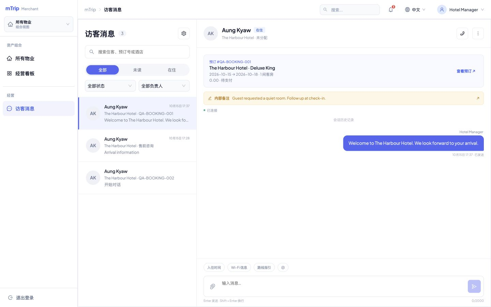
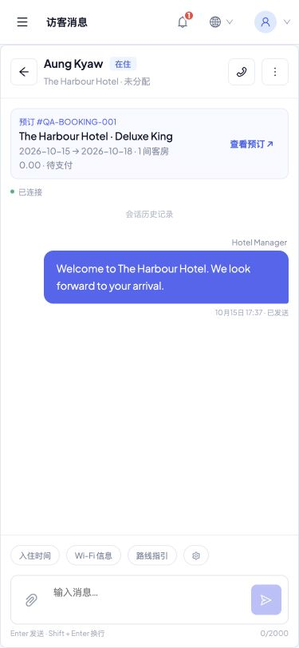
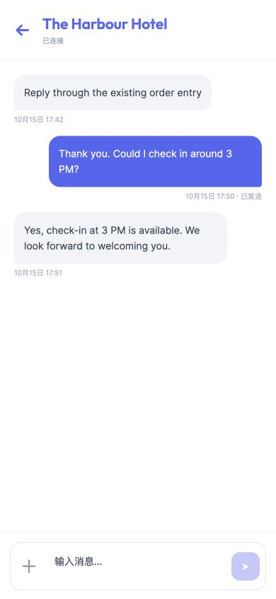

# 2026-10-15 访客消息实施报告

依据：Merchant PRD v1.0.8 中文版 §10.2–10.7、Figma `guest-messaging`（2711:22602）及[方案第 9 节](../设计方案-Merchant-M11-访客消息.md#9-已确认的-9-项产品决定)。用户已确认全部推荐规则，并明确授权开始实施。

当前状态（2026-10-16 更新）：首期源码、隔离联调与本地 8091/8093 发布已完成；历史迁移阻塞已解除，账本 45/45。正常账号收发与原生真机待复验，未提交、未推送。补迁移、本轮 24 项回归及发布证据见[发布记录](2026-10-16-guest-messaging-local-rollout.md)。下文为 2026-10-15 当日实施和验证记录。

## 实施范围

| 领域 | 已实现 |
| --- | --- |
| 商家 Web | `/guest-messaging` 会话列表/聊天双栏，All/Unread/In-House、处理状态、负责人、搜索、分页、预订摘要、团队待回复与个人未读 |
| 员工协作 | 认领、分配/转交、有权限同事协作回复；版本冲突防覆盖、失效负责人释放；备注当前版本与分页历史 |
| 消费者 | 登录守卫，酒店售前/订单聊天、会话列表、文字、图片预览/PDF、失败重试、通知历史和深链 |
| 消息一致性 | 售前按用户+物业、预订按订单；解决后双方发送原线程重开；发送幂等、游标历史、重连补齐、单调送达/已读 |
| 附件 | JPEG/PNG/WebP ≤10MB，PDF ≤20MB，最多 5 个/消息；嗅探 MIME，私有共享卷、30 秒单次票据、下载时实时授权 |
| 提醒与快捷回复 | 站内历史、全量未读角标、负责人优先、个人通知/声音配置；按物业/语言维护并插入可编辑草稿，Wi-Fi 限符合条件在住订单 |
| 兼容 | 原订单 `guest-thread`/`guest-message` 复用相同会话，保留 `mch:order:message`；原平台客服机器人/结束规则保留，坐席回复接实时事件 |

商户 App 独立工作台、非酒店业务的具体聊天上下文、后台推送、短信/邮件、AI 自动回复仍按确认范围留在后续阶段。

## 关键实现

- `backend/shared/src/Chat/ChatService.php`、`ChatAccess.php`：共用收发与实时授权；聊天属性范围不扩大其他模块的酒店权限集合。
- user-service `Controller/Merchant/ChatController.php`、`ChatTransportController.php`、`Chat/ChatSocket.php`：工作台接口、私有文件和双池实时事件。
- `merchant-web/src/views/guest-messaging/index.vue`、`client-app/src/screens/chat/ChatScreen.tsx`：真实接口与前台收发。
- `database/migrations/V20261015100000__guest-messaging.sql`：明确物业归属、唯一线程键、消息幂等、回执、备注/历史、附件、快捷回复、通知接收员工及审计；菜单种子同步 `database/seed/04-merchant-menu.sql`。
- 旧会话仅通过同站点、同用户的真实订单映射物业；无法确定归属的旧 target_id 保留隔离，重复线程保留各自 ID/历史，新写入复用最早明确线程。
- 网关聊天上传/WS 专用正则位于通用 App 正则前；user-service 保持原 HTTP 端口并支持 WebSocket，主池和 APP 池新增共享 `chat-private` 卷。新卷需要重建，单纯 restart 不会挂载。

## 验证证据

共 72 项隔离自动化回归通过，命令与清理方法见 `test/chat/README.md`。

| 测试 | 数量 | 主要覆盖 |
| --- | ---: | --- |
| `run-integration.py` | 17 | 迁移重复执行、会话复用/订单分离、物业/商户/消费者隔离、个人独立已读、发送幂等、备注和分配 CAS、双方重开、Wi-Fi |
| `realtime-attachments.cjs` | 21 | 两个真实服务实例双向 WebSocket、回执单调、单次票据与并发缩略图票据、真实图片/PDF、伪造/超限/越权、通知接收人、新授权历史未读、撤权立即拒绝并断连 |
| `extended-integration.py` | 23 | 原订单入口、215 条历史完整分页、并发回执、个人偏好、失效负责人、通知深链/已读独立、预订/电话权限、只读角色、撤权、全量角标、备注分页总数 |
| `gateway.cjs` | 5 | 独立真实 OpenResty 双端升级、跨池事件、20MB PDF 加 multipart 开销上传、私有下载 |
| `platform.cjs` | 6 | 原平台机器人消息、商家不能进入平台会话、坐席实时回复、站点隔离、平台关闭不重开、平台协助酒店会话身份 |

其他检查：现有 shared 124 个用例/1086 次断言通过；首次安装顺序下的商家菜单种子重复执行通过。16 个新增/修改 PHP 文件 lint，Merchant Web build，client-app typecheck 与 H5 export，`bash scripts/db-migrate.sh --validate`（45 个版本）、OpenResty `nginx -t`、`git diff --check` 均通过。构建仍有既有的大包提示，不作为功能通过证据。

真实浏览器使用合成账号：商家登录后发送消息、编辑内部备注；消费者密码登录后从通知历史进入订单会话、发送消息并实时收到商家回复。商家 1440×900、1280×720（无横向溢出，输入区底部可见）、375×812 和消费者 390×844 已检查。移动视口并非原生设备。







## 隔离与环境限制

测试只克隆常规库的空表结构，独立随机业务/系统数据库与受限 DB 用户、合成商户/员工/消费者/订单、短期 QA JWT、两个 user-service 实例及额外 order/merchant/gateway 实例。未复制客户数据，未发送短信/邮件，未改变正常业务账号或订单。验收后清理所有本任务容器、数据库/DB 用户、临时私有附件、环境文件及短期凭证；截图不含凭证。

2026-10-15 当日常规环境发布阻塞的实际输出（现已解除）：

```text
bash scripts/db-migrate.sh --status
[FAIL] 待执行版本 20261013100000 低于已上线最高版本 20261013130200；禁止倒序补迁移
```

当日已只读核对：更早 bedroom_count 的 DDL 确实缺失，因此不能将其伪造为已执行或更改历史校验和来通过检查。2026-10-15 未修历史账本、未应用常规库新迁移、未重启常规业务服务、未重载正常网关、未发布 8091/8093。隔离演练通过不代表常规环境已经可用。

当日计划的后续发布顺序：先独立核清并修复历史迁移，再经标准 `deploy/mtrip.sh` 流程迁移、重建带私有卷的 user-service 与 user-service-app、重载网关并发布两个前端，最后使用真实授权账号复验。前述本地迁移与发布已于 2026-10-16 完成，正常账号复验仍待进行。

待验：原生 iOS/Android、软键盘/输入法、设备文件选择、真实大图性能；缅文资源采用英文兜底，需母语复核。后台系统推送、短信、邮件不属于本期，未声称已实现。
