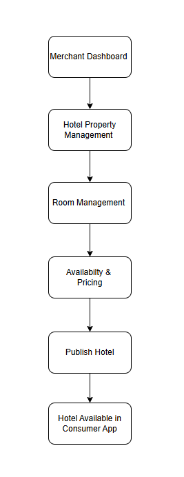

# 场景2-酒店配置与发布

> [!info] 原文摘录
> 来源：[[mTrip 商户 App 知识库/08-原始资料/mTrip_Merchant App PRD_v1.0.14_中文版|mTrip_Merchant App PRD_v1.0.14_中文版]]，第 275–298 行（按导入快照计）。
> 摘录保留原文措辞、表格和需求状态；仅调整图片相对路径。原文中的冲突请结合[[mTrip 商户 App 知识库/06-规划与治理/待澄清事项|待澄清事项]]阅读。

<!-- PRD_SOURCE_START:275-298 -->
### 场景 2——酒店配置与发布

##### 目标

允许已通过审批的商户配置酒店门店，并在完成所需运营配置后将其发布至 mTrip 用户端 App。

**工作流**

##### 业务规则

- 仅已通过审批的商户可创建酒店门店。
- 一个商户账户可管理多个酒店门店。
- 酒店信息可保存为草稿。
- 提交前必须完成必填信息。
- 在适用情况下支持物业管理系统（PMS）和渠道管理器同步。
- 未接入集成的酒店可直接在商户门户中管理运营。
- 仅已发布的酒店会显示在用户端 App 中。

**预期结果**

酒店可供客户搜索和预订。

<!-- PRD_SOURCE_END -->

---

返回：[[mTrip 商户 App 知识库/00-知识库首页|00-知识库首页]] · [[mTrip 商户 App 知识库/09-导入记录/原文章节映射|原文章节映射]]

## 关联阅读

- [[mTrip 商户 App 知识库/03-功能模块/M02-酒店与客房管理|M02-酒店与客房管理]]
- [[mTrip 商户 App 知识库/03-功能模块/M03-供应、库存与定价|M03-供应、库存与定价]]
- [[mTrip 商户 App 知识库/04-验收标准/AC02-酒店与客房管理|AC02-酒店与客房管理]]
