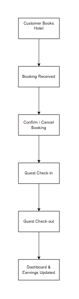
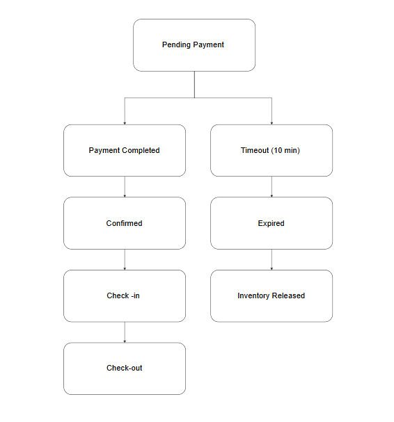

# 场景3-预订管理与支付

> [!info] 原文摘录
> 来源：[[mTrip 商户 App 知识库/08-原始资料/mTrip_Merchant App PRD_v1.0.14_中文版|mTrip_Merchant App PRD_v1.0.14_中文版]]，第 299–346 行（按导入快照计）。
> 摘录保留原文措辞、表格和需求状态；仅调整图片相对路径。原文中的冲突请结合[[mTrip 商户 App 知识库/06-规划与治理/待澄清事项|待澄清事项]]阅读。

<!-- PRD_SOURCE_START:299-346 -->
### 场景 3——预订管理

##### 目标

允许商户接收、管理和履行通过 mTrip 用户端 App 产生的酒店预订，同时保持商户端 App、用户端 App、管理后台及受支持的集成系统之间的预订信息同步。

**工作流**

##### 业务规则

- 通过用户端 App 提交的预订请求会实时同步至商户端 App。
- 商户会收到新预订、预订变更、取消及运营事件的通知。
- 在支持的情况下，预订状态会与已对接的物业管理系统（PMS）或渠道管理器同步。
- 未对接物业管理系统（PMS）或渠道管理器的酒店，可直接通过商户 Web 门户管理预订操作。
- 商户可查看预订详情、住客信息、支付状态及预订历史。
- 商户可根据平台政策与业务规则确认、修改或取消预订。
- 仅已确认的预订可执行入住与退房。
- 商户可根据已配置的业务规则，将符合条件的住客标记为未入住（No-Show）。
- 预订完成后，系统会自动更新可用房量、入住率、收入、结算信息及经营业绩指标。
- 所有预订活动均会被记录，用于运营历史、报表及审计。
- 商户可根据已配置的业务规则，将符合条件的住客标记为未入住（No-Show）。

##### 预订支付规则

- 当用户选择客房并进入支付环节时，系统会创建状态为“待支付”的预订。
- 在用户完成支付期间，所选房型的房量库存会被临时保留 10 分钟。
- 在保留期内，该客房不可被其他用户预订。
- 若在 10 分钟内成功完成支付，预订状态变更为“已确认”，该保留转为有效预订。
- 若未在 10 分钟内完成支付，待支付预订自动失效，房量库存释放回可售库存，用户须重新创建预订才能再次保留该客房。
- 已失效的待支付预订会保留在系统中，用于审计与报表，但不视为已确认预订，也不计入商户结算。
- 到店支付——商户预订规则：到店支付仅对已明确开通该支付模式的商户可用。预订应展示预付的 mTrip 费用、到店支付的剩余金额、适用的佣金与交易手续费、支付状态，以及取消/未入住政策。
- 在结算时，交易手续费应仅按佣金金额计算：交易手续费 = 佣金金额 × 适用交易手续费率，而非按预订总价计算。经批准的商户佣金与适用交易手续费按结算时披露的内容预付收取。
- 对于已确认的到店支付预订，记录住客实际入住应自动将到店支付的运营结算标记为“已完成”。仅凭计划入住日期不得触发结算完成。商户支付确认不是该入住触发状态的额外前提条件。
- 取消与未入住的费用分摊应遵循结算时约定的该预订专属政策；适用时间戳、可退与不可退金额及付款方均应保留，用于对账与审计。
- 商户专属商务配置：超级管理员控制商户的到店支付资格、mTrip 佣金与交易手续费率，以及商户未入住房费预收比例上限（不得超过 30%）。商户未入住费用设置仅在开启到店支付时适用。商户可选择未入住费用（免费），此时商户预收比例为 0%；或开启未入住费用并选择不超过所配置上限的房费预收比例。mTrip 佣金不与商户分成。
- 预订配置快照：在确认时，记录到店支付资格与选择、商户未入住费用开启/关闭状态、适用商户预收比例（未入住费用为免费时为 0%）、房费计算基数、佣金与交易手续费率及配置版本。后续变更仅适用于新预订。
- 到店支付预付订金：到店支付关闭时，不适用商户未入住预收，使用普通支付流程。开启且未入住费用为免费时，仅预付适用的 mTrip 佣金（以及任何单独适用的、由用户承担的交易手续费）。开启且设置商户未入住费用时，将 mTrip 佣金与商户选定的房费比例（上限为最高 30%）作为一笔面向用户的预付订金收取（以及任何适用的、由用户承担的交易手续费）。内部账务必须拆分各组成部分。商户金额的任何部分均不来自 mTrip 佣金。

**预订状态流转**

**预期结果**

预订信息在商户端 App、用户端 App 与管理后台之间保持同步，使商户能够高效管理预订，同时保持准确的运营与财务数据。

<!-- PRD_SOURCE_END -->

---

返回：[[mTrip 商户 App 知识库/00-知识库首页|00-知识库首页]] · [[mTrip 商户 App 知识库/09-导入记录/原文章节映射|原文章节映射]]

## 关联阅读

- [[mTrip 商户 App 知识库/03-功能模块/M04-预订管理|M04-预订管理]]
- [[mTrip 商户 App 知识库/03-功能模块/M05-经营工作台、收益与结算|M05-经营工作台、收益与结算]]
- [[mTrip 商户 App 知识库/06-规划与治理/待澄清事项|待澄清事项]]
