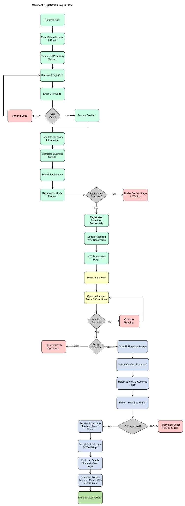
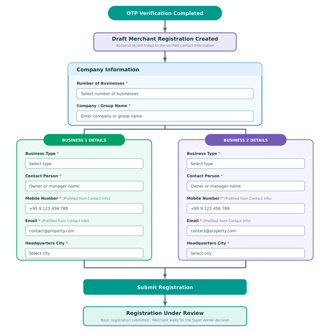
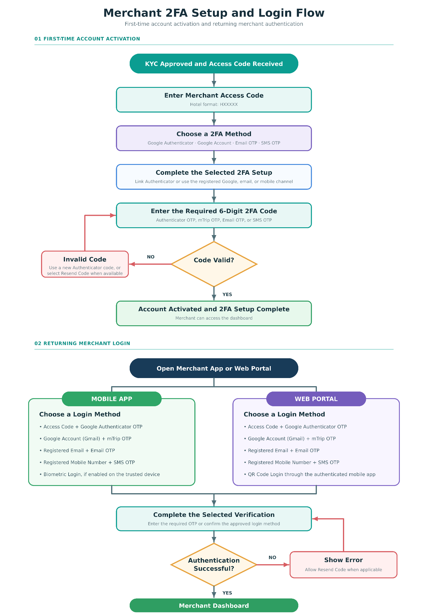

# 用户旅程总览

> [!info] 原文摘录
> 来源：[[mTrip 商户 App 知识库/08-原始资料/mTrip_Merchant App PRD_v1.0.13_中文版|mTrip_Merchant App PRD_v1.0.13_中文版]]，第 81–98 行（按导入快照计）。
> 摘录保留原文措辞、表格和需求状态；仅调整图片相对路径。原文中的冲突请结合[[mTrip 商户 App 知识库/06-规划与治理/待澄清事项|待澄清事项]]阅读。

<!-- PRD_SOURCE_START:81-98 -->
#### 用户旅程与平台流程

以下用户旅程描述了酒店商户在商户生命周期各阶段如何与 mTrip 酒店商户端 App 交互。这些流程展示了从商户注册、商户运营审核到业务验证（KYC）、酒店配置、预订管理和经营监控的关键运营过程。酒店商户端 App 与商户运营团队、超级管理员后台和用户端 App 紧密协作，以支持商户入驻、业务验证、酒店发布、客户预订以及 mTrip 生态内的实时同步。

图：端到端商户注册、审批与身份验证流程——移动端 App 与 Web 门户

**图 1——商户基础注册表单流程**

备注：业务联系人信息预填：系统应使用初次注册时录入的联系信息，为每个业务预填“手机号码”和“电子邮件”字段。商户可分别为每个业务编辑这些字段。“业务详情”中所做的任何更改均不得更新商户已通过验证的注册联系信息。

**图 2——商户双因素认证设置与登录流程**

<!-- PRD_SOURCE_END -->

---

返回：[[mTrip 商户 App 知识库/00-知识库首页|00-知识库首页]] · [[mTrip 商户 App 知识库/09-导入记录/原文章节映射|原文章节映射]]

## 关联阅读

- [[mTrip 商户 App 知识库/02-业务流程/场景1-注册与两阶段审批|场景1-注册与两阶段审批]]
- [[mTrip 商户 App 知识库/02-业务流程/场景1-账号激活与登录|场景1-账号激活与登录]]
- [[mTrip 商户 App 知识库/02-业务流程/端到端平台工作流|端到端平台工作流]]
