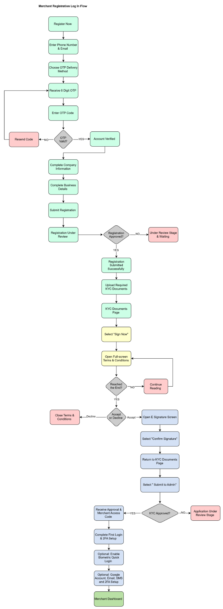
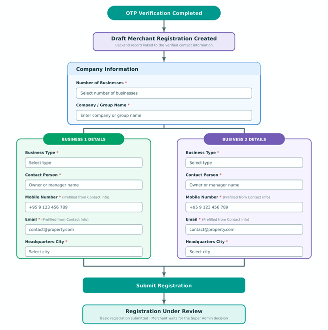
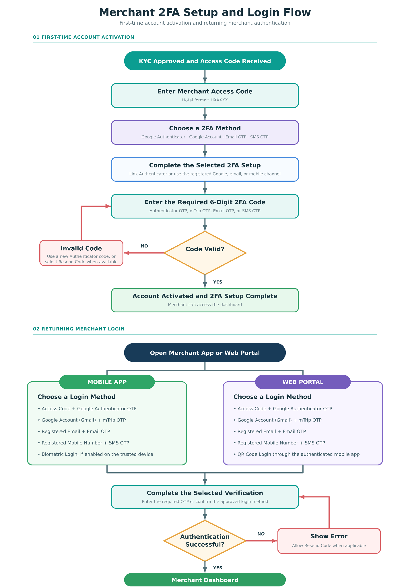

# 用户旅程总览

> [!info] 原文摘录
> 来源：[[mTrip 商户 App 知识库/08-原始资料/mTrip_Merchant App PRD_v1.0.12_中文版|mTrip_Merchant App PRD_v1.0.12_中文版]]，第 163–180 行（按导入快照计）。
> 摘录保留原文措辞、表格和需求状态；仅调整图片相对路径。原文中的冲突请结合[[mTrip 商户 App 知识库/06-规划与治理/待澄清事项|待澄清事项]]阅读。

<!-- PRD_SOURCE_START:163-180 -->
#### 用户旅程与平台工作流

以下用户旅程描述了酒店商户在整个商户生命周期内与 mTrip 酒店商户 App 的交互方式。这些工作流展示了关键的运营流程，包括商户注册与商户运营审核、企业认证（KYC）、酒店配置、预订管理和经营监控。酒店商户 App 与商户运营团队、超级管理后台和用户端 App 密切协作，以实现商户入驻、企业认证、酒店发布、客户预订以及 mTrip 生态内的实时同步。

**图：端到端商户注册、审批与认证流程 — 移动 App 与 Web 门户**

**图 1 - 商户基本信息注册表单流程**

**说明：业务联系人预填：系统应使用初始注册时输入的联系人信息，为每个业务预填手机号和电子邮箱字段。商户可以为每个业务单独编辑这些字段。在“业务详情”中所做的任何修改，均不会更新商户已验证的注册联系信息。**

**图 2 - 商户双重认证（2FA）设置与登录流程**

<!-- PRD_SOURCE_END -->

---

返回：[[mTrip 商户 App 知识库/00-知识库首页|00-知识库首页]] · [[mTrip 商户 App 知识库/09-导入记录/原文章节映射|原文章节映射]]

## 关联阅读

- [[mTrip 商户 App 知识库/02-业务流程/场景1-注册与两阶段审批|场景1-注册与两阶段审批]]
- [[mTrip 商户 App 知识库/02-业务流程/场景1-账号激活与登录|场景1-账号激活与登录]]
- [[mTrip 商户 App 知识库/02-业务流程/端到端平台工作流|端到端平台工作流]]
