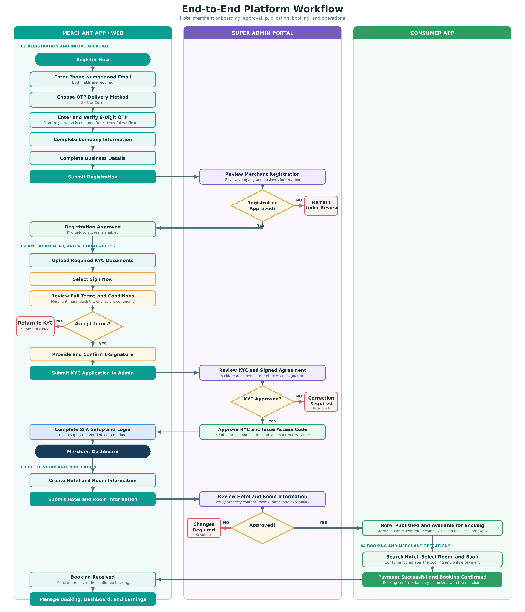

# 端到端平台工作流

> [!info] 原文摘录
> 来源：[[mTrip 商户 App 知识库/08-原始资料/mTrip_Merchant App PRD_v1.0.14_中文版|mTrip_Merchant App PRD_v1.0.14_中文版]]，第 347–358 行（按导入快照计）。
> 摘录保留原文措辞、表格和需求状态；仅调整图片相对路径。原文中的冲突请结合[[mTrip 商户 App 知识库/06-规划与治理/待澄清事项|待澄清事项]]阅读。

<!-- PRD_SOURCE_START:347-358 -->
##### 端到端平台工作流

**描述**

以下工作流展示了商户端 App、管理后台与用户端 App 在酒店商户全生命周期中的完整交互。它体现了商户入驻、酒店发布、用户预订及预订管理如何在 mTrip 生态内保持同步。

##### 功能需求

功能范围采用与 Sprint 规划表相同的模块名称进行组织。Ctrip EBK 作为成熟酒店运营的参考；mTrip 的最终实现仍取决于业务、设计与技术验证。

<!-- PRD_SOURCE_END -->

---

返回：[[mTrip 商户 App 知识库/00-知识库首页|00-知识库首页]] · [[mTrip 商户 App 知识库/09-导入记录/原文章节映射|原文章节映射]]

## 关联阅读

- [[mTrip 商户 App 知识库/02-业务流程/用户旅程总览|用户旅程总览]]
- [[mTrip 商户 App 知识库/02-业务流程/场景2-酒店配置与发布|场景2-酒店配置与发布]]
- [[mTrip 商户 App 知识库/02-业务流程/场景3-预订管理与支付|场景3-预订管理与支付]]
