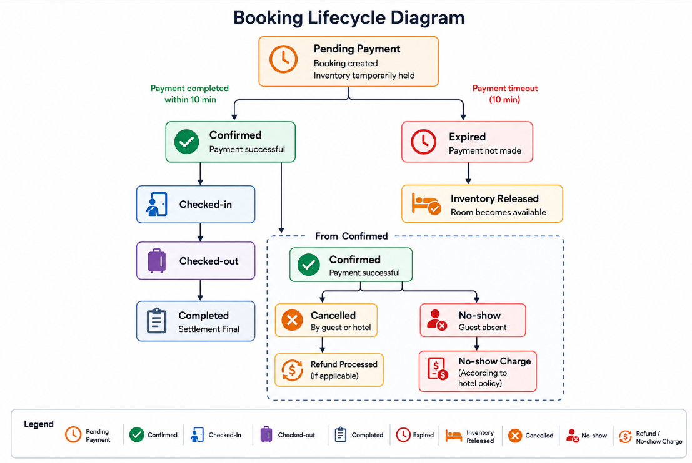

# M04-预订管理

> [!info] 原文摘录
> 来源：[[mTrip 商户 App 知识库/08-原始资料/mTrip_Merchant App PRD_v1.0.14_中文版|mTrip_Merchant App PRD_v1.0.14_中文版]]，第 656–799 行（按导入快照计）。
> 摘录保留原文措辞、表格和需求状态；仅调整图片相对路径。原文中的冲突请结合[[mTrip 商户 App 知识库/06-规划与治理/待澄清事项|待澄清事项]]阅读。

<!-- PRD_SOURCE_START:656-799 -->
## 模块 4 – 预订管理

目标：使酒店员工能够管理完整的预订生命周期、监控预订状态、处理住客相关操作，并与已对接的物业管理系统（PMS）和渠道管理器同步预订信息。

### 功能需求

##### 4.1 预订列表管理

- 在统一的预订列表中查看全部预订。
- 按预订编号、住客姓名或预订参考号搜索预订。
- 按日期范围、门店、预订状态、支付状态或预订渠道筛选预订。
- 按入住日期、退房日期、预订日期或预订状态排序。
- 查看预订摘要信息，包括住客、酒店、房型、入住日期、预订状态、支付状态与预订渠道。
- 导出或下载预订记录。

##### 4.2 预订详情

- 查看预订详细信息。
- 展示预订摘要。
- 展示住客信息。
- 展示支付摘要。
- 展示入住详情。
- 展示特殊需求。
- 查看预订时间线。
- 查看与物业管理系统（PMS）或渠道管理器的同步状态。
- 添加仅酒店员工可见的内部备注。

##### 4.3 预订状态管理

在预订生命周期内跟踪预订。

支持以下预订状态：

- 待支付
- 已确认
- 已入住
- 已退房
- 已取消
- 未入住（No-Show）

**业务规则**

- 当用户进入结算流程但尚未完成支付时，预订以“待支付”状态创建。
- 预订处于“待支付”状态期间，房量库存被临时预留。
- 若在配置的支付超时时间内（例如 10 分钟）完成支付，预订状态自动变更为“已确认”。
- 若未在配置的支付超时时间内完成支付，待支付预订自动失效，已预留的房量库存被释放。
- 预订状态可由获授权的商户手动更新，或通过已对接的物业管理系统（PMS）或渠道管理器集成所同步的更新自动变更。
- 支付状态与预订状态分别管理。

备注：待支付（Pending）：预订已创建，房量库存在等待用户支付期间被临时预留。

##### 4.4 住客入住管理

- 为住客办理入住。
- 为住客办理退房。
- 查看住客入住时长。
- 查看客房分配。
- 查看餐食方案。
- 查看附加服务。

##### 4.5 预订操作

- 确认预订。
- 取消预订。
- 按取消政策处理退款。
- 生成预订凭证。
- 向住客发送消息。
- 导出预订信息。
- 在配置的支付超时时间后自动取消已失效的待支付预订。

##### 4.6 通知与同步

- 有新预订时提醒商户。
- 预订状态更新时提醒商户。
- 与已对接的物业管理系统（PMS）同步预订信息。
- 与已对接的渠道管理器同步预订信息。
- 展示同步状态。
- 支持商户在需要时手动同步预订。

##### 4.7 预订历史与时间线

- 展示预订活动时间线。
- 记录预订状态变更。
- 记录支付更新。
- 记录同步事件。
- 展示操作人、时间戳与操作历史。

##### 4.8 取消管理

- 商户可为每个房型配置取消政策。
- 商户接收取消通知。
- 取消后预订状态自动更新。
- 免费取消、部分退款与不可退款预订遵循酒店已配置的政策。
- 取消记录可在预订历史中查看。

**业务规则**

未入住（No-Show）：若住客在酒店入住截止时间前未到店且未取消预订，则该预订应标记为“未入住（No-Show）”。系统应按商户配置的未入住政策处理库存、结算与适用费用。

**商户对未入住（No-Show）的处理操作**

当预订到达入住截止时间时，商户可以：

- 将该预订标记为“未入住（No-Show）”。
- 在确认未入住前查看住客的预订详情。
- 添加内部备注（可选），例如“无法联系到住客”。
- 若住客延迟到店且客房仍可用，可将该预订改为“已入住”而非“未入住（No-Show）”（以酒店政策为准）。

**未入住（No-Show）后的系统操作**

- 按酒店配置的未入住政策释放房量库存。
- 对于已确认的到店支付未入住（No-Show）：若商户选择了“未入住费用（No-Show Fee）”，且商户未入住预收款为零、仅预收 mTrip 佣金（受任何单独适用的、需向客户收取的交易手续费约束）。若启用了商户未入住费用，则按预订时记录的商户房费预收比例执行，不超过 30%，且与 mTrip 佣金相互独立。不允许商户分成 mTrip 佣金。所有组成部分应分别记录。
- 应使用预订确认时记录的到店支付与商户未入住费用设置。在到店支付已禁用、或商户决定对未入住费用（No-Show Fee）给予免费（FOC）的情况下，商户未入住比例必须为零。后续配置变更不影响已确认的预订。应保留审计时间戳、分摊、退款与对账记录。
- 更新可用房量。
- 将预订状态同步至物业管理系统（PMS）或渠道管理器（如已对接）。
- 按商户的未入住政策执行结算与佣金计算。

**待支付**

若用户发起预订但未立即完成支付，则该预订应在最长 10 分钟内保持“待支付”状态，期间所选房量库存被临时预留。

**商户视图**

- 商户可在预订管理模块中查看待支付预订。
- 待支付预订与已确认预订应有明显区分。
- 待支付预订不可办理入住、退房、修改或结算。

**系统操作**

若在预留期内完成支付：

- 预订状态变更为“已确认”。
- 支付状态变更为“已支付”。

若未在 10 分钟内完成支付：

- 预订自动失效。
- 已预留的房量库存被释放。
- 可用房量随之更新。
- 该预订不计入结算与收益计算。
- 用户须重新创建预订才能再次预留该客房。

<!-- PRD_SOURCE_END -->

---

返回：[[mTrip 商户 App 知识库/00-知识库首页|00-知识库首页]] · [[mTrip 商户 App 知识库/09-导入记录/原文章节映射|原文章节映射]]

## 关联阅读

- [[mTrip 商户 App 知识库/04-验收标准/AC04-预订管理|AC04-预订管理]]
- [[mTrip 商户 App 知识库/07-专题索引/预订支付与结算|预订支付与结算]]
- [[mTrip 商户 App 知识库/06-规划与治理/待澄清事项|待澄清事项]]
