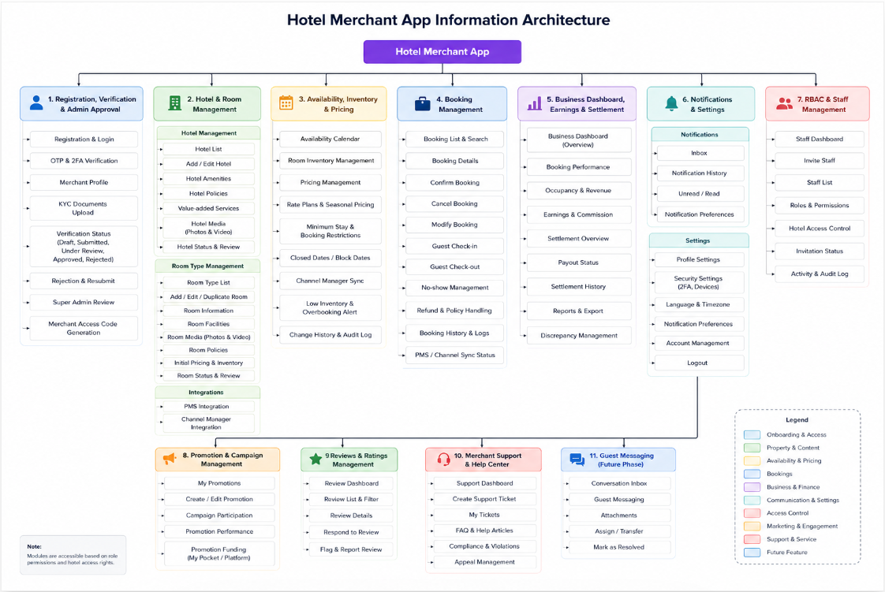
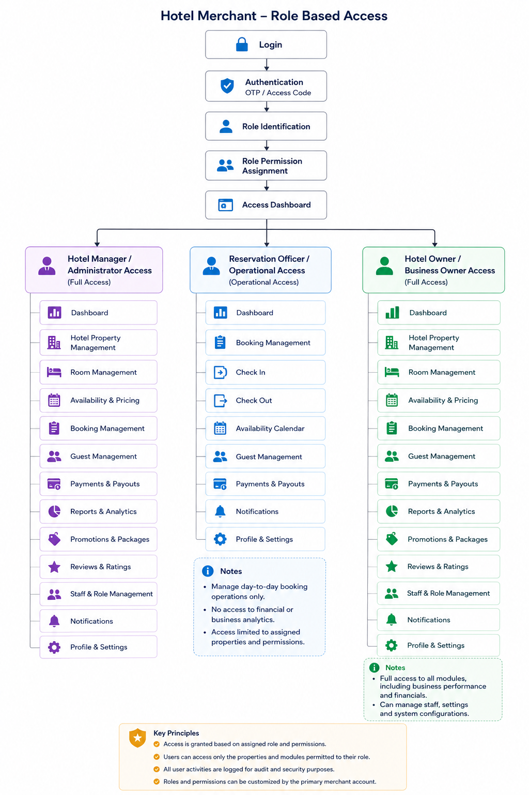

# 设计、信息架构与权限矩阵

> [!info] 原文摘录
> 来源：[[mTrip 商户 App 知识库/08-原始资料/mTrip_Merchant App PRD_v1.0.14_中文版|mTrip_Merchant App PRD_v1.0.14_中文版]]，第 1329–1346 行（按导入快照计）。
> 摘录保留原文措辞、表格和需求状态；仅调整图片相对路径。原文中的冲突请结合[[mTrip 商户 App 知识库/06-规划与治理/待澄清事项|待澄清事项]]阅读。

<!-- PRD_SOURCE_START:1329-1346 -->
### 设计

酒店商户端 App 的设计产物包括工作流图、信息架构和 UI 概念，用于支撑产品讨论与开发规划。

### 酒店商户端 App 信息架构

### 酒店商户端 App 基于角色的访问控制（RBAC）

### 设计链接

| ***设计团队提供的 UX/UI Figma 链接*** | Figma |
|---|---|
| PO 的设计原型链接 | https://big-plank-58319748.figma.site |

<!-- PRD_SOURCE_END -->

---

返回：[[mTrip 商户 App 知识库/00-知识库首页|00-知识库首页]] · [[mTrip 商户 App 知识库/09-导入记录/原文章节映射|原文章节映射]]

## 关联阅读

- [[mTrip 商户 App 知识库/03-功能模块/M07-RBAC 与员工管理|M07-RBAC 与员工管理]]
- [[mTrip 商户 App 知识库/07-专题索引/术语与图示索引|术语与图示索引]]
