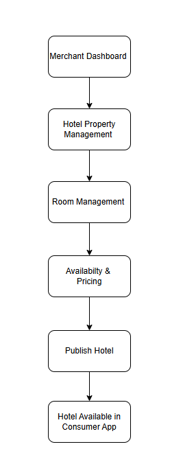
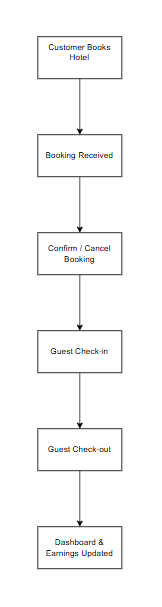
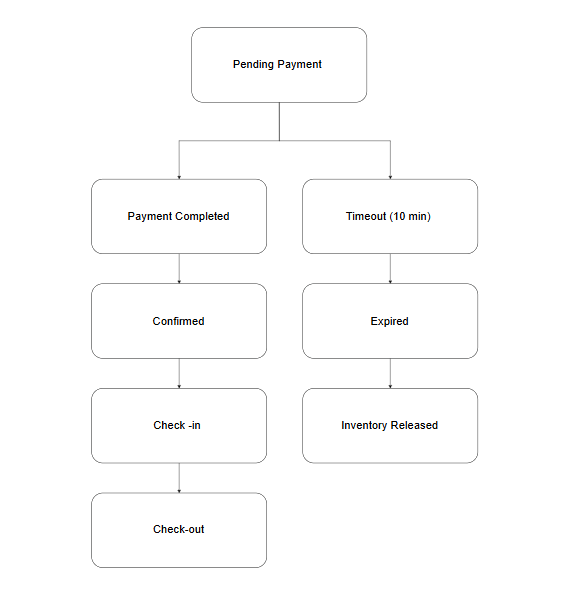
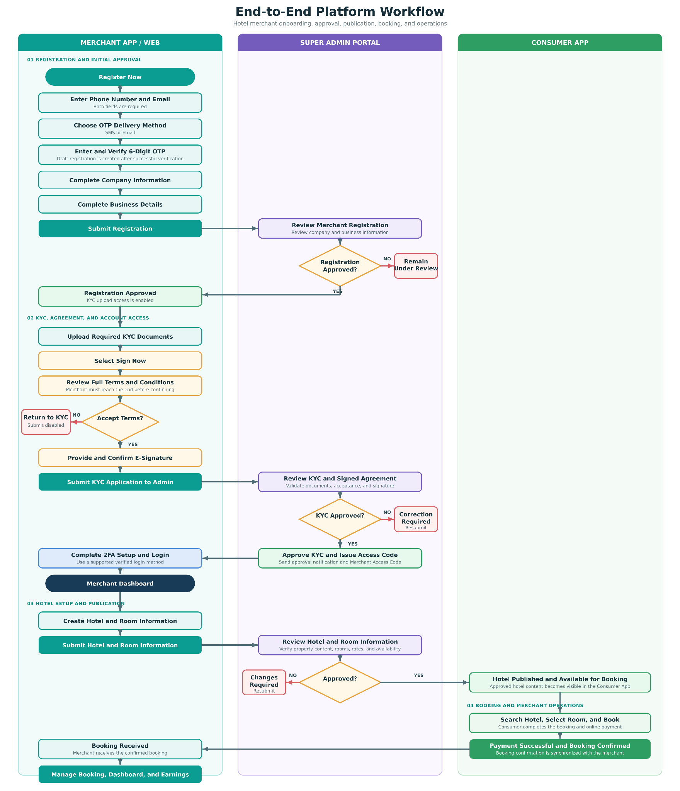
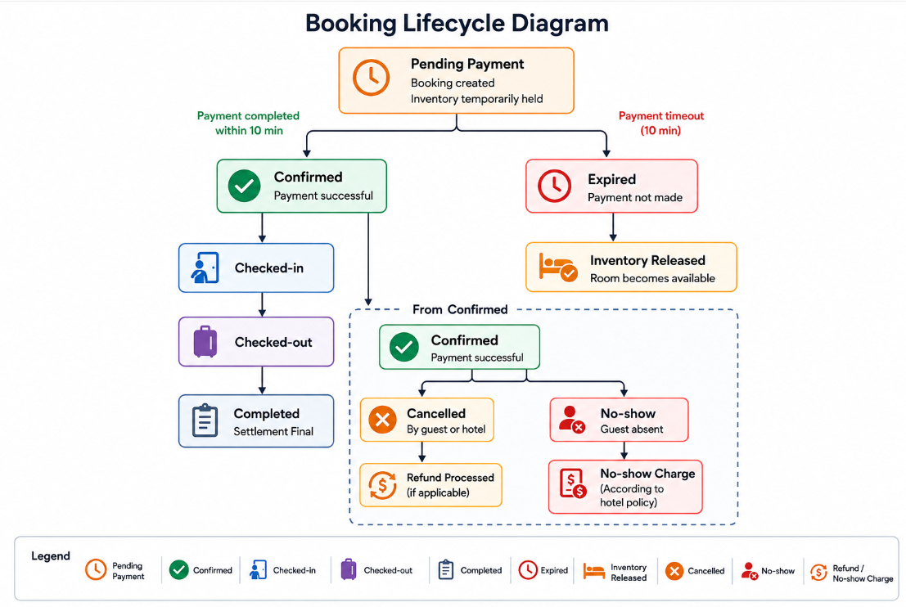
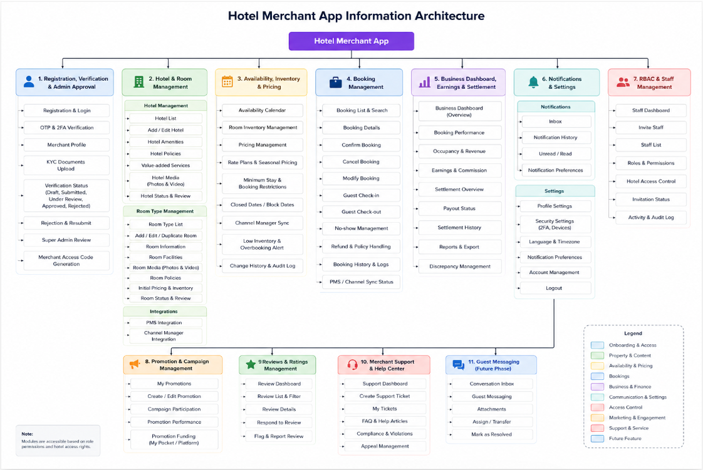
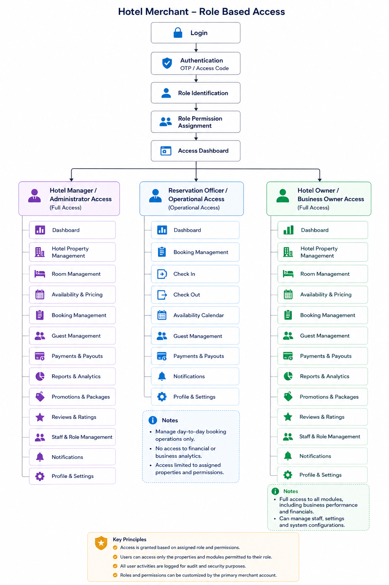

# mTrip 产品需求文档（PRD）

## 商户 App - v 1.0.12

**作者：May Shoon Lett Zaw 女士**

**团队：**产品团队

<!--TABLE_START-->
| 产品经理 | Aung Khant Kyaw 先生 |
| --- | --- |
| 工程负责人/团队负责人 | 李思先生 |
| 设计师 | Chit Ko Ko 先生 |
| 审批人/签核 |  |
<!--TABLE_END-->

PM 冲刺规划：mTrip 冲刺计划

PRD 状态：进行中

## 目录

- 商户 App - v 1.0.12
- 目录
- 概述
- 问题
- 目标
  - 目标 1
  - 目标 2
  - 目标 3
- 约束条件
    - 约束 1：MVP 范围与时间线
    - 约束 2：资源有限与平台成熟度
    - 约束 3：外部系统依赖
    - 用户画像
    - 用户旅程与平台工作流
    - 场景 1 - 酒店商户注册与认证
  - 场景 2 - 酒店配置与发布
  - 场景 3 - 预订管理
- 商户工作台
    - 功能需求
    - 物业选择
    - 运营概要
    - 运营告警
    - 经营洞察
    - 物业表现
    - 今日运营
- 模块 1 – 注册、认证与管理员审批
  - 功能需求
- 模块 2 – 酒店与客房管理
  - 功能需求
- 模块 3 – 供应、库存与定价
  - 功能需求
- 模块 4 – 预订管理
  - 功能需求
- 模块 5 – 经营工作台、收益与结算
  - 功能需求
- 模块 6 – 通知与设置
  - 功能需求
- 模块 7 – 基于角色的访问控制（RBAC）与员工管理
  - 功能需求
- 模块 8 – 促销与活动管理
  - 功能需求
- 模块 9 – 评价与评分管理
  - 功能需求
- 模块 10 – 商户支持与帮助中心
  - 功能需求
- 验收标准
    - 1. 注册、认证与管理员审批
    - 2. 酒店与客房管理
    - 3. 供应、库存与定价
    - 4. 预订管理
    - 5. 经营工作台、收益与结算
    - 6. 通知与设置
    - 7. RBAC 与员工管理
    - 8. 促销与活动管理
    - 9. 评价与评分管理
    - 10. 商户支持与帮助中心
  - 设计
  - 酒店商户 App 信息架构
  - 酒店商户 App 基于角色的访问控制（RBAC）
  - 设计链接
  - 技术考量
  - PMS 与 Channel Manager 集成
    - 场景 1 – PMS 直连集成
    - PMS 集成
    - Channel Manager 集成
    - 业务规则
  - 其他技术考量
    - 实时预订通知
    - 房量配额同步
    - 可扩展性与可延展性
  - 成功指标
  - 待决问题
  - 问答
  - 功能时间线与阶段划分
  - 参考与范围说明
  - PRD 检查清单：
  - 变更历史

## 概述

mTrip 酒店商户 App 是一个定制化平台，让酒店合作伙伴能够在 mTrip 生态体系内高效管理

自己的物业与日常运营。作为第一阶段 MVP 的一部分，该程序为酒店商户提供了在单一平台上管理客房库存、预订、价格、促销和企业信息所需的全部工具。

该程序旨在通过减少人工流程、提高预订准确性和提供预订活动的实时可见性来改善酒店运营。自助管理功能让酒店合作伙伴能够轻松响应客户预订、调整客房供应、管理促销活动并跟踪企业经营表现。

酒店商户 App 是 mTrip 生态体系的重要组成部分，它让酒店合作伙伴能够提供顺畅的预订体验，同时支持平台打造可信、可扩展的旅行市场的目标。

该平台将整合每日运营工作台、受控的员工访问权限、透明的结算可见性、商户营销工具以及未来的联盟生态支持。携程 EBK 作为运营参考，而 mTrip 特有的入驻流程、双因素认证和联盟功能则是本产品的差异化亮点。

多业务商户结构

mTrip 商户平台支持集中式的组合管理结构，允许一个商户账号在单一账号下管理多个物业和业务类型。“全部物业”视图作为组合层级的入口，商户可以在此查看和管理所有已注册的业务。每个物业都在其适用的业务领域（如酒店或餐厅）内运营，并配有领域专属的管理模块和运营流程。共享的商户功能（包括工作台与收益、促销、评价、住客消息、员工管理、支持和设置）在所有支持的业务领域中均保持可用。

## 问题

许多酒店，尤其是中小型酒店，仍在通过电话、通讯软件、电子表格或各种互不联通的系统人工管理预订和客房供应。这些碎片化的流程增加了运营工作量，导致预订确认延迟，并可能造成超售、客房库存不准确和价格不一致。

随着 mTrip 酒店预订业务的增长，酒店合作伙伴需要一个集中化管理平台，让他们能够高效管理预订、客房供应、价格和促销活动，同时实时向客户提供准确的信息。

如果没有专门的酒店商户 App，运营低效将对酒店合作伙伴和客户都产生严重影响，导致响应速度变慢、预订准确性下降和客户满意度降低。

## 目标

### 目标 1

为酒店合作伙伴提供一个集中化平台，管理酒店运营，包括物业信息、客房库存、价格、预订、促销、员工访问权限、客户评价和企业经营表现。

### 目标 2

通过实时预订管理、自动通知、基于角色的访问控制、自助管理工具和集中的商户支持，减少人工流程，提升运营效率。

### 目标 3

构建一个可扩展的商户平台，提升酒店合作伙伴满意度，改善消费者预订体验，并支持 mTrip 旅行生态的长期增长。

## 约束条件

#### 约束 1：MVP 范围与时间线

酒店商户 App 将作为第一阶段 MVP 的一部分在项目时间线内开发。为确保按时交付，首版发布将聚焦核心酒店管理能力，包括商户入驻、酒店与客房管理、供应与定价、预订管理、工作台与收益、员工管理、促销、评价、通知和商户支持。高级能力和第三方集成将在后续阶段交付。

#### 约束 2：资源有限与平台成熟度

作为一个新平台，酒店商户 App 将与其他核心 mTrip 服务同步开发，包括用户端 App、超级管理后台、支付服务和配套的平台基础设施。开发优先级、技术依赖和可用的工程资源可能会影响各功能的实现顺序。

#### 约束 3：外部系统依赖

多项核心能力依赖第三方服务和外部集成，包括 KYC 实名认证、支付网关、短信/OTP 服务、推送通知、结算处理、PMS 集成、Channel Manager 集成和地图服务。这些外部系统的可用性、性能和可靠性可能影响功能交付和用户体验。

#### 用户画像

<!--TABLE_START-->
| 用户画像 | 描述 |
| --- | --- |
| 关键用户画像 - 酒店经理/管理员 | 负责统筹酒店日常运营、管理预订、查询客房供应、调整价格、创建促销以及评估企业经营表现。酒店经理是酒店商户 App 的主要用户和决策者。 |
| 用户画像 2 – 预订专员/编辑权限 | 负责接收新预订、确认或修改预订、更新客房供应、管理住客信息以及响应客户请求。该用户的核心工作是日常预订流程。 |
| 用户画像 3 - 酒店业主/企业主 | 负责评估酒店整体经营表现、查看收益和入住记录、管理促销计划，并基于运营数据做出经营决策。该用户使用应用的频率可能较低，但依赖业务统计和报表。 |
<!--TABLE_END-->

#### 用户旅程与平台工作流

以下用户旅程描述了酒店商户在整个商户生命周期内与 mTrip 酒店商户 App 的交互方式。这些工作流展示了关键的运营流程，包括商户注册与商户运营审核、企业认证（KYC）、酒店配置、预订管理和经营监控。酒店商户 App 与商户运营团队、超级管理后台和用户端 App 密切协作，以实现商户入驻、企业认证、酒店发布、客户预订以及 mTrip 生态内的实时同步。

**图：端到端商户注册、审批与认证流程 — 移动 App 与 Web 门户**

**图 1 - 商户基本信息注册表单流程**

**说明：业务联系人预填：系统应使用初始注册时输入的联系人信息，为每个业务预填手机号和电子邮箱字段。商户可以为每个业务单独编辑这些字段。在“业务详情”中所做的任何修改，均不会更新商户已验证的注册联系信息。**

**图 2 - 商户双重认证（2FA）设置与登录流程**

#### 场景 1 - 酒店商户注册与认证

##### 目标

允许新的酒店商户使用必填的手机号和电子邮箱进行注册，通过 OTP 验证其中一个选定的联系渠道，提交公司和业务信息以供注册审批，在注册审批通过后完成 KYC 文件上传和电子签署，并在最终 KYC 审批通过和账号激活后安全地访问商户工作台。

##### 工作流

入驻流程始于潜在商户在商户 App 或 Web 门户中选择“成为我们的合作伙伴”。商户输入手机号和电子邮箱，选择短信或邮件作为 OTP 发送方式，并使用 6 位 OTP 验证所选联系渠道。如果验证码无效或已过期，商户可以点击“重新发送验证码”。

OTP 验证成功后，系统创建一条商户注册草稿记录。商户填写公司信息和每个已注册业务的业务详情，然后提交注册。在公司信息和业务详情页面不展示、也不需要接受条款与条件。提交的注册将保持“审核中”状态，直至获得批准。

注册审批通过后，商户可以进入 KYC 文件页面，为所有已注册物业上传所需的文件。商户必须选择“立即签署”，完整阅读全屏条款与条件至末尾，接受声明，提供电子签名并确认签名。只有在此之后“提交给管理员”按钮才会启用。提交的 KYC 申请由超级管理员审核。最终 KYC 审批通过后，商户会收到审批通知和商户访问码，并完成既有的账号激活和登录设置。

说明：

审批通过后，商户会通过短信和/或邮件收到审批通知以及一个简短、唯一、与商户类型对应的商户访问码。酒店商户访问码以 H 开头，租车商户访问码以 C 开头。商户激活账号、关联可用的登录方式，并完成强制的 OTP 验证后方可进入商户工作台。账号激活后，商户访问码可作为可选的登录标识。

##### 业务规则

- 商户选择“成为我们的合作伙伴”。
- 商户输入有效的手机号和有效的电子邮箱；两个字段均为必填。
- 商户选择一种 OTP 发送方式：发送到所输入手机号的短信，或发送到所输入邮箱的邮件。
- 商户输入 6 位 OTP。如果 OTP 无效或已过期，商户可以选择“重新发送验证码”。
- OTP 验证成功后，系统创建一条与已验证联系信息关联的商户注册草稿记录。
- 系统自动保存已填写的字段、当前入驻步骤、完成进度和最后活动时间，以便商户稍后继续。
- 商户填写公司信息和每个业务的业务详情。
- 商户在此阶段提交注册时无需接受条款与条件。
- 提交的注册在超级管理员批准之前保持“审核中”状态。
- 只有已批准的注册才会显示“注册提交成功”，并启用“前往 KYC 上传”。
- 商户为所有已注册物业上传所需的全部 KYC 文件。
- 在完成条款与条件审阅和电子签名之前，“提交给管理员”保持禁用。
- 选择“立即签署”将以全屏模式打开条款与条件。商户必须滚动至末尾，“接受并继续”才会启用。
- 如果商户选择“拒绝”，条款与条件将关闭，商户返回 KYC 文件页面；电子签名保持未完成状态，“提交给管理员”保持禁用。
- 如果商户选择“接受并继续”，将打开电子签名页面。
- 商户必须提供签名并选择“确认签名”。
- 确认后，商户返回 KYC 文件页面，电子签名状态显示为“已签署”，并且“提交给管理员”变为可用。
- 商户选择“提交给管理员”后，KYC 申请状态变更为“审核中”。
- 被驳回或需要重新提交的 KYC 申请会显示原因，并允许商户更正后重新提交所需材料。
- 最终 KYC 审批通过后，商户会通过配置的渠道收到审批通知以及与商户类型对应的商户访问码。
- 已批准的商户可以在同一商户账号下管理一个或多个物业。
- 已通过认证的商户新增物业时无需重复商户级 KYC，只需提交适用的物业专项认证文件。

##### 商户审批通过前 — 注册与申请访问

- 潜在商户可以通过商户移动 App 或商户 Web 门户完成基本信息注册。KYC 功能仅在基本信息注册获批后才可用。
- 初始注册与 OTP 验证
- 同时输入手机号和电子邮箱。
- 选择短信或邮件作为 OTP 发送方式。
- 输入并验证 6 位 OTP；需要新验证码时使用“重新发送验证码”。
- OTP 验证通过后，填写公司信息和每个业务的业务详情。
- 提交注册以供审核，注册表单上无需接受条款与条件。
- 注册处于“审核中”时，商户可以使用已验证的联系信息恢复已保存的草稿或查看当前申请状态。
- 在注册获批之前，商户无法进入 KYC 环节。
- 注册获批后，“前往 KYC 上传”变为可用。
- 商户上传所需的 KYC 文件，完成强制的条款与条件审阅和电子签名，并提交 KYC 申请。
- 商户可以查看 KYC 审核状态，并在适用时更正并重新提交所要求的文件。
- 申请人在最终 KYC 审批通过并成功激活账号之前，无法访问商户工作台。
- 申请状态
- 联系信息 → OTP 已验证 → 注册草稿 → 注册审核中 → 注册提交成功 → 待 KYC → KYC 已提交并电子签署 → KYC 审核中 → 已批准 / 已驳回 / 需重新提交

##### 商户审批通过后 — 商户账号访问

超级管理员对已完成的 KYC 申请做出最终批准后：

- 商户会通过短信和/或邮件收到审批通知，同时收到应用内推送通知。
- 商户会通过短信和/或邮件收到一个简短、唯一的商户访问码。该码由恰好 6 个大写字母数字字符组成。首位字符标识商户类型：H 代表酒店（格式 HXXXXX），C 代表租车（格式 CXXXXX）。其余五个字符由系统使用 A-Z 和 0-9 生成。每种商户类型支持 60,466,176 种组合。示例：H7K9P2 和 C4M8X6。
- 必须至少关联一种已验证的登录方式并完成强制的 OTP 验证，才能获得商户工作台的访问权限。

**首次账号激活与登录设置**

- 输入简短的、与商户类型对应的商户访问码（酒店为 HXXXXX，租车为 CXXXXX），或通过已验证联系渠道接收到的一次性激活密码。
- 使用 6 位激活 OTP 验证注册的电子邮箱或手机号。
- 查看并确认与商户账号关联的已验证电子邮箱和手机号。
- 商户移动 App 和 Web 门户不再支持 Google 账号登录。
- 如果商户希望使用商户访问码 + Google Authenticator，系统会显示唯一的设置二维码（Setup QR Code）和设置密钥（Setup Key）供其绑定验证器。
- 商户扫描设置二维码或手动输入设置密钥，然后输入当前 6 位 Google Authenticator OTP。
- 激活和 OTP 验证成功后，商户即可进入商户工作台。
- 当商户选择其他已验证登录方式时，再次登录不强制要求商户访问码。

##### 老商户登录 — 移动 App

- 商户选择一种可用的登录方式：
- 方式 1 - 简短的、与商户类型对应的商户访问码（酒店为 HXXXXX，租车为 CXXXXX）+ 当前 6 位 Google Authenticator OTP。
- 方式 2 - 已关联的 Google 账号（Gmail）+ 发送到注册已验证联系渠道的强制 6 位 mTrip OTP。
- 方式 3 - 注册电子邮箱 + 6 位邮箱 OTP。
- 方式 4 - 注册手机号 + 6 位短信 OTP。
- 方式 5 - 生物识别登录，仅限之前在同一可信移动设备上启用过的情况。
- 验证成功后，商户进入商户移动 App 工作台。
- 再次登录时商户访问码为可选项；选择其他方式时不得再要求输入商户访问码。

##### 可选的生物识别登录 — 仅限移动 App

**范围说明：**生物识别登录仅适用于 mTrip 商户移动 App，商户 Web 门户/工作台不提供该功能。

**启用条件：**

商户必须先完成账号激活，并使用任一已验证的关联登录方式及其要求的 OTP 成功完成一次完整登录。进入商户移动 App 工作台后，商户可手动启用生物识别登录，路径为：

**商户移动 App 工作台 > 设置 > 安全 > 生物识别登录**

当商户在商户移动 App 的“设置 > 安全”中开启生物识别登录后，同一可信移动设备上的后续登录即可使用生物识别登录。

对于后续登录，商户可以使用移动设备上已注册的生物识别方式（如面部扫描或指纹），而无需完成基于 OTP 的登录方式。

该生物识别登录流程仅用于访问商户移动 App。它不应要求商户重新完成 KYC，也不需要进行活体检测、面部身份验证、文件验证或新的人脸注册流程。

商户移动 App 不得采集、存储或比对商户的面部图像或指纹信息。生物识别认证由移动设备负责处理。

生物识别登录界面、操作指引、重试提示、错误状态以及“使用商户访问码”选项应遵循已批准的 mTrip UI/UX 设计。

设备的生物识别确认弹窗可以遵循移动操作系统标准外观。mTrip 商户移动 App 在该弹窗之前和之后展示的所有页面和消息都应与已批准的 mTrip 设计保持一致。

生物识别认证成功后，商户应被授权进入商户移动 App 工作台。

**使用资格：**

当满足以下全部条件时，商户才有资格使用生物识别登录：

- 商户已完成账号激活，并使用已验证的关联登录方式及其要求的 OTP 成功完成了一次完整登录。
- 商户已在商户移动 App 的“设置 > 安全”中手动启用生物识别登录。
- 移动设备至少支持一种生物识别认证方式。
- 移动设备上至少注册了一种受支持的生物识别方式。
- 商户正在同一可信移动设备上进行后续登录。
- 可信设备的认证凭据仍然有效。

**生物识别登录业务规则：**

- 应用应调用设备操作系统的原生生物识别提示，并接受任何受支持且已注册的生物识别方式，如面部扫描或指纹。
- 如果面部和指纹认证均可用，由设备操作系统管理可用的生物识别方式。
- 在同一登录会话内切换受支持的生物识别方式，不应重置失败尝试次数。
- 商户在一次登录会话内，跨所有受支持的生物识别方式，最多可累计尝试三次失败匹配，且须遵守设备或操作系统更严格的限制。例如：两次面部认证失败加一次指纹失败，应计为累计三次生物识别失败。
- 累计第三次生物识别失败后，或操作系统报告生物识别被锁定或不可用时，生物识别登录应停止。此后商户必须使用任一可用的已验证关联登录方式及其要求的 OTP 进行认证。
- 商户可以随时选择“使用商户访问码”，无需等待三次生物识别失败。
- 取消或关闭生物识别弹窗不应计为一次生物识别匹配失败。
- 生物识别验证成功后，应授权商户进入商户移动 App 工作台。
- 更换新移动设备、卸载重装应用、生物识别注册信息变更、已注册生物识别方式被移除或相关设备安全变更，都应使该设备的生物识别登录失效。
- 发生上述变更后，商户必须使用任一可用的已验证关联登录方式及其要求的 OTP 完成完整认证，然后在该可信移动设备上从商户移动 App 的“设置 > 安全”中重新手动启用生物识别登录。

##### 老商户登录 — Web 门户（无生物识别登录）

- Web 门户支持四种登录方式：
- 方式 1 - 简短的、与商户类型对应的商户访问码（酒店为 HXXXXX，租车为 CXXXXX）+ 当前 6 位 Google Authenticator OTP。
- 方式 2 - 已关联的 Google 账号（Gmail）+ 发送到注册已验证联系渠道的强制 6 位 mTrip OTP。
- 方式 3 - 注册电子邮箱 + 6 位邮箱 OTP。
- 方式 4 - 注册手机号 + 6 位短信 OTP。
- 验证成功后，商户进入商户 Web 门户工作台。
- Web 门户不显示生物识别登录。
- 二维码登录自本版本起一并纳入并予以保留。

##### 认证业务规则

- 注册获批前，申请人只能访问注册、已保存草稿和申请状态相关功能。注册获批后，可以访问 KYC 提交、KYC 重新提交和 KYC 状态相关功能。
- 商户工作台仅对 KYC 申请已获批并完成账号激活及要求的 OTP 验证的商户开放。
- 初始注册需要同时提供手机号和电子邮箱。商户选择短信或邮件作为 OTP 发送渠道，注册 OTP 用于验证所选渠道。
- 每种再次登录方式都要求其指定的 OTP 验证；商户访问码本身不得用于直接登录。
- 商户访问码由恰好 6 个大写字母数字字符组成，必须唯一且输入时不区分大小写。首位字符由商户类型固定：H 代表酒店（HXXXXX），C 代表租车（CXXXXX）。其余五个字符可使用 A-Z 或 0-9，每种商户类型提供 60,466,176 种可能的组合。访问码前缀必须与账号记录的商户类型一致。
- 商户访问码 + Google Authenticator 仍然可用，但当商户选择邮箱 OTP 或短信 OTP 登录时，商户访问码为可选项。
- 商户移动 App 和 Web 门户均不支持 Google 社交登录。Google Authenticator OTP 仍作为独立的双因素认证方式继续支持。
- 邮箱登录只允许通过注册的已验证电子邮箱及其邮箱 OTP 进行。
- 短信登录只允许通过注册的已验证手机号及其短信 OTP 进行。
- 所有 mTrip 邮箱和短信 OTP 均为一次性使用，5 分钟后过期，重发冷却时间为 60 秒，累计输入错误 5 次后将临时锁定。
- 请求新 OTP 会使该次登录尝试中之前未过期的 OTP 失效。
- 登录页面必须对电子邮箱和手机号进行脱敏显示，并使用不泄露账号是否存在的通用错误提示。
- 认证尝试、OTP 请求、OTP 失败、登录方式变更、设备信任变更和恢复事件都必须记录审计日志。
- 如果验证器设备丢失，账号恢复必须使用注册的已验证邮箱或手机号，并通过批准的身份与风险校验后，才能签发新的设置二维码或设置密钥。
- 生物识别登录仅是商户移动 App 的可选功能，不得在商户 Web 门户/工作台上展示或提供。
- 商户 Web 门户登录应要求输入商户访问码和当前 6 位 Google Authenticator 验证码。商户 Web 门户不提供生物识别登录。
- 三次生物识别失败上限在同一登录会话内跨所有可用生物识别方式合并计算，而不是对面部和指纹分别计算。
- 设备与操作系统的生物识别锁定规则优先。如果设备在达到 mTrip 上限之前就阻止了生物识别认证，应用应立即要求商户访问码 + Google Authenticator 双因素认证。

**注册期间的客户支持：**

- 用户在商户获批前的注册过程中可以访问客户支持。
- 客户支持弹窗显示支持邮箱和电话号码。
- 用户可以使用复制图标复制支持邮箱，或点击邮箱地址通过 mailto 链接打开默认邮件应用。
- 用户可以使用“呼叫”按钮直接发起电话。
- 如适用，弹窗中会显示支持的运营时间。

### 场景 2 - 酒店配置与发布

##### 目标

允许已获批的商户在完成必要的运营配置后，配置酒店物业并将其发布到 mTrip 用户端 App。

**工作流**

##### 业务规则

- 只有已获批的商户才能创建酒店物业。
- 一个商户账号可以管理多家酒店物业。
- 酒店信息可以保存为草稿。
- 提交前必须填写完整必填信息。
- 在适用的情况下支持 PMS 和 Channel Manager 同步。
- 未接入集成的酒店直接在商户门户中管理运营。
- 只有“已发布”的酒店才会出现在用户端 App 中。

**预期结果**

酒店可供客户搜索和预订。

### 场景 3 - 预订管理

##### 目标

允许商户接收、管理和履行通过 mTrip 用户端 App 发起的酒店预订，同时确保预订信息在商户 App、用户端 App、管理后台和受支持的集成系统之间保持同步。

**工作流**

##### 业务规则

- 通过用户端 App 提交的预订请求会实时同步到商户 App。
- 商户会收到新预订、预订更新、取消以及运营事件的通知。
- 在受支持的情况下，预订状态会与已连接的 PMS 或 Channel Manager 集成保持同步。
- 未接入 PMS 或 Channel Manager 的酒店直接通过商户门户管理预订操作。
- 商户可以查看预订详情、住客信息、支付状态和预订历史。
- 商户可以根据平台政策和业务规则确认、修改或取消预订。
- 只有“已确认”的预订才能办理入住和退房。
- 商户可以根据配置的业务规则将符合资格的住客标记为“未到店”（No Show）。
- 预订完成后，系统自动更新客房供应、入住率、收益、结算信息和经营表现指标。
- 所有预订活动都会被记录，用于运营历史、报表和审计。
- 商户可以根据配置的业务规则将符合资格的住客标记为“未到店”（No Show）。

##### 预订支付规则

- 当客户选择房间并进入支付环节时，预订以“待支付”状态创建。
- 在客户完成支付期间，所选客房库存将被临时保留 10 分钟。
- 保留期间，该房间不能被其他客户预订。
- 如果在 10 分钟内完成支付，预订状态变为“已确认”，该预留即成为有效预订。
- 如果 10 分钟内未完成支付，待支付预订将自动过期，客房库存释放回可售库存，客户必须重新创建预订才能再次保留该房间。
- 已过期的待支付预订会被保留在系统中用于审计和报表，但不被视为已确认预订，也不计入商户结算。
- 到店支付 – 商户预订规则：到店支付仅对已明确启用该支付模式的商户可用。预订应显示 mTrip 预收费用、到店应付余额、适用的佣金与交易手续费、支付状态以及取消/未到店政策。
- 在结账时，交易手续费应仅按佣金金额计算：交易手续费 = 佣金金额 × 适用的交易手续费率，而非按预订总价计算。已批准的商户佣金及适用的交易手续费在结账时按披露金额预收。
- 对于已确认的到店支付预订，记录客户的实际入住应自动将到店支付的运营结算标记为“已完成”。仅凭计划入住日期不得触发结算完成。商户的支付确认不是该由入住触发的状态的前提条件。
- 取消与未到店的费用分摊应遵循结账时约定的该笔预订专属政策；适用的时间戳、可退与不可退金额以及付款方应予以保留，用于对账与审计。
- 商户专属商务配置：超级管理员控制商户的到店支付资格、mTrip 佣金比例与交易手续费率，以及商户未到店房费预收比例上限（不得超过 30%）。商户未到店费用设置仅在启用到店支付时生效。商户可选择未到店费用（FOC），此时商户预收比例为 0%；也可启用未到店费用，并在配置上限内选择房费预收比例。mTrip 佣金不与商户分成。
- 预订配置快照：在确认时，记录到店支付资格与选择、商户未到店费用的启用/停用状态、适用的商户预收比例（存在未到店费用时为 0%）、房费计算基数、佣金比例与交易手续费率，以及配置版本。后续变更仅适用于新预订。
- 到店支付预付金额：当到店支付停用时，不适用商户未到店预收；使用正常支付流程。当启用并选择未到店费用时，仅预收适用的 mTrip 佣金（另加任何单独适用的、由客户承担的交易手续费）。当启用并设置商户未到店费用时，将 mTrip 佣金与商户选择的房费比例（上限为 30%）合并为一笔面向客户的预付金额收取（另加任何适用的、由客户承担的交易手续费）。内部账务必须拆分各组成部分。商户金额的任何部分均不来自 mTrip 佣金。

**预订状态流转**

**预期结果**

预订信息在商户 App、用户端 App 和管理后台之间保持同步，使商户能够高效管理预订，同时确保运营和财务数据准确。

##### 端到端平台工作流

**描述**

以下工作流展示了酒店商户全生命周期内商户 App、管理后台和用户端 App 之间的完整交互。它演示了商户入驻、酒店发布、客户预订和预订管理如何在 mTrip 生态中同步。

##### 功能需求

功能范围采用与冲刺规划表相同的模块名称命名。携程 EBK 作为成熟酒店运营的参考；mTrip 的最终实现以业务、设计和技术验证为准。

##### 组合与业务领域管理

**目标**

让商户能够通过单一商户账号管理多个物业和业务领域。

##### 功能需求

- 商户可以通过集中的“全部物业”视图查看与其账号关联的所有物业。
- 组合中可以包含来自不同受支持业务领域（如酒店和餐厅）的物业。
- 物业按业务领域分组或标识。
- 商户可以选择某个物业以访问其对应的管理功能。
- 酒店物业提供酒店专属功能入口，如酒店物业、房型、供应与定价和预订管理。
- 餐厅物业提供餐厅专属功能入口，如餐厅资料、菜单管理、餐桌预订和营业时间。
- 共享的商户功能（如工作台与收益、促销、评价、住客消息、员工管理、支持和设置）在所有受支持的业务领域中保持可用。
- 在满足相应的注册、认证和审批要求的前提下，商户可以新增更多物业。

## 商户工作台

目标：为商户提供覆盖所有受管酒店物业的集中运营总览，使其能够从单一工作台监控经营表现、预订活动、入住率、收益和运营告警。

#### 功能需求

#### 物业选择

- 支持“全部物业”和单个物业选择。
- 工作台指标、图表和表格应根据所选物业刷新。

#### 运营概要

显示关键运营 KPI：

- 酒店总数
- 今日预订
- 今日入住
- 今日退房
- 在住客人
- 入住率
- 今日收益
- 待确认
- 待结算
- 进行中的促销

#### 运营告警

显示重要的运营通知，包括：

- PMS 同步失败
- 连接超时
- 系统通知
- 物业相关运营告警

在适用的情况下，商户应能够查看详细日志。

#### 经营洞察

显示经营表现图表：

- 收益趋势
- 入住率趋势
- 预订趋势

#### 物业表现

显示汇总表，包括：

- 酒店名称
- 今日预订
- 入住率
- 今日收益
- 物业状态

#### 今日运营

显示需要商户关注的预订，包括：

- 酒店
- 预订 ID
- 住客
- 房间
- 入住日期
- 退房日期
- 预订状态

**导航：**商户应能够从工作台直接跳转到相关管理模块，包括酒店物业和预订管理。

## 模块 1 – 注册、认证与管理员审批

**目标：**让酒店商户安全注册，验证其身份和企业，提交所需文件，跟踪认证状态，并在超级管理员批准后访问平台。

### 功能需求

##### 1.1 注册与认证

- 初始注册时要求同时提供有效的手机号和有效的电子邮箱。允许商户选择短信或邮件作为 6 位注册 OTP 的发送方式。
- OTP 验证成功后立即创建商户注册草稿记录。
- 当注册 OTP 无效、过期或未收到时，提供“重新发送验证码”。
- 最终 KYC 审批通过后，生成并发送一个简短、唯一的 6 位字符商户访问码，用于账号激活和后续可选登录：酒店商户为 HXXXXX，租车商户为 CXXXXX。
- 在商户移动 App 和 Web 门户上支持三种老商户登录方式：商户访问码 + Google Authenticator OTP、注册邮箱 + 邮箱 OTP，以及注册手机号 + 短信 OTP。
- 当商户选择 Google、邮箱 OTP 或短信 OTP 登录时，不要求商户访问码。
- 每种登录方式都要求指定的 OTP 验证，并强制执行 OTP 过期、重发冷却、尝试次数限制、脱敏显示和审计日志。
- 仅针对老商户，在完成完整认证和可信设备注册后，仅在 mTrip 商户移动 App 中支持可选的生物识别登录。
- 商户 Web 门户/工作台不提供面部扫描或指纹登录。
- 在一次登录会话内，跨所有受支持的生物识别方式，最多允许累计三次失败尝试，之后要求商户访问码 + Google Authenticator 双因素认证，并遵守设备或操作系统更严格的锁定规则。

##### 1.2 商户注册与草稿管理

- 商户应提供必填的手机号和电子邮箱、公司信息以及每个已注册业务的业务详情。
- OTP 验证成功后，系统应在后端创建一条与商户已验证联系信息关联的商户注册草稿记录。
- 系统应自动保存已填写的字段、当前入驻步骤、完成百分比和最后活动时间。
- 商户应能够中途退出注册流程，并稍后恢复已保存的草稿。
- 商户应提交已填写的公司和业务信息以进行初始注册审核。
- 在注册获批之前，系统应将注册状态保持为“审核中”。
- 只有在初始注册获批后，系统才应启用“前往 KYC 上传”。
- 系统应使已保存的入驻信息、完成进度和步骤事件历史仅供有权限的运营和超级管理员用户访问。
- 系统应跟踪已保存的数据和已完成的步骤事件，但不应记录商户输入的每一次按键。

##### 1.3 商户认证（KYC）

- 仅在商户的基本注册获批后才允许上传 KYC 文件。
- 支持所需文件，包括：
- 营业执照
- 酒店经营许可证
- 业主/授权代表人 NRC 或护照
- 银行账户信息
- 银行存折/银行证明
- 税务登记证
- 经营场所产权/租赁协议
- 组织架构图/结构图（适用于拥有多个物业的商户）
- 在 KYC 文件列表下方显示带“立即签署”操作的电子签名区域。
- 在商户完成条款与条件审阅并确认电子签名之前，“提交给管理员”保持禁用。
- 当商户选择“立即签署”时，以全屏模式打开条款与条件。
- 要求商户滚动至条款与条件末尾后才启用“接受并继续”。
- 如果商户选择“拒绝”，则关闭条款与条件并返回 KYC 文件页面，且无签名；“提交给管理员”保持禁用。
- 如果商户选择“接受并继续”，则打开电子签名页面，要求商户提供签名并选择“确认签名”。
- 签名确认后，返回 KYC 文件页面，电子签名状态显示为“已签署”，并启用“提交给管理员”。
- 将已接受的条款与条件版本、电子签名、签署人身份和确认时间戳与 KYC 提交审计记录一并存储。

##### 1.4 认证工作流

- 管理商户申请的两阶段生命周期：
- 注册草稿
- 注册审核中
- 注册已批准 / 已授予 KYC 权限
- KYC 已提交
- KYC 审核中
- 已批准 / 已驳回 / 需重新提交
- 在整个入驻过程中分别显示注册审核和 KYC 审核状态。被驳回或需重新提交的 KYC 申请必须显示原因，并允许更正和重新提交。
- 对已完成商户认证（KYC）的商户支持物业专项认证。
- 当已获批商户新增物业时，仅要求提供所需的物业专项认证文件。此前已批准的商户 KYC 信息保持有效，除非因企业信息变更或监管要求需要重新认证。

##### 1.5 超级管理员审批

- 允许超级管理员审核提交的基本注册，并在注册获批后审核 KYC 文件和已签署的协议。
- 在授予 KYC 上传权限前批准基本注册，并在 KYC 提交后批准、驳回或要求重新提交 KYC 申请。
- 仅在最终 KYC 审批通过后，生成一个简短、唯一的 6 位大写字母数字商户访问码。酒店商户使用 HXXXXX，租车商户使用 CXXXXX；其余五个字符使用 A-Z 或 0-9 生成，并校验前缀与商户类型一致。每种商户类型支持 60,466,176 种可能的组合。
- 仅在最终 KYC 审批通过并成功认证后，才开放账号激活和商户工作台访问权限。

## 模块 2 – 酒店与客房管理

**目标：**让已获批的商户创建、管理和维护向客户展示的酒店与客房信息，并确保所有发布内容在发布前符合平台质量标准。

### 功能需求

- 单一商户账号应能够在同一账号下创建和管理多家酒店物业，且受分配的用户权限约束。
- 商户应能够按酒店名称、物业状态和位置查看、搜索、筛选和管理酒店物业。
- 商户应能够创建、编辑、查看和维护酒店信息，包括酒店名称、物业类型、描述、星级、地址、位置、联系信息、网站和 Google 地图位置。
- 商户应能够配置酒店设施，包括酒店设施、客用设施以及向客户展示的标准物业服务。
- 商户应能够配置酒店政策，包括入住/退房时间、儿童政策、吸烟政策、宠物政策、加床政策、早餐政策、取消政策和酒店守则。
- 商户应能够为每个酒店物业创建、编辑、复制、删除和管理房型，包括房型名称、房型描述、房间面积、床型、可住人数、客房设施、房间图片、房型生命周期状态和房间供应配置。
- 商户应能够上传、编辑、排序、分类、预览和管理酒店与客房媒体，包括酒店照片、房间图片、封面图选择、图片质量校验、批准的图片数量上限，以及一段可选的酒店宣传视频（最长 7 秒）。
- 对于 360 度酒店与客房媒体，商户 Web 门户应允许商户从电脑上传兼容的 360 度图片；商户移动 App 应允许商户通过受支持的应用内引导拍摄流程使用手机相机拍摄 360 度图片，或从设备相册选择兼容图片。系统应在提交前提供可交互的 360 度预览，并在批准后向客户展示已批准的 360 度媒体。商户还可以选择配置房间级 VR/360 全景导览，使用受支持的安全导览 URL 或嵌入链接以及封面缩略图。手机拍摄的 360 度图片与外部托管的 VR 导览应视为两种独立的受支持媒体来源。商户还可以选择配置可交互的 3D 平面图，通过上传基础平面图并管理热点（含标题、简短描述和可选特写图片）。VR/360 导览和 3D 平面图应支持预览、启用/停用状态、审核，且仅在批准后向客户展示。
- 商户应能够配置可选的增值服务，包括早餐套餐、水疗与健康、洗衣服务、送房服务、加床和延迟退房。（机场接送 = 未来阶段。）
- 商户应能够将酒店和客房信息保存为草稿、预览更改、提交更新以供审核、监控审核状态、查看驳回原因、查看审批历史，并重新提交被驳回的信息。此前已批准的信息在最新提交的更改获批之前对客户保持可见。
- 已拥有物业管理系统（PMS）的酒店应能够通过受支持的 API 进行集成，同步酒店信息、房型、库存、价格和预订状态。
- 没有现成 PMS 的酒店可以将 mTrip 商户门户作为其主要物业管理系统（PMS），管理酒店信息、房型、库存、价格和预订。
- Channel Manager 集成应在受支持的在线旅行社（OTA）之间同步客房供应、库存、房量配额分配、预订状态和价格。

##### 2.1 房型管理

**功能需求**

- 商户应能够为每个酒店物业创建、编辑、复制、删除和管理房型。
- 商户应能够配置房型信息，包括房型名称、房型代码、房型描述、床型、床位数量、房间面积、楼层、房间景观、吸烟偏好、最大成人入住人数、最大儿童入住人数和最大可住人数。
- 商户应能够配置每种房型可用的客房设施和便利设施。
- 商户应能够上传、编辑、预览、替换和删除房间图片，支持封面图选择、图片质量校验、批准的图片数量上限，以及一段可选的房间视频。对于房间专属的 360 度媒体，Web 门户支持从电脑上传，移动 App 支持手机相机拍摄和相册选择。房间媒体设置应包含房间图片、VR 导览和 3D 平面图三个独立步骤。VR 导览步骤应接受受支持的 URL 或嵌入链接以及封面缩略图。3D 平面图步骤应支持基础平面图上传以及热点的创建、编辑和删除。
- 商户应能够配置房间价格，包括基础价格、周末价格、币种和加床价格。
- 商户应能够配置房间库存，包括实际房间总数和上线时的初始可售房间数。
- 商户应能够配置房间专属政策，包括取消政策、餐食计划和入住须知。
- 商户应能够将房间信息保存为草稿、提交房型以供审核、监控审批状态、查看驳回原因，并重新提交被驳回的房间信息。此前已批准的房间信息在最新提交的更改获批之前对客户保持可见。
- 房型应与特定酒店物业关联，并用于库存管理、供应、定价、预订管理和面向客户的酒店列表展示。

## 模块 3 – 供应、库存与定价

**目标：**让商户管理客房供应、库存、价格和预订限制，以最大化入住率，同时确保所有销售渠道的库存准确。

### 功能需求

##### 3.1 供应管理

- 基于日历的供应与库存管理。
- 支持日历视图和列表视图。
- 跨多个物业和房型管理供应。
- 对单个日期或日期范围开放、关闭、封存或释放客房库存。
- 跨所选日期批量更新供应。

##### 3.2 库存管理

- 针对单个日期或日期范围手动更新客房库存。
- 预订确认后自动扣减库存。
- 库存归零时自动显示“已售罄”状态。
- 显示库存状态，包括可售、库存偏低、已售罄和商户关闭。
- 防止库存出现负数。
- 生成库存偏低和超售风险告警。

##### 3.3 定价管理

- 按房型配置价格。
- 支持基础定价。
- 支持按日期定价。
- 支持周末定价。
- 支持季节性定价。
- 支持提前预订优惠。
- 支持临期（last-minute）定价。
- 支持长住定价。
- 支持促销定价。
- 跨所选日期批量更新价格。
- 保存更改前校验最低价格。

##### 3.4 限制管理

- 配置最少入住晚数要求。
- 配置最多入住晚数要求。
- 启用或禁用停售（Stop Sell）。
- 配置禁止到店（Closed to Arrival, CTA）。
- 配置禁止离店（Closed to Departure, CTD）。
- 将限制应用于单个日期或日期范围。

##### 3.5 同步管理

- 与已连接的物业管理系统（PMS）同步库存和价格。
- 与已连接的 Channel Manager 同步库存和价格。
- 显示同步状态和最近一次同步时间戳。
- 允许商户手动同步库存和价格。
- 当 PMS 或 Channel Manager 集成不可用时，允许商户手动更新供应、库存、价格和限制。
- 同步失败时通知商户。

###### 3.5.1 同步错误场景与冲突处理

当交易关键数据在用户端 App、商户 App/门户、支付服务、预订服务、库存服务、PMS/Channel Manager 集成或其他已连接的 mTrip 服务之间出现不一致时，平台应检测并呈现同步异常。同步问题在最终状态完成对账之前应保持可处理状态。

<!--TABLE_START-->
| # | 场景 | 示例 | 分类 |
| --- | --- | --- | --- |
| 1 | 支付状态不一致 | 客户支付成功，但商户侧仍显示“待支付”。 | 同步错误 |
| 2 | 预订状态不一致 | 客户预订已确认，但商户侧预订缺失或仍为待处理。 | 同步错误 |
| 3 | 预订后库存更新失败 | 预订已确认，但可售客房库存未扣减。 | 同步错误 |
| 4 | 商户封存/解封未同步 | 商户封存或释放某房间/日期，但用户端 App 仍显示此前的供应状态。 | 同步错误 |
| 5 | 预订与批量封存并发冲突 | 客户预订最后一间可售房间的同时，商户几乎同时对同一房间/日期发起封存。 | 并发冲突；仅在最终状态出现分歧时计为同步错误 |
| 6 | 取消同步失败 | 客户取消了预订，但商户侧仍显示“已确认”。 | 同步错误 |
| 7 | 取消后库存释放失败 | 预订已取消，但已释放的客房库存仍不可售。 | 同步错误 |
| 8 | 退款同步失败 | 退款已由支付服务/服务商完成，但商户侧仍显示“退款待处理”或过期的退款状态。 | 同步错误 |
| 9 | 价格同步失败 | 商户更新了房间价格，但在可接受的生效/缓存时间窗之后，用户端 App 仍显示此前价格。 | 同步错误 |
| 10 | 可售数量不一致 | 同一房型/日期在商户库存与用户端 App 中显示的可售房间数量不一致。 | 同步错误 |
| 11 | 促销同步失败 | 商户控制的促销被启用、更新或停用，但用户端 App 仍保留过期的促销状态。 | 同步错误 |
| 12 | 预订修改不一致 | 住客预订日期或房间信息已变更，但商户侧仍保留此前的预订信息。 | 同步错误 |
| 13 | 重复事件/webhook | 同一支付、预订、取消或库存事件被重复投递或处理，造成错误的重复状态。 | 集成异常；若影响状态则计为同步错误 |
| 14 | 事件延迟/乱序 | 较旧的预订事件晚于较新事件到达（例如“已确认”事件在“已取消”之后到达），可能覆盖正确的最终状态。 | 若最终状态出现错误则计为同步错误 |
| 15 | 服务/API/网络故障 | 预订、支付、库存或其他同步更新已发出，但接收服务超时或处理失败。 | 同步错误 |
| 16 | 房间映射失败 | 预订引用了已删除、已停用、不可用或错误的房型 ID，无法在商户侧正确映射。 | 同步错误 |
| 17 | 手动供应更新部分成功 | 商户批量更新涉及多个日期/房间，但只有部分更新成功。 | 部分同步/更新失败 |
<!--TABLE_END-->

##### 并发与库存事务规则

- 对于预订与批量封存的并发冲突，平台应以首个成功提交的库存事务作为受影响房间/日期的权威结果。
- 如果客户预订事务先行提交，则该预订应被认可，商户针对已被预订库存的封存请求应被拒绝。商户应收到明确提示，例如：“无法封存该房间/日期，因为它已被客户预订。”
- 如果商户封存事务先行提交，则受影响库存应变为不可售。在最终预订确认/支付承诺之前，用户端 App 应重新校验供应情况，并告知客户该房间已不可售。
- 同时发生的预订与封存请求属于并发冲突，不能自动认定为同步错误。只有当最终预订/库存状态在各系统之间出现分歧，或该冲突无法自动对账时，才应记录为同步错误。
- 批量更新应在提交/确认时执行服务端供应校验。系统不应仅依赖商户最初打开日历时所显示的供应情况。
- 当批量操作涉及多个日期或房间记录时，应告知商户哪些更新成功、哪些失败；成功的更新不应被显示为失败。
- 系统应防止库存出现负数，且不得仅因商户后提交了封存请求就取消或使已确认的客户预订失效。
- 较旧或重复的同步事件不得覆盖较新的有效状态。工程侧应实现合适的幂等性、事件排序/版本校验、重试处理和状态对账控制。

##### 3.6 告警与通知

- 向商户发送库存偏低通知。
- 向商户发送同步失败通知。
- 向商户发送超售风险通知。
- 允许商户查看告警详情并执行相关操作。

##### 3.7 变更历史

- 记录库存更新。
- 记录价格更新。
- 记录限制更新。
- 记录同步活动。
- 为每次变更显示操作人、时间戳和所执行的操作。

## 模块 4 – 预订管理

**目标：**让酒店员工管理完整的预订生命周期、监控预订状态、处理住客操作，并与已连接的物业管理系统（PMS）和 Channel Manager 同步预订信息。

### 功能需求

##### 4.1 预订列表管理

- 在集中的预订列表中查看所有预订。
- 按预订 ID、住客姓名或预订参考号搜索预订。
- 按日期范围、物业、预订状态、支付状态或预订渠道筛选预订。
- 按入住日期、退房日期、预订日期或预订状态对预订排序。
- 查看预订摘要信息，包括住客、酒店、房型、入住日期、预订状态、支付状态和预订渠道。
- 导出或下载预订记录。

##### 4.2 预订详情

- 查看详细的预订信息。
- 显示预订摘要。
- 显示住客信息。
- 显示支付摘要。
- 显示入住详情。
- 显示特殊要求。
- 查看预订时间线。
- 查看与 PMS 或 Channel Manager 的同步状态。
- 添加仅酒店员工可见的内部备注。

##### 4.3 预订状态管理

在预订全生命周期内跟踪预订。

**支持的预订状态：**

- 待支付
- 已确认
- 已入住
- 已退房
- 已取消
- 未到店

**业务规则**

- 当客户进入结账环节但尚未完成支付时，预订以“待支付”状态创建。
- 预订处于“待支付”状态期间，客房库存被临时保留。
- 如果在配置的支付超时时间内（如 10 分钟）完成支付，预订状态自动变更为“已确认”。
- 如果未在配置的支付超时时间内完成支付，待支付预订自动过期，预留的客房库存被释放。
- 预订状态可由有权限的商户手动更新，也可通过已连接的 PMS 或 Channel Manager 集成的同步更新自动变更。
- 支付状态与预订状态分开管理。

**说明：待支付：**预订已创建，客房库存被临时保留，等待客户支付。

##### 4.4 住客入住管理

- 办理住客入住。
- 办理住客退房。
- 查看着住客入住时长。
- 查看房间分配。
- 查看餐食计划。
- 查看附加服务。

##### 4.5 预订操作

- 确认预订。
- 取消预订。
- 根据取消政策处理退款。
- 生成预订凭证。
- 给住客发消息。
- 导出预订信息。
- 在配置的支付超时时间后自动取消已过期的“待支付”预订。

##### 4.6 通知与同步

- 向商户发送新预订通知。
- 向商户发送预订状态更新通知。
- 与已连接的 PMS 同步预订信息。
- 与已连接的 Channel Manager 同步预订信息。
- 显示同步状态。
- 必要时允许商户手动同步预订。

##### 4.7 预订历史与时间线

- 显示预订活动时间线。
- 记录预订状态变更。
- 记录支付更新。
- 记录同步事件。
- 显示操作人、时间戳和操作历史。

##### 4.8 取消管理

- 商户可以为每种房型配置取消政策。
- 商户会收到取消通知。
- 取消后预订状态自动更新。
- 免费取消、部分退款和不可退款预订遵循酒店配置的政策。
- 取消记录可在预订历史中查看。

**业务规则**

**未到店：**如果住客未在酒店入住截止时间前到达且未取消预订，该预订应被标记为“未到店”。系统应根据商户配置的未到店政策处理库存、结算及适用的费用。

**商户针对未到店的操作**

当预订到达入住截止时间时，商户可以：

- 将预订标记为“未到店”。
- 在确认未到店之前查看着该住客的预订详情。
- 添加内部备注（可选），例如“无法联系到住客”。
- 如果住客晚到且房间仍可用，可将预订改为“已入住”而非“未到店”（以酒店政策为准）。

**未到店后的系统操作**

- 根据酒店配置的未到店政策释放客房库存。
- 对于已确认的到店支付未到店：如果商户选择“未到店费用”，且商户未到店预收为零、仅预收 mTrip 佣金（受任何单独适用的客户应付交易手续费约束）。如果启用了商户未到店费用，则按预订时的商户房费预收比例执行，不超过 30%，与 mTrip 佣金相互独立。不允许商户分成 mTrip 佣金。所有组成项应分别记录。
- 使用预订确认时记录的到店支付与商户未到店费用设置。在到店支付未启用，或商户决定对未到店费用给予 FOC 的情况下，商户未到店比例必须为零。后续配置变更不改变已确认预订。保留审计时间戳、分摊、退款和对账记录。
- 更新客房供应。
- 与 PMS 或 Channel Manager 同步预订状态（如已集成）。
- 根据商户的未到店政策执行结算和佣金计算。

**待支付**

如果客户发起预订但未立即完成支付，预订应保持“待支付”状态最长 10 分钟，期间所选客房库存被临时保留。

**商户视图**

- 商户可以在预订管理模块中查看“待支付”预订。
- “待支付”预订与“已确认”预订有明确区分。
- “待支付”预订不能办理入住、退房、修改或结算。

**系统操作**

如果在保留期内完成支付：

- 预订状态变为“已确认”。
- 支付状态变为“已支付”。

如果 10 分钟内未完成支付：

- 预订自动过期。
- 预留的客房库存被释放。
- 客房供应被更新。
- 该预订不计入结算和收益计算。
- 客户必须重新创建预订才能再次保留该房间。

## 模块 5 – 经营工作台、收益与结算

目标：为商户提供集中的运营工作台，并透明呈现酒店经营表现、收益、佣金、结算和打款状态。

### 功能需求

- 工作台摘要，含新预订、待确认、今日到店与离店、未读消息、系统通知和运营告警等操作卡片。

经营工作台应包含“同步错误/待处理操作”指示器，显示未解决的同步异常数量。选择该指示器应打开相关的问题详情，包括问题类型、受影响的预订 ID/房型/日期（如适用）、mTrip/客户当前状态、商户侧状态、最近一次同步尝试，以及可用的恢复操作（如“重试同步”或“查看详情”）。

- 经营表现指标，包括预订量、间夜数、入住率、收益、平均每日房价（ADR）、佣金和打款指标。
- 预订级财务明细，包括预订金额、折扣、平台补贴促销（如适用）、佣金、扣款、税费（如适用）和净结算金额。
- 结算应按预订 ID 逐笔处理，每笔预订维护各自的结算状态。
- 结算对账单支持按日、按周或按月查看，具体取决于配置的结算周期。
- 结算历史，包括预订 ID、支付参考号、打款日期、结算状态和可下载的结算报表。
- 打款状态跟踪（如待处理、处理中、已支付、失败）。
- 对账差异报告和结算申诉流程。
- 可导出的财务报表和发票支持（如适用）。
- 商务与支付条款可见性：以只读方式显示超级管理员分配的佣金比例和交易手续费比例。仅对已启用到店支付的商户提供未到店费用设置：“未到店费用”（商户预收 0%）或“收取未到店费用”（配置房费比例，从 0% 至超级管理员上限比例，且上限不得高于 30%）。对未启用到店支付的商户，不显示也不适用该商户预收设置。
- 到店支付结算明细：内部显示房费、到店支付状态、商户未到店费用选择、商户房费预收比例与金额（无费用时为零）、mTrip 佣金、适用交易手续费、客户预付金额、到店应付余额、退款/未到店结果以及对账状态。mTrip 不与商户分成其佣金。
- 示例计算（房费为 200,000 MMK；mTrip 佣金为 10% = 20,000 MMK；为简化起见不含交易手续费）：（A）启用到店支付 + 未到店费用：商户预收为 0 MMK，客户预付金额为 20,000 MMK，到店应付余额为 180,000 MMK。（B）启用到店支付 + 商户未到店费用为 20%：商户预收为 40,000 MMK，合并预付金额为 60,000 MMK，到店应付余额为 140,000 MMK。（C）未启用到店支付：使用常规预订支付流程，不适用未到店预收规则。任何客户应付交易手续费按配置政策单独处理。
- 结算历史应标识用于计算的该预订专属商务配置版本与生效日期，并区分由实际入住触发的运营结算完成与酒店代收款项的独立确认。

##### 5.1 结算流程概览

5.1.1 到店支付 – 结算与对账（与超级管理员对齐）

- 对已启用到店支付的商户，显示该预订层级的佣金比例、mTrip 预收的佣金与交易手续费、酒店代收余额、取消/未到店调整以及结算/对账状态。
- 生效佣金比例与交易手续费比例由授权的超级管理员按商户分配并维护。交易手续费 = mTrip 佣金金额 × 适用交易手续费比例；该费用不按预订全价计算。
- 商户未到店预收仅适用于商户启用未到店费用的到店支付预订。已启用到店支付但未选择未到店费用、且商户预收为 0% 时，仅预收 mTrip 佣金（以及任何单独适用的、由客户承担的交易手续费）。已选择未到店费用时，商户比例基于适用的房费计算，且不得超过超级管理员设定的上限比例或最高 30%。在预订确认时对所有适用设置进行快照。
- 为已确认的到店支付预订记录实际入住后，系统应自动将其运营结算状态置为“已完成”。该状态不独立核验酒店实际收取的款项；如有差异，可提交财务/运营对账。
- 交易手续费按佣金金额计算，而非预订总金额。到店支付记录应防止佣金/手续费重复收取，并保留预订与财务审计历史。
- 结算按每笔已完成的预订计算。
- 结算金额 = 预订金额 − 佣金 − 商户出资促销费用（如适用）。
- 结算状态：待处理 → 处理中 → 已完成。
- 对于到店支付预订，适用结账时披露的该预订专属取消与未到店政策。商户对未到店费用的选择决定商户房费的预收部分是否预收。若未到店费用设为 FOC，则不会收取商户未到店费用。mTrip 保留其佣金，佣金不与商户分成。退款遵循已确认预订政策。
- 商户可以查看每笔预订的结算历史、打款详情和结算状态。
- 结算报表可以导出。

##### 5.2 佣金

- 佣金按商户协议扣减。
- 只有商户出资的促销才会减少商户的结算金额。
- 由 mTrip、银行或其他合作方出资的促销不会减少商户的结算金额，除非另有约定。
- 详细的结算规则可在支付与财务实现阶段进一步细化。

##### 5.3 退款规则

- 退款金额根据配置的取消政策确定。
- 商户可以查看退款状态，但不能直接发起钱包退款。
- 退款处理由平台负责。

## 模块 6 – 通知与设置

**目标：**集中管理商户通知、账号设置、安全偏好和平台公告，帮助商户及时了解动态、安全管理账号并高效响应运营事件。

### 功能需求

##### 6.1 通知管理

- 接收运营事件和系统活动的应用内通知。
- 查看通知历史。
- 搜索和筛选通知。
- 按类别和已读状态筛选通知。
- 将单条或全部通知标记为已读。
- 从通知直接打开相关模块或记录。

##### 6.2 通知类别

**支持以下通知：**

- 预订通知
- 库存与供应告警
- 同步告警
- 结算与打款更新
- 客户评价
- 平台公告
- 系统日志

##### 6.3 通知内容

- 显示通知详情，包括：
- 通知标题
- 描述
- 相关物业
- 日期和时间
- 已读/未读状态
- 通知类别
- 查看相关详情的快捷操作

##### 6.4 同步告警

- PMS 同步失败时通知商户。
- Channel Manager 同步失败时通知商户。
- 显示同步错误日志。
- 允许商户重试失败的同步。

同步告警应使用业务可读的消息（例如“支付状态未同步”“供应未更新”或“取消未同步”），而不应向酒店商户暴露底层技术错误。详细的 API/webhook 错误数据、事件 ID、重试次数和技术日志应仅对有权限的技术或管理用户可见。

##### 6.5 商户资料与偏好

- 管理商户资料信息。
- 更新联系信息。
- 配置通知偏好。

##### 6.6 安全设置

- 配置和管理登录方式：商户访问码 + Google Authenticator、注册邮箱 + 邮箱 OTP，以及注册手机号 + 短信 OTP。
- 变更注册邮箱、手机号、Google 账号或验证器绑定时，须通过批准的恢复与 OTP 流程进行验证。
- 管理可信设备并查看活跃会话。
- 安全退出平台，并在受支持的情况下吊销所选会话。
- 仅允许商户在商户移动 App 的“设置 > 安全”中启用或禁用生物识别登录。
- 显示设备支持的生物识别标签（如面部扫描、指纹或生物识别），不基于指纹传感器位置创建单独的流程。
- 将生物识别登录绑定到同一可信移动设备；在更换新设备、卸载重装应用、生物识别注册信息变更或相关安全变更后，要求进行完整的商户访问码 + 双因素认证。
- 商户 Web 门户/工作台不显示生物识别登录设置。

##### 6.7 本地化

- 配置语言偏好。
- 配置时区设置。
- 在受支持的情况下配置区域偏好。

##### 6.8 账号注销申请 – 仅限商户移动 App

范围说明：账号注销申请仅可在商户移动 App 发起。未经超级管理员审核批准，商户无法直接注销商户账号。

- 允许已授权的主商户账号通过「设置 > 账号 > 注销账号」发起账号注销申请。
- 提交前显示确认提示，说明该申请将提交超级管理员审核，账号不会被立即注销。
- 要求商户在提交前使用任一可用的已验证认证方式及其所需的 OTP 确认注销申请。
- 提交后，将注销申请状态设置为「待超级管理员审批」，并在商户移动 App 中显示当前申请状态。
- 在申请处于待审批状态期间，商户账号保持可用，除非已被有权限的管理员单独暂停或限制。
- 在注销申请处于「待超级管理员审批」状态期间，商户可以取消该申请。
- 超级管理员可以批准或驳回注销申请。当管理员执行批准或驳回操作时，商户移动 App 应接收并显示相应的处理结果，并获得相关的应用内推送通知。若被驳回，商户账号保持可用，且在超级管理员提供驳回原因时，商户应能查看该原因。
- 若获批，系统应停用商户访问权限，并按照平台已批准的数据留存、法律、财务、预订、结算、审计与合规规则处理账号注销。必须留存的记录不得仅因商户账号注销而被删除。
- 当注销申请被提交、批准、驳回或取消时，商户应收到应用内通知，并在已配置的情况下收到邮件/短信通知。
- 账号注销操作及状态变更应记录在审计历史中，包括商户、管理员、时间戳、决定，以及适用时的原因。

## 模块 7 – 基于角色的访问控制（RBAC）与员工管理

**目标：**让主商户账号能够管理员工、分配基于角色的权限，并控制对酒店资源的访问，同时保护敏感的企业和财务信息。

### 功能需求

##### 7.1 员工管理

- 通过电子邮件邀请员工。
- 管理员工账号，包括激活、停用和账号状态。
- 查看员工信息、所分配酒店、角色、最后登录时间和邀请状态。
- 按姓名、角色、所分配酒店和账号状态搜索和筛选员工。
- 重发待处理的员工邀请。

##### 7.2 角色管理

- 分配预定义的员工角色，包括：
- 酒店业主
- 酒店经理
- 预订专员
- 根据运营需要更新员工角色。

##### 7.3 权限管理

- 通过预定义的角色权限模板配置模块级访问权限。
- 支持的权限级别包括：
- 完全访问
- 受限编辑
- 仅查看
- 无权限
- 管理系统模块的权限，包括：
- 酒店物业
- 房型
- 供应与定价
- 预订管理
- 经营工作台
- 促销
- 评价
- 员工管理
- 设置
- 限制对敏感企业信息的访问，包括收益、佣金、结算、打款、商户资料和安全设置。
- 现在这与你们的权限矩阵完全匹配。

##### 7.4 酒店分配

- 根据所分配的角色将员工分配到一个或多个酒店物业。
- 员工的访问权限仅限其所分配的酒店物业。

##### 7.5 邀请管理

- 向新员工发送邀请邮件。
- 跟踪邀请状态。
- 重发待处理的邀请。
- 配置邀请有效期。
- 与你们的“邀请员工”弹窗完全一致。

##### 7.6 审计历史

- 记录与员工相关的活动和权限变更。
- 显示审计日志，包括：
- 执行的操作
- 受影响的账号
- 活动详情
- 执行人
- 日期和时间
- 导出审计历史以供行政审查。

##### 7.7 员工工作台

- 显示员工管理摘要，包括：
- 员工总数
- 在职员工
- 待处理邀请
- 已停用账号

## 模块 8 – 促销与活动管理

**目标：**让商户创建酒店促销、参与平台活动并监控活动效果，以提升预订量和收益。

### 功能需求

- 创建和管理促销优惠，包括折扣百分比、固定金额减免、优惠码、季节性促销、提前预订优惠和长住促销。
- 配置促销规则，包括适用物业、房型、折扣值、兑换上限、促销有效期，以及可选的条款和备注。商户自建促销的设置不应提供出资类型或共同出资配置。
- 配置长住促销，包括最少入住晚数要求、适用入住时长、折扣值和适用房型。
- 可直接查看、编辑、启用、停用、结束和删除商户自费促销，无需超级管理员审批。确认对话框应说明其对新增领取和此前已领取客户权益的影响。
- 商户仅可加入由 mTrip 创建的平台活动，方式为查看资格、参与房型、预算/折扣详情、活动条款，并接受活动报价。商户不可自行创建 mTrip 活动。
- 平台活动出资及任何共同出资条款由超级管理员配置。商户可提交参与报价，但不可修改平台出资分摊。撤回已接受的活动报价需提交经超级管理员批准的撤回申请；撤回并非立即生效。
- 活动撤回工作流：选择“撤回报价”将打开确认弹窗，并向超级管理员提交撤回申请。状态变为“撤回待审批”；在获批前，活动参与和符合条件的新增领取保持不变，除非活动条款自行到期。获批后，停止该商户的新活动领取/参与，按原条款保留现有预订和此前已领取的客户权益，并通知商户。被拒后，参与情况保持不变，并显示拒绝原因。在审计留痕中记录操作人、时间戳、原因、状态和决定。
- 对于商户自建的折扣百分比、固定金额减免和优惠码促销，系统应应用从超级管理员处获取的平台定义的商户促销限额。商户仅需配置促销折扣（百分比、固定金额、优惠码）；商户 App 中不显示出资类型和共同出资控件。
- 系统应依据超级管理员配置的适用商户出资折扣上限和受保护的最低应付金额，校验商户输入的折扣。促销不得使应付金额低于为保障按官方价/基础价计算的 mTrip 佣金而设定的受保护最低金额。
- 示例：若官方房价为 100,000 MMK，适用的受保护 mTrip 金额为 20,000 MMK，则商户出资折扣上限为 80,000 MMK。商户不能创建 100% 免费促销，也不能输入使应付金额低于 20,000 MMK 的折扣。
- 若商户输入的折扣超过允许上限，系统应阻止提交并显示校验提示，说明该折扣已超过商户促销限额上限。
- 商户自费促销（折扣百分比、固定金额和优惠码）在创建、编辑、激活、停用或结束时无需超级管理员审批。保存后，符合条件的促销将遵循其配置的生效日期和时间以及商户控制的启用/停用状态。
- 促销生效日期与时间：要求生效时间和失效时间均同时包含日期与时间（移动端界面显示为“开始日期/时间”和“结束日期/时间”）。失效时间必须晚于生效时间；使用平台定义的时区。任何“终身促销”选项都需要单独定义资格与结束日期策略。
- 在生效时间开始前，已启用的促销为“待生效”。在有效期内，若已启用则为“生效中”。失效时间结束后，促销即过期。停用或结束促销会立即阻止客户新增领取，无论计划失效时间为何。
- 商户对商户自费促销的编辑直接保存，无需提交审批申请。影响未来领取的变更仅向后生效；此前已领取的权益完全保留领取时记录的原始条款、折扣、核销次数限制和有效期。
- 商户可以使用移动端开关启用或停用促销。停用生效中的促销时，显示确认弹窗，说明新的领取将立即停止，但已领取该促销的客户仍可按原始条款和有效期使用。
- 商户发起的结束、停用或删除必须立即停止新的领取。删除为面向商户列表展示的软删除/归档；促销记录和此前已领取的权益必须保留，以供客户查看、核销、对账和审计。
- 此前已领取的客户促销仍会在客户账号中可见，并可按领取时的原始条款和有效期核销，即使商户后续停用、结束、编辑或删除该促销。已过期或已用完的领取不可核销。
- 商户不得通过修改促销设置来撤销、缩短或变更此前已领取的权益。现有预订折扣和领取记录必须保持完整。
- 超级管理员对所有商户自费促销拥有跨商户的只读监管视图，包括商户/物业、促销类型、折扣、有效期、启用状态、生命周期状态、领取和活动历史。这些商户自费促销无需超级管理员审批操作。
- 超级管理员创建的平台活动和共同出资活动参与仍由其单独的平台活动规则管辖。商户自费促销的独立性不授予商户对平台出资或共同出资设置的控制权。
- 商户界面应按适用情况显示“待生效”“生效中”“已停用/已结束”和“已过期”状态。商户自费促销流程中移除“待审批”“已批准”“已拒绝”“暂停”和“向超级管理员申请”状态。
- 记录促销的创建、编辑、启用/停用操作、结束/删除操作、时间戳、操作人、原始版本以及关联的客户领取记录，以便追溯。此前已领取的权益应引用其原始促销版本。
- 通过工作台和分析工具监控促销与活动表现，包括曝光量、预订量、转化率、促销收益和投资回报率（ROI）。

## 模块 9 – 评价与评分管理

**目标：**让商户监控客户评价、进行专业回复、管理酒店声誉，并发现提升服务质量的机会。

### 功能需求

- 查看受支持预订渠道的客户评价、总体评分和评价摘要。
- 按物业、评价状态、评分、预订渠道和其他可用条件搜索和筛选评价。
- 查看评价详情，包括评价人信息、预订渠道、评分、评价内容和评价日期。
- 提交和管理商户对客户评价的官方回复。
- 查看评价状态，包括已发布、待审核和已标记。
- 按平台政策标记评价以供平台审核。
- 通过平均评分、已发布评价、待审核评价和已标记评价监控评价表现。

## 模块 10 – 商户支持与帮助中心

**目标：**为商户提供自助资源与结构化的支持渠道，以高效解决运营问题并提升平台使用率。支持工单与超级管理后台的支持工作流保持同步，使商户与支持专员共享同一工单生命周期与会话历史。

### 功能需求

- 针对预订、供应与定价、结算、评价、客房管理、技术问题和其他运营咨询提交并管理支持工单。
- 跟踪支持工单的状态、优先级、分配的支持专员、响应历史和处理进度。
- 访问按业务类别组织的可搜索常见问题（FAQ），快速解决常见问题。
- 访问用户指南内容，包括分类的商户指引视频/视频教程、入驻文档、操作手册和技术集成指南。
- 查看平台政策、合规规则、违规行为、处罚积分、警告和申诉状态。
- 使用可用的搜索和筛选选项搜索和筛选支持工单、常见问题、用户指南和合规信息。
- 接收支持工单进度、响应和处理结果的通知与状态更新。

##### 10.1 支持工单管理

- 目标：让商户能够创建、跟踪并就运营支持请求进行沟通，同时保持工单状态与超级管理后台的支持工作流同步。
- 通过选择必填的分类和优先级，并填写必填的主题和描述来创建支持工单。
- 支持工单分类应覆盖结算与打款、预订问题、技术问题、供应与定价、评价、客房管理及其他已配置的支持分类等运营领域。
- 允许可选的工单附件。支持的附件类型和文件大小限制应遵循平台已配置的规则（设计参考：PDF、JPG、PNG、XLSX；最大 10 MB）。
- 提交成功后生成唯一的工单 ID，并在商户支持工单列表中显示该工单。
- 显示工单列表信息，包括工单 ID、分类、主题、优先级、状态、指派客服和最后更新日期/时间。
- 允许商户按工单 ID 或主题搜索工单，并按分类、优先级和状态筛选工单。
- 显示支持汇总数量：待处理工单、等待商户回复、等待客服回复，以及已解决/已关闭工单。
- 面向商户的工单状态应包括：待处理、处理中、等待商户回复、等待客服回复、已解决和已关闭。
- 允许商户打开工单，查看原始请求、附件、指派的支持专员、完整的回复/会话历史以及工单活动时间线。
- 允许商户回复进行中的工单，并在支持团队要求时提供补充信息或附件。
- 当超级管理员/支持团队更新工单时，相应的状态、指派客服、回复历史和最后更新信息应同步至商户 App/Web 门户。
- 当支持团队回复、要求补充信息、变更相关工单状态、解决工单或关闭工单时，商户应收到通知。
- 已解决和已关闭的工单仍保留在工单历史中，供商户查阅。在平台规则允许的情况下，重新开启的行为应与超级管理后台保持同步。
- 工单的可见性与操作应遵循商户 RBAC 权限，仅已授权的商户员工可以创建、查看或回复支持工单。

##### 10.2 住客消息

**目标：**让商户通过实时消息与住客沟通，以提升

住客入住前、入住期间和离店后的客户服务体验。

##### 10.3 住客会话

- 查看所有酒店物业的住客会话。
- 按住客姓名、预订 ID 或酒店搜索会话。
- 按状态（待处理、未读、已解决）筛选会话。

##### 10.4 消息收发

- 发送和接收实时文字消息。
- 支持图片和文档附件。
- 显示消息送达和已读状态。
- 保留完整的会话历史。

##### 10.5 预订上下文

- 在会话旁显示住客的预订信息。
- 支持快速跳转到相关预订。
- 显示住客的入住和退房日期。

##### 10.6 通知

- 接收新住客消息通知。
- 显示未读消息数量。
- 住客回复时通知员工。

##### 10.7 员工分配

- 将会话分配给酒店员工。
- 在员工之间转接会话。
- 将会话标记为已解决。

##### 10.8 用户指南与视频教程

**目标：**为商户提供易于访问的教学视频和使用 mTrip 商户 App 及 Web 门户关键功能的指引。

为关键工作流提供分类的商户指引视频/视频教程，包括入驻、酒店与客房管理、供应与定价、预订管理、促销、评价以及账号/安全功能。

允许商户从“系统”导航的支持（Support）下打开用户指南。

在商户工作台/Web 门户的上部导航区域提供常驻的“指南”快捷入口。选择该快捷入口应跳转到同一个用户指南模块；它是导航快捷方式，而非独立模块。

允许商户按分类和标题浏览并选择可用的教程视频。

每个教程应显示清晰的标题及适用的功能/工作流，以便商户在打开视频前确认是否为所需的指引。

用户指南结构应支持未来新增图文指南、常见问题或其他教学资源，而无需新增单独的导航模块。

## 验收标准

这些验收标准定义了对齐的商户 App 模块的最低业务成果。

字段级和异常场景的详细标准将在需求细化过程中持续维护。

**商户工作台**

- 商户可以基于所选物业或全部物业查看工作台 KPI。
- 工作台指标显示当前的预订、入住率、收益和运营摘要信息。
- 在适用情况下，运营告警显示同步失败、待处理操作和系统通知。
- 商户可以从工作台小组件直接跳转到对应的管理模块。

#### 1. 注册、认证与管理员审批

- 商户必须同时输入有效的手机号和有效的电子邮箱，选择短信或邮件作为 OTP 发送方式，并完成 OTP 验证。
- OTP 验证通过后，系统创建草稿记录并自动保存商户已填写的公司信息、业务详情、当前步骤、进度和最后活动时间。
- 商户可以在不接受条款与条件的情况下提交基本注册，且在注册获批前无法进入 KYC 环节。
- 在 KYC 文件页面上，只有当商户完整阅读条款与条件、接受声明、提供电子签名并确认签名后，“提交给管理员”才会启用。选择拒绝则返回 KYC 页面且提交保持禁用。
- 只有签署的 KYC 申请已获批并完成账号激活和 OTP 验证的商户，才能访问商户工作台和运营模块。
- 最终 KYC 审批成功后生成一个简短、唯一的 6 位字符商户访问码：酒店商户为 HXXXXX，租车商户为 CXXXXX。
- 审批成功后生成一个简短、唯一的 6 位字符商户访问码：酒店商户为 HXXXXX，租车商户为 CXXXXX。
- 老商户可以选择商户访问码 + Google Authenticator OTP、已关联 Google 账号 + mTrip OTP、注册邮箱 + 邮箱 OTP，或注册手机号 + 短信 OTP。
- 选择 Google、邮箱 OTP 或短信 OTP 登录时，不需要商户访问码。
- 启用了生物识别登录的老商户，可以在同一可信移动设备上使用受支持的生物识别方式访问商户移动 App。
- 一次登录会话内跨所有可用生物识别方式累计三次匹配失败后，必须回退到商户访问码 + 当前 Google Authenticator 双因素验证码。
- 商户 Web 门户/工作台不显示生物识别登录。

#### 2. 酒店与客房管理

- 商户可以创建和管理多家酒店物业。
- 商户可以创建和管理包含完整房间信息、媒体、政策和设施的房型。
- 在商户 Web 门户上，符合条件的商户可以从电脑上传兼容的 360 度酒店和房间图片。
- 在商户移动 App 上，符合条件的商户可以使用手机相机拍摄 360 度酒店和房间图片，或从设备相册选择兼容图片。
- 商户可以在提交前交互式预览 360 度媒体，且只有已批准的 360 度媒体才会展示给客户。
- 符合条件的商户可以选择启用房间级 VR/360 导览，提供受支持的安全导览 URL 或嵌入链接，并上传封面缩略图。
- 符合条件的商户可以选择启用可交互的 3D 平面图，上传基础平面图，并添加、编辑或删除包含标题、简短描述和可选特写图片的热点。
- 商户可以在提交前预览 VR/360 导览和 3D 平面图；已停用或未批准的交互式媒体不会展示给客户。
- 酒店和客房信息可以在提交前保存为草稿。
- 已提交的酒店或客房更新会显示审核状态、审批历史和驳回原因。
- 此前已批准的酒店和客房信息在更新信息获批前保持可见。
- 已批准的酒店信息在发布后即可供客户预订。
- 支持 PMS 集成的酒店可以成功同步酒店信息。
- 没有 PMS 的酒店可以直接在商户门户中管理酒店运营。

#### 3. 供应、库存与定价

- 商户可以通过日历更新客房供应、库存、价格和预订限制。
- 预订确认后库存自动扣减。
- 库存归零时房间不可售。
- 系统对库存偏低、同步失败和超售风险生成告警。
- 在集成可用时，库存和价格与已连接的 PMS 或 Channel Manager 保持同步。
- 所有供应、价格、库存和同步变更都记录在变更历史中。

当客户预订与商户封存请求几乎同时作用于最后一间可售库存时，仅首个成功提交的库存事务被认可，另一操作被拒绝/需重新校验，并向用户显示明确提示。

平台会检测并呈现未解决的同步不一致，涵盖支付、预订、库存、供应、取消、退款、价格、促销、预订修改、事件投递、服务/API 故障、房间映射以及批量更新部分成功等场景。

以下示例说明了同步/并发场景下系统的预期行为。

**示例 – 预订与批量封存并发冲突**

例如，2026年9月20日仅剩 1 间豪华房，客户尝试预订该房间的同时，商户通过批量更新尝试封存同一房间/日期：如果客户预订事务先行提交，则预订被接受，商户的封存请求被拒绝。商户会收到提示：“无法封存该房间/日期，因为它已被客户预订。”

对于到店支付预订，预订详情应显示已记录的商户未到店费用选择、商户预收（无未到店费用时为 0）、mTrip 佣金、适用交易手续费、合并预付金额、到店应付余额、取消/未到店结果以及结算状态。非到店支付的场景不适用商户未到店预收。

商户用户不能更改由超级管理员控制的佣金比例、交易手续费率或到店支付资格。仅已开通到店支付的商户可以选择是否收取未到店费用；若不收取，商户预收为 0%。若收取，所选择的房费百分比不得超过超级管理员上限或 30%。变更仅向后生效。

如果商户封存事务先行提交，该库存变为不可售。用户端 App 在最终预订/支付承诺前重新校验供应情况，并告知客户：“该房间已不可售。”

如果系统正确解决了这两个竞争事务，则视为并发冲突，而非同步错误。只有当最终状态在相关系统之间出现分歧或自动对账失败时，才成为同步错误。

**示例 – 同步不一致**

商户收益与结算记录应区分 mTrip 佣金、适用交易手续费以及任何商户未到店房费预收。对于不收取未到店费用的到店支付，商户预收为零；对于收取未到店费用的到店支付，预收最高可达房费的 30%。不适用商户佣金分成。

对于到店支付结账，仅显示一个预付金额：商户不收取未到店费用时为 mTrip 佣金，商户收取未到店费用时为 mTrip 佣金加商户房费预收，任何单独适用的客户应付交易手续费按政策处理。不得披露内部分成比例；保留独立的账务分录。

未到店分配必须遵循预订配置快照：未开通到店支付即无商户未到店预收；已开通到店支付但不收取未到店费用即商户金额为零；已开通到店支付且收取未到店费用时，商户百分比不得高于 30%。防止重复收取并保留审计留痕。

客户在允许的 10 分钟支付窗口内成功完成支付，支付服务/mTrip 将支付记录为“已支付”。但商户侧仍保持“待支付”，未更新为正确的已支付/已确认状态。这应被视为支付同步错误并呈现以供重试/对账。

#### 4. 预订管理

- 商户可以在预订全生命周期内搜索、筛选和管理预订。
- 有权限的员工可以确认、取消、办理入住、办理退房、退款，并将符合条件的预订标记为“未到店”。
- 预订状态更新遵循已定义的业务规则。
- 在适用情况下，预订信息与已连接的 PMS、Channel Manager、用户端 App 和管理后台保持同步。
- 预订历史记录用户操作、时间戳、同步事件和状态变更。
- 创建或更新新预订时，商户会收到实时通知。

#### 5. 经营工作台、收益与结算

- 商户可以查看运营 KPI、收益、入住率、预订表现和结算摘要。
- 财务信息显示预订金额、折扣、佣金、扣款、税费（如适用）和净结算金额。
- 商户可以跟踪结算历史和打款状态。
- 商户可以导出结算报表并提交对账差异以供审查。

#### 6. 通知与设置

- 商户接收受支持运营事件的通知。
- 通知历史可以搜索、筛选并标记为已读。
- 商户可以从通知直接打开相关记录。
- 商户可以更新资料信息、通知偏好、语言、时区和安全设置。
- 商户可以配置双因素认证、管理可信设备并安全退出登录。
- 同步失败会生成带相关错误详情的通知告警。
- 当设备支持已注册的生物识别方式时，商户可以在商户移动 App 的“设置 > 安全”中启用或禁用生物识别登录。
- 移动 App 提供“使用其他登录方式”的即时回退；在累计三次生物识别匹配失败、设备锁定或生物识别不可用后，要求使用任一可用的已验证关联登录方式及其要求的 OTP。
- 商户移动 App 允许已授权的主商户账号通过「设置 > 账号 > 注销账号」提交账号注销申请。
- 提交账号注销申请时，需使用任一可用的已验证认证方式及其所需的 OTP 进行确认。
- 账号不会被立即注销；申请提交后状态为「待超级管理员审批」。
- 商户可以查看注销申请状态，并在申请处于待审批状态期间取消该申请。
- 超级管理员可以批准或驳回该申请；当管理员执行批准或驳回操作时，商户将收到相关的应用内推送通知。
- 若申请被驳回，商户账号保持可用，并在提供驳回原因时显示该原因。
- 若申请获批，商户访问权限将被停用，并在符合适用的数据留存、法律、财务、预订、结算、审计与合规要求的前提下处理账号注销。
- 账号注销申请的提交、取消、批准和驳回均记录在审计历史中，并触发相应的商户通知。

#### 7. RBAC 与员工管理

- 主商户账号可以邀请、激活、停用和管理员工账号。
- 员工被分配具有相应权限级别的预定义角色。
- 员工访问权限根据所分配的酒店和权限设置进行限制。
- 邀请状态和待处理邀请可以被监控和重发。
- 权限变更和员工活动记录在审计历史中。
- 员工工作台显示当前的员工统计，包括员工总数、在职员工、待处理邀请和已停用账号。

#### 8. 促销与活动管理

- 商户可以创建、编辑、启用、停用、结束和软删除商户自费促销，无需请求超级管理员批准。
- 促销规则校验适用物业、房型、有效期、折扣值和兑换条件。
- 退出验收标准：“撤回优惠”绝不会立即撤回商户。系统会创建一条“待超级管理员审批”的请求；已批准的请求自批准后停止新的领取，被拒绝的请求保留参与状态，已领取的权益仍按原条款有效。
- 商户可以参与符合条件的由 mTrip 创建的活动，但不能创建平台活动。退出活动需向超级管理员提交申请，仅在获批后生效。
- 活动表现显示预订量、转化率、收益和 ROI 指标。
- 商户自建促销表单不显示出资类型、共同出资选择或出资比例控件。
- 折扣百分比、固定金额减免和优惠码促销将依据超级管理员定义的商户出资折扣上限和受保护的最低应付金额进行校验。
- 对于会使应付金额低于受保护最低金额（用于保障按官方价/基础价计算的 mTrip 佣金）的任何商户促销，系统都会予以阻止。
- 当违反受保护最低金额时，商户不能创建 100% 免费促销；超限折扣无法提交。
- 商户自费促销不需要“向超级管理员申请”“待审批”或超级管理员的批准/驳回操作。
- 符合条件且已启用的自费促销在其配置的生效期内可供客户领取；已停用、已结束和已过期的促销不能接受新的领取。
- 当商户停用或结束促销时，确认弹窗会说明新的领取将立即停止，而此前已领取的权益仍可按原条款使用。
- 生效时间和失效时间均需填写日期与时间；无效的时间区间将被阻止，生命周期状态依据所配置的时间戳确定。
- 商户的编辑无需重新审批即可保存，且仅对后续领取生效。原领取时点的权益与有效期保持不变。
- 商户可以在无需审批流程的情况下开启/关闭符合条件的促销；已关闭/已结束的促销会立即停止新的领取。
- 软删除保留历史促销记录、预订以及此前已领取的客户权益，用于兑换和审计。
- 即使商户后续停用、编辑、结束或删除促销，此前已领取的促销仍对客户可见，并可在原有效期和限额内兑换。
- 超级管理员可以查看商户创建的促销及其在各商户间的状态/历史，以进行监督；在商户自费流程中不具备审批权限。

#### 9. 评价与评分管理

- 商户可以查看来自受支持预订渠道的客户评价。
- 评价可以按物业、状态、评分和预订渠道进行搜索和筛选。
- 商户可以提交和管理对符合条件评价的官方回复。
- 商户可以按平台政策标记评价以供审核。
- 评价工作台显示平均评分、已发布评价、待审核评价和已标记评价。

#### 10. 商户支持与帮助中心

- 商户可以创建支持工单，填写必填的分类、优先级、主题和描述，并可按已配置的文件规则添加可选附件。
- 每个已提交的工单都会获得唯一的工单 ID，并显示在商户工单列表中，包含分类、主题、优先级、状态、指派客服和最后更新信息。
- 商户可以按工单 ID 或主题搜索工单，并按分类、优先级和状态筛选。
- 商户可以查看工单汇总数量：待处理、等待商户回复、等待客服回复，以及已解决/已关闭工单。
- 商户可以打开工单，查看完整请求、附件、支持回复、指派客服以及工单活动/历史。
- 商户可以回复进行中的工单，并在支持团队要求商户处理时提供补充信息或附件。
- 工单状态、指派客服、回复以及超级管理员/支持团队所做的更新均同步至商户 App/Web 门户。
- 商户会收到相关支持回复、商户回复请求、状态变更、解决和关闭的通知。
- 已解决和已关闭的工单仍保留在工单历史中，任何被允许的重新开启操作均与超级管理后台保持同步。
- 支持工单的访问与操作遵循商户 RBAC 权限。
- 商户可以创建和管理分类的支持工单。
- 商户可以监控工单状态、分配的支持专员和响应历史。
- 商户可以访问可搜索的常见问题、用户指南和技术文档。
- 商户可以查看平台合规规则、警告、违规行为、处罚积分和申诉状态。
- 支持工单更新或解决时，商户会收到通知。
- 商户可以与住客实时互发消息。
- 会话显示相关预订信息和住客入住详情。
- 商户可以发送文字消息和附件。
- 员工会收到新住客消息的通知。
- 会话可以被分配、转接并标记为已解决。

商户可以从“系统”导航的支持（Support）下访问用户指南。

商户也可以通过上部导航区域的常驻“指南”快捷入口访问同一个用户指南。

用户指南为受支持的商户工作流提供分类的商户指引视频/视频教程，并允许商户选择并观看相关教程。

上部的“指南”快捷入口与侧边栏的用户指南入口跳转到同一模块，不会产生重复的指南模块。

### 设计

酒店商户 App 的设计产物包括工作流图、信息架构和 UI 概念稿，用于支持产品讨论和开发规划。

### 酒店商户 App 信息架构

### 酒店商户 App 基于角色的访问控制（RBAC）

### 设计链接

<!--TABLE_START-->
| ***设计团队提供的 UX/UI Figma 链接 *** | Figma |
| --- | --- |
| PO 的设计原型链接 | https://big-plank-58319748.figma.site |
<!--TABLE_END-->

### 技术考量

酒店商户 App 将与 mTrip 生态中的多个核心服务集成，包括用于商户认证与审批的超级管理后台、用于酒店内容和预订同步的用户端 App、通知服务，以及未来的支付与结算服务。

解决方案架构应支持酒店信息、客房库存、价格、预订、促销、评价、结算和基于角色的访问权限在商户门户、用户端 App、超级管理后台和已连接外部系统之间可靠同步。

技术实现细节、API 规范、集成方式、数据模型和基础设施决策将在实现阶段与工程团队协作确定。

安全敏感操作和金融交易应支持：

- 安全认证与强制授权校验
- 基于角色的访问控制
- 审计日志
- 传输和静态数据加密
- 必要的幂等处理
- 错误处理与重试机制
- 集成监控与同步日志

交易关键同步应支持权威状态管理、幂等事件处理、重复事件防护、事件排序/版本校验、服务端库存重新校验、重试/对账处理和可审计性。在相关最终状态于适用的 mTrip 服务之间达成一致之前，预订、支付、取消、退款、库存、供应、价格和促销状态不应被视为已成功同步。

架构还应支持可扩展性，并支持未来与更多 PMS 服务商、Channel Manager、支付网关、结算服务以及其他商户类别的集成。

### PMS 与 Channel Manager 集成

#### 场景 1 – PMS 直连集成

已拥有物业管理系统（PMS）和 Channel Manager 的酒店应能够通过受支持的 API 与 mTrip 商户平台集成。

集成应同步以下内容：

#### PMS 集成

- 酒店信息
- 房型
- 客房库存
- 预订状态
- 住客入住/退房状态（如受支持）

#### Channel Manager 集成

- 客房供应
- 价格与房价计划
- 房量配额分配
- OTA 库存同步
- 跨已连接在线旅行社（OTA）的预订同步

同步应根据受支持的集成能力自动进行，确保酒店数据在商户门户、PMS、Channel Manager 和已连接的 OTA 平台之间保持一致。

**场景 2 – 以 mTrip 商户平台作为 PMS**

没有现成物业管理系统（PMS）的酒店可以将 mTrip 商户平台作为其主要酒店管理系统。

商户应能够管理：

- 酒店信息
- 房型
- 客房库存
- 供应
- 价格
- 预订

当 Channel Manager 集成可用时，mTrip 商户平台可以与受支持的在线旅行社（OTA）同步库存、供应、价格和预订状态。

**场景 3 – 人工操作**

没有受支持 PMS 集成或 Channel Manager 集成的酒店应能够通过 mTrip 商户平台人工管理酒店运营。

商户应能够手动更新：

- 酒店信息
- 客房库存
- 供应
- 价格
- 预订状态

直至受支持的集成可用为止。

#### 业务规则

- 一家酒店同一时间只能使用一个库存来源，以防止库存冲突和超售。
- 启用 PMS 集成时，PMS 应作为库存和预订状态的主要事实来源。
- PMS 集成不可用时，mTrip 商户平台应成为主要事实来源。
- Channel Manager 同步仅对受支持的服务商和集成配置可用。

### 其他技术考量

#### 实时预订通知

平台应向商户实时推送新预订、预订更新、取消和其他运营事件的通知。商户应能够从通知直接跳转到相关预订详情。

#### 房量配额同步

商户门户与受支持的 PMS 或 Channel Manager 集成之间的房量配额分配同步，应在实现前与工程团队共同验证，以确定合适的同步策略和技术可行性。

#### 可扩展性与可延展性

解决方案架构应支持未来扩展而无需重大的架构变更，包括支持：

- 更多 PMS 服务商
- 更多 Channel Manager 服务商
- 支付网关集成
- 结算服务集成
- 更多商户业务类别
- 未来的第三方集成

### 成功指标

酒店商户 App 的成功将基于商户采用情况、运营效率、平台可靠性、预订表现和业务增长来衡量。

- 提高成功入驻平台并通过认证的酒店商户数量。
- 提升与用户端 App 发布并同步的酒店信息的完整性和准确性。
- 通过简化库存、价格、预订管理以及受支持的 PMS 和 Channel Manager 集成，减少人工运营投入。
- 通过商户门户及其运营功能的常态化使用，提升商户采用率和活跃度。
- 通过缩短预订处理时间和减少同步问题，提升预订管理效率。
- 保持酒店信息、库存、价格、客房供应和预订状态在商户门户、用户端 App、超级管理后台和受支持外部集成之间的可靠同步。
- 交付一个安全、可靠、可扩展的商户平台，支持未来业务增长和更多商户类别。

### 待决问题

以下业务决策需要在实现前进一步明确。

- 商户发起的预订取消、退款、补偿和未到店处理的业务规则是什么？
- 已完成预订的打款周期、结算周期和佣金计算流程是什么？
- 第一阶段 MVP 将包含哪些促销与活动功能？
- 第一阶段将支持哪些物业管理系统（PMS）服务商和 Channel Manager 服务商？
- 结算处理是由 mTrip 内部管理，还是通过外部支付或金融服务商处理？

### 问答

关于产品的常见问题及已确定的答案是什么？这里是记录关键决策的好地方。

<!--TABLE_START-->
| 提问人 | 问题 | 回答 |
| --- | --- | --- |
| 产品团队 | 谁可以注册成为酒店商户？ | 拥有所需企业信息和认证文件的酒店可以通过酒店商户 App 注册。 |
| 产品团队 | 使用该应用前是否必须完成商户认证？ | 是的。必须完成商户认证与审批后，才能访问酒店管理功能。 |
| 产品团队 | 商户认证需要哪些文件？ | 营业执照、酒店经营许可证、业主/代表人身份证件或护照、银行账户信息、银行存折/银行证明、税务登记证、经营场所产权/租赁协议 |
| 产品团队 | 被驳回的商户可以再次申请吗？ | 可以。商户可以更新所需信息并重新提交申请以供审核。 |
| 产品团队 | 酒店何时会在用户端 App 中可见？ | 在商户获批并完成所需的酒店信息、客房设置、供应和定价之后。 |
| 产品团队 | 谁可以管理预订？ | 具有相应角色权限的酒店员工可以根据 RBAC 策略管理预订。 |
| 产品团队 | 酒店预订如何接收？ | 通过用户端 App 创建的预订会同步到商户 App 进行管理。 |
| 产品团队 | 已获批商户可以使用哪些登录方式？ | 商户访问码 + Google Authenticator OTP、已关联 Google 账号 + mTrip OTP、注册邮箱 + 邮箱 OTP，或注册手机号 + 短信 OTP。商户访问码格式：酒店商户为 HXXXXX，租车商户为 CXXXXX。Web 门户还支持通过已完成认证的商户移动 App 进行二维码登录。移动端用户在同一可信设备上启用后可使用生物识别登录。选择其他登录方式时，商户访问码为可选项。 |
<!--TABLE_END-->

### 功能时间线与阶段划分

<!--TABLE_START-->
| 功能 | 状态 | 日期 |
| --- | --- | --- |
| 注册、认证与管理员审批 | 审核中 |  |
| 酒店与客房管理 | 审核中 |  |
| 供应、库存与定价 | 审核中 |  |
| 预订管理 | 审核中 |  |
| 经营工作台、收益与结算 | 审核中 |  |
| 通知与设置 | 审核中 |  |
| 基于角色的访问控制（RBAC）与员工管理 | 审核中 |  |
| 促销与活动管理 | 审核中 |  |
| 评价与评分管理 | 审核中 |  |
| 商户支持与帮助中心 | 审核中 |  |
| 住客消息 | 审核中 |  |
<!--TABLE_END-->

### 参考与范围说明

携程 EBK 作为成熟酒店商户运营的参考，涵盖商户工作台、物业与客房管理、供应与房价管理、预订生命周期、结算、评价、员工管理和活动管理。mTrip 商户平台借鉴了这些经过验证的工作流，但旨在满足自身的业务需求和市场需求。因此，并非所有携程 EBK 能力都会纳入第一阶段 MVP。商户入驻、强制双因素认证（2FA）、联盟与达人管理以及未来的多品类商户支持等功能是 mTrip 产品路线图所独有的。

### PRD 检查清单：

以下是你必须在 PRD 中涵盖的主题列表：

<!--TABLE_START-->
| PRD 检查清单 |  |  |
| --- | --- | --- |
| 序号 | 主题 | 是否完成 |
| 1. | 标题 | 已完成 |
| 2. | 作者 | 已完成 |
| 3. | 决策日志 | 进行中 |
| 4. | 变更历史 | 进行中 |
| 5. | 概述 | 已完成 |
| 6. | 成功指标概览 | 进行中 |
| 7. | 消息 | 待规划 |
| 8. | 时间线/发布规划 | 进行中 |
| 9. | 用户画像 | 已完成 |
| 10. | 用户场景 | 已完成 |
| 11. | 用户故事/功能/需求 | 审核中 |
| 12. | 纳入功能 | 进行中 |
| 13. | 排除功能 | 进行中 |
| 14. | 设计 | 进行中 |
| 15. | 待决问题 | 进行中 |
| 16. | 问答 | 待规划 |
| 17. | 其他考量 | 待规划 |
<!--TABLE_END-->

### 变更历史

<!--TABLE_START-->
| 版本 | 日期 | 变更内容 |
| --- | --- | --- |
| 1.0 | 2026年8月14日 | 初版商户 App PRD，涵盖已定义的模块、需求和工作流。 |
| 1.0.1 | 2026年9月2日 | - 明确生物识别登录仅在商户移动 App 可用，商户 Web 门户不提供。 - 新增：商户使用商户访问码 + Google Authenticator 双因素认证完成首次登录后，可在商户移动 App 的“设置 > 安全”中启用可选的生物识别功能。 - 新增可信设备要求，并明确生物识别登录不需要额外的 KYC、活体检测或面部验证。 - 新增：同一登录会话内跨面部和指纹最多累计三次生物识别失败尝试，且以设备或操作系统限制为准。 - 新增：第三次生物识别失败、操作系统锁定、生物识别不可用，或商户选择“使用商户访问码”时，回退到商户访问码 + Google Authenticator 双因素认证。 - 新增：更换新设备、卸载重装应用、生物识别注册信息变更或相关安全变更时，需进行完整认证的要求。 - 明确商户 Web 门户支持商户访问码 + Google Authenticator 双因素认证，或通过已完成认证的商户移动 App 进行二维码登录。 - 更新了端到端注册、审批、首次登录、生物识别设置、后续移动端登录和 Web 门户登录流程图。 |
| 1.0.2 | 2026年9月8日 | - 新增 Google 账号（Gmail）+ mTrip OTP、注册邮箱 + 邮箱 OTP，以及注册手机号 + 短信 OTP 作为商户登录方式。 - 保留商户访问码 + Google Authenticator OTP 作为可选登录方式，并明确选择其他方式时不需要商户访问码。 - 确认二维码登录作为 Web 门户的一种内置登录方式，通过已完成认证的商户移动 App 实现，采用唯一、一次性、会过期的二维码并需在手机端明确确认。 - 更新了移动 App 与 Web 门户登录流程、生物识别回退、可信设备恢复、OTP 安全规则、功能需求、验收标准、安全设置、问答和认证流程图。 - 确定采用 6 位字符商户访问码，并与商户类型对应。 - 酒店商户访问码使用 HXXXXX；租车商户访问码使用 CXXXXX。 - 首位字符由商户类型固定。其余五个字符由系统使用 A-Z 或 0-9 生成。 - 确认每种商户类型有 60,466,176 种可能的组合。 - 新增前缀与商户类型的一致性校验，并更新认证要求、验收标准、问答和流程图。 |
| 1.0.3 | 2026年9月11日 | 根据已批准的设计和会议决议，更新了初始商户注册与 KYC 入驻流程。将手机号和电子邮箱设为必填；新增商户选择短信或邮件作为注册 OTP 发送方式；新增 OTP 验证后创建商户注册草稿、自动保存、进度跟踪和稍后继续的能力；从公司信息和业务详情中移除条款与条件的接受环节；新增 KYC 权限开放前的初始注册审核与审批；新增全屏条款与条件审阅、强制滚动到末尾、接受/拒绝处理、电子签名确认，以及“提交给管理员”的禁用/启用状态；明确了 KYC 审核、最终审批、商户访问码发放、申请状态、功能需求和业务规则与验收标准；将图 1 替换为最新的商户基本信息注册表单流程。图 2 的设置与登录流程、再次登录选项、Google/邮箱/短信 OTP 登录、二维码登录和生物识别要求保持不变。 - 新增 360 度酒店与房间媒体支持：商户移动 App 手机相机拍摄和相册选择；商户 Web 门户从电脑上传；提交前交互式预览；批准后向客户展示。 - 新增可选的房间级 VR/360 导览支持，使用受支持的安全 URL 或嵌入链接及封面缩略图。新增可选的可交互 3D 平面图支持，包括基础平面图上传、热点管理、预览、启用/停用状态、审核，以及批准后向客户展示。 |
| 1.0.4 | 2026年9月17日 | 新增了商户运营的同步错误场景与冲突处理要求。定义了 17 个同步/集成异常场景，涵盖支付、预订、库存、供应、取消、退款、价格、促销、预订修改、重复/乱序事件、服务/API 故障、房间映射以及批量更新部分成功。新增预订与批量封存并发规则：首个成功提交的库存事务为权威结果；若预订先提交，商户对该已预订库存的封存被拒绝；若封存先提交，用户端 App 重新校验并将房间显示为不可售。新增服务端供应重新校验、幂等性/事件排序要求、同步错误工作台行为、业务可读的同步告警以及相关验收标准。 - 在模块 10 – 商户支持与帮助中心下新增“用户指南与视频教程”，包括针对商户 App/Web 门户关键工作流的分类商户指引视频。新增“系统 > 支持”下的用户指南入口，以及跳转到同一用户指南模块的上部导航常驻“指南”快捷入口。新增相关验收标准，以及图文指南、常见问题和其他教学资源的未来扩展能力。 |
| 1.0.5 | 2026年9月24日 | 更新模块 10 – 商户支持与帮助中心，以与超级管理后台的支持工单管理保持一致。新增商户支持工单管理需求，涵盖工单创建（分类、优先级、主题、描述、可选附件）、唯一工单 ID、工单列表与汇总数量、搜索/筛选、面向商户的状态生命周期、指派支持专员、工单详情与会话/活动历史、商户回复、通知、RBAC，以及商户 App/Web 门户与超级管理后台之间的工单状态/回复同步。更新了相关验收标准和模块 10 的编号。 |
| 1.0.6 | 2026年9月28日 | 在模块 6 – 通知与设置下新增商户移动 App 账号注销申请流程。商户不能直接注销其商户账号；由已授权的主商户提交注销申请，交由超级管理员审批。新增已验证认证确认、「待超级管理员审批」状态、待审批申请的取消、超级管理员的批准/驳回处理、驳回原因显示、商户通知、审计历史，以及受适用的数据留存、法律、财务、预订、结算、审计与合规要求约束的注销获批处理。更新了相关验收标准。 |
| 1.0.7 | 2026年9月30日 | 根据修订后的出资决策，更新模块 8 – 促销与活动管理。移除商户自建的折扣百分比、固定金额减免和优惠码促销中商户侧的出资类型与共同出资配置。共同出资配置仍由超级管理员控制。新增平台定义的商户促销限额校验、受保护的最低应付金额、阻止 100% 免费/超限商户促销、带校验提示的提交拦截，并更新了相关验收标准。 |
| 1.0.8 | 2026年10月12日 | 从商户 Web 工作台和商户移动 App 移除 Google 社交/账号登录。保留注册邮箱 + 邮箱 OTP、手机号 + 短信 OTP、商户访问码 + Google Authenticator OTP、移动端生物识别登录和 Web 二维码登录。更新了登录要求与认证选项；UX/UI 将在两个平台上移除 Google 社交登录按钮。变更以青色突出显示。 |
| 1.0.9 | 2026年10月19日 | 使商户 PRD 与超级管理员 v1.0.8 的到店支付预订、基于佣金的交易手续费、由实际入住触发的结算完成、取消/未到店对账及相应验收标准保持一致。 |
| 1.0.11 | 2026年10月20日 | 修订模块 8 与促销验收标准：商户自费促销不再需要超级管理员审批；商户直接创建/编辑/启用/停用/结束促销；停用/结束时停止新的领取；对已领取权益保留原有条款及客户可见性/核销；超级管理员只读监控；更新设计中的移动端 UI 操作及审计要求。 |
| 1.0.12 | 2026年10月23日 | 更新了以下商户 PRD 章节：商务与支付设置、预订管理、支付管理、经营工作台与收益、结算与对账、活动与促销管理及相关验收标准。使商户侧的佣金与交易手续费可见性、到店支付资格、预订级配置快照及结算/对账与超级管理员 PRD 保持一致。确认到店支付/未到店规则：到店支付停用时，不进行商户房费预收；启用且未到店费用设为 FOC 时，仅预收 mTrip 佣金；启用且设置商户未到店费用时，预付金额包含 mTrip 佣金加上商户选定的房费预收，上限为房价的 30%。mTrip 佣金不与商户分成。新增商户针对 mTrip 创建及共同出资活动发起的提款申请，需超级管理员审批，同时保留此前已领取的客户权益、已确认预订及审计留痕。 |
<!--TABLE_END-->