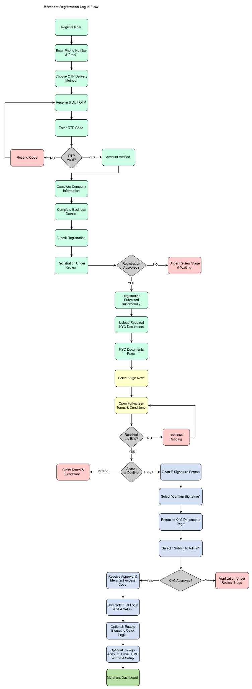
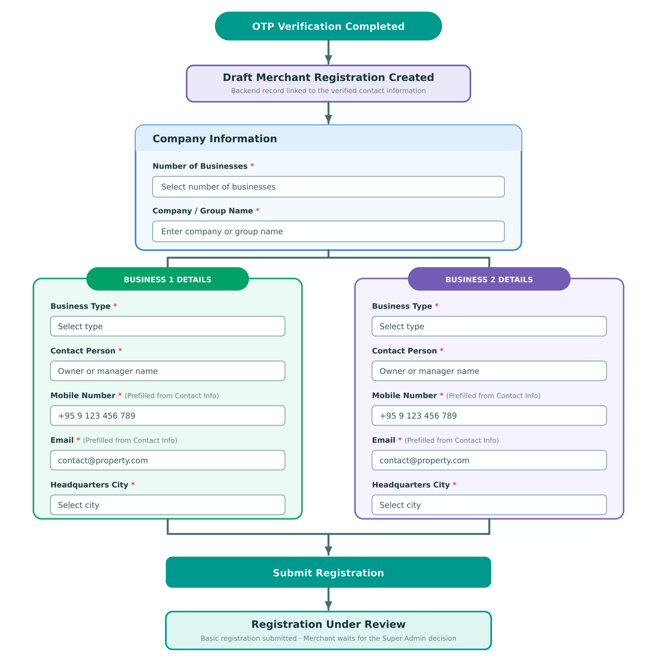
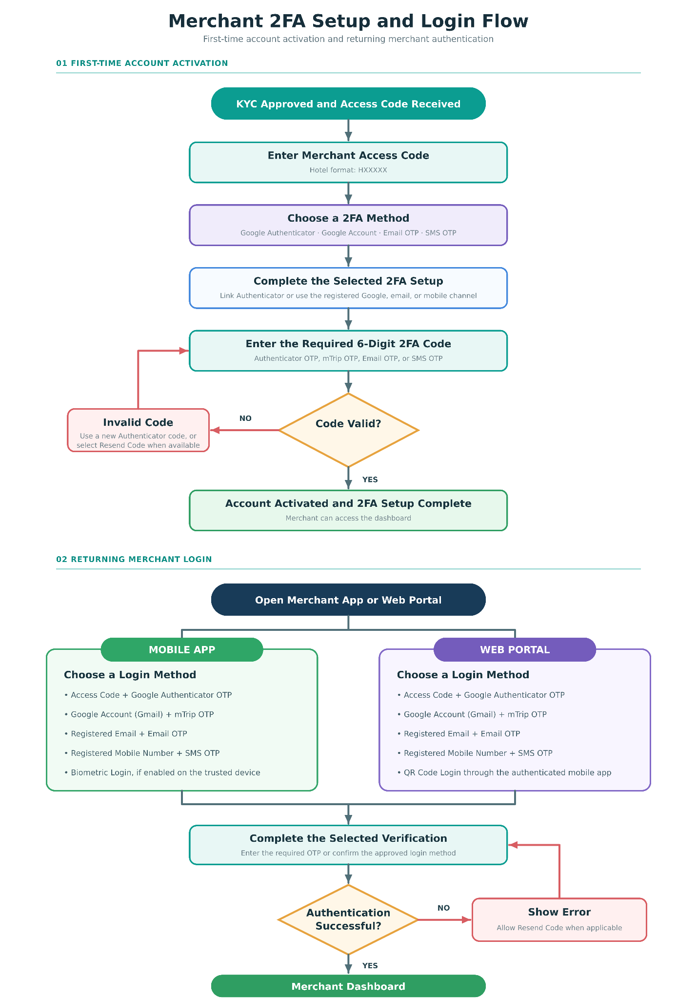
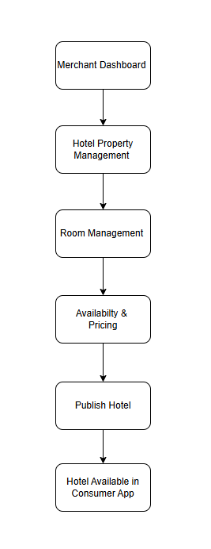
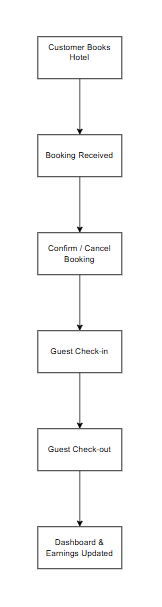
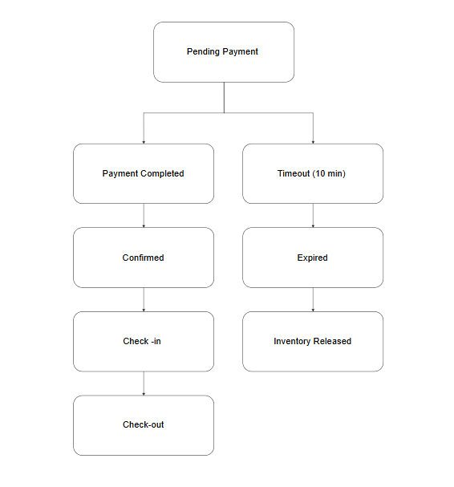
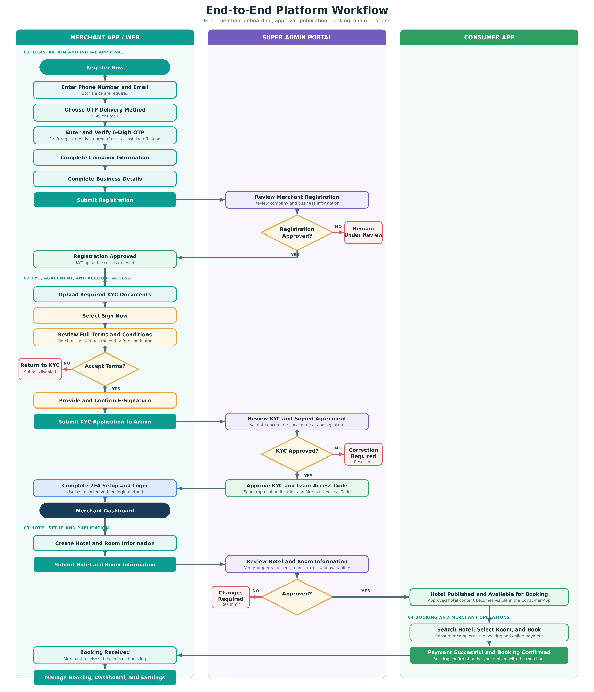
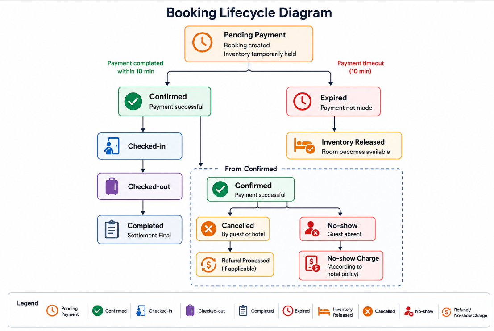
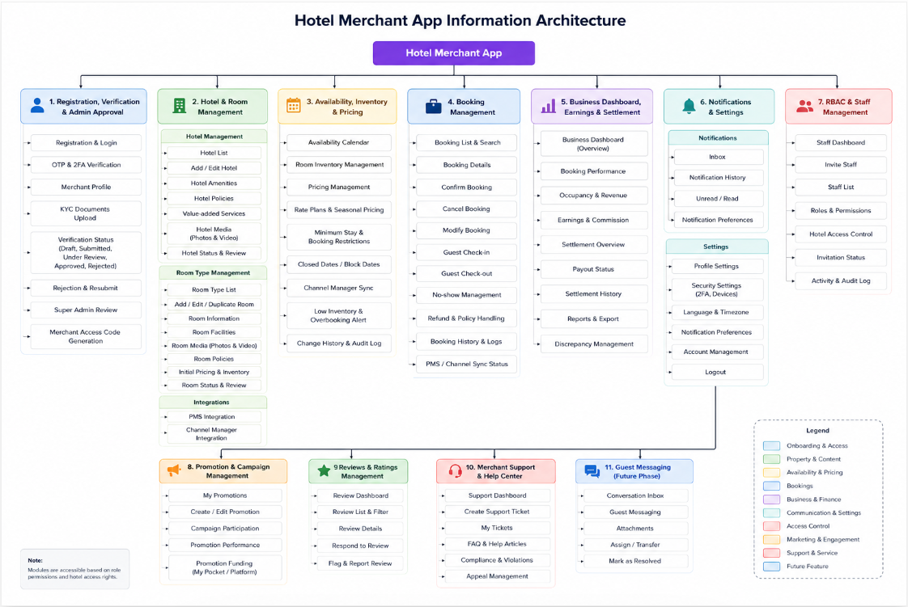
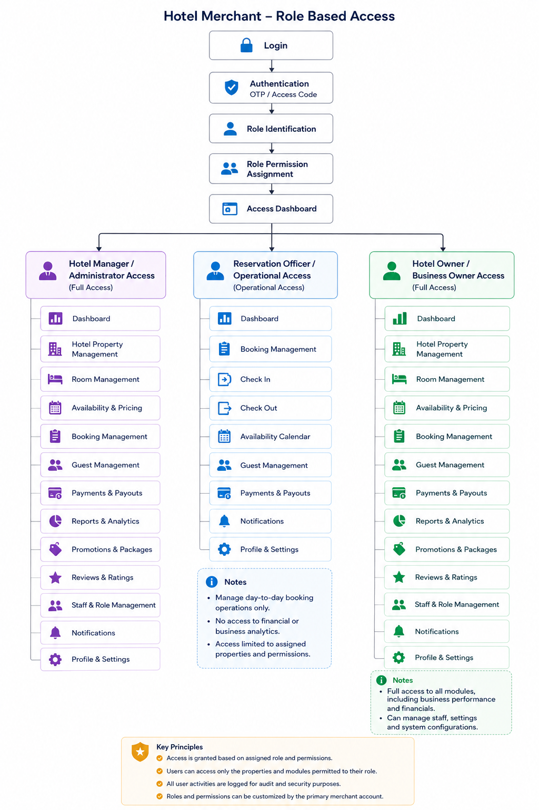

# mTrip 产品需求文档（PRD）

## 商户端 App - v1.0.14

作者：Ms. May Shoon Lett Zaw

团队：产品团队

| 产品经理 | Mr. Aung Khant Kyaw |
|---|---|
| 工程负责人/团队负责人 | Mr. Li Sir |
| 设计师 | Mr. Chit Ko Ko |
| 审批人/签署 |  |

PM 迭代计划：mTrip 迭代计划

PRD 状态：

## 目录

*（原文此处为 Word 自动生成目录域，文档中未包含目录条目。）*

## 概述

mTrip 酒店商户端 App 是一个定制化平台，使酒店合作伙伴能够在 mTrip 生态内高效地管理其门店和日常运营。该项目属于第一阶段 MVP 的一部分，为酒店商户提供所需工具，使其能够在单一平台上管理房量库存、预订、价格、促销和公司信息。

该项目旨在通过减少人工流程、提升预订准确性，并提供对预订活动的实时可见性，来改善酒店运营。自助式管理选项使酒店合作伙伴能够轻松响应客户预订、调整可用房量、管理促销活动并跟踪公司业绩。

酒店商户端 App 是 mTrip 生态的重要组成部分，因为它使酒店合作伙伴能够提供无缝的预订体验，同时也支撑平台打造可信、可扩展的旅游交易市场的目标。

该平台将整合日常运营工作台、受控的员工访问权限、透明的结算可见性、商户营销工具以及未来的联盟生态支持。Ctrip EBK 作为运营参考，而 mTrip 特有的入驻、双因素认证和联盟推广能力仍是产品的差异化优势。

**多业务商户结构**

mTrip 商户平台支持集中式组合结构，允许一个商户账号在单一账号下管理多个门店和业务类型。“全部门店”视图是组合层级的入口，商户可在其中查看和管理所有已注册业务。每个门店在其适用的业务领域内运营，例如酒店或餐厅，并具备该领域专属的管理模块和运营流程。共享的商户能力，包括工作台与收益、促销、评价、住客消息、员工管理、支持与设置，在受支持的各个业务领域内均可访问。

## 问题

许多酒店，尤其是中小型酒店，仍通过电话、即时通讯工具、电子表格或各种互不连通的系统手动管理预订和房量。这些零散的流程增加了运营工作量，导致预订确认延迟，并可能造成超订、房量库存不准确和价格不一致。

随着 mTrip 不断扩展酒店预订服务，酒店合作伙伴希望有一个集中的管理平台，使其能够高效管理预订、可用房量、价格和促销活动，同时实时向客户提供准确信息。

如果没有专门的酒店商户端 App，运营低效将对酒店合作伙伴和客户造成严重影响，导致响应时间变慢、预订准确性下降和客户满意度降低。

## 目标

### 目标 1

为酒店合作伙伴提供集中式平台，以管理酒店运营，包括门店信息、房量库存、价格、预订、促销、员工访问权限、客户评价和经营业绩。

### 目标 2

通过实时预订管理、自动通知、基于角色的访问控制、自助式管理工具和集中的商户支持来减少人工流程，从而提升运营效率。

### 目标 3

构建可扩展的商户平台，提升酒店合作伙伴满意度，改善用户预订体验，并支撑 mTrip 旅游生态的长期增长。

## 约束条件

#### 约束 1：MVP 范围与时间计划

酒店商户端 App 将作为第一阶段 MVP 的一部分在项目时间计划内开发。为确保按时交付，首个版本将聚焦核心酒店管理能力，包括商户入驻、酒店与客房管理、可用房量与价格、预订管理、工作台与收益、员工管理、促销、评价、通知和商户支持。高级能力和第三方集成将在后续阶段交付。

#### 约束 2：资源有限与平台就绪度

作为一个新平台，酒店商户端 App 将与其他 mTrip 核心服务同步开发，包括用户端 App、超级管理员后台、支付服务和支持性平台基础设施。开发优先级、技术依赖和可用工程资源可能影响各功能的实施顺序。

#### 约束 3：外部系统依赖

若干核心能力依赖第三方服务和外部集成，包括实名认证（KYC）验证、支付网关、短信/一次性验证码（OTP）服务、推送通知、结算处理、物业管理系统（PMS）集成、渠道管理器集成和地图服务。这些外部系统的可用性、性能和可靠性可能影响功能交付和用户体验。

#### 用户画像

| 用户画像 | 说明 |
|---|---|
| 关键用户画像——酒店经理/管理员 | 负责指导酒店日常运营、管理预订、查看可用房量、调整价格、创建促销并评估公司业绩。酒店经理是酒店商户端 App 的主要用户和决策者。 |
| 用户画像 2——预订专员/编辑 | 负责接收入店预订、确认或修改预订、更新可用房量、管理住客信息并响应客户请求。日常预订流程是该用户的主要关注点。 |
| 用户画像 3——酒店业主/企业主 | 负责评估酒店整体业绩、查看收入和入住率记录、管理促销计划，并基于运营信息做出经营决策。该用户使用应用的频率可能较低，但依赖经营统计和报表。 |

#### 用户旅程与平台流程

以下用户旅程描述了酒店商户在商户生命周期各阶段如何与 mTrip 酒店商户端 App 交互。这些流程展示了从商户注册、商户运营审核到业务验证（KYC）、酒店配置、预订管理和经营监控的关键运营过程。酒店商户端 App 与商户运营团队、超级管理员后台和用户端 App 紧密协作，以支持商户入驻、业务验证、酒店发布、客户预订以及 mTrip 生态内的实时同步。

图：端到端商户注册、审批与身份验证流程——移动端 App 与 Web 门户

**图 1——商户基础注册表单流程**

备注：业务联系人信息预填：系统应使用初次注册时录入的联系信息，为每个业务预填“手机号码”和“电子邮件”字段。商户可分别为每个业务编辑这些字段。“业务详情”中所做的任何更改均不得更新商户已通过验证的注册联系信息。

**图 2——商户双因素认证设置与登录流程**

#### 场景 1：酒店商户注册与验证

##### 目标

允许新酒店商户使用必填的手机号码和电子邮件地址进行注册，通过一次性验证码（OTP）验证所选的一个联系渠道，提交公司和业务信息以申请注册审批，在注册审批通过后完成实名认证（KYC）文件和电子签署，并在最终实名认证（KYC）审批通过且账号激活后安全访问商户工作台。

##### 流程

入驻流程始于潜在商户在商户端 App 或商户 Web 门户中选择“成为我们的合作伙伴”。商户需同时录入手机号码和电子邮件地址，选择短信或电子邮件作为一次性验证码（OTP）发送方式，并使用 6 位一次性验证码（OTP）验证所选联系渠道。如果验证码无效或已过期，商户可请求“重新发送验证码”。

一次性验证码（OTP）验证成功后，系统创建“草稿”状态的商户注册记录。商户填写公司信息以及每个注册业务的业务详情，然后提交注册。公司信息页和业务详情页不展示也不接受条款与条件。已提交的注册在获批前保持“审核中”状态。

注册审批通过后，商户可进入实名认证（KYC）文件页面上传所有已注册门店所需的文件。商户必须选择“Sign Now（立即签署）”，将全屏条款与条件阅读至末尾，接受声明，提供电子签名并确认签名。只有完成上述步骤后，“提交至管理员”才会启用。提交的实名认证（KYC）申请由超级管理员审核。最终实名认证（KYC）审批通过后，商户将收到审批通知和商户访问码，并完成现有的账号激活与登录设置。

**备注：**

审批通过后，商户将通过短信和/或电子邮件收到审批通知以及一个简短、唯一且与商户类型对应的商户访问码。酒店类访问码以 H 开头，租车类访问码以 C 开头。商户激活账号、关联可用的登录方式，并在访问商户工作台前完成强制的一次性验证码（OTP）验证。激活后，商户访问码仍可作为可选的登录标识。

##### 业务规则

- 商户选择“成为我们的合作伙伴”。
- 商户录入有效的手机号码和有效的电子邮件地址；两个字段均为必填。
- 商户选择一种一次性验证码（OTP）发送方式：发送短信至所录入的手机号码，或发送电子邮件至所录入的电子邮件地址。
- 商户录入 6 位一次性验证码（OTP）。如果一次性验证码（OTP）无效或已过期，商户可选择“重新发送验证码”。
- 一次性验证码（OTP）验证成功后，系统创建与已验证联系信息关联的“草稿”状态商户注册记录。
- 系统自动保存已填写的字段、当前入驻步骤、完成进度和最后活动时间，以便商户稍后继续。
- 商户填写公司信息以及每个业务的业务详情。
- 商户在此阶段无需接受条款与条件即可提交注册。
- 已提交的注册在超级管理员审批通过前保持“审核中”状态。
- 仅当注册已通过审批时，系统才展示“注册提交成功”并启用“继续上传实名认证（KYC）文件”。
- 商户为所有已注册门店上传全部必需的实名认证（KYC）文件。
- 在完成条款与条件阅读和电子签名之前，“提交至管理员”保持禁用状态。
- 选择“立即签署”将以全屏模式打开条款与条件。商户必须滚动至末尾，“接受并继续”才会启用。
- 如果商户选择“拒绝”，条款与条件关闭，商户返回实名认证（KYC）文件页面；电子签名仍未完成，“提交至管理员”保持禁用状态。
- 如果商户选择“接受并继续”，则打开电子签名页面。
- 商户必须提供签名并选择“确认签名”。
- 确认后，商户返回实名认证（KYC）文件页面，电子签名状态显示为“已签署”，“提交至管理员”变为启用状态。
- 商户选择“提交至管理员”后，实名认证（KYC）申请状态变更为“审核中”。
- 被驳回或需重新提交的实名认证（KYC）申请将展示原因，并允许商户更正并重新提交所需材料。
- 最终实名认证（KYC）审批通过后，商户将通过已配置的渠道收到审批通知和与商户类型对应的商户访问码。
- 已通过审批的商户可在同一商户账号下管理一个或多个门店。
- 已通过验证的商户新增门店时无需重复进行商户级实名认证（KYC），仅需提供适用的门店级验证文件。

##### 商户审批前——注册与申请访问

- 潜在商户可通过商户移动端 App 或商户 Web 门户完成基础注册。基础注册通过审批后，实名认证（KYC）功能才会开放。
- 初始注册与一次性验证码（OTP）验证
    - 同时录入手机号码和电子邮件地址。
    - 选择短信或电子邮件作为一次性验证码（OTP）发送方式。
    - 录入并验证 6 位一次性验证码（OTP）；需要新验证码时使用“重新发送验证码”。
    - 一次性验证码（OTP）验证通过后，填写公司信息以及每个业务的业务详情。
    - 在注册表单上未接受条款与条件的情况下提交注册以供审核。
    - 注册处于“审核中”期间，商户可使用已验证的联系信息恢复已保存的草稿或查看当前申请状态。
        - 注册通过审批前，商户无法进入实名认证（KYC）。
        - 注册审批通过后，“继续上传实名认证（KYC）文件”变为可用。
        - 商户上传指定的实名认证（KYC）文件，完成必填的条款与条件阅读和电子签名，并提交实名认证（KYC）申请。
        - 商户可查看实名认证（KYC）审核状态，并在适用时更正并重新提交被要求补充的文件。
- 在实名认证（KYC）最终通过且账户激活成功之前，申请人无法访问商户工作台。
- 申请状态：联系方式 → 一次性验证码（OTP）已验证 → 注册草稿 → 注册审核中 → 注册提交成功 → 需要实名认证（KYC） → 实名认证（KYC）已提交并完成电子签署 → 实名认证（KYC）审核中 → 已通过 / 已驳回 / 需重新提交

##### 商户审批通过后——商户账户访问

超级管理员对已完成的实名认证（KYC）申请授予最终批准后：

- 商户将通过短信和/或邮件收到审批通知，同时收到应用内推送通知。
- 商户通过短信和/或邮件收到一个简短的、唯一的商户访问码。该访问码应恰好包含 6 位大写字母或数字字符。首位字符用于标识商户类型：H 代表酒店（格式为 HXXXXX），C 代表租车（格式为 CXXXXX）。其余五位字符由系统使用 A-Z 和 0-9 生成。每种商户类型支持 60,466,176 种组合。示例：H7K9P2 和 C4M8X6。
- 在获准访问商户工作台之前，必须至少绑定一种已验证的登录方式，并完成强制的一次性验证码（OTP）验证。

**首次账户激活与登录设置**

- 输入简短的、按商户类型区分的商户访问码（酒店为 HXXXXX，租车为 CXXXXX），或输入通过已验证联系方式渠道收到的一次性激活验证码。
- 使用 6 位激活一次性验证码（OTP）验证注册邮箱地址或手机号码。
- 查看并确认与商户账户绑定的已验证邮箱地址和手机号码。
- 商户移动端 App 和商户 Web 门户不再支持 Google 账号登录。
- 若商户希望使用商户访问码 + Google Authenticator，系统应显示用于注册验证器的唯一设置二维码和设置密钥。
- 商户扫描设置二维码或手动输入设置密钥，然后输入当前 6 位 Google Authenticator 一次性验证码（OTP）。
- 激活成功并通过一次性验证码（OTP）验证后，商户可访问商户工作台。
- 当商户选择其他已验证登录方式时，商户访问码在再次登录时不是必填项。

##### 再次登录——移动端 App

- 商户选择一种可用的登录方式：
- 方式 1——简短的、按商户类型区分的商户访问码（酒店为 HXXXXX，租车为 CXXXXX）+ 当前 6 位 Google Authenticator 一次性验证码（OTP）。
- 方式 2——已绑定的 Google 账号（Gmail）+ 发送至已注册已验证联系方式渠道的、强制要求的 6 位 mTrip 一次性验证码（OTP）。
- 方式 3——注册邮箱地址 + 6 位邮件一次性验证码（OTP）。
- 方式 4——注册手机号码 + 6 位短信一次性验证码（OTP）。
- 方式 5——生物识别登录，仅限此前在同一可信移动设备上启用过该功能的情况。
- 验证成功后，商户可访问商户移动端 App 工作台。
- 商户访问码在再次登录时为可选项，选择其他方式时不应要求输入。

##### 可选生物识别登录——仅限移动端 App

适用范围说明：生物识别登录仅适用于 mTrip 商户移动端 App，在商户 Web 门户/工作台不可用。

**启用**

商户必须首先完成账户激活，并使用任一已验证的绑定登录方式及其所需的一次性验证码（OTP）成功完成一次完整登录。进入商户移动端 App 工作台后，商户可手动启用生物识别登录，路径为：

商户移动端 App 工作台 > 设置 > 安全 > 生物识别登录当商户在商户移动端 App 设置 > 安全 中开启生物识别登录后，该功能应对同一可信移动设备上的后续登录生效。

后续登录时，商户可使用移动设备上已注册的生物识别方式，如面容识别或指纹，代替完成任一基于一次性验证码（OTP）的登录方式。

该生物识别登录流程仅用于访问商户移动端 App。不应要求商户重新完成实名认证（KYC），也不应要求执行活体检测、人脸身份核验、证件核验或新的人脸注册流程。

商户移动端 App 不得采集、存储或比对商户的面部图像或指纹信息。生物识别认证应由移动设备处理。

生物识别登录界面、操作说明、重试提示、错误状态及“使用商户访问码”选项应遵循已批准的 mTrip UI/UX 设计。

设备的生物识别确认窗口可遵循移动操作系统的标准外观。该窗口前后由 mTrip 商户移动端 App 显示的所有界面和提示均应符合已批准的 mTrip 设计。

生物识别认证成功后，应授予商户访问商户移动端 App 工作台的权限。

**适用条件**

当满足以下全部条件时，商户可使用生物识别登录：

- 商户已完成账户激活，并使用已验证的绑定登录方式及其所需的一次性验证码（OTP）成功完成一次完整登录。
- 商户已在商户移动端 App 设置 > 安全 中手动启用生物识别登录。
- 移动设备支持至少一种生物识别认证方式。
- 移动设备上已注册至少一种受支持的生物识别方式。
- 商户正在同一可信移动设备上尝试再次登录。
- 可信设备认证凭证仍处于有效状态。

**生物识别登录业务规则**

- App 应调用设备操作系统的原生生物识别提示，并接受任一种受支持且已注册的生物识别方式，如面容识别或指纹。
- 若面容识别和指纹认证均可用，应由设备操作系统管理可用的生物识别方式。
- 在同一登录会话中切换受支持的生物识别方式，不应重置失败尝试次数。
- 在同一登录会话中，商户在所有受支持生物识别方式下的失败匹配尝试总次数最多为三次，同时受设备或操作系统更严格限制的约束。例如，两次面容识别失败后再出现一次指纹识别失败，即计为三次失败尝试。
- 在第三次失败尝试后，或当操作系统报告生物识别锁定或不可用时，生物识别登录应停止。商户随后必须使用任一可用的已验证绑定登录方式及其所需的一次性验证码（OTP）完成认证。
- 商户可随时选择“使用商户访问码”，无需等待三次失败尝试。
- 取消或关闭生物识别提示不应计为一次失败的生物识别匹配。
- 生物识别验证成功后，应授予访问商户移动端 App 工作台的权限。
- 更换新移动设备、重新安装 App、生物识别注册信息变更、移除已注册的生物识别信息或相关设备安全设置变更，均会使该设备的生物识别登录失效。
- 发生此类变更后，商户必须使用任一可用的已验证绑定登录方式及其所需的一次性验证码（OTP）完成完整认证，随后必须在可信移动设备上通过商户移动端 App 设置 > 安全 重新手动启用生物识别登录。

##### 再次登录——Web 门户（无生物识别登录）

- Web 门户支持四种登录方式：
- 方式 1——简短的、按商户类型区分的商户访问码（酒店为 HXXXXX，租车为 CXXXXX）+ 当前 6 位 Google Authenticator 一次性验证码（OTP）。
- 方式 2——已绑定的 Google 账号（Gmail）+ 发送至已注册已验证联系方式渠道的、强制要求的 6 位 mTrip 一次性验证码（OTP）。
- 方式 3——注册邮箱地址 + 6 位邮件一次性验证码（OTP）。
- 方式 4——注册手机号码 + 6 位短信一次性验证码（OTP）。
- 验证成功后，商户可访问商户 Web 门户工作台。
- Web 门户不应显示生物识别登录。
- 扫码登录自本版本起也已包含并保留。

##### 认证业务规则

- 注册审批通过前，申请人仅可访问注册、已保存草稿和申请状态功能。注册审批通过后，可访问实名认证（KYC）提交、实名认证（KYC）重新提交和实名认证（KYC）状态功能。
- 仅实名认证（KYC）申请已通过、且完成账户激活和所需一次性验证码（OTP）验证的商户，方可访问商户工作台。
- 首次注册需同时提供手机号码和邮箱地址。商户选择短信或邮件作为一次性验证码（OTP）下发渠道，注册一次性验证码用于验证所选渠道。
- 每种再次登录方式均需完成其指定的一次性验证码（OTP）验证；仅凭商户访问码不得授予访问权限。
- 商户访问码应恰好包含 6 位大写字母或数字字符，且必须唯一，输入时不区分大小写。首位字符由商户类型固定：H 代表酒店（HXXXXX），C 代表租车（CXXXXX）。其余五位字符可使用 A-Z 或 0-9，每种商户类型提供 60,466,176 种可能组合。访问码前缀必须与账户记录的商户类型一致。
- 商户访问码 + Google Authenticator 仍可使用，但当商户选择邮件一次性验证码（OTP）或短信一次性验证码（OTP）登录时，商户访问码为可选项。
- 商户移动端 App 和 Web 门户均不支持 Google 社交账号登录。Google Authenticator 一次性验证码（OTP）仍作为独立的双因素认证方式受支持。
- 邮件登录仅允许使用已注册的已验证邮箱地址及其邮件一次性验证码（OTP）。
- 短信登录仅允许使用已注册的已验证手机号码及其短信一次性验证码（OTP）。
- 所有 mTrip 邮件和短信一次性验证码（OTP）均为一次性使用，5 分钟后失效，重发冷却时间为 60 秒，最多允许五次输入失败，之后临时锁定。
- 请求新的一次性验证码（OTP）应使该登录尝试此前尚未失效的一次性验证码失效。
- 登录界面必须对邮箱地址和手机号码进行掩码处理，并使用不暴露账户是否存在的通用错误提示。
- 认证尝试、一次性验证码（OTP）请求、一次性验证码验证失败、登录方式变更、设备信任变更及账户恢复事件均须记录审计日志。
- 若验证器设备丢失，账户恢复必须通过已注册的已验证邮箱地址或手机号码，并结合已批准的身份与风险核查，之后方可签发新的设置二维码或设置密钥。
- 生物识别登录仅为商户移动端 App 的可选功能，不应在商户 Web 门户/工作台上显示或提供。
- 商户 Web 门户应要求登录时提供商户访问码及当前 6 位 Google Authenticator 验证码。商户 Web 门户不应提供生物识别登录。
- 最多三次生物识别失败尝试在同一登录会话内跨全部可用生物识别方式合并计算，而非按面容识别和指纹分别计算。
- 设备和操作系统的生物识别锁定规则优先。若设备在达到 mTrip 限制前就阻止生物识别认证，App 应立即要求使用商户访问码 + Google Authenticator 双因素认证（2FA）。

**注册期间的客户支持**

- 用户可在商户审批通过前的注册流程中访问客户支持。
- 客户支持弹窗显示支持邮箱地址和电话号码。
- 用户可使用复制图标复制支持邮箱地址，或点击该邮箱地址，通过 mailto 超链接打开默认邮件应用。
- 用户可使用“拨打”按钮直接发起电话呼叫。
- 如适用，弹窗中显示支持服务时间。

### 场景 2——酒店配置与发布

##### 目标

允许已通过审批的商户配置酒店门店，并在完成所需运营配置后将其发布至 mTrip 用户端 App。

**工作流**

##### 业务规则

- 仅已通过审批的商户可创建酒店门店。
- 一个商户账户可管理多个酒店门店。
- 酒店信息可保存为草稿。
- 提交前必须完成必填信息。
- 在适用情况下支持物业管理系统（PMS）和渠道管理器同步。
- 未接入集成的酒店可直接在商户门户中管理运营。
- 仅已发布的酒店会显示在用户端 App 中。

**预期结果**

酒店可供客户搜索和预订。

### 场景 3——预订管理

##### 目标

允许商户接收、管理和履行通过 mTrip 用户端 App 产生的酒店预订，同时保持商户端 App、用户端 App、管理后台及受支持的集成系统之间的预订信息同步。

**工作流**

##### 业务规则

- 通过用户端 App 提交的预订请求会实时同步至商户端 App。
- 商户会收到新预订、预订变更、取消及运营事件的通知。
- 在支持的情况下，预订状态会与已对接的物业管理系统（PMS）或渠道管理器同步。
- 未对接物业管理系统（PMS）或渠道管理器的酒店，可直接通过商户 Web 门户管理预订操作。
- 商户可查看预订详情、住客信息、支付状态及预订历史。
- 商户可根据平台政策与业务规则确认、修改或取消预订。
- 仅已确认的预订可执行入住与退房。
- 商户可根据已配置的业务规则，将符合条件的住客标记为未入住（No-Show）。
- 预订完成后，系统会自动更新可用房量、入住率、收入、结算信息及经营业绩指标。
- 所有预订活动均会被记录，用于运营历史、报表及审计。
- 商户可根据已配置的业务规则，将符合条件的住客标记为未入住（No-Show）。

##### 预订支付规则

- 当用户选择客房并进入支付环节时，系统会创建状态为“待支付”的预订。
- 在用户完成支付期间，所选房型的房量库存会被临时保留 10 分钟。
- 在保留期内，该客房不可被其他用户预订。
- 若在 10 分钟内成功完成支付，预订状态变更为“已确认”，该保留转为有效预订。
- 若未在 10 分钟内完成支付，待支付预订自动失效，房量库存释放回可售库存，用户须重新创建预订才能再次保留该客房。
- 已失效的待支付预订会保留在系统中，用于审计与报表，但不视为已确认预订，也不计入商户结算。
- 到店支付——商户预订规则：到店支付仅对已明确开通该支付模式的商户可用。预订应展示预付的 mTrip 费用、到店支付的剩余金额、适用的佣金与交易手续费、支付状态，以及取消/未入住政策。
- 在结算时，交易手续费应仅按佣金金额计算：交易手续费 = 佣金金额 × 适用交易手续费率，而非按预订总价计算。经批准的商户佣金与适用交易手续费按结算时披露的内容预付收取。
- 对于已确认的到店支付预订，记录住客实际入住应自动将到店支付的运营结算标记为“已完成”。仅凭计划入住日期不得触发结算完成。商户支付确认不是该入住触发状态的额外前提条件。
- 取消与未入住的费用分摊应遵循结算时约定的该预订专属政策；适用时间戳、可退与不可退金额及付款方均应保留，用于对账与审计。
- 商户专属商务配置：超级管理员控制商户的到店支付资格、mTrip 佣金与交易手续费率，以及商户未入住房费预收比例上限（不得超过 30%）。商户未入住费用设置仅在开启到店支付时适用。商户可选择未入住费用（免费），此时商户预收比例为 0%；或开启未入住费用并选择不超过所配置上限的房费预收比例。mTrip 佣金不与商户分成。
- 预订配置快照：在确认时，记录到店支付资格与选择、商户未入住费用开启/关闭状态、适用商户预收比例（未入住费用为免费时为 0%）、房费计算基数、佣金与交易手续费率及配置版本。后续变更仅适用于新预订。
- 到店支付预付订金：到店支付关闭时，不适用商户未入住预收，使用普通支付流程。开启且未入住费用为免费时，仅预付适用的 mTrip 佣金（以及任何单独适用的、由用户承担的交易手续费）。开启且设置商户未入住费用时，将 mTrip 佣金与商户选定的房费比例（上限为最高 30%）作为一笔面向用户的预付订金收取（以及任何适用的、由用户承担的交易手续费）。内部账务必须拆分各组成部分。商户金额的任何部分均不来自 mTrip 佣金。

**预订状态流转**

**预期结果**

预订信息在商户端 App、用户端 App 与管理后台之间保持同步，使商户能够高效管理预订，同时保持准确的运营与财务数据。

##### 端到端平台工作流

**描述**

以下工作流展示了商户端 App、管理后台与用户端 App 在酒店商户全生命周期中的完整交互。它体现了商户入驻、酒店发布、用户预订及预订管理如何在 mTrip 生态内保持同步。

##### 功能需求

功能范围采用与 Sprint 规划表相同的模块名称进行组织。Ctrip EBK 作为成熟酒店运营的参考；mTrip 的最终实现仍取决于业务、设计与技术验证。

##### 门店组合与业务领域管理

目标：使商户能够在单一商户账号下管理多个门店与业务领域。商户账号与门店层级：一个已注册的商户账号可管理多个关联门店/业务。商户账号代表注册商号；各酒店/门店的名称，以及门店所属的城市、星级、类别与运营状态，均归属于对应的门店记录。商户层级的账号身份、登录、认证与安全设置在整个商户账号内共享。门店专属的运营数据与操作仅作用于所选门店。

##### 功能需求

- 商户可在集中的“全部门店”视图中查看与其账号关联的全部门店。
- 门店组合中可包含来自不同受支持业务领域的门店，例如酒店与餐厅。
- 门店按业务领域分组或标识。
- 商户可选择门店以进入其相应的管理功能。
- 酒店门店可访问酒店专属功能，例如酒店门店、房型、可用房量与价格、预订管理。
- 餐厅门店可访问餐厅专属功能，例如餐厅资料、菜单管理、餐位预订与营业时间。
- 工作台与收益、促销、评价、住客消息、员工管理、支持与设置等商户共享功能在受支持的业务领域中均保持可用。
- 商户可按适用的注册、验证与审批要求新增门店。
- 门店状态与欺诈升级：经授权的超级管理员可单独暂停或恢复某一家门店，而不会自动暂停商户账号或其他门店。门店被暂停后，该门店将无法接受新预订；此前已确认的预订仍按原有条款执行。
- 经授权的超级管理员可整体暂停商户账号，从而限制其所有关联门店的新预订。某一家门店疑似存在欺诈或严重违规时，可对其进行标记并升级至商户层级调查；仅标记本身不会自动暂停整个商户账号。商户端 App 应反映门店/商户的实际生效状态，并据此限制受影响的操作。

## 商户工作台

目标：为商户提供覆盖所有受管理酒店门店的集中运营概览，使其能够在单一工作台中监控经营业绩、预订活动、入住率、收入及运营告警。

#### 功能需求

#### 门店选择

- 支持“全部门店”与单个门店选择。
- 工作台指标、图表与表格应根据所选门店刷新。

#### 运营摘要

展示关键运营 KPI：

- 酒店总数
- 今日预订数
- 今日入住数
- 今日退房数
- 当前住客数
- 入住率
- 今日收入
- 待确认数
- 待结算
- 进行中的促销

#### 运营告警

展示重要的运营通知，包括：

- 物业管理系统（PMS）同步失败
- 连接超时
- 系统通知
- 门店相关运营告警

商户应能够在适用时查看详细日志。

#### 经营洞察

展示经营业绩图表：

- 收入趋势
- 入住率趋势
- 预订趋势

#### 门店表现

展示汇总表，包含：

- 酒店名称
- 今日预订数
- 入住率
- 今日收入
- 门店状态

#### 今日运营

展示需要商户处理的预订，包括：

- 酒店
- 预订编号
- 住客
- 客房
- 入住日期
- 退房日期
- 预订状态

导航：商户应能够从工作台直接跳转至相关管理模块，包括酒店门店与预订管理。

## 模块 1 – 注册、验证与管理审批

目标：使酒店商户能够安全注册、验证其身份与业务、提交所需文件、跟踪验证状态，并在超级管理员审批后访问平台。

### 功能需求

##### 1.1 注册与身份验证

- 首次注册时须同时提供有效手机号与有效邮箱地址。允许商户选择短信或邮件作为 6 位注册一次性验证码（OTP）的接收方式。
- 一次性验证码（OTP）验证成功后，立即创建商户注册草稿记录。
- 当注册一次性验证码（OTP）无效、已过期或未收到时，提供“重新发送验证码”。
- 最终实名认证（KYC）审批通过后，生成并发送一个短的、唯一的 6 位商户访问码，用于账号激活及后续可选登录：酒店商户为 HXXXXX，租车商户为 CXXXXX。
- 在商户移动端 App 与 Web 门户上均支持三种再次登录方式：商户访问码 + Google Authenticator 一次性验证码、注册邮箱 + 邮件一次性验证码、注册手机号 + 短信一次性验证码。
- 当商户选择 Google、邮件一次性验证码或短信一次性验证码登录时，不要求提供商户访问码。
- 每种登录方式均须执行所规定的一次性验证码（OTP）验证，并落实验证码有效期、重发冷却、尝试次数限制、掩码显示及审计日志。
- 仅在商户移动端 App 中，且完成完整身份验证与可信设备注册后，为再次登录的商户支持可选的生物识别登录。
- 商户 Web 门户/工作台不提供面容识别或指纹登录。
- 在要求商户访问码 + Google Authenticator 双因素认证（2FA）之前，每次登录会话在所有支持的生物识别方式下合计最多允许三次失败尝试，并受更严格的设备或操作系统锁定规则约束。

##### 1.2 商户注册与草稿管理

- 商户须为每个注册业务提供必填的手机号与邮箱地址、公司信息及业务详情。
- 一次性验证码（OTP）验证成功后，系统应在后端创建商户注册草稿记录，并与商户已验证的联系信息关联。
- 系统应自动保存已填写字段、当前入驻步骤、完成百分比及最后活动时间。
- 商户应能够离开注册流程，并在之后恢复已保存的草稿。
- 商户应提交完整的公司与业务信息，用于初始注册审核。
- 在注册获批之前，系统应保持注册状态为“审核中”。
- 仅在初始注册获批后，系统才应启用“继续上传实名认证（KYC）资料”。
- 系统应仅向经授权的运营人员与超级管理员提供已保存的入驻信息、完成进度及步骤事件历史。
- 系统应跟踪已保存数据与已完成的步骤事件，但不应记录商户的每一次按键输入。

##### 1.3 商户验证（KYC）

- 仅在商户基础注册获批后，才允许上传实名认证（KYC）文件。
- 支持所需文件，包括：
    - 营业执照
    - 酒店经营许可证
    - 业主/授权代表的身份证（NRC）或护照
    - 银行账户信息
    - 银行存折/银行证明
    - 税务登记证
    - 场所产权/租赁协议
    - 组织架构图/结构图（适用于拥有多个门店的商户）
- 在实名认证（KYC）文件列表下方展示电子签名区域，并提供“立即签署”操作。
- 在商户完成条款与条件审阅并确认电子签名之前，保持“提交至管理员”为禁用状态。
- 当商户选择“Sign Now（立即签署）”时，以全屏模式打开条款与条件。
- 要求商户滚动至条款与条件的末尾，之后才启用“Accept & Continue（接受并继续）”。
- 若商户选择“Decline（拒绝）”，则关闭条款与条件并在未签署的情况下返回实名认证（KYC）资料页面；“Submit to Admin（提交至管理员）”保持禁用。
- 若商户选择“Accept & Continue（接受并继续）”，则打开电子签名页面，并要求商户提供签名并选择“Confirm Signature（确认签名）”。
- 签名确认后，返回实名认证（KYC）资料页面，将电子签名状态显示为“Signed（已签署）”，并启用“Submit to Admin（提交至管理员）”。
- 将已接受的条款与条件版本、电子签名、签署人身份及确认时间戳与实名认证（KYC）提交的审计记录一并存储。

##### 1.4 验证流程

- 管理两阶段的商户申请生命周期：
- 草稿注册
- 注册审核中
- 注册已通过 / 已获得实名认证（KYC）权限
- 实名认证（KYC）已提交
- 实名认证（KYC）审核中
- 已通过 / 已驳回 / 需重新提交
- 在入驻全过程中分别显示注册审核状态与实名认证（KYC）审核状态。被驳回或需重新提交的实名认证（KYC）申请必须显示原因，并允许修正与重新提交。
- 对于已完成商户验证（KYC）的商户，支持门店维度的验证。
- 已通过审核的商户新增门店时，仅应要求提供必需的门店维度验证文件。此前已通过的商户实名认证（KYC）信息应保持有效，除非因经营信息变更或监管要求而需重新验证。

##### 1.5 超级管理员审批

- 系统应允许超级管理员审核已提交的基础注册信息，并在注册审核通过后审核实名认证（KYC）文件及已签署的协议。
- 系统应在授予实名认证（KYC）上传权限之前先通过基础注册审核，并在实名认证（KYC）申请提交后对其进行通过、驳回或要求重新提交。
- 仅在最终实名认证（KYC）审核通过后，系统才应生成简短、唯一、由 6 位大写字母数字组成的商户访问码。酒店商户使用 HXXXXX，租车商户使用 CXXXXX；其余五位中的每一位均使用 A-Z 或 0-9 生成，并校验前缀与商户类型一致。每种商户类型支持 60,466,176 种可能组合。
- 仅在最终实名认证（KYC）审核通过且身份验证成功后，系统才应授予账户激活与商户工作台的访问权限。

## 模块 2 – 酒店与客房管理

目标：使已通过审核的商户能够创建、管理并维护面向客户展示的酒店与客房信息，同时确保所有发布内容在发布前符合平台质量标准。

### 功能需求

- 单个商户账户应能够在同一账户下创建和管理多个酒店门店，且受所分配的用户权限约束。
- 商户应能够按酒店名称、门店状态和位置查看、搜索、筛选并管理酒店门店。
- 商户应能够创建、编辑、查看并维护酒店信息，包括酒店名称、门店类型、描述、星级、地址、位置、联系方式、网站及 Google 地图位置。
- 商户应能够配置酒店配套设施，包括面向客户展示的酒店设施、住客配套设施及标准门店服务。
- 商户应能够配置酒店政策，包括入住/退房时间、儿童政策、吸烟政策、宠物政策、加床政策、早餐政策、取消政策及入住须知。
- 商户应能够为每个酒店门店创建、编辑、复制、删除并管理房型，包括房型名称、房型描述、房型面积、床型、可住人数、客房设施、客房图片、房型生命周期状态及可用房量配置。
- 商户应能够上传、编辑、排序、分类、预览并管理酒店与客房媒体，包括酒店照片、客房图片、封面照片选择、图片质量校验、已批准的图片数量上限，以及一段可选的酒店宣传视频（最长 7 秒）。
- 对于 360 度酒店与客房媒体，商户 Web 门户应允许商户从电脑上传兼容的 360 度图片。商户移动端 App 应允许商户通过受支持的应用内引导拍摄流程使用手机摄像头拍摄 360 度图片，或从设备相册中选择兼容的图片。系统应在提交前提供可交互的 360 度预览，并向客户展示已批准的 360 度媒体。商户应能够使用受支持的安全导览 URL 或嵌入链接及封面缩略图，可选配置房型级 VR/360 全景导览。手机拍摄的 360 度图片与外部托管的 VR 导览应被视为两种独立的受支持媒体来源。商户还应能够通过上传基础户型图并管理带有标题、简短描述及可选特写图片的热点，可选配置可交互的 3D 户型图。VR/360 全景导览与 3D 户型图仅应在审核通过后支持预览、启用或停用状态、审核及面向客户展示。
- 商户应能够配置可选的增值服务，包括早餐套餐、水疗与康养、洗衣服务、客房送餐、加床及延迟退房。（机场接送 = 后续阶段。）
- 商户应能够将酒店与客房信息保存为草稿、预览变更、提交更新以供审核、跟踪审核状态、查看驳回原因、查看审批历史，并重新提交被驳回的信息。在最新提交的变更通过审核之前，此前已批准的信息应继续对客户可见。
- 已有物业管理系统（PMS）的酒店应能够通过受支持的 API 进行集成，以同步酒店信息、房型、库存、价格及预订状态。
- 没有物业管理系统（PMS）的酒店应能够将 mTrip 商户门户作为其主要物业管理系统（PMS），以管理酒店信息、房型、库存、价格及预订。
- 渠道管理器集成应在受支持的在线旅行社（OTA）之间同步可用房量、库存、房量配额分配、预订状态及价格。

##### 2.1 房型管理

**功能需求**

- 商户应能够为每个酒店门店创建、编辑、复制、删除并管理房型。
- 商户应能够配置客房信息，包括房型名称、房型编码、房型描述、床型、床数、房型面积、楼层、客房景观、吸烟偏好、最大成人数、最大儿童数及最大入住人数。
- 商户应能够配置每个房型可用的客房设施与配套设施。
- 商户应能够上传、编辑、预览、替换并删除客房图片，支持封面照片选择、图片质量校验、已批准的图片数量上限，以及一段可选的客房视频。对于房型专属的 360 度媒体，Web 门户应支持从电脑上传，移动端 App 应支持手机拍摄与相册选择。客房媒体设置应包含“Room Images（客房图片）”“VR Tour（VR 导览）”“3D Floor Plan（3D 户型图）”三个独立步骤。VR 导览步骤应接受受支持的 URL 或嵌入链接及封面缩略图。3D 户型图步骤应支持基础户型图上传及热点的新建、编辑与删除。
- 商户应能够配置客房价格，包括基础价、周末价、币种及加床价格。
- 商户应能够配置客房库存，包括物理客房总数及上线时的初始可用客房数。
- 商户应能够配置房型专属政策，包括取消政策、餐食方案及入住说明。
- 商户应能够将客房信息保存为草稿、提交房型以供审核、跟踪审批状态、查看驳回原因，并重新提交被驳回的客房信息。在最新提交的变更通过审核之前，此前已批准的客房信息应继续对客户可见。
- 房型应与特定酒店门店关联，并用于库存管理、可用房量、价格、预订管理及面向客户的酒店展示。

## 模块 3 – 可用房量、库存与价格

目标：使商户能够管理客房可用房量、库存、价格及预订限制，以最大化入住率，同时确保各销售渠道的库存准确。

### 功能需求

##### 3.1 可用房量管理

- 基于日历的可用房量与库存管理。
- 支持日历视图与列表视图。
- 跨多个门店与房型管理可用房量。
- 针对单个日期或日期范围开启、关闭、锁定或释放客房库存。
- 跨选定日期批量更新可用房量。

##### 3.2 库存管理

- 针对单个日期或日期范围手动更新客房库存。
- 预订确认后自动扣减库存。
- 库存归零时自动显示“Sold Out（售罄）”状态。
- 显示库存状态，包括“Available（可用）”“Low Inventory（库存偏低）”“Sold Out（售罄）”“Closed by Merchant（商户关闭）”。
- 防止库存为负数。
- 生成库存偏低与超售风险提醒。

##### 3.3 价格管理

- 按房型配置价格。
- 支持基础价格。
- 支持按日期定价。
- 支持周末价格。
- 支持季节性价格。
- 支持提前预订折扣。
- 支持临期价格。
- 支持长住价格。
- 支持促销价格。
- 跨选定日期批量更新价格。
- 保存变更前校验最低价格。

##### 3.4 限制条件管理

- 配置最短入住要求。
- 配置最长入住要求。
- 启用或停用“Stop Sell（停止售卖）”。
- 配置“Closed to Arrival（CTA，禁止入住）”。
- 配置“Closed to Departure（CTD，禁止离店）”。
- 针对单个日期或日期范围应用限制条件。

##### 3.5 同步管理

- 与已连接的物业管理系统（PMS）同步库存与价格。
- 与已连接的渠道管理器同步库存与价格。
- 显示同步状态及最近一次同步时间戳。
- 允许商户手动同步库存与价格。
- 当物业管理系统（PMS）或渠道管理器集成不可用时，允许商户手动更新可用房量、库存、价格及限制条件。
- 同步失败时通知商户。

###### 3.5.1 同步错误场景与冲突处理

当交易关键数据在用户端 App、商户端 App/门户、支付服务、预订服务、库存服务、物业管理系统（PMS）/渠道管理器集成或其他已连接的 mTrip 服务之间出现不一致时，平台应检测并呈现同步异常。在最终状态完成对账之前，同步问题应保持可处理状态。

| # | 场景 | 示例 | 分类 |
|---|---|---|---|
| 1 | 支付状态不一致 | 客户支付成功，但商户侧仍显示“Pending Payment（待支付）”。 | 同步错误 |
| 2 | 预订状态不一致 | 客户预订已确认（Confirmed），但商户侧预订缺失或仍为待处理（Pending）。 | 同步错误 |
| 3 | 预订后库存更新失败 | 预订已确认，但可用客房库存未扣减。 | 同步错误 |
| 4 | 商户锁定/解锁未生效 | 商户锁定或释放某客房/日期，但用户端 App 仍显示此前的可用房量。 | 同步错误 |
| 5 | 预订与批量锁定并发 | 客户预订最后一间可用客房的同时，商户试图锁定同一客房/日期。 | 并发冲突；仅当最终状态出现分歧时才是同步错误 |
| 6 | 取消同步失败 | 客户取消预订，但商户侧仍显示已确认（Confirmed）。 | 同步错误 |
| 7 | 取消后库存释放失败 | 预订已取消，但释放的客房库存仍不可用。 | 同步错误 |
| 8 | 退款同步失败 | 支付服务/支付提供商已完成退款，但商户侧仍显示“Refund Pending（退款处理中）”或过期的退款状态。 | 同步错误 |
| 9 | 价格同步失败 | 商户更新客房价格，但超出可接受的传播/缓存窗口后，用户端 App 仍显示此前价格。 | 同步错误 |
| 10 | 可用房量数量不一致 | 同一房型/日期，商户库存显示的可用客房数量与用户端 App 不一致。 | 同步错误 |
| 11 | 促销同步失败 | 商户控制的促销被激活、更新或停用，但用户端 App 仍保留过期的促销状态。 | 同步错误 |
| 12 | 预订修改不一致 | 住客的预订日期或客房详情已变更，但商户侧仍保留此前的预订信息。 | 同步错误 |
| 13 | 重复事件/Webhook | 同一支付、预订、取消或库存事件被重复投递或处理多次，造成错误的重复状态。 | 集成异常；若状态受影响则为同步错误 |
| 14 | 事件延迟/乱序 | 较旧的预订事件在较新事件之后到达（例如“Confirmed（已确认）”事件在“Cancellation（取消）”事件之后到达），可能覆盖正确的最终状态。 | 若最终状态出错则为同步错误 |
| 15 | 服务/API/网络故障 | 预订、支付、库存或其他同步更新已发出，但接收服务超时或处理失败。 | 同步错误 |
| 16 | 房型映射失败 | 预订引用了已删除、未启用、不可用或错误的 Room Type ID，无法在商户侧正确映射。 | 同步错误 |
| 17 | 手动可用房量更新部分成功 | 商户的批量更新覆盖多个日期/客房，但只有部分更新成功。 | 部分同步/更新失败 |

##### 并发与库存交易规则

- 对于预订与批量锁房的并发场景，平台应以首个成功提交的库存交易作为受影响客房/日期的权威结果。
- 若用户预订交易先提交，则应保障该预订，并拒绝商户对已被预留库存的锁房请求。商户应收到明确提示，例如：“无法锁定该客房/日期，因为它已被用户预订。”
- 若商户锁房交易先提交，受影响库存应变为不可售。在最终预订确认/支付承诺之前，用户端 App 应重新校验可用房量，并告知用户该客房已不可预订。
- 同时发生的预订与锁房请求属于并发冲突，并不自动等同于同步错误。仅当最终预订/库存状态在系统间出现分歧，或该冲突无法自动调和时，才应记录为同步错误。
- 批量更新应在提交/确认时执行服务端可用房量校验。系统不得仅依赖商户首次打开日历时所展示的可用房量。
- 当批量操作包含多个日期或客房记录时，应告知商户哪些更新成功、哪些失败；成功的更新不得被呈现为失败。
- 系统应防止出现负库存，且不得仅因商户随后提交了锁房请求，就取消或置已确认的用户预订单为无效。
- 较早或重复的同步事件不得覆盖较新的有效状态。工程实现应具备适当的幂等、事件顺序/版本校验、重试处理与对账控制。

##### 3.6 提醒与通知

- 在房量库存偏低时提醒商户。
- 在同步失败时提醒商户。
- 在存在超售风险时提醒商户。
- 支持商户查看提醒详情并执行相关操作。

##### 3.7 变更记录

- 记录房量库存更新。
- 记录价格更新。
- 记录限制条件更新。
- 记录同步活动。
- 展示每次变更的操作人、时间戳与所执行的操作。

## 模块 4 – 预订管理

目标：使酒店员工能够管理完整的预订生命周期、监控预订状态、处理住客相关操作，并与已对接的物业管理系统（PMS）和渠道管理器同步预订信息。

### 功能需求

##### 4.1 预订列表管理

- 在统一的预订列表中查看全部预订。
- 按预订编号、住客姓名或预订参考号搜索预订。
- 按日期范围、门店、预订状态、支付状态或预订渠道筛选预订。
- 按入住日期、退房日期、预订日期或预订状态排序。
- 查看预订摘要信息，包括住客、酒店、房型、入住日期、预订状态、支付状态与预订渠道。
- 导出或下载预订记录。

##### 4.2 预订详情

- 查看预订详细信息。
- 展示预订摘要。
- 展示住客信息。
- 展示支付摘要。
- 展示入住详情。
- 展示特殊需求。
- 查看预订时间线。
- 查看与物业管理系统（PMS）或渠道管理器的同步状态。
- 添加仅酒店员工可见的内部备注。

##### 4.3 预订状态管理

在预订生命周期内跟踪预订。

支持以下预订状态：

- 待支付
- 已确认
- 已入住
- 已退房
- 已取消
- 未入住（No-Show）

**业务规则**

- 当用户进入结算流程但尚未完成支付时，预订以“待支付”状态创建。
- 预订处于“待支付”状态期间，房量库存被临时预留。
- 若在配置的支付超时时间内（例如 10 分钟）完成支付，预订状态自动变更为“已确认”。
- 若未在配置的支付超时时间内完成支付，待支付预订自动失效，已预留的房量库存被释放。
- 预订状态可由获授权的商户手动更新，或通过已对接的物业管理系统（PMS）或渠道管理器集成所同步的更新自动变更。
- 支付状态与预订状态分别管理。

备注：待支付（Pending）：预订已创建，房量库存在等待用户支付期间被临时预留。

##### 4.4 住客入住管理

- 为住客办理入住。
- 为住客办理退房。
- 查看住客入住时长。
- 查看客房分配。
- 查看餐食方案。
- 查看附加服务。

##### 4.5 预订操作

- 确认预订。
- 取消预订。
- 按取消政策处理退款。
- 生成预订凭证。
- 向住客发送消息。
- 导出预订信息。
- 在配置的支付超时时间后自动取消已失效的待支付预订。

##### 4.6 通知与同步

- 有新预订时提醒商户。
- 预订状态更新时提醒商户。
- 与已对接的物业管理系统（PMS）同步预订信息。
- 与已对接的渠道管理器同步预订信息。
- 展示同步状态。
- 支持商户在需要时手动同步预订。

##### 4.7 预订历史与时间线

- 展示预订活动时间线。
- 记录预订状态变更。
- 记录支付更新。
- 记录同步事件。
- 展示操作人、时间戳与操作历史。

##### 4.8 取消管理

- 商户可为每个房型配置取消政策。
- 商户接收取消通知。
- 取消后预订状态自动更新。
- 免费取消、部分退款与不可退款预订遵循酒店已配置的政策。
- 取消记录可在预订历史中查看。

**业务规则**

未入住（No-Show）：若住客在酒店入住截止时间前未到店且未取消预订，则该预订应标记为“未入住（No-Show）”。系统应按商户配置的未入住政策处理库存、结算与适用费用。

**商户对未入住（No-Show）的处理操作**

当预订到达入住截止时间时，商户可以：

- 将该预订标记为“未入住（No-Show）”。
- 在确认未入住前查看住客的预订详情。
- 添加内部备注（可选），例如“无法联系到住客”。
- 若住客延迟到店且客房仍可用，可将该预订改为“已入住”而非“未入住（No-Show）”（以酒店政策为准）。

**未入住（No-Show）后的系统操作**

- 按酒店配置的未入住政策释放房量库存。
- 对于已确认的到店支付未入住（No-Show）：若商户选择了“未入住费用（No-Show Fee）”，且商户未入住预收款为零、仅预收 mTrip 佣金（受任何单独适用的、需向客户收取的交易手续费约束）。若启用了商户未入住费用，则按预订时记录的商户房费预收比例执行，不超过 30%，且与 mTrip 佣金相互独立。不允许商户分成 mTrip 佣金。所有组成部分应分别记录。
- 应使用预订确认时记录的到店支付与商户未入住费用设置。在到店支付已禁用、或商户决定对未入住费用（No-Show Fee）给予免费（FOC）的情况下，商户未入住比例必须为零。后续配置变更不影响已确认的预订。应保留审计时间戳、分摊、退款与对账记录。
- 更新可用房量。
- 将预订状态同步至物业管理系统（PMS）或渠道管理器（如已对接）。
- 按商户的未入住政策执行结算与佣金计算。

**待支付**

若用户发起预订但未立即完成支付，则该预订应在最长 10 分钟内保持“待支付”状态，期间所选房量库存被临时预留。

**商户视图**

- 商户可在预订管理模块中查看待支付预订。
- 待支付预订与已确认预订应有明显区分。
- 待支付预订不可办理入住、退房、修改或结算。

**系统操作**

若在预留期内完成支付：

- 预订状态变更为“已确认”。
- 支付状态变更为“已支付”。

若未在 10 分钟内完成支付：

- 预订自动失效。
- 已预留的房量库存被释放。
- 可用房量随之更新。
- 该预订不计入结算与收益计算。
- 用户须重新创建预订才能再次预留该客房。

## 模块 5 – 经营工作台、收益与结算

目标：为商户提供统一的运营工作台，并透明呈现酒店经营表现、收益、佣金、结算与打款状态。

### 功能需求

- 工作台摘要，包含新预订、待确认、今日到店与离店、未读消息、系统通知与运营提醒等操作卡片。
- 经营工作台应包含“同步错误 / 待处理操作”指示器，展示未解决的同步异常数量。点击该指示器应打开相关问题详情，包括问题类型、受影响的预订编号/房型/日期（如适用）、当前 mTrip/用户端状态、商户端状态、最近一次同步尝试，以及可用的恢复操作，例如“重新同步”或“查看详情”。
- 经营表现指标，包括预订量、间夜数、入住率、收益、平均每日房价（ADR）、佣金与打款指标。
- 预订维度的财务明细，包括预订金额、折扣、平台承担的促销（如适用）、佣金、扣款、税费（如适用）与结算净额。
- 结算应按预订编号逐笔处理，每笔预订维护各自的结算状态。
- 结算对账单支持按日、按周或按月查看，具体取决于已配置的结算周期。
- 结算历史，包括预订编号、支付参考号、打款日期、结算状态与可下载的结算报告。
- 打款状态跟踪（例如：待处理、处理中、已打款、失败）。
- 对账差异报告与结算申诉流程。
- 可导出的财务报表与发票支持（如适用）。
- 商业与支付条款可见性：以只读方式展示超级管理员分配的佣金与交易手续费费率。仅向已启用到店支付的商户提供未入住费用（No-Show Fee）设置：“未入住费用（商户预收 0%）”或“收取未入住费用（房费比例可配置为 0% 至超级管理员设定的最高上限比例，且该上限绝不应超过 30%）”。对于未开通到店支付的商户，不得展示或应用此商户预收设置。
- 适用的佣金比例按预订/门店确定：若超级管理员为该门店配置了专属佣金比例覆盖，则以该覆盖为准；否则适用商户层级的默认佣金比例。针对所选门店与预订，以只读方式展示适用的比例。商户用户不能修改上述任一比例。
- 到店支付结算明细：在内部展示房费、到店支付状态、商户未入住费用选择、商户房费预收比例与金额（无费用时为零）、mTrip 佣金、适用的交易手续费、用户预付定金、酒店剩余余额、退款/未入住结果以及对账状态。mTrip 不与商户分成其佣金。
- 示例计算（房费为 200,000 MMK；mTrip 佣金为 10% = 20,000 MMK；为简化起见不含交易手续费）：（A）启用到店支付 + 未入住费用：商户预收为 0 MMK，用户预付定金为 20,000 MMK，酒店剩余余额为 180,000 MMK。（B）启用到店支付 + 商户未入住费用为 20%：商户预收为 40,000 MMK，合计预付定金为 60,000 MMK，酒店剩余余额为 140,000 MMK。（C）未启用到店支付：走常规预订支付流程，不适用未入住预收规则。任何需向客户收取的交易手续费按已配置政策单独处理。
- 结算历史应标识该预订所适用的商业配置版本与生效日期（用于计算），并区分由实际入住触发的运营结算完成，与酒店收款支付的独立确认。

##### 5.1 结算流程概述

5.1.1 到店支付 – 结算与对账（与超级管理员端对齐）

- 对于已启用“到店支付”的商户，展示预订维度的佣金比例、mTrip 预先收取的佣金与交易手续费、酒店实收余额、取消/未入住调整，以及结算/对账状态。
- 实际生效的佣金比例与交易手续费比例由获得授权的超级管理员按商户分配与维护。交易手续费 = mTrip 佣金金额 × 适用的交易手续费比例；该费用不按整笔预订金额计算。
- 佣金与商业配置的变更由获得授权的超级管理员控制，并记录生效日期、变更原因与配置历史。已确认的预订仍保留确认时所适用的佣金比例与商业条款，即使此后商户默认比例或门店专属覆盖发生变更。
- 商户未入住预收仅适用于已启用“到店支付”且商户开启未入住费用的预订。当已启用“到店支付”但未选择“未入住费用”，且商户预收比例为 0% 时，仅预先收取 mTrip 佣金（以及另行适用的、应由客户承担的交易手续费）。当选择未入住费用时，商户分成比例按适用的房费计算，且不得超过超级管理员设定的上限比例或最高 30%。在预订确认时对所有适用设置做快照留存。
- 已确认的“到店支付”预订记录实际入住后，系统应自动将其运营结算状态置为“已完成”。该状态并不独立核验酒店实际收到的款项；如有差异，可提交财务/运营对账。
- 交易手续费按佣金金额计算，而非按预订总额计算。到店支付记录应防止重复收取佣金/手续费，并保留预订与财务审计历史。
- 结算按每笔已完成的预订计算。
- 结算金额 = 预订金额 − 佣金 − 商户承担的促销（如适用）。
- 结算状态：待处理 → 处理中 → 已完成。
- 对于到店支付预订，适用结账时披露的该预订对应的取消与未入住政策。商户对未入住费用的选择决定是否预先收取商户房费中的预收部分。若未入住费用设为免费，则不会收取商户未入住费用。mTrip 保留其佣金，佣金不与商户分成。退款按已确认的预订政策执行。
- 商户可查看结算历史、打款明细以及每笔预订的结算状态。
- 结算报表可导出。

##### 5.2 佣金

- 佣金按商户协议扣减。
- 仅商户承担的促销会减少商户的结算金额。
- 由 mTrip、银行或其他合作方承担的促销，除另有约定外，不影响商户的结算金额。
- 详细的结算规则可在支付与财务实现阶段进一步细化。

##### 5.3 退款规则

- 退款金额按配置的取消政策确定。
- 商户可查看退款状态，但不可直接发起钱包退款。
- 退款处理由平台负责。

##### 5.4 酒店商户联盟推广/代理佣金 – 跨平台对齐

- 符合条件且已通过审核的酒店商户可作为代理/联盟推广方参与 mTrip 联盟与达人推广计划，具体以超级管理员后台管理的资格与配置为准。
- 在 MVP 阶段，所有面向商户的联盟推广功能，包括推荐链接/二维码、联盟推广佣金收益、资金钱包余额、提现申请与提现状态，均通过用户端 App 处理，而非酒店商户 App 或 Web 门户。
- 联盟推广佣金的配置、推荐归因、钱包与提现管理、审批流程及报表，由《超级管理员 PRD》规范，尤其是模块 15、16、17、22 和 24。
- 联盟推广佣金收益与酒店的正常预订收入、平台佣金、交易手续费及商户结算流程相互独立。
- 在 MVP 阶段，酒店商户 App 或 Web 门户无需提供额外的联盟推广工作台、推荐管理、资金联盟推广钱包或提现功能。

## 模块 6 – 通知与设置

目标：统一汇总商户通知、账户设置、安全偏好与平台公告，帮助商户及时掌握信息、安全地管理账户，并高效响应运营事件。

### 功能需求

##### 6.1 通知管理

- 接收运营事件与系统活动的站内通知。
- 查看通知历史。
- 通知应同时支持由超级管理员发起的商户账号级与单门店级定向推送。商户级通知在商户范围内可见；门店定向通知与相应门店关联，其目标上下文应可清晰识别，并受员工访问权限约束。
- 搜索与筛选通知。
- 按类别与已读状态筛选通知。
- 将单条通知或全部通知标记为已读。
- 从通知直接打开相关模块或记录。

##### 6.2 通知类别

支持以下通知：

- 预订通知
- 房量库存与可用房量提醒
- 同步提醒
- 结算与打款更新
- 住客评价
- 平台公告
- 系统日志

##### 6.3 通知内容

- 展示通知详情，包括：
- 通知标题
- 描述
- 关联门店
- 日期与时间
- 已读或未读状态
- 通知类别
- 查看相关详情的快捷操作

##### 6.4 同步提醒

- 当 PMS 同步失败时通知商户。
- 当渠道管理器同步失败时通知商户。
- 展示同步错误日志。
- 允许商户重试失败的同步。

同步提醒应使用业务可读的消息（例如“支付状态未同步”“可用房量未更新”或“取消未同步”），而不向酒店商户暴露底层技术错误。详细的 API/Webhook 错误数据、事件 ID、重试次数及技术日志应仍可供获得授权的技术或管理人员查看。

##### 6.5 商户资料与偏好

- 管理商户资料信息。
- 注册商号即商户账号的主名称。各酒店/门店的经营名称在对应的门店记录中维护与展示。门店资料的变更不会自动改变商户已注册的账号身份。
- 更新联系方式。
- 配置通知偏好。

##### 6.6 安全设置

- 配置与管理登录方式：商户访问码 + Google Authenticator、注册邮箱 + 邮箱一次性验证码（OTP）、注册手机号 + 短信一次性验证码（OTP）。
- 通过经批准的找回与 OTP 流程验证对注册邮箱、手机号、Google 账号或 Authenticator 绑定的变更。
- 管理可信设备并查看活跃会话。
- 安全退出平台，并在支持的情况下撤销所选会话。
- 仅允许商户在商户移动端 App 的“设置 > 安全”中启用或禁用生物识别登录。
- 展示设备支持的生物识别名称，如面容识别、指纹或生物识别，不因指纹传感器位置不同而创建独立流程。
- 将生物识别登录绑定至同一台可信移动设备，并在更换新设备、重装 App、变更生物识别录入或发生相关安全变更后，要求完整的商户访问码 + 双因素认证（2FA）验证。
- 不得在商户 Web 门户/商户工作台展示生物识别登录设置。

##### 6.7 本地化

- 配置语言偏好。
- 配置时区设置。
- 在支持的情况下配置区域偏好。

##### 6.8 账号注销申请 – 仅限商户移动端 App

适用范围：账号注销申请仅可从商户移动端 App 发起。未经超级管理员审核与批准，商户不能直接注销商户账号。

- 允许获得授权的主商户账号从“设置 > 账号 > 注销账号”发起账号注销申请。
- 提交前展示确认提示，说明该申请将提交超级管理员审核，账号不会被立即注销。
- 要求商户在提交前使用可用的已验证认证方式及其所需 OTP 确认注销申请。
- 提交后，将注销申请状态置为“待超级管理员批准”，并在商户移动端 App 展示当前申请状态。
- 申请待处理期间，除非被授权管理员另行暂停或限制，商户账号保持有效。
- 在状态为“待超级管理员批准”期间，商户可取消注销申请。
- 超级管理员可批准或驳回注销申请。当管理员执行批准或驳回操作时，商户移动端 App 应接收并展示该决定，并通过站内推送通知接收相关更新。若被驳回，商户账号保持有效，且商户应能在超级管理员提供驳回原因时查看该原因。
- 若获批准，系统应按平台经批准的数据留存、法律、财务、预订、结算、审计与合规规则停用商户访问权限并处理账号注销。必须留存的记录不得仅因商户账号注销而被删除。
- 当注销申请被提交、批准、驳回或取消时，商户应收到站内通知，并在已配置的情况下收到邮件/短信通知。
- 账号注销操作与状态变更应记入审计历史，包含商户、管理员、时间戳、决定及适用时的原因。

## 模块 7 – 基于角色的访问控制（RBAC）与员工管理

目标：使主商户账号能够管理员工成员、分配基于角色的权限，并控制对酒店资源的访问，同时保护敏感的业务与财务信息。

### 功能需求

##### 7.1 员工管理

- 通过邮件邀请员工成员。
- 管理员工账号，包括启用、停用及账号状态。
- 查看员工信息、所属酒店、角色、最近登录时间及邀请状态。
- 按姓名、角色、所属酒店及账号状态搜索与筛选员工。
- 重新发送待处理的员工邀请。

##### 7.2 角色管理

- 分配预定义的员工角色，包括：
- 酒店所有者
- 酒店经理
- 预订专员
- 根据运营需要更新员工角色。

##### 7.3 权限管理

- 通过预定义的角色权限模板配置模块级访问权限。
- 支持以下权限级别：
- 完全访问
- 有限编辑
- 仅查看
- 无访问权限
- 管理各系统模块的权限，包括：
- 酒店门店
- 房型
- 可用房量与价格
- 预订管理
- 业务工作台
- 促销
- 评价
- 员工管理
- 设置
- 限制对敏感业务信息的访问，包括收入、佣金、结算、打款、商户资料及安全设置。
- 此设计现已与你的权限矩阵完全一致。

##### 7.4 酒店分配

- 根据员工所分配的角色，将其分配至一个或多个酒店门店。
- 将员工的访问权限限制在其被分配的酒店门店范围内。

##### 7.5 邀请管理

- 向新员工成员发送邀请邮件。
- 跟踪邀请状态。
- 重新发送待处理的邀请。
- 配置邀请有效期。
- 与你的“邀请员工”弹窗完全一致。

##### 7.6 审计历史

- 记录员工相关活动与权限变更。
- 展示审计日志，包括：
- 执行的操作
- 受影响的账号
- 活动详情
- 操作人
- 日期与时间
- 导出审计历史以供管理审查。

##### 7.7 员工工作台

- 展示员工管理摘要，包括：
- 员工总数
- 在职员工
- 待处理邀请
- 已停用账号

## 模块 8 – 促销与活动管理

目标：使商户能够创建酒店促销、参与平台活动，并监控活动效果，以提升预订量与收入。

### 功能需求

- 创建并管理促销优惠，包括折扣型促销、固定金额型促销、优惠码、季节性促销、提前预订优惠及长住促销。
- 配置促销规则，包括适用门店、房型、折扣值、核销次数上限、促销有效期以及可选的条款与备注。商户创建的促销设置不得提供出资类型或共担配置。
- 配置连住促销，包含最低入住要求、适用入住时长、折扣值及适用房型。
- 直接查看、编辑、启用、停用、结束和删除商户创建的自出资促销，无需超级管理员审批。确认弹窗应说明该操作对新增领取及此前已领取的用户权益的影响。
- 商户仅可通过查看参与资格、参与房型、预算/折扣详情、活动条款并接受活动方案的方式加入 mTrip 创建的平台活动。商户不可自行创建 mTrip 活动。
- 平台活动的出资及任何共担条款由超级管理员配置。商户可提交参与方案，但不可修改平台出资比例。撤回已接受的活动方案需提交撤回申请并经超级管理员审批；撤回并非即时生效。
- 活动撤回流程：选择“撤回方案”后打开确认弹窗，并向超级管理员提交撤回申请。状态变为“撤回待处理”；在获得审批前，活动参与状态与符合条件的新增领取保持不变，除非活动条款自行到期。审批通过后，停止该商户的新增活动领取/参与，保留现有预订及此前已领取的用户权益按原条款执行，并通知商户。审批驳回后，参与状态保持不变，并展示驳回原因。在审计历史中记录操作人、时间戳、原因、状态及决策。
- 对于商户创建的折扣型、固定金额型及优惠码促销，系统应应用从超级管理员处接收的平台定义商户促销上限。商户仅可配置促销的折扣（折扣比例、固定金额、优惠码）；出资类型与共担控件不在商户端 App 中展示。
- 系统应依据超级管理员配置的适用商户出资折扣上限及受保护的最低应付金额，校验商户输入的折扣。促销不得使应付金额低于为保障基于官方价/原价计算的 mTrip 佣金所需的受保护最低金额。
- 示例：若官方房价为 100,000 MMK，适用的 mTrip 受保护金额为 20,000 MMK，则商户出资折扣上限为 80,000 MMK。商户不可创建 100% 免费促销，也不可输入使应付金额低于 20,000 MMK 的折扣。
- 若商户输入的折扣超过允许上限，系统应阻止提交，并展示校验提示，说明该折扣已超过商户促销上限。
- 商户创建的自出资促销（折扣型、固定金额型及优惠码）在创建、编辑、启用、停用或结束时无需超级管理员审批。保存后，符合条件的促销按配置的有效日期与时间及商户控制的启用/停用状态执行。
- 促销有效期日期与时间：要求填写“生效时间”与“失效时间”，二者均须包含日期与时间（移动端 UI 中为开始日期/时间与结束日期/时间）。“失效时间”必须晚于“生效时间”；使用平台定义的时区。任何“长期有效促销”选项均需另行定义资格与结束日期策略。
- 有效期开始前，已启用的促销处于“已排期”状态。在有效期内，若已启用则为“进行中”。有效期结束后，促销过期。停用或结束促销会立即阻止用户新增领取，无论已排期的有效期结束时间如何。
- 商户对自出资促销的编辑直接保存，无需提交审批申请。影响未来领取的变更自变更后生效；此前已领取的权益保留领取时记录的原始条款、折扣、核销次数上限及有效期。
- 商户可通过移动端开关启用或停用促销。停用进行中的促销时，应展示确认弹窗，说明新增领取将立即停止，但已领取该促销的用户仍可按其原始条款与有效期继续使用。
- 商户发起的结束、停用或删除操作必须立即停止新增领取。删除为面向商户列表展示的软删除/归档；促销记录及此前已领取的权益必须保留，以供用户访问、核销、对账及审计。
- 此前已领取的用户促销仍须在用户账户中可见，并可按原始领取时的条款与有效期核销，即使商户后续停用、结束、编辑或删除了该促销。已过期或已用尽核销次数的领取不可核销。
- 商户不得通过修改促销设置撤销、缩短或变更此前已领取的权益。现有预订折扣及领取记录必须保持完整。
- 超级管理员对所有商户创建的自出资促销拥有只读监督权限，可跨商户查看商户/门店、促销类型、折扣、有效期、启用状态、生命周期状态、领取情况及活动历史。此类自出资促销无需超级管理员审批操作。
- 超级管理员创建的平台活动及共担活动参与仍受其独立的超级管理员活动规则约束。商户自出资促销的独立性不赋予商户对平台出资或共担设置的控制权。
- 商户界面应按适用情况展示“已排期”“进行中”“已停用/已结束”及“已过期”状态。在商户自出资促销流程中移除“待审批”“已通过”“已驳回”“暂停”及“向超级管理员申请”。
- 记录促销创建、编辑、启用/停用操作、结束/删除操作、时间戳、操作人、原始版本及关联的用户领取，以便追溯。此前已领取的权益应引用其原始促销版本。
- 通过仪表盘与分析监控促销及活动表现，包括曝光量、预订量、转化率、促销收入及投资回报率（ROI）。

## 模块 9 – 评价与评分管理

目标：使商户能够监控用户评价、进行专业回复、管理酒店口碑，并识别服务质量改进机会。

### 功能需求

- 查看各支持的预订渠道的用户评价、总体评分及评价摘要。
- 按门店、评价状态、评分、预订渠道及其他可用条件搜索与筛选评价。
- 查看评价详情，包括评价人信息、预订渠道、评分、评价内容及评价日期。
- 提交并管理商户对用户评价的官方回复。
- 查看评价状态，包括“已发布”“待审核”及“已标记”。
- 依据平台政策将评价标记为待平台审核。
- 通过平均评分、已发布评价数、待审核评价数及已标记评价数监控评价表现。

## 模块 10 – 商户支持与帮助中心

目标：为商户提供自助资源与结构化的支持渠道，以高效解决运营问题并提升平台使用率。支持工单与超级管理员支持流程同步，使商户与支持人员共享同一工单生命周期与沟通历史。

### 功能需求

- 就预订、可用房量与价格、结算、评价、客房管理、技术问题及其他运营咨询提交并管理支持工单。
- 跟踪支持工单状态、优先级、指派的客服人员、回复历史及解决进度。
- 访问按业务类别组织的可搜索常见问题，以快速解决常见疑问。
- 访问使用指南内容，包括分类的商户指南视频/视频教程、入驻文档、操作手册及技术对接指南。
- 查看平台政策、合规规则、违规记录、罚分、警告及申诉状态。
- 使用可用的搜索与筛选选项搜索及筛选支持工单、常见问题、使用指南与合规信息。
- 接收支持工单进展、回复及解决的通知与状态更新。

##### 10.1 支持工单管理

- 目标：使商户能够创建、跟踪运营支持请求并进行沟通，同时保持工单状态与超级管理员支持流程同步。
- 通过选择必填的“类别”与“优先级”，并输入必填的“主题”与“描述”创建支持工单。
- 支持工单类别应覆盖结算与打款、预订问题、技术问题、可用房量与价格、评价、客房管理及其他已配置的支持类别等运营领域。
- 允许可选的工单附件。支持的附件类型与文件大小上限应遵循已配置的平台规则（设计参考：PDF、JPG、PNG、XLSX；最大 10 MB）。
- 提交成功后生成唯一工单号，并在商户“支持工单”列表中展示该工单。
- 展示工单列表信息，包括工单号、类别、主题、优先级、状态、指派客服及最后更新日期/时间。
- 允许商户按工单号或主题搜索工单，并按类别、优先级与状态筛选工单。
- 展示支持汇总计数，包括“待处理工单”“等待商户回复”“等待支持回复”及“已解决/已关闭”工单。
- 面向商户的工单状态应支持“待处理”“处理中”“等待商户回复”“等待支持回复”“已解决”及“已关闭”。
- 允许商户打开工单，查看原始请求、附件、指派的客服人员、完整回复/沟通历史及工单活动时间线。
- 允许商户回复进行中的工单，并在支持团队要求时提供补充信息或附件。
- 当超级管理员/支持人员更新工单时，相应状态、指派客服、回复历史及最后更新信息应同步至商户端 App/商户 Web 门户。
- 当支持人员回复、要求补充信息、变更相关工单状态、解决工单或关闭工单时，商户应收到通知。
- “已解决”与“已关闭”工单保留在工单历史中供商户查阅。在平台规则允许时的重新开启行为，应与超级管理员保持同步。
- 工单可见性与操作应遵循商户基于角色的访问控制（RBAC）权限，仅获授权的商户员工可创建、查看或回复支持工单。

##### 10.2 住客消息

目标：使商户能够通过实时消息与住客沟通，以提升住客在入住前、入住期间及入住后的服务水平。

##### 10.3 住客会话

- 查看所有酒店门店的住客会话。
- 按住客姓名、预订编号或酒店搜索会话。
- 按状态（待处理、未读、已解决）筛选会话。

##### 10.4 消息收发

- 收发实时文本消息。
- 支持图片与文档附件。
- 展示消息送达与已读状态。
- 保留完整会话历史。

##### 10.5 预订上下文

- 在会话旁展示住客预订信息。
- 支持快速跳转至关联预订。
- 展示住客入住与退房日期。

##### 10.6 通知

- 接收新住客消息通知。
- 展示未读消息数。
- 住客回复时通知员工。

##### 10.7 员工指派

- 将会话指派给酒店员工。
- 在员工之间转移会话。
- 将会话标记为已解决。

##### 10.8 使用指南与视频教程

**目标：为商户提供易于获取的操作视频与指引，以使用 mTrip 商户端 App 与商户 Web 门户的关键功能。**

- 针对关键流程提供分类的商户指南视频/视频教程，包括入驻、酒店与客房管理、可用房量与价格、预订管理、促销、评价及账户/安全功能。
- 允许商户从“支持”下的系统导航打开使用指南。
- 在商户工作台/商户 Web 门户的上部导航区域提供固定的“指南”快捷入口。选择该指南快捷入口应跳转至同一使用指南模块；该入口为导航快捷方式，而非独立模块。
- 允许商户按类别与标题浏览并选择可用的教程视频。
- 每个教程应展示清晰的标题及适用功能/流程，以便商户在打开视频前确认正确的指引内容。
- 使用指南结构应支持未来新增书面指南、常见问题或其他指引资源，而无需单独的导航模块。

## 验收标准

这些验收标准定义了调整后的商户端 App 模块的最低业务成果。详细的字段级标准与异常标准将在细化阶段维护。

**商户工作台**

- 商户可基于所选门店或全部门店查看工作台 KPI。
- 工作台指标展示当前预订、入住率、收益及运营摘要信息。
- 运营提醒在适用时展示同步失败、待处理操作及系统通知。
- 商户可从工作台组件直接跳转至相应的管理模块。

#### 1. 注册、验证与管理员审批

- 商户必须同时填写有效的手机号与有效的邮箱地址，选择短信或邮件作为 OTP 发送方式，并完成 OTP 验证。
- OTP 验证通过后，系统创建草稿记录，并自动保存商户已填写的公司信息、业务详情、当前步骤、进度及最后活动时间。
- 商户可在不接受条款与条件的情况下提交基础注册，且在注册审批通过前无法进入 KYC。
- 在 KYC 文档页面，“提交至管理员”按钮在商户完整阅读条款与条件、接受声明、提供电子签名并确认签名之前保持禁用。若拒绝，商户将返回 KYC 页面且提交按钮保持禁用。
- 仅当商户已签署的 KYC 申请获得通过，且完成账户激活与 OTP 验证后，方可访问商户工作台及运营模块。
- 最终 KYC 审批通过后生成简短的 6 位唯一商户访问码：酒店商户为 HXXXXX，租车商户为 CXXXXX。
- 审批通过后生成简短的 6 位唯一商户访问码：酒店商户为 HXXXXX，租车商户为 CXXXXX。
- 老商户可选择商户访问码 + Google Authenticator OTP、已关联的 Google 账号 + mTrip OTP、注册邮箱 + 邮件 OTP，或注册手机号 + 短信 OTP。
- 选择 Google、邮件 OTP 或短信 OTP 登录时无需商户访问码。
- 已启用生物识别登录的老商户，可在同一台可信移动设备上使用受支持的生物识别方式访问商户移动端 App。
- 单次登录会话中，在所有可用生物识别方式下累计三次匹配失败后，必须回退至商户访问码 + 当前 Google Authenticator 双因素认证（2FA）验证码。
- 商户 Web 门户/工作台不展示生物识别登录。

#### 2. 酒店与客房管理

- 商户可创建并管理多个酒店门店。
- 商户可创建并管理房型，包含完整的客房信息、媒体、政策及配套设施。
- 在商户 Web 门户中，符合条件的商户可从电脑上传兼容的酒店及客房 360 度图片。
- 在商户移动端 App 中，符合条件的商户可使用手机摄像头拍摄酒店及客房 360 度图片，或从设备相册中选择兼容的图片。
- 商户可在提交前以交互方式预览 360 度媒体，且仅审批通过的 360 度媒体会展示给客户。
- 符合条件的商户可选择启用房型级 VR/360 全景导览，提供受支持的安全导览 URL 或嵌入链接，并上传封面缩略图。
- 符合条件的商户可选择启用交互式 3D 户型图，上传底图，并新增、编辑或删除热点；热点包含标题、简短描述及可选的特写图片。
- 商户可在提交前预览 VR/360 全景导览与 3D 户型图；已禁用或未审批通过的交互式媒体不会展示给客户。
- 酒店及客房信息可在提交前保存为草稿。
- 已提交的酒店或客房更新会展示审核状态、审批历史及驳回原因。
- 此前已审批通过的酒店及客房信息在更新信息获批前保持可见。
- 审批通过的酒店信息在发布后可开放供客户预订。
- 接入受支持 PMS 的酒店可成功同步酒店信息。
- 未接入 PMS 的酒店可直接在商户门户中管理酒店运营。

#### 3. 房量、库存与定价

- 商户可通过日历更新可用房量、库存、价格及预订限制。
- 预订确认后系统自动扣减库存。
- 库存降至零时客房不可售卖。
- 系统针对低库存、同步失败及超售风险生成提醒。
- 在具备集成时，库存与价格与已连接的 PMS 或渠道管理器保持同步。
- 所有可用房量、价格、库存及同步变更均记录在变更历史中。

当客户预订与商户封房请求几乎同时针对最后一间可用库存时，仅接受第一笔成功提交的库存事务；另一操作被拒绝或重新校验，并向用户展示明确的提示信息。

平台检测并呈现在以下方面未解决的同步不一致：支付、预订、库存、可用房量、取消、退款、价格、促销、预订修改、事件投递、服务/API 故障、房型映射及部分批量更新。

以下示例说明同步/并发场景下的预期系统行为。

**示例 – 预订与批量封房的并发**

例如，若 2026 年 9 月 20 日仅剩 1 间豪华客房可用，客户尝试预订该客房的同时，商户尝试通过批量更新封控同一客房/日期：若客户预订事务先提交，则预订被接受，商户的封房请求被拒绝。系统向商户提示：“无法封控该客房/日期，因为其已被客户预订。”

对于到店支付预订，预订详情应展示所捕获的商户未入住（No-Show）费用选择、商户预收金额（无未入住费用时为 0）、mTrip 佣金、适用的交易手续费、合并的前置押金、酒店剩余应付金额、取消/未入住结果及结算状态。到店支付以外不适用商户未入住预收。

商户用户无法更改由超级管理员控制的佣金比例、交易手续费比例或到店支付资格。仅已开通到店支付的商户可选择是否收取未入住费用；若不收取，商户预收比例为 0%。若收取，所选房费比例不得超过超级管理员上限或 30%。变更仅对未来生效。

若商户封房事务先提交，则该库存变为不可用。用户端 App 在最终预订/支付提交前重新校验可用房量，并向客户提示：“该客房已不可用。”

若系统正确处理竞争事务，则视为并发冲突而非同步错误。仅当最终状态在相关系统中出现分歧或自动对账失败时，才构成同步错误。

**示例 – 同步不一致**

商户收益与结算记录应区分 mTrip 佣金、适用的交易手续费及任何商户未入住房费预收。对于不收取未入住费用的到店支付，商户预收为零；对于收取未入住费用的到店支付，预收最高可为房费的 30%。不适用商户佣金分成。

对于到店支付结账，展示单笔前置押金金额：商户不收取未入住费用时仅为 mTrip 佣金；商户收取未入住费用时为 mTrip 佣金加商户房费预收；任何另行适用的客户应付交易手续费按政策处理。不得暴露内部比例拆分；须保留独立的账目记录。

未入住费用分配必须遵循预订配置快照：到店支付关闭即无商户未入住预收；到店支付开启且不收取未入住费用即商户金额为零；到店支付开启且收取未入住费用时，商户比例不得高于 30%。防止重复收取并保留审计历史。

客户在允许的 10 分钟支付窗口内成功完成支付，支付服务/mTrip 将款项记录为已支付。但商户侧仍为待支付，未更新为正确的已支付/已确认状态。此情况应视为支付同步错误并呈报以进行重试/对账。

#### 4. 预订管理

- 商户可在预订全生命周期内搜索、筛选及管理预订。
- 获授权员工可确认、取消、办理入住、办理退房、退款，并将符合条件的预订标记为未入住（No-Show）。
- 预订状态更新遵循既定业务规则。
- 预订信息在适用情况下与已连接的 PMS、渠道管理器、用户端 App 及管理员后台保持同步。
- 预订历史记录用户操作、时间戳、同步事件及状态变更。
- 新预订创建或更新时，商户可收到实时通知。

#### 5. 业务工作台、收益与结算

- 商户可查看运营 KPI、收益、入住率、预订表现及结算摘要。
- 财务信息展示预订金额、折扣、佣金、扣款、税费（如适用）及净结算金额。
- 商户可跟踪结算历史与打款状态。
- 商户可导出结算报表，并提交对账差异以供审核。

#### 6. 通知与设置

- 商户可接收受支持的运营事件通知。
- 通知历史可搜索、筛选并标记为已读。
- 商户可直接从通知打开相关记录。
- 商户可更新个人资料信息、通知偏好、语言、时区及安全设置。
- 商户可配置双因素认证（2FA）、管理可信设备并安全退出登录。
- 同步失败会生成包含相关错误详情的通知提醒。
- 当设备支持已录入的生物识别方式时，商户可在商户移动端 App 的“设置 > 安全”中开启或关闭生物识别登录。
- 在累计三次生物识别匹配失败、设备锁定或生物识别不可用时，移动端 App 提供“使用其他登录方式”的即时回退入口，并要求使用任一可用的已验证关联登录方式及其所需的 OTP。
- 商户移动端 App 允许获授权的主商户账号在“设置 > 账户 > 删除账户”中提交账户删除请求。
- 提交账户删除请求需使用任一可用的已验证认证方式及其所需的 OTP 进行确认。
- 账户不会被立即删除；请求提交后状态为待超级管理员审批。
- 商户可查看删除请求状态，并可在请求仍处于待审批期间取消该请求。
- 超级管理员可批准或驳回请求，管理员作出批准或驳回操作时，商户将收到有关更新的应用内推送通知。
- 若请求被驳回，商户账户保持有效，并在提供时展示驳回原因。
- 若请求获批，商户访问权限被停用，账户删除按适用的数据留存、法律、财务、预订、结算、审计及合规要求处理。
- 账户删除请求的提交、取消、批准及驳回均记录在审计历史中，并触发相应的商户通知。

#### 7. 基于角色的访问控制（RBAC）与员工管理

- 主商户账号可邀请、激活、停用及管理员工账号。
- 员工被分配具有相应权限级别的预定义角色。
- 员工访问权限按所分配的酒店及权限设置进行限制。
- 可监控邀请状态与待处理邀请，并重新发送邀请。
- 权限变更及员工活动记录在审计历史中。
- 员工工作台展示当前员工统计信息，包括员工总数、在职员工、待处理邀请及已停用账号。

#### 8. 促销与活动管理

- 商户可创建、编辑、启用、停用、结束及软删除自费促销，无需请求超级管理员审批。
- 促销规则校验符合条件的门店、房型、有效期、折扣值及核销条件。
- 退出验收标准：退出优惠不会立即退出商户。系统创建待超级管理员审批请求；已批准的请求对未来新增领取停止生效，已驳回的请求保留参与资格，已领取的权益按原条款继续有效。
- 商户可加入符合条件的 mTrip 创建的活动，但不可创建平台活动。活动退出需向超级管理员提交请求，且仅在审批通过后生效。
- 活动效果展示预订量、转化率、收入和 ROI 指标。
- 商户创建的促销表单不展示出资类型、共担选择或出资分摊控件。
- 折扣型、固定金额型和优惠码促销应按超级管理员定义的最大商户出资折扣与受保护的最低应付金额进行校验。
- 系统应拦截任何会使应付金额低于受保护最低金额的商户促销，该最低金额用于保障按官方价/基础价计算的 mTrip 佣金。
- 当 100% 免费促销违反受保护最低金额时，商户不能创建；超出限额的折扣无法提交。
- 商户创建的自出资促销无需“向超级管理员申请”“待审批”，也无需超级管理员执行通过/驳回操作。
- 符合条件的已启用自出资促销在其配置的有效期内可被用户领取；已停用、已结束和已过期的促销不能接收新的领取。
- 商户停用或结束促销时，确认弹窗应说明新的领取将立即停止，而已领取的权益仍可按原条款使用。
- 生效开始时间和生效结束时间均需包含日期与时间；无效的时间区间应被拦截，生命周期状态按配置的时间戳变化。
- 商户的编辑保存后无需重新审批，且仅对未来领取生效。领取时原有的权益和有效期保持不变。
- 商户可在无审批流程的情况下开启/关闭符合条件的促销；已关闭/已结束的促销立即停止新的领取。
- 软删除应保留历史促销记录、预订以及此前已领取的用户权益，以供核销和审计。
- 即使商户已停用、编辑、结束或删除，此前已领取的促销对用户仍可见，并可在原有效期和限额内核销。
- 超级管理员可跨商户查看商户创建的促销及其状态/历史以进行监督，但在自出资流程中不具备审批权限。

#### 9. 评价与评分管理

- 商户可查看来自受支持预订渠道的住客评价。
- 评价可按门店、状态、评分和预订渠道进行搜索与筛选。
- 商户可对符合条件的评价提交和管理官方回复。
- 商户可按平台政策将评价标记为待审核。
- 评价工作台展示平均评分、已发布评价、待处理评价和已标记评价。

#### 10. 商户支持与帮助中心

- 商户可创建支持工单，需填写类别、优先级、主题和描述，并可按配置的文件规则添加可选附件。
- 每个提交的工单都会获得唯一的工单编号，并在商户工单列表中显示类别、主题、优先级、状态、指派的客服和最后更新时间。
- 商户可按工单编号或主题搜索工单，并按类别、优先级和状态筛选。
- 商户可查看“待处理”“等待商户回复”“等待客服回复”和“已解决/已关闭”工单的汇总数量。
- 商户可打开工单，查看完整的请求内容、附件、客服回复、指派的客服以及工单活动/历史记录。
- 商户可回复进行中的工单，并在客服要求商户处理时提供补充信息或附件。
- 超级管理员/客服所做的工单状态、指派客服、回复和更新应同步至商户端 App/商户 Web 门户。
- 商户应收到相关客服回复、商户回复请求、状态变更、问题解决和工单关闭的通知。
- 已解决和已关闭的工单仍保留在工单历史中，任何允许的重新打开操作应与超级管理员保持同步。
- 支持工单的访问与操作遵循商户的基于角色的访问控制（RBAC）权限。
- 商户可创建和管理分类的支持工单。
- 商户可监控工单状态、指派的客服和回复历史。
- 商户可访问可搜索的常见问题、使用指南和技术文档。
- 商户可查看平台合规规则、警告、违规记录、扣分和申诉状态。
- 支持工单更新或解决时，商户应收到通知。
- 商户可与住客进行实时消息沟通。
- 会话展示关联的预订信息和住客入住详情。
- 商户可发送文本消息和附件。
- 新住客消息到达时，员工应收到通知。
- 会话可被指派、转接并标记为已解决。

商户可从“系统”导航下的“支持”进入使用指南。

商户可通过顶部导航区的常驻“指南”快捷入口访问同一份使用指南。

使用指南提供按类别划分的商户规范视频/视频教程，覆盖受支持的商户工作流，商户可选择并观看相关教程。

顶部“指南”快捷入口与侧边栏“使用指南”入口指向同一模块，不会产生重复的指南模块。

### 设计

酒店商户端 App 的设计产物包括工作流图、信息架构和 UI 概念，用于支撑产品讨论与开发规划。

### 酒店商户端 App 信息架构

### 酒店商户端 App 基于角色的访问控制（RBAC）

### 设计链接

| ***设计团队提供的 UX/UI Figma 链接*** | Figma |
|---|---|
| PO 的设计原型链接 | https://big-plank-58319748.figma.site |

### 技术考量

酒店商户端 App 将接入 mTrip 生态内的多个核心服务，包括用于商户认证与审批的超级管理员后台、用于酒店内容与预订同步的用户端 App、通知服务，以及后续的支付与结算服务。

该解决方案架构应支持酒店信息、房量库存、价格、预订、促销、评价、结算以及基于角色的访问权限在商户 Web 门户、用户端 App、超级管理员后台及对接的外部系统之间可靠同步。

技术实现细节、API 规范、对接方式、数据模型和基础设施决策将在实施阶段与工程团队共同确定。

涉及安全敏感的操作和资金交易应支持：

- 安全的身份认证与强制的授权校验
- 基于角色的访问控制
- 审计日志
- 传输中和静态数据加密
- 必要时进行幂等处理
- 错误处理与重试机制
- 对接监控与同步日志

对交易关键的同步应支持权威状态管理、幂等事件处理、重复事件防护、事件顺序/版本校验、服务端房量复核、重试/对账处理以及可审计性。在相关最终状态于适用的 mTrip 服务间达成一致之前，预订、支付、取消、退款、房量、可用房量、价格和促销状态不应被视为同步成功。

架构还应支持可扩展性，并支持后续对接更多物业管理系统（PMS）提供商、渠道管理器、支付网关、结算服务以及其他商户类别。

### 物业管理系统（PMS）与渠道管理器对接

#### 场景 1 – 直接对接 PMS

已有物业管理系统（PMS）和渠道管理器的酒店应能够通过受支持的 API 与 mTrip 商户平台对接。

对接应同步以下内容：

#### PMS 对接

- 酒店信息
- 房型
- 房量库存
- 预订状态
- 住客入住/退房状态（在支持的情况下）

#### 渠道管理器对接

- 可用房量
- 价格与价格计划
- 房量配额分配
- OTA 房量同步
- 在已对接的在线旅行社（OTA）之间同步预订

同步应按受支持的对接能力自动执行，确保酒店数据在商户 Web 门户、PMS、渠道管理器及已对接的 OTA 平台之间保持一致。

**场景 2 – mTrip 商户平台作为 PMS**

没有现成物业管理系统（PMS）的酒店可将 mTrip 商户平台作为其主要酒店管理系统使用。

商户应能够管理：

- 酒店信息
- 房型
- 房量库存
- 可用房量
- 价格
- 预订

在具备渠道管理器对接能力时，mTrip 商户平台可将房量库存、可用房量、价格和预订状态同步至受支持的在线旅行社（OTA）。

**场景 3 – 手动操作**

不具备受支持的 PMS 对接或渠道管理器对接的酒店，应能够通过 mTrip 商户平台手动管理酒店运营。

商户应能够手动更新：

- 酒店信息
- 房量库存
- 可用房量
- 价格
- 预订状态

直至出现受支持的对接方式。

#### 业务规则

- 同一酒店在同一时间只能使用一个房量库存来源，以避免房量冲突和超售。
- 启用 PMS 对接时，PMS 应为房量库存和预订状态的权威数据源。
- PMS 对接不可用时，mTrip 商户平台应成为权威数据源。
- 渠道管理器同步仅对受支持的提供商和对接配置可用。

### 其他技术考量

#### 实时预订通知

平台应向商户推送新预订、预订变更、取消及其他运营事件的实时通知。商户应能够从通知直接跳转至相关预订详情。

#### 房量配额同步

商户 Web 门户与受支持的 PMS 或渠道管理器对接之间的房量配额分配同步，应在实施前与工程团队共同验证，以确定合适的同步策略和技术可行性。

#### 可扩展性与可延伸性

该解决方案架构应支持未来扩展而无需进行重大架构调整，包括支持：

- 更多 PMS 提供商
- 更多渠道管理器提供商
- 支付网关对接
- 结算服务对接
- 更多商户业务类别
- 未来的第三方对接

### 成功指标

酒店商户端 App 的成功将依据商户采用度、运营效率、平台可靠性、预订表现和业务增长来衡量。

- 提升成功入驻平台的已认证酒店商户数量。
- 提升已发布并与用户端 App 同步的酒店信息的完整性和准确性。
- 通过简化的房量库存、价格、预订管理以及受支持的 PMS 和渠道管理器对接，减少人工运营投入。
- 通过商户 Web 门户及其运营功能的常规使用，提升商户采用度和参与度。
- 通过缩短预订处理时间和减少同步问题，提升预订管理效率。
- 保持酒店信息、房量库存、价格、可用房量和预订状态在商户 Web 门户、用户端 App、超级管理员后台及受支持的外部对接之间可靠同步。
- 交付安全、可靠且可扩展的商户平台，以支撑未来业务增长和更多商户类别。

### 待定问题

以下业务决策需在实施前进一步明确。

- 商户主动取消预订、退款、赔付和未入住（No-Show）处理的业务规则是什么？
- 已完成预订的打款计划、结算周期和佣金计算流程是什么？
- 第一阶段 MVP 将包含哪些促销和活动功能？
- 第一阶段将支持哪些物业管理系统（PMS）提供商和渠道管理器提供商？
- 结算处理将由 mTrip 内部管理，还是通过外部支付或金融服务提供商管理？

### 问答

关于产品的常见问题及已确定的答案是什么？此处适合记录关键决策。

| 提问方 | 问题 | 回答 |
|---|---|---|
| 产品团队 | 谁可以注册为酒店商户？ | 具备所需经营信息与验证文件的酒店可通过酒店商户端 App 注册。 |
| 产品团队 | 使用该 App 前是否需要完成商户验证？ | 是。访问酒店管理功能前需完成商户验证与批准。 |
| 产品团队 | 商户验证需要哪些文件？ | 营业执照、酒店经营许可证、业主/代表身份证件或护照、银行账户信息、银行存折/银行证明、税务登记证、经营场所产权/租赁协议 |
| 产品团队 | 被驳回的商户可以再次申请吗？ | 可以。商户可更新所需信息并重新提交申请以供审核。 |
| 产品团队 | 酒店何时会在用户端 App 中可见？ | 在商户审核通过并完成所需的酒店信息、客房设置、可用房量与价格配置后。 |
| 产品团队 | 谁可以管理预订？ | 具备相应角色权限的酒店员工可按照基于角色的访问控制（RBAC）策略管理预订。 |
| 产品团队 | 酒店预订将如何接收？ | 通过用户端 App 产生的预订将同步至商户端 App 进行管理。 |
| 产品团队 | 已批准的商户可使用哪些登录方式？ | 商户访问码 + Google Authenticator 一次性验证码（OTP）、已关联的 Google 账号 + mTrip 一次性验证码（OTP）、注册邮箱 + 邮箱一次性验证码（OTP），或注册手机号 + 短信一次性验证码（OTP）。酒店商户的商户访问码格式为 HXXXXX，租车商户的商户访问码格式为 CXXXXX。Web 门户还支持通过已完成认证的商户移动端 App 扫码登录。移动端用户在同一可信设备上启用生物识别后可使用生物识别登录。选择其他登录方式时，商户访问码为可选项。 |

### 功能时间线与分期

| 功能 | 状态 | 日期 |
|---|---|---|
| 注册、验证与管理员审批 |  |  |
| 酒店与客房管理 |  |  |
| 可用房量、库存与价格 |  |  |
| 预订管理 |  |  |
| 经营工作台、收益与结算 |  |  |
| 通知与设置 |  |  |
| 基于角色的访问控制（RBAC）与员工管理 |  |  |
| 促销与活动管理 |  |  |
| 评价与评分管理 |  |  |
| 商户支持与帮助中心 |  |  |
| 住客消息 |  |  |

### 参考与范围说明

Ctrip EBK 可作为成熟酒店商户运营的参考，涵盖商户工作台、门店与客房管理、可用房量与房价管理、预订生命周期、结算、评价、员工管理及活动管理。mTrip 商户平台受这些成熟工作流启发，但旨在满足自身业务要求与市场需求。因此，并非所有 Ctrip EBK 能力都会纳入第一阶段 MVP。商户入驻、强制双因素认证（2FA）、联盟推广与达人管理，以及未来的多品类商户支持等功能为 mTrip 产品路线图所独有。

### PRD 检查清单

以下是 PRD 中必须包含的主题清单：

| 序号 | 主题 | 已完成 |
|---|---|---|
| 1. | 标题 |  |
| 2. | 作者 |  |
| 3. | 决策记录 |  |
| 4. | 变更记录 |  |
| 5. | 概述 |  |
| 6. | 成功概述 |  |
| 7. | 信息传达 |  |
| 8. | 时间线/发布计划 |  |
| 9. | 用户画像 |  |
| 10. | 用户场景 |  |
| 11. | 用户故事/功能/需求 |  |
| 12. | 纳入功能 |  |
| 13. | 排除功能 |  |
| 14. | 设计 |  |
| 15. | 待定问题 |  |
| 16. | 问答 |  |
| 17. | 其他考量 |  |

### 变更记录

| 版本 | 日期 | 变更内容 |
|---|---|---|
| 1.0 | 2026 年 8 月 14 日 | 初始商户端 App PRD，涵盖所定义的模块、需求与工作流。 |
| 1.0.1 | 2026 年 9 月 2 日 | - 明确生物识别登录仅在商户移动端 App 提供，商户 Web 门户不支持。 - 新增可选的生物识别启用入口，位于商户移动端 App 的“设置 > 安全”，商户使用商户访问码 + Google Authenticator 双因素认证（2FA）完成首次登录后即可启用。 - 新增可信设备要求，并明确生物识别登录无需额外实名认证（KYC）、活体检测或人脸核验。 - 新增同一登录会话内面容与指纹合计最多允许三次生物识别失败，具体受设备或操作系统限制。 - 新增回退机制：第三次生物识别失败、操作系统锁定、生物识别不可用，或商户选择“使用商户访问码”时，回退至商户访问码 + Google Authenticator 双因素认证（2FA）。 - 新增完整认证要求，适用于新设备、重装 App、生物识别录入变更或相关安全设置变更。 - 明确商户 Web 门户支持商户访问码 + Google Authenticator 双因素认证（2FA），或通过已完成认证的商户移动端 App 扫码登录。 - 更新端到端流程图，涵盖注册、审核、首次登录、生物识别设置、后续移动端登录及 Web 门户登录。 |
| 1.0.2 | 2026 年 9 月 8 日 | - 新增 Google 账号（Gmail）+ mTrip 一次性验证码（OTP）、注册邮箱 + 邮箱一次性验证码（OTP）、注册手机号 + 短信一次性验证码（OTP）作为商户登录方式。 - 保留商户访问码 + Google Authenticator 一次性验证码（OTP）作为可选登录方式，并明确选择其他方式时无需提供商户访问码。 - 确认扫码登录为 Web 门户已纳入的登录方式，通过已完成认证的商户移动端 App 实现，二维码唯一、一次性使用并具有有效期，且需在移动端明确确认。 - 更新移动端 App 与 Web 门户登录流程、生物识别回退、可信设备恢复、一次性验证码（OTP）安全规则、功能需求、验收标准、安全设置、问答及认证相关图表。 - 确定 6 位商户访问码按商户类型区分。 - 酒店商户访问码使用 HXXXXX；租车商户访问码使用 CXXXXX。 - 首位字符由商户类型固定，其余五位由系统使用 A-Z 或 0-9 生成。 - 确认每种商户类型有 60,466,176 种可能组合。 - 新增前缀与商户类型的校验，并更新认证要求、验收标准、问答及图表。 |
| 1.0.3 | 2026 年 9 月 11 日 | 根据已批准的设计与会议决策，更新初始商户注册与实名认证（KYC）入驻流程。将手机号与邮箱设为必填；新增商户在注册时选择通过短信或邮箱接收注册一次性验证码（OTP）；新增草稿状态的商户注册创建、自动保存、进度跟踪，以及一次性验证码（OTP）验证后可稍后继续的行为；从公司信息与业务详情中移除条款与条件接受项；新增进入实名认证（KYC）前的初始注册审核与批准；新增全屏条款与条件阅读、强制滚动至末尾、接受/拒绝处理、电子签名确认，以及“提交至管理员”的禁用/启用状态；明确实名认证（KYC）审核、最终批准、商户访问码发放、申请状态、功能需求、业务规则及验收标准；将图 1 替换为最新的商户基础注册表单流程，图 2 设置与登录流程、再次登录选项、Google/邮箱/短信一次性验证码（OTP）登录、扫码登录及生物识别要求保持不变。 - 新增 360 度酒店与客房媒体支持：商户移动端 App 手机拍照与相册选择；商户 Web 门户从电脑上传；提交前可交互预览；审核通过后向用户端展示。 - 新增可选的客房级 VR/360 全景导览支持，使用受支持的安全 URL 或嵌入链接及封面缩略图。新增可选的交互式 3D 户型图支持，包含基础户型图上传、热点管理、预览、启用或停用状态、审核，以及审核通过后向用户端展示。 |
| 1.0.4 | 2026 年 9 月 17 日 | 新增商户运营的同步错误场景与冲突处理需求。定义 17 个同步/集成异常场景，覆盖支付、预订、库存、可用房量、取消、退款、价格、促销、预订修改、重复/乱序事件、服务/API 故障、房型映射及批量部分更新。新增“预订与批量封房的并发规则”：以首个成功提交的库存事务为准；若预订先提交，则商户对该已预订库存的封房将被拒绝；若封房先提交，则用户端 App 重新校验并将该客房显示为不可用。新增服务端可用房量重新校验、幂等性/事件顺序要求、同步错误看板行为、业务可读的同步告警及相关验收标准。 - 在模块 10——商户支持与帮助中心下新增使用指南与视频教程，包括面向商户端 App/Web 门户关键工作流的分门别类的商户指引视频。新增系统 > 支持下的使用指南入口，以及常驻顶部导航的“指南”快捷入口，路由至同一使用指南模块。新增相关验收标准，并为书面指南、常见问题及其他指导性资源的后续扩展预留能力。 |
| 1.0.5 | 2026 年 9 月 24 日 | 更新模块 10——商户支持与帮助中心，以与超级管理员支持工单管理保持一致。新增商户支持工单管理需求，涵盖工单创建（类别、优先级、主题、描述、可选附件）、唯一工单编号、工单列表与汇总计数、搜索/筛选、商户侧状态生命周期、指派的客服人员、工单详情与会话/活动历史、商户回复、通知、基于角色的访问控制（RBAC），以及商户端 App/Web 门户与超级管理员之间工单状态/回复的同步。更新相关验收标准及模块 10 的编号。 |
| 1.0.6 | 2026 年 9 月 28 日 | 在模块 6——通知与设置下新增商户移动端 App 账号注销申请流程。商户不能直接注销其商户账号；由获授权的主商户提交注销申请，经超级管理员批准。新增已验证身份认证确认、“待超级管理员批准”状态、待处理申请撤销、超级管理员批准/驳回处理、驳回原因展示、商户通知、审计历史，以及批准注销后的处理，且需符合适用的数据留存、法律、财务、预订、结算、审计与合规要求。更新相关验收标准。 |
| 1.0.7 | 2026 年 9 月 30 日 | 根据修订后的出资决策，更新模块 8——促销与活动管理。移除商户创建折扣型、固定金额型及优惠码促销时的商户侧出资类型与共担（Co-Fund）配置。共担配置仍由超级管理员控制。新增平台定义的商户促销上限校验、受保护的最低应付金额、阻止 100% 免费/超限的商户促销、带校验提示的提交拦截，并更新相关验收标准。 |
| 1.0.8 | 2026 年 10 月 12 日 | 从商户 Web 工作台与商户移动端 App 中移除 Google 社交/账号登录。保留注册邮箱 + 邮箱一次性验证码（OTP）、手机号 + 短信一次性验证码（OTP）、商户访问码 + Google Authenticator 一次性验证码（OTP）、移动端生物识别登录及 Web 扫码登录。更新登录要求与认证方式；UX/UI 需在两个平台上移除 Google 社交登录按钮。变更以青绿色高亮标注。 |
| 1.0.9 | 2026 年 10 月 19 日 | 使商户 PRD 与超级管理员 v1.0.8 保持一致，涵盖到店支付预订、基于佣金的交易手续费、以实际入住触发的结算完成、取消/未入住（No-Show）对账及相应验收标准。 |
| 1.0.11 | 2026 年 10 月 20 日 | 修订模块 8 及促销验收标准：商户自出资促销不再需要超级管理员批准；商户可直接创建/编辑/启用/停用/结束促销；停用/结束时停止新的领取；对已领取权益保留原有条款及面向客户的可见性与核销；超级管理员仅做只读监控；更新设计中的移动端 UI 操作及审计要求。 |
| 1.0.12 | 2026 年 10 月 23 日 | 更新以下商户 PRD 章节：商务与支付设置、预订管理、支付管理、工作台与收益、结算与对账、活动与促销管理及相关验收标准。使商户侧佣金与交易手续费可见性、到店支付资格、预订级配置快照，以及结算/对账与超级管理员 PRD 保持一致。确认到店支付/未入住（No-Show）规则：禁用到店支付时，不收取商户房费预收款；启用且未入住（No-Show）费用设为免费时，仅预收 mTrip 佣金；启用且设置商户未入住费用时，预付款包含 mTrip 佣金加上商户选定的房费预收款，上限为房价的 30%。mTrip 佣金不与商户分成。新增针对 mTrip 创建及共担促销的商户提现申请，需经超级管理员批准，同时保留此前已领取的客户权益、已确认预订及审计历史。 |
| 1.0.13 | 2026 年 11 月 12 日 | 新增酒店商户参与联盟与达人推广计划的跨平台范围说明。确认面向商户的联盟推广功能通过用户端 App 处理，而联盟佣金配置、资金钱包管理、提现审批及结算处理通过超级管理员后台管理。明确联盟佣金结算与普通酒店预订结算分开维护，MVP 阶段酒店商户端 App 或 Web 门户无需新增联盟推广看板、钱包或提现页面。 |
| 1.0.14 | 2026 年 11 月 18 日 | 与超级管理员后台 M12 对齐：澄清商户账号与关联门店的层级关系及业务命名；门店级与商户级的暂停及欺诈升级；商户默认佣金与门店佣金覆盖；通知定向；以及跨平台运营/状态可见性。 |
