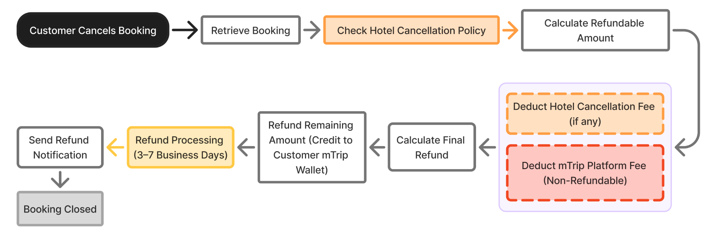

# 取消退款与平台费政策

> [!info] 原文摘录
> 来源：[[mTrip 消费者 App 知识库/08-原始资料/mTrip_ Consumer App PRD_v1.0.8_中文版|mTrip_ Consumer App PRD_v1.0.8_中文版]]，第 1079–1119 行（按导入快照计）。
> 下方保留原文措辞、表格、状态与重复条款，仅调整图片路径；整理标题与关联阅读置于摘录区外。

<!-- PRD_SOURCE_START:1079-1119 -->
### 退款政策与平台手续费透明化

为提升透明度，mTrip 应提供在线退款政策，用户可在预订前后访问该政策。在结算过程中，用户应可访问“什么是平台手续费？”或“便利费”的信息链接，该链接说明退款的计算方式。

退款政策应明确说明：

- 首次预订支付时不收取平台手续费。
- 平台手续费仅在用户发起预订取消时扣除，并遵循平台手续费政策。
- 酒店取消手续费（如适用）由酒店的取消政策确定。

剩余可退金额将退回至用户的 mTrip 钱包。

退款处理通常需要 3–7 个工作日。

可提供退款示例，帮助用户理解退款的计算方式。

上述信息可确保用户在确认预订前了解退款政策，提升整个预订流程的透明度，并有助于减少与退款相关的纠纷。

**图：预订取消流程（含平台手续费）**

### 取消、退款与平台手续费政策

酒店预订在结账时不收取平台手续费，用户仅需支付酒店房费金额。

若预订被取消，系统应根据酒店的取消政策计算可退金额。在处理退款前，系统应扣除适用的平台手续费（便利费）以及酒店取消手续费（如适用）。剩余可退金额随后将退回至用户的 mTrip 钱包。

退款仅退回至 mTrip 钱包，处理时间可能需要 3–7 个工作日。退款完成后，系统将向用户发送通知。

**平台手续费适用情况**

| 场景 | 平台手续费 | 业务规则 |
|---|---|---|
| 预订支付完成（预订生效中） | 0（不收取） | 用户成功完成酒店预订支付时不收取平台手续费。预订在入住、完成或取消之前保持生效状态。 |
| 用户主动取消 | ✅ 收取 | 在退款退回至用户 mTrip 钱包之前，应从可退金额中扣除平台手续费。 |
| 支付超时（预订未确认） | ❌ 不收取 | 若预订因确认前支付超时而自动取消，则不收取平台手续费。 |
| 酒店拒绝 | ❌ 不收取 | 若酒店无法接受或确认该预订，则不收取平台手续费。 |
| 系统预订失败 | ❌ 不收取 | 若预订因系统或技术问题而失败，则不收取平台手续费。 |
| 商户主动取消 | ❌ 不收取 | 若商户或酒店取消已确认的预订，则不收取平台手续费。 |

<!-- PRD_SOURCE_END -->

---

返回：[[mTrip 消费者 App 知识库/00-知识库首页|00-知识库首页]] · [[mTrip 消费者 App 知识库/09-导入记录/原文章节映射|原文章节映射]] · [[00-mTrip 产品知识库|产品知识库总入口]]

## 关联阅读

- [[mTrip 消费者 App 知识库/06-规划与治理/待澄清事项|待澄清事项]]
- [[mTrip 消费者 App 知识库/04-验收标准/验收汇总说明|验收汇总说明]]
