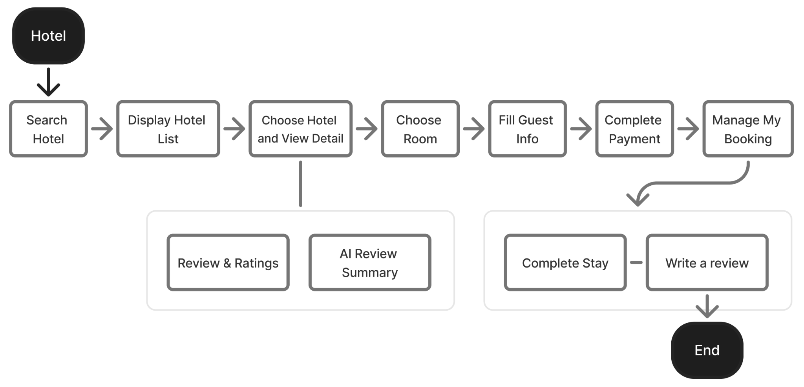
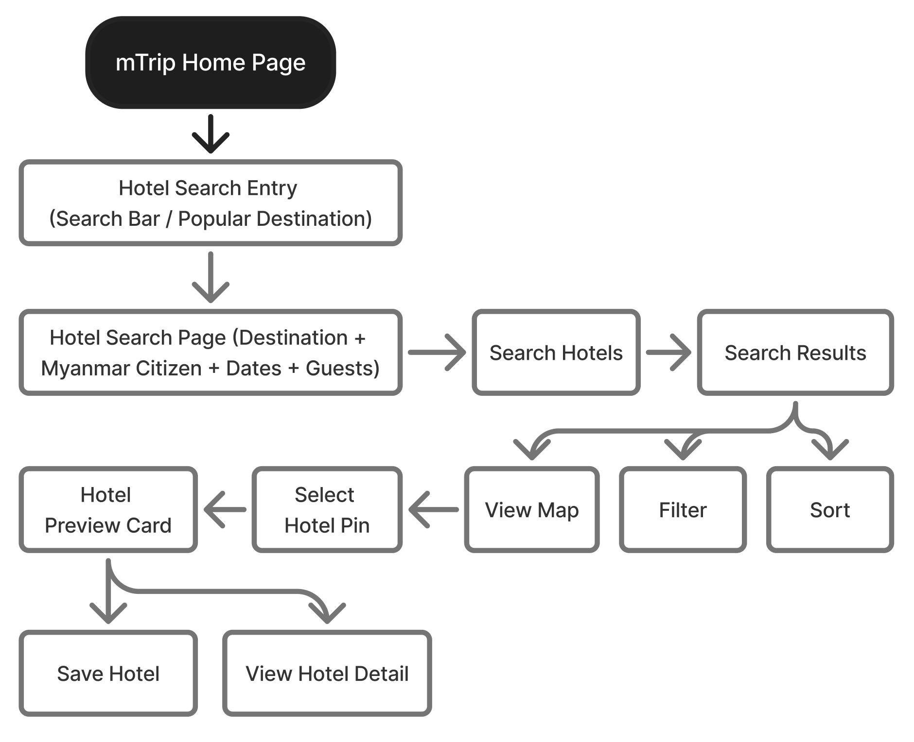
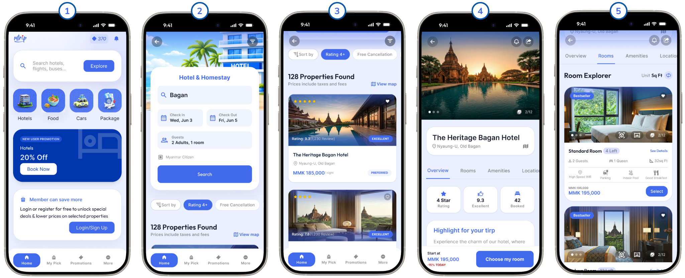
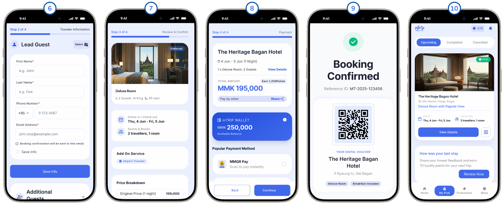

# M01-整体酒店预订旅程与预订生命周期

> [!info] 原文摘录
> 来源：[[mTrip 消费者 App 知识库/08-原始资料/mTrip_ Consumer App PRD_v1.0.9_中文版|mTrip_ Consumer App PRD_v1.0.9_中文版]]，第 67–99 行（按导入快照计）。
> 下方保留原文措辞、表格、状态与重复条款，仅调整图片路径；整理标题与关联阅读置于摘录区外。

<!-- PRD_SOURCE_START:67-99 -->
## 模块 1：酒店预订整体旅程与预订生命周期 + 多酒店预订

**图：端到端酒店预订用户旅程流程（用户端 App）**

**图：端到端酒店搜索与发现流程**

Figma UI：端到端酒店预订流程（界面 1 至 10）

**概要说明**

本指南说明 mTrip 超级 App 中酒店预订的端到端用户流程，涵盖步骤 1 至 10。

- 点击酒店图标进入酒店预订功能。
- 输入目的地、出行日期、住客人数与缅甸公民价格偏好，搜索酒店。
- 根据搜索条件查看酒店列表。
- 选择酒店以查看详细信息。
- 选择偏好的房型。
- 填写本次预订的住客信息。
- 继续操作前核对并确认各项信息。
- 完成支付流程。
- 收到预订确认。
- 进入“我的预订”页面进行预订管理。

在整个流程中，所选的缅甸公民价格偏好始终生效，确保从搜索到预订管理的体验连贯一致。

<!-- PRD_SOURCE_END -->

---

返回：[[mTrip 消费者 App 知识库/00-知识库首页|00-知识库首页]] · [[mTrip 消费者 App 知识库/09-导入记录/原文章节映射|原文章节映射]] · [[00-mTrip 产品知识库|产品知识库总入口]]

## 关联阅读

- [[mTrip 消费者 App 知识库/03-功能模块/M01.1-多酒店预订、添加住宿与模式限制|M01.1-多酒店预订、添加住宿与模式限制]]
- [[mTrip 消费者 App 知识库/06-规划与治理/待澄清事项|待澄清事项]]
- [[mTrip 消费者 App 知识库/04-验收标准/验收汇总说明|验收汇总说明]]
