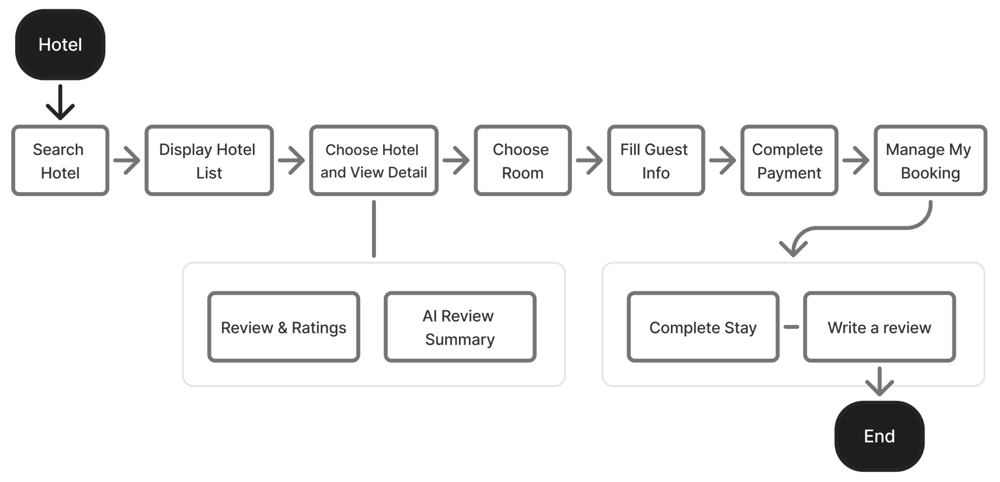
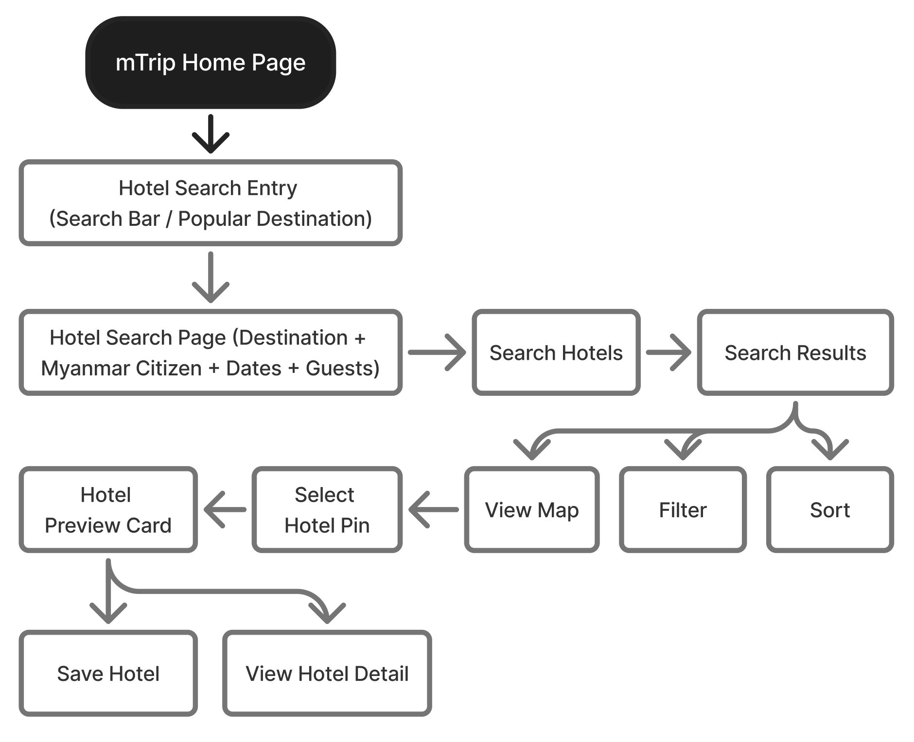
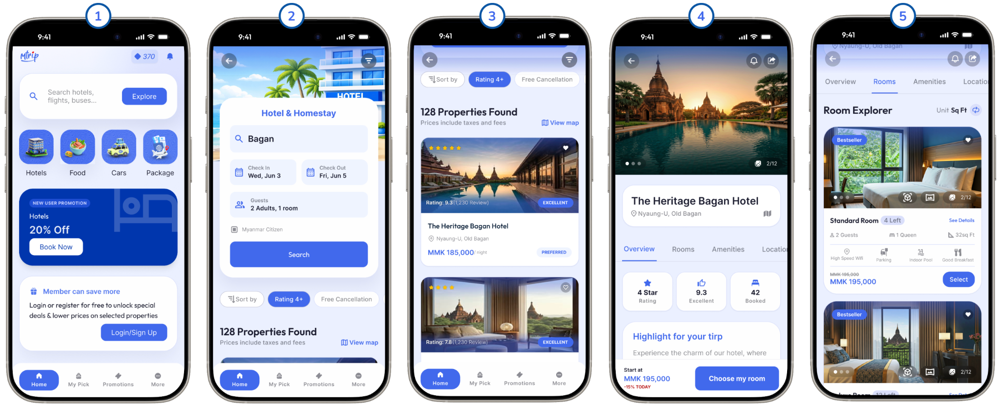
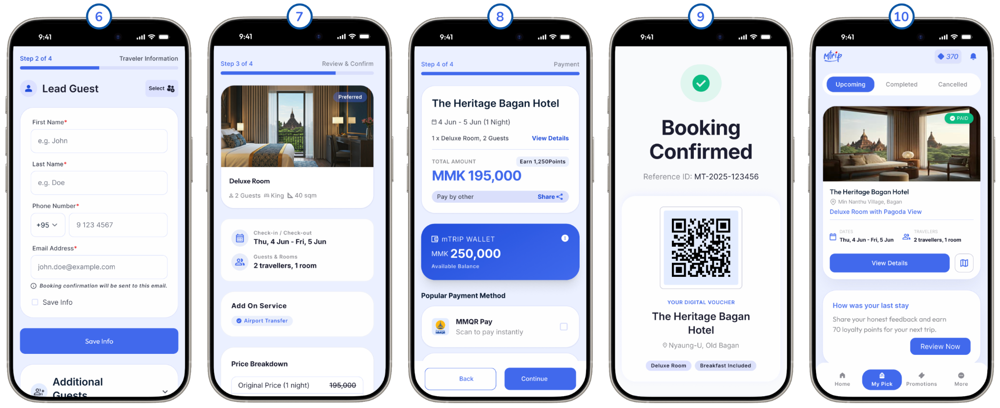

# M01-整体酒店预订旅程与预订生命周期

> [!info] 原文摘录
> 来源：[[mTrip 消费者 App 知识库/08-原始资料/mTrip_ Consumer App PRD_v1.0.6_中文版|mTrip_ Consumer App PRD_v1.0.6_中文版]]，第 202–243 行（按导入快照计）。
> 下方保留原文措辞、表格、状态与重复条款，仅调整图片路径；整理标题与关联阅读置于摘录区外。

<!-- PRD_SOURCE_START:202-243 -->
模块 1：整体酒店预订旅程与预订生命周期 + 多酒店预订

图：端到端酒店预订用户旅程流程（消费者 App）

图：端到端酒店搜索与发现工作流

Figma UI：端到端酒店预订流程（页面 1 至 10）

概要说明

本指南阐述了 mTrip 超级 App 中酒店预订的端到端用户流程，涵盖步骤 1 至 10。

- 点击「酒店」图标以进入酒店预订功能。

- 通过输入目的地、出行日期、住客人数以及缅甸公民价格偏好来搜索酒店。

- 根据搜索条件查看酒店列表。

- 选择一家酒店以查看详细信息。

- 选择您偏好的房型。

- 填写预订的住客信息。

- 在继续之前检查并确认您的信息。

- 完成支付流程。

- 收到预订确认。

- 进入「我的预订」页面进行预订管理。

在整个过程中，所选的缅甸公民价格偏好将始终生效，确保从搜索到预订管理的体验顺畅一致。

<!-- PRD_SOURCE_END -->

---

返回：[[mTrip 消费者 App 知识库/00-知识库首页|00-知识库首页]] · [[mTrip 消费者 App 知识库/09-导入记录/原文章节映射|原文章节映射]] · [[00-mTrip 产品知识库|产品知识库总入口]]

## 关联阅读

- [[mTrip 消费者 App 知识库/03-功能模块/M01.1-多酒店预订、添加住宿与模式限制|M01.1-多酒店预订、添加住宿与模式限制]]
- [[mTrip 消费者 App 知识库/06-规划与治理/待澄清事项|待澄清事项]]
- [[mTrip 消费者 App 知识库/04-验收标准/验收汇总说明|验收汇总说明]]
