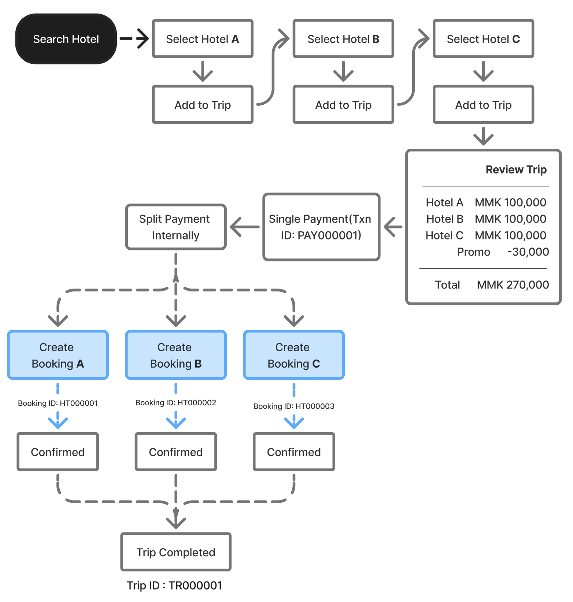

# M01.1-多酒店预订、添加住宿与模式限制

> [!info] 原文摘录
> 来源：[[mTrip 消费者 App 知识库/08-原始资料/mTrip_ Consumer App PRD_v1.0.10_中文版|mTrip_ Consumer App PRD_v1.0.10_中文版]]，第 100–216 行（按导入快照计）。
> 下方保留原文措辞、表格、状态与重复条款，仅调整图片路径；整理标题与关联阅读置于摘录区外。

<!-- PRD_SOURCE_START:100-216 -->
### 模块 1.1：多酒店预订

**多酒店功能：一次结账 → 分别生成预订交易**

**支付倒计时规则（方案 A – 已确认）**

- 用户打开多酒店支付页面时，10 分钟支付倒计时必须立即开始。
- 用户停留在支付页面期间，倒计时必须持续运行。
- 若倒计时在支付完成前归零，系统必须自动将用户跳转至价格复核页面。
- 用户必须重新核对更新后的预订价格与可用房量，然后再继续支付。
- 同一结账会话中，用户刷新或重新进入支付页面时，倒计时不得重新开始。

注：倒计时时长固定为 10 分钟。

**多酒店预订功能说明**

多酒店预订功能允许用户在一次结账中预订位于不同目的地或不同入住时段的多家酒店。用户完成一次支付交易，系统则为每家所选酒店分别创建独立的酒店预订交易。支付完成后，每笔预订独立管理，包括预订确认、修改、取消、退款、结算与预订历史。

注：本功能在开发前需与工程团队进行技术可行性评估。

**多酒店预订功能需求**

| 模块 | 需求 | 业务规则 |
|---|---|---|
| 行程管理 | 系统应创建一个行程 ID，将所选的全部酒店预订归入同一行程。 | 一个行程可包含一笔或多笔酒店预订。 |
| 预订 | 系统应为每笔酒店预订生成唯一的预订编号。 | 每笔预订独立遵循既有的预订生命周期。 |
| 结账 | 用户应对所选全部酒店完成一次结账。 | 支付前，所选全部酒店在同一复核页面展示。 |
| 支付 | 用户应对全部酒店预订进行一次支付。 | 一次支付交易关联一个行程 ID。 |
| 支付成功 | 系统应在支付成功后分别创建各笔酒店预订。 | 仅在支付确认后才开始创建预订。 |
| 预订失败 | 若某笔酒店预订无法确认，该失败预订不得影响已成功创建的预订。 | 仅对失败的那笔预订退款。 |
| 预订管理 | 支付完成后，用户应分别管理各笔酒店预订。 | 可独立查看、修改、取消与跟踪每笔预订。 |
| 促销优惠券 | 系统应允许在结账时使用一张促销优惠券。 | 优惠券折扣应按比例分摊至全部酒店预订。 |
| 折扣分摊 | 系统应存储每笔预订分摊到的折扣金额。 | 用于退款计算、商户结算与报表。 |
| 取消 | 用户可取消单笔酒店预订。 | 取消政策遵循各酒店自身的政策。 |
| 退款 | 仅对已取消的预订处理退款。 | 退款仅退回客户的 mTrip 钱包。 |
| 商户结算 | 商户结算应按每笔预订独立处理。 | 符合条件的预订完成后，按约定的结算周期进行结算。 |
| 佣金 | 平台佣金应按每笔预订单独计算。 | 佣金遵循商户合同。 |
| 通知 | 系统应就每笔酒店预订发送预订确认。 | 支付确认发送一次；预订确认分别发送。 |
| 行程历史 | 用户应可查看同一行程下的全部酒店预订。 | 行程页面展示全部预订状态。 |
| 客户支持 | 支持团队应可按行程 ID 或预订编号搜索预订。 | 各笔预订可独立处理。 |

**多酒店预订的促销优惠券需求**

| 需求 | 说明 |
|---|---|
| 优惠券范围 | 一张优惠券可应用于整个结账。 |
| 分摊方式 | 优惠券折扣应按预订金额比例分摊至全部酒店预订。 |
| 预订金额 | 每笔预订应存储自身的原始金额、折扣金额与最终应付金额。 |
| 退款计算 | 退款金额应基于折扣后的预订金额计算。 |
| 结算 | 商户结算应按促销出资规则使用最终预订金额。 |

**多酒店预订的商户结算需求**

| 需求 | 说明 |
|---|---|
| 结算单位 | 结算按预订编号逐笔处理。 |
| 结算时间 | 预订进入可打款状态后处理结算（以业务政策为准）。 |
| 结算金额 | 结算金额 = 预订金额 − 佣金 − 平台承担的促销（如适用）。 |
| 结算状态 | 每笔预订维护自身的结算状态。 |
| 结算报表 | 财务应按预订与商户生成结算报表。 |

**多酒店预订的退款需求**

| 需求 | 说明 |
|---|---|
| 退款范围 | 退款仅适用于已取消或失败的预订。 |
| 退款方式 | 退款仅退回客户的 mTrip 钱包。 |
| 退款状态 | 每笔预订单独跟踪退款状态。 |
| 部分退款 | 同一行程下的其它酒店预订不受影响。 |

**多酒店预订的预订失败需求**

| 需求 | 说明 |
|---|---|
| 部分成功 | 若其它预订失败，已成功的预订仍保持确认状态。 |
| 失败预订 | 失败预订的状态置为“预订失败”。 |
| 退款 | 系统自动对失败预订的金额发起退款。 |
| 用户通知 | 通知客户哪笔预订失败、哪些预订已成功确认。 |

**多酒店预订的行程管理需求**

| 需求 | 说明 |
|---|---|
| 行程汇总 | 展示同一行程下的全部酒店预订。 |
| 行程时间线 | 按入住时间顺序展示预订。 |
| 预订状态 | 展示每家酒店的预订状态。 |
| 酒店管理 | 用户分别管理每笔酒店预订。 |

**流程图：多酒店预订结账（一次支付 + 分别生成预订）**

**多酒店预订——增加更多住宿**

多酒店预订体验已更新，新增可展开、可收起的“增加更多住宿”卡片，使用户更易在单次预订中管理与添加多段酒店住宿。

用户可添加的住宿数量上限由后台管理端配置控制。例如，若最大住宿数配置为 3 段，则用户在一次预订中最多可添加 3 段住宿。

达到配置的最大住宿数后，“增加更多住宿”选项将被隐藏或置为不可用，以阻止用户继续添加住宿。

若用户移除已添加的一段或多段住宿，“增加更多住宿”选项将重新可用，用户可再次添加住宿，直至达到配置的上限。

流程：酒店预订 → 增加更多住宿 → 展开/收起 → 添加额外住宿

用户可持续添加住宿，直至达到后台管理端配置的最大数量。

**多酒店预订——精简模式限制**

为让需要更简洁界面的用户获得简单、易用的预订体验，多酒店预订已在精简模式下停用。

多酒店预订仅在完整模式下可用。

**模式行为：**

- 精简/简易模式：仅支持单酒店预订
- 完整/标准模式：支持单酒店预订与多酒店预订

<!-- PRD_SOURCE_END -->

---

返回：[[mTrip 消费者 App 知识库/00-知识库首页|00-知识库首页]] · [[mTrip 消费者 App 知识库/09-导入记录/原文章节映射|原文章节映射]] · [[00-mTrip 产品知识库|产品知识库总入口]]

## 关联阅读

- [[mTrip 消费者 App 知识库/03-功能模块/M01-整体酒店预订旅程与预订生命周期|M01-整体酒店预订旅程与预订生命周期]]
- [[mTrip 消费者 App 知识库/06-规划与治理/待澄清事项|待澄清事项]]
- [[mTrip 消费者 App 知识库/04-验收标准/验收汇总说明|验收汇总说明]]
