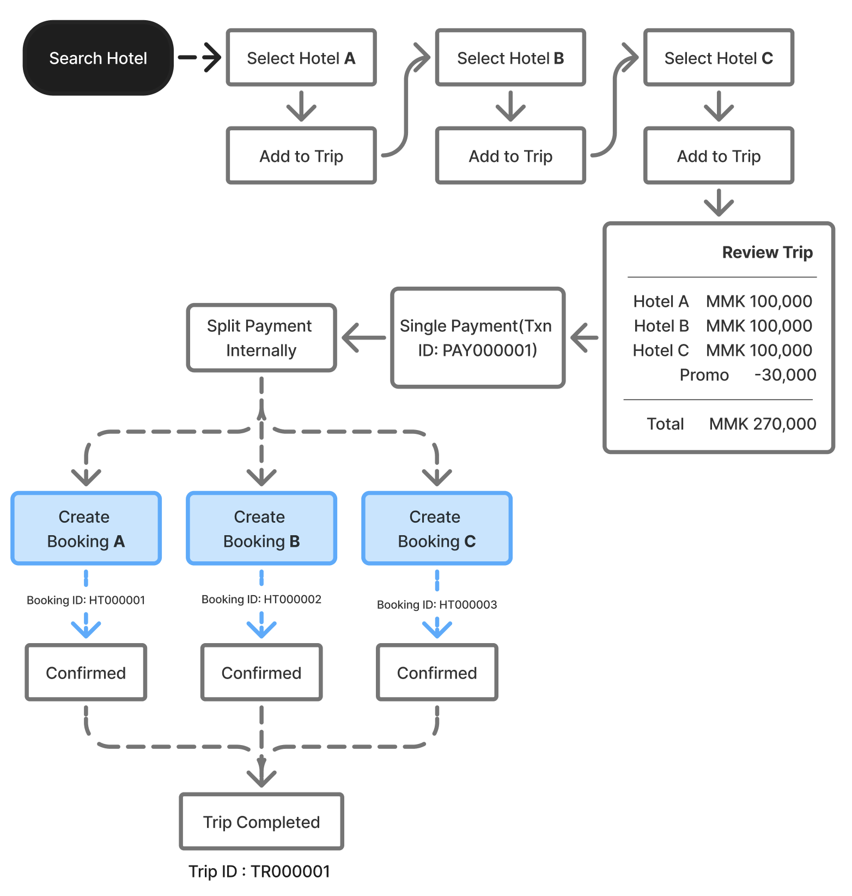

# M01.1-多酒店预订、添加住宿与模式限制

> [!info] 原文摘录
> 来源：[[mTrip 消费者 App 知识库/08-原始资料/mTrip_ Consumer App PRD_v1.0.6_中文版|mTrip_ Consumer App PRD_v1.0.6_中文版]]，第 244–363 行（按导入快照计）。
> 下方保留原文措辞、表格、状态与重复条款，仅调整图片路径；整理标题与关联阅读置于摘录区外。

<!-- PRD_SOURCE_START:244-363 -->
模块 1.1：多酒店预订

多酒店功能：单次结算 → 独立预订交易

#### 多酒店预订功能说明

多酒店预订功能允许用户在一次结算中预订多个不同目的地或不同入住时段的酒店。用户完成一次支付交易，系统则为每家所选酒店创建独立的酒店预订交易。支付完成后，每笔预订独立管理，包括预订确认、修改、取消、退款、结算和预订历史。

注：本功能在开发前需与工程团队进行技术可行性评估。

多酒店预订的功能需求

<!--TABLE_START-->
| 模块 | 需求 | 业务规则 |
|---|---|---|
| 行程管理 | 系统应创建一个 行程 ID，用于归集所有已选酒店预订。 | 一个 行程 可包含一笔或多笔酒店预订。 |
| 预订 | 系统应为每笔酒店预订生成唯一的预订 ID。 | 每笔预订独立遵循现有预订生命周期。 |
| 结算 | 用户应对所有已选酒店完成一次结算。 | 支付前，所有已选酒店在同一个确认页面中展示。 |
| 支付 | 用户应对所有酒店预订进行一次支付。 | 一次支付交易关联一个 行程 ID。 |
| 支付成功 | 系统应在支付成功后创建各笔独立的酒店预订。 | 仅在支付确认后才开始创建预订。 |
| 预订失败 | 若某一笔酒店预订无法确认，失败的预订不应影响已成功创建的预订。 | 仅对失败的预订进行退款。 |
| 预订管理 | 支付后，用户应分别管理每笔酒店预订。 | 独立查看、修改、取消和跟踪每笔预订。 |
| 促销优惠券 | 系统应允许在结算时使用一张促销优惠券。 | 优惠券折扣应按比例分摊至所有酒店预订。 |
| 折扣分摊 | 系统应存储每笔预订所分摊的折扣金额。 | 用于退款计算、商家结算和报表。 |
| 取消 | 用户可取消单笔酒店预订。 | 取消政策遵循各酒店的政策。 |
| 退款 | 仅对已取消的预订处理退款。 | 退款仅退至客户的 mTrip 钱包。 |
| 商家结算 | 商家结算应针对每笔预订独立处理。 | 在符合条件的预订完成后，按约定的结算周期进行结算。 |
| 佣金 | 平台佣金应按每笔预订单独计算。 | 佣金遵循商家合同。 |
| 通知 | 系统应针对每笔酒店预订发送预订确认。 | 支付确认仅发送一次；预订确认分别发送。 |
| 行程历史 | 用户应可查看同一 行程 下的所有酒店预订。 | 行程 页面展示所有预订状态。 |
| 客户支持 | 客服团队应可按 行程 ID 或预订 ID 查询预订。 | 各笔预订可独立处理。 |
<!--TABLE_END-->

多酒店预订的促销优惠券需求

<!--TABLE_START-->
| 需求 | 说明 |
|---|---|
| 优惠券范围 | 整笔结算可使用一张优惠券。 |
| 分摊方式 | 优惠券折扣应按预订金额比例分摊至所有酒店预订。 |
| 预订金额 | 每笔预订应存储各自的原始金额、折扣金额和最终应付金额。 |
| 退款计算 | 退款金额应使用折扣后的预订金额计算。 |
| 结算 | 商家结算应根据促销承担规则使用最终预订金额。 |
<!--TABLE_END-->

多酒店预订的商家结算需求

<!--TABLE_START-->
| 需求 | 说明 |
|---|---|
| 结算单位 | 结算按预订 ID 处理。 |
| 结算时间 | 预订符合打款条件后进行处理（以业务政策为准）。 |
| 结算金额 | 结算金额 = 预订金额 − 佣金 − 平台承担的促销（如适用）。 |
| 结算状态 | 每笔预订维护各自的结算状态。 |
| 结算报表 | 财务应按预订和商家生成结算报表。 |
<!--TABLE_END-->

多酒店预订的退款需求

<!--TABLE_START-->
| 需求 | 说明 |
|---|---|
| 退款范围 | 退款仅适用于已取消或失败的预订。 |
| 退款方式 | 退款应仅退至客户的 mTrip 钱包。 |
| 退款状态 | 每笔预订分别跟踪退款状态。 |
| 部分退款 | 同一 行程 下的其他酒店预订不受影响。 |
<!--TABLE_END-->

多酒店预订的预订失败需求

<!--TABLE_START-->
| 需求 | 描述 |
|---|---|
| 部分成功 | 若另一笔预订失败，成功的预订仍保持确认状态。 |
| 预订失败 | 失败的预订状态设置为「预订失败」。 |
| 退款 | 系统自动针对失败的预订金额发起退款。 |
| 用户通知 | 通知客户哪些预订失败、哪些预订已成功确认。 |
<!--TABLE_END-->

多酒店预订的行程管理需求

<!--TABLE_START-->
| 需求 | 描述 |
|---|---|
| 行程摘要 | 在一个行程下展示所有酒店预订。 |
| 行程时间线 | 按入住时间顺序展示预订。 |
| 预订状态 | 展示每家酒店的预订状态。 |
| 酒店管理 | 用户可单独管理每笔酒店预订。 |
<!--TABLE_END-->

流程图：多酒店预订结算（单次支付 + 分别预订）

#### 多酒店预订 — 添加更多住宿

多酒店预订体验已更新，引入了可展开和折叠的「添加更多住宿」卡片，使用户更轻松地在单次预订中管理并添加多个酒店住宿。

用户可添加的住宿数量上限由管理后台配置控制。例如，若最大住宿数量上限配置为 3 个住宿，则用户可在单次预订中最多添加 3 个住宿。

一旦达到配置的最大住宿数量，「添加更多住宿」选项将被隐藏或禁用，以防止用户添加更多住宿。

若用户删除一个或多个先前添加的住宿，「添加更多住宿」选项将再次可用，允许用户再添加一个住宿，直至达到配置的最大上限。

流程：酒店预订 → 添加更多住宿 → 展开 / 折叠 → 添加额外住宿

用户可以持续添加住宿，直至达到管理后台中配置的最大数量。

#### 多酒店预订 — 轻量模式限制

为保持预订体验对需要更简洁界面的用户而言简单易用，多酒店预订已在轻量模式中禁用。

多酒店预订仅在完整模式中可用。

模式行为：

- 轻量/简易模式：仅支持单酒店预订

- 完整/标准模式：支持单酒店预订和多酒店预订

<!-- PRD_SOURCE_END -->

---

返回：[[mTrip 消费者 App 知识库/00-知识库首页|00-知识库首页]] · [[mTrip 消费者 App 知识库/09-导入记录/原文章节映射|原文章节映射]] · [[00-mTrip 产品知识库|产品知识库总入口]]

## 关联阅读

- [[mTrip 消费者 App 知识库/03-功能模块/M01-整体酒店预订旅程与预订生命周期|M01-整体酒店预订旅程与预订生命周期]]
- [[mTrip 消费者 App 知识库/06-规划与治理/待澄清事项|待澄清事项]]
- [[mTrip 消费者 App 知识库/04-验收标准/验收汇总说明|验收汇总说明]]
