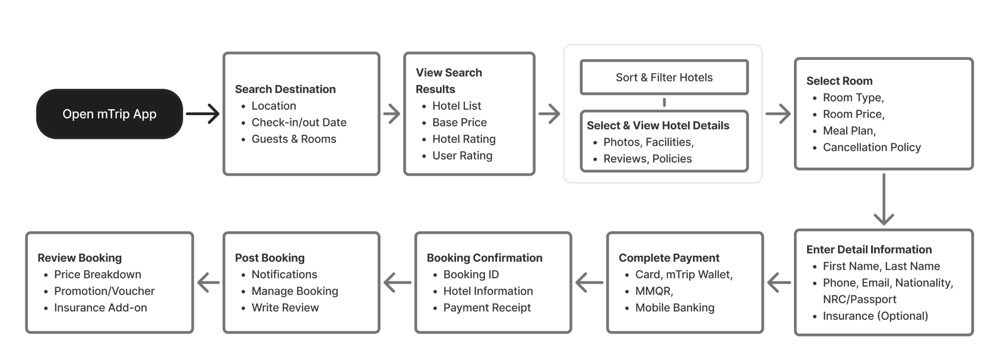

# M02-酒店搜索与发现

> [!info] 原文摘录
> 来源：[[mTrip 消费者 App 知识库/08-原始资料/mTrip_ Consumer App PRD_v1.0.6_中文版|mTrip_ Consumer App PRD_v1.0.6_中文版]]，第 364–401 行（按导入快照计）。
> 下方保留原文措辞、表格、状态与重复条款，仅调整图片路径；整理标题与关联阅读置于摘录区外。

<!-- PRD_SOURCE_START:364-401 -->
#### 模块 2：酒店搜索与发现 + 长住

场景 1：搜索并预订酒店 - 用户旅程流程

搜索 → 发现 → 选择 → 定制 → 结算 → 支付 → 确认 → 预订后

预期结果

用户成功完成酒店预订旅程，收到确认的预订，并可通过 mTrip App 访问预订详情、通知和预订后服务。

表 1：用户体验与互动功能

<!--TABLE_START-->
| 用户功能 | 沟通 |
|---|---|
| • 收藏的酒店 / • 保存的住客信息 / • 用户偏好 / （语言、货币、计量单位） | • 通知 / • 在线客服与客户支持 |
<!--TABLE_END-->

#### 表 2：智能与增长功能（未来路线图）

<!--TABLE_START-->
| 互动 | AI 服务（未来） |
|---|---|
| • 联盟与推荐计划 | • AI 酒店助手 / • AI 评价摘要 |
<!--TABLE_END-->

### 功能需求

<!--TABLE_START-->
| 功能 | 描述 |
|---|---|
| 功能 1： / 酒店发现与预订 | 使用户能够通过无缝的端到端预订旅程搜索、比较和预订酒店，包括酒店搜索、筛选、房型选择、住客信息、价格、支付和预订确认。 |
| 功能 2： / 预订管理与旅行服务 | 允许用户管理预订、接收通知、收藏喜爱的酒店、访问在线客户支持、购买旅行保险，并参与联盟与推荐计划。 |
| 功能 3： / AI 驱动的旅行体验 | 通过 AI 酒店推荐、AI 生成的评价摘要以及 AI 酒店助手帮助用户做出明智的预订决策，从而提升用户体验。 |
<!--TABLE_END-->

<!-- PRD_SOURCE_END -->

---

返回：[[mTrip 消费者 App 知识库/00-知识库首页|00-知识库首页]] · [[mTrip 消费者 App 知识库/09-导入记录/原文章节映射|原文章节映射]] · [[00-mTrip 产品知识库|产品知识库总入口]]

## 关联阅读

- [[mTrip 消费者 App 知识库/03-功能模块/M02.1-长住优惠|M02.1-长住优惠]]
- [[mTrip 消费者 App 知识库/06-规划与治理/待澄清事项|待澄清事项]]
- [[mTrip 消费者 App 知识库/04-验收标准/验收汇总说明|验收汇总说明]]
