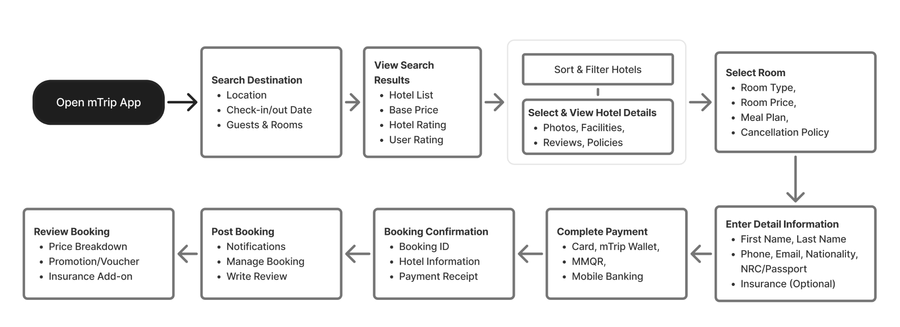

# M02-酒店搜索与发现

> [!info] 原文摘录
> 来源：[[mTrip 消费者 App 知识库/08-原始资料/mTrip_ Consumer App PRD_v1.0.10_中文版|mTrip_ Consumer App PRD_v1.0.10_中文版]]，第 217–248 行（按导入快照计）。
> 下方保留原文措辞、表格、状态与重复条款，仅调整图片路径；整理标题与关联阅读置于摘录区外。

<!-- PRD_SOURCE_START:217-248 -->
## 模块 2：酒店搜索与发现 + 长住

**场景 1：搜索并预订酒店——用户旅程流程**

搜索 → 发现 → 选择 → 定制 → 结账 → 支付 → 确认 → 预订后服务

**预期结果**

用户成功完成酒店预订旅程，收到已确认的预订，并可通过 mTrip App 查看预订详情、通知与预订后服务。

**表 1：用户体验与互动功能**

| 用户功能 | 沟通与支持 |
|---|---|
| 收藏酒店、已保存住客信息、用户偏好（语言、货币、计量单位） | 通知、在线聊天与客户支持 |

**表 2：智能与增长功能（未来规划）**

| 互动 | AI 服务（未来） |
|---|---|
| 联盟与推荐计划 | AI 酒店助手、AI 评价摘要 |

### 功能需求

| 功能 | 说明 |
|---|---|
| 功能 1：酒店搜索与预订 | 支持用户通过完整的端到端预订旅程搜索、比较并预订酒店，涵盖酒店搜索、筛选、房型选择、住客信息、价格、支付与预订确认。 |
| 功能 2：预订管理与旅行服务 | 支持用户管理预订、接收通知、收藏酒店、获取人工客服支持、购买旅行保险，并参与联盟推广与推荐计划。 |
| 功能 3：AI 驱动的旅行体验 | 通过 AI 酒店推荐、AI 生成评价摘要以及 AI 酒店助手提升用户体验，帮助用户做出明智的预订决策。 |

<!-- PRD_SOURCE_END -->

---

返回：[[mTrip 消费者 App 知识库/00-知识库首页|00-知识库首页]] · [[mTrip 消费者 App 知识库/09-导入记录/原文章节映射|原文章节映射]] · [[00-mTrip 产品知识库|产品知识库总入口]]

## 关联阅读

- [[mTrip 消费者 App 知识库/03-功能模块/M02.1-长住优惠|M02.1-长住优惠]]
- [[mTrip 消费者 App 知识库/06-规划与治理/待澄清事项|待澄清事项]]
- [[mTrip 消费者 App 知识库/04-验收标准/验收汇总说明|验收汇总说明]]
