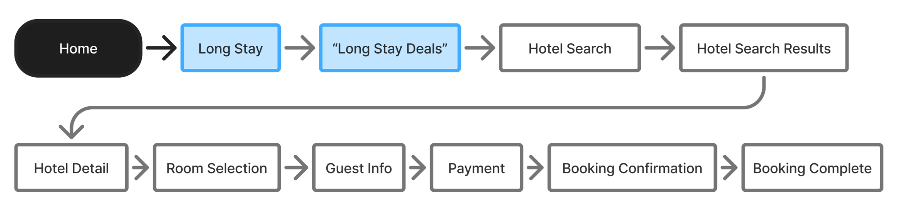

# M02.1-长住优惠

> [!info] 原文摘录
> 来源：[[mTrip 消费者 App 知识库/08-原始资料/mTrip_ Consumer App PRD_v1.0.8_中文版|mTrip_ Consumer App PRD_v1.0.8_中文版]]，第 249–397 行（按导入快照计）。
> 下方保留原文措辞、表格、状态与重复条款，仅调整图片路径；整理标题与关联阅读置于摘录区外。

<!-- PRD_SOURCE_START:249-397 -->
### 模块 2.1：- 长住优惠

**概述**

长住优惠功能使用户能够发现并预订可享长住专属折扣的住宿。与标准酒店预订入口不同，长住以 mTrip 首页上的独立入口形式提供，以提升曝光度并推广长住活动。

预订流程与现有酒店预订流程基本保持一致，用户可在熟悉的预订体验中，根据入住时长自动享受适用的长住折扣。

**目标**

- 通过首页独立入口推广长住住宿。
- 通过展示有吸引力的折扣档位，鼓励用户延长入住天数。
- 复用现有酒店预订流程，降低复杂度。
- 自动计算并应用适用的长住折扣。
- 支持长住专属促销与优惠券。

### “长住优惠” | “长住”入口

mTrip 首页应展示独立的“长住”图标按钮，作为与现有“酒店”入口相分离的独立服务。

选择长住入口后，系统应将用户引导至长住优惠搜索页。

**流程图**

### 核心功能

### 1. 长住入口

系统应在首页提供独立的“长住”图标入口。

该入口应：

- 在视觉上与标准“酒店”服务相区分。
- 将用户引导至长住优惠页面。
- 支持后续接入活动横幅与推广内容。

### 2. 长住优惠搜索页

系统应展示标题为“长住优惠”的独立搜索页。

搜索表单应复用现有酒店搜索体验，包括：

- 目的地
- 入住日期
- 退房日期
- 住客与客房选择
- 缅甸公民选择

### 3. 入住时长校验

用户选择入住日期与退房日期后，系统应自动计算总入住时长。

系统应根据计算出的时长判断该预订是否符合长住优惠条件。

**示例：**

| 入住时长 | 是否符合 |
|---|---|
| 2 晚 | 否 |
| 5 晚 | 否 |
| 7 晚 | 是 |
| 14 晚 | 是 |
| 30 晚 | 是 |

最低可享时长应可通过管理后台配置。

### 4. 长住折扣档位

系统应支持按入住时长配置折扣档位。

**示例配置：**

| 入住时长 | 折扣 |
|---|---|
| 7 晚 | 立减 30% |
| 14 晚 | 立减 35% |
| 30 晚 | 立减 45% |
| 60 晚 | 立减 50% |

系统应自动判定适用的最高档位。

折扣比例与适用时长均应可配置。

### 5. 搜索结果展示

符合条件的酒店应直接在酒店卡片上展示长住优惠信息。

**示例信息：**

- 长住优惠标签
- 立减 XX%
- 原价
- 折扣价
- 共节省

未参与长住优惠的酒店应继续展示其正常价格。

### 6. 酒店详情页

对于符合条件的预订，酒店详情页应展示：

- 长住优惠标签
- 可享折扣比例
- 原价
- 折扣价
- 共节省

### 7. 长住优惠券

系统应支持长住专属优惠券。

符合条件的用户可：

- 领取长住优惠券
- 查看可用的长住优惠券
- 在结账时使用符合条件的优惠券

优惠券校验应遵循现有“促销与优惠券”模块。

### 8. 结账

结账流程应与标准酒店预订流程完全一致。

若该预订符合长住优惠条件，价格摘要应展示：

- 原价
- 长住折扣
- 优惠券折扣（如适用）
- 最终应付金额

所有折扣应在支付前完成计算。

### 9. 长住优惠业务规则

| 规则 | 说明 |
|---|---|
| BR-01 | 长住应通过首页的独立入口进入，即“长住”入口。 |
| BR-02 | 预订流程应复用标准酒店预订流程。 |
| BR-03 | 入住时长应根据入住日期与退房日期自动计算。 |
| BR-04 | 仅当预订满足已配置的最低入住时长时，才应用长住折扣。 |
| BR-05 | 折扣档位应可通过管理后台配置。 |
| BR-06 | 系统应自动应用适用的最高折扣档位。 |
| BR-07 | 长住折扣应在搜索结果、酒店详情页、结账页与预订确认页全程体现。 |
| BR-08 | 长住优惠券应遵循现有优惠券的适用资格与校验规则。 |
| BR-09 | 未配置长住优惠的酒店应继续展示标准价格。 |
| BR-10 | 长住折扣与优惠券是否可叠加或互斥，应依据促销模块中配置的活动规则确定。 |

<!-- PRD_SOURCE_END -->

---

返回：[[mTrip 消费者 App 知识库/00-知识库首页|00-知识库首页]] · [[mTrip 消费者 App 知识库/09-导入记录/原文章节映射|原文章节映射]] · [[00-mTrip 产品知识库|产品知识库总入口]]

## 关联阅读

- [[mTrip 消费者 App 知识库/03-功能模块/M02-酒店搜索与发现|M02-酒店搜索与发现]]
- [[mTrip 消费者 App 知识库/06-规划与治理/待澄清事项|待澄清事项]]
- [[mTrip 消费者 App 知识库/04-验收标准/验收汇总说明|验收汇总说明]]
