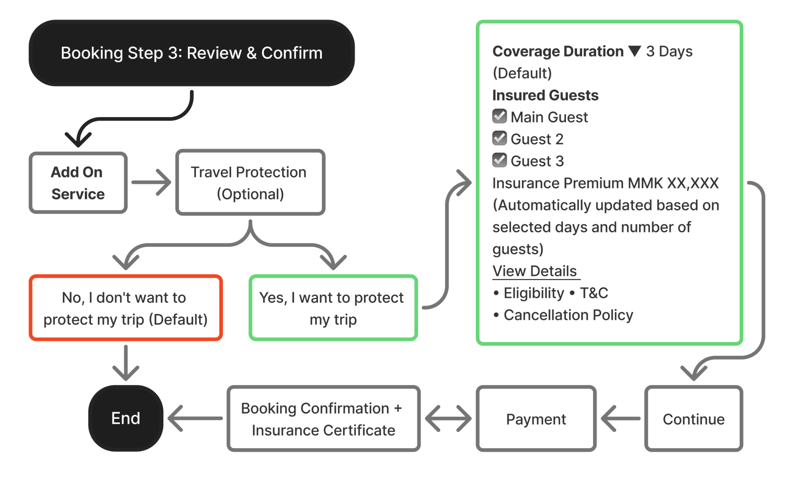

# M06-定价、促销与保险

> [!info] 原文摘录
> 来源：[[mTrip 消费者 App 知识库/08-原始资料/mTrip_ Consumer App PRD_v1.0.10_中文版|mTrip_ Consumer App PRD_v1.0.10_中文版]]，第 513–526 行（按导入快照计）。
> 下方保留原文措辞、表格、状态与重复条款，仅调整图片路径；整理标题与关联阅读置于摘录区外。

<!-- PRD_SOURCE_START:513-526 -->
## 模块 6：价格、促销与保险 + 我的优惠券

**图：mTrip 旅行保险流程（第二阶段 | 不包含在 MVP 首版中）**

**高层级用户旅程流程**

附加服务 → 选择旅行保险 → 选择保障时长与出行人 → 查看保险详情 → 支付 → 预订与保险确认

**预期结果**

mTrip 保险附加功能支持用户在酒店预订过程中购买旅行保险。用户可在添加前查看保障范围、保费与权益。若选择购买，保费会计入总金额，并在预订摘要、支付与确认页面展示。预订完成后，保险会与该订单记录关联，便于后续查询与客服支持。该功能通过提供旅行保障提升用户信心，并通过保险合作创造收入机会。

<!-- PRD_SOURCE_END -->

---

返回：[[mTrip 消费者 App 知识库/00-知识库首页|00-知识库首页]] · [[mTrip 消费者 App 知识库/09-导入记录/原文章节映射|原文章节映射]] · [[00-mTrip 产品知识库|产品知识库总入口]]

## 关联阅读

- [[mTrip 消费者 App 知识库/03-功能模块/M06.1-促销中心与我的优惠券|M06.1-促销中心与我的优惠券]]
- [[mTrip 消费者 App 知识库/06-规划与治理/待澄清事项|待澄清事项]]
- [[mTrip 消费者 App 知识库/04-验收标准/验收汇总说明|验收汇总说明]]
