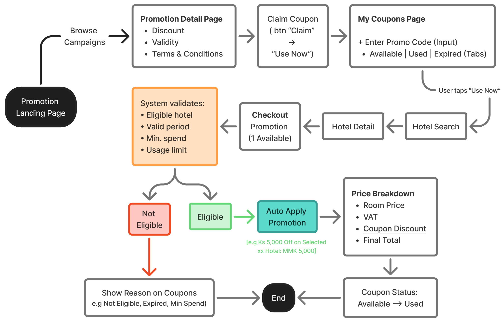

# M07-预订偏好与常旅客信息

> [!info] 原文摘录
> 来源：[[mTrip 消费者 App 知识库/08-原始资料/mTrip_ Consumer App PRD_v1.0.8_中文版|mTrip_ Consumer App PRD_v1.0.8_中文版]]，第 569–665 行（按导入快照计）。
> 下方保留原文措辞、表格、状态与重复条款，仅调整图片路径；整理标题与关联阅读置于摘录区外。

<!-- PRD_SOURCE_START:569-665 -->
## 模块 7：预订偏好与收藏内容 + 轻量模式功能

### 常旅客信息管理

### 功能概述

常旅客信息功能支持用户安全地保存和管理旅客信息，以便在酒店、机票及未来的旅行服务中更快完成预订。用户可手动输入旅客信息，或扫描护照自动填充支持的字段。

### 功能需求

| 模块 | 需求 |
|---|---|
| 功能名称 | 常旅客信息 |
| 位置 | 账户 → 常旅客信息 |
| 说明 | 用户可添加、查看、编辑和删除已保存的旅客资料，用于后续预订。 |

#### 添加旅客

系统应支持用户创建新的旅客资料。

**必填字段**

- 国籍
- 名
- 姓
- 证件类型
    - NRC
    - 护照
    - 其他证件
- 证件号码
- 有效期（适用于护照或相关证件类型）

#### 护照扫描

系统应提供“扫描护照”按钮。

护照扫描成功后，系统应自动填充以下信息：

- 护照号码
- 护照有效期
- 名
- 姓

用户可在保存前手动编辑任何自动填充的信息。

#### 旅客列表

系统应以列表形式展示所有已保存的旅客资料。

每张旅客卡片应展示：

- 全名
- 国籍
- 证件类型
- 证件号码（部分隐藏）

用户可点击旅客卡片查看其详情。

#### 删除旅客

系统应支持两种删除旅客资料的方式。

##### 方式 1 — 滑动删除

- 用户向左滑动旅客卡片。
- 显示“删除”操作。
- 用户点击“删除”。
- 旅客资料被永久删除。
- 展示 toast 提示：

**已删除**

- 旅客卡片从列表中移除。

##### 方式 2 — 在详情页删除

- 用户打开某个旅客资料。
- 滚动至页面底部。
- 点击“删除旅客”。
- 系统删除该旅客资料。
- Toast 提示：

**已删除**

- 用户返回旅客列表。
- 已删除的旅客不再显示。

### 业务规则

- 用户可保存多个旅客资料。
- 旅客信息在用户账户内安全存储。
- 护照扫描为可选项。
- 自动填充的信息可在保存前编辑。
- 已删除的旅客资料无法恢复。

<!-- PRD_SOURCE_END -->

---

返回：[[mTrip 消费者 App 知识库/00-知识库首页|00-知识库首页]] · [[mTrip 消费者 App 知识库/09-导入记录/原文章节映射|原文章节映射]] · [[00-mTrip 产品知识库|产品知识库总入口]]

## 关联阅读

- [[mTrip 消费者 App 知识库/03-功能模块/M07.3-轻量模式|M07.3-轻量模式]]
- [[mTrip 消费者 App 知识库/03-功能模块/M07.2-收藏的酒店|M07.2-收藏的酒店]]
- [[mTrip 消费者 App 知识库/06-规划与治理/待澄清事项|待澄清事项]]
- [[mTrip 消费者 App 知识库/04-验收标准/验收汇总说明|验收汇总说明]]
