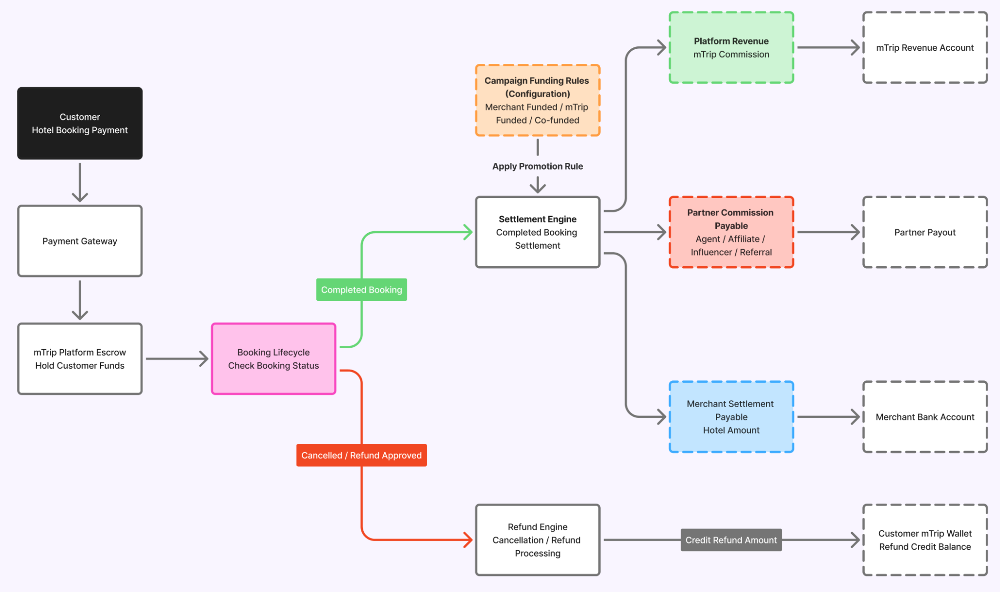
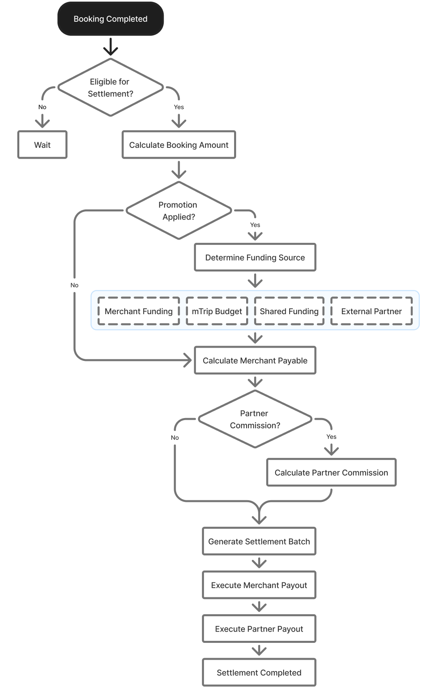

# M08-支付、活动出资与结算

> [!info] 原文摘录
> 来源：[[mTrip 消费者 App 知识库/08-原始资料/mTrip_ Consumer App PRD_v1.0.9_中文版|mTrip_ Consumer App PRD_v1.0.9_中文版]]，第 734–860 行（按导入快照计）。
> 下方保留原文措辞、表格、状态与重复条款，仅调整图片路径；整理标题与关联阅读置于摘录区外。

<!-- PRD_SOURCE_START:734-860 -->
## 模块 8：支付（结算）

### 概述

活动费用承担与结算流程使 mTrip 能够高效追踪和分摊促销成本。优惠券成功核销后会自动更新活动预算，并为财务和商户准备结算数据，确保信息清晰可见并简化财务对账。

酒店预订功能整合了支付、促销与结算流程，应用适用的促销、处理支付，并为商户准备结算数据。它在保持记录准确的同时，支持实时预算追踪与自动化成本分摊，从而为用户带来顺畅的预订体验。

**mTrip 活动费用记录示例**

| 预订编号 | 活动 | 折扣（MMK） | mTrip 承担 | 商户承担 | 合作方承担 | 状态 |
|---|---|---|---|---|---|---|
| BK10001 | 新用户活动 | 20,000 | 20,000 | 0 | 0 | 已完成 |
| BK10015 | 夏季促销 | 30,000 | 15,000 | 15,000 | 0 | 已完成 |
| BK10032 | 酒店周 | 40,000 | 0 | 40,000 | 0 | 已完成 |
| BK10058 | 银行合作方促销 | 50,000 | 0 | 0 | 50,000 | 已完成 |

**结算架构图（系统架构）**

### 高层说明

预订完成后，结算引擎会应用促销费用承担规则，将资金分配到平台佣金、合作方应付佣金和商户应付结算账户，同时由退款引擎处理取消与退款。

**结算决策流程（业务规则）**

**财务结算矩阵**

| 场景 | 用户支付 | 酒店结算 | mTrip 佣金 | 用户退款 |
|---|---|---|---|---|
| 酒店预订成功 | 酒店预订金额 | 酒店金额 − 佣金（如 MMK 50,000 − 10%） | 按商户协议扣除佣金（如 10%） | 不适用 |
| 用户取消（免费取消） | 已支付 | 不结算 | 无佣金 | 100% 退款至 mTrip 钱包 |
| 用户取消（部分可退） | 已支付 | 按酒店取消政策结算 | 按商户协议收取佣金 | 部分退款至 mTrip 钱包 |
| 用户取消（不可退） | 已支付 | 按酒店取消政策结算 | 按商户协议保留佣金 | 不退款 |
| 酒店取消预订 | 已支付 | 不结算 | 无佣金 | 100% 退款至 mTrip 钱包 |
| 支付失败 | 支付未成功 | 不结算 | 无佣金 | 不收取费用 |

### 8.3 退款结算矩阵

| 场景 | 退款金额 | 退款方式 | 结算处理 |
|---|---|---|---|
| 用户取消（免费取消） | 100% | mTrip 钱包 | 不向酒店商户结算 |
| 用户取消（部分可退） | 按酒店取消政策 | mTrip 钱包 | 按可退金额调整结算 |
| 用户取消（不可退） | 不退款 | 不适用 | 酒店结算按商户协议进行 |
| 酒店取消预订 | 100% | mTrip 钱包 | 取消酒店结算 |
| 支付失败 | 100%（如已扣款）或不收取费用 | 原支付渠道冲正或自动撤销 | 不结算 |

### 业务规则

- 用户就酒店预订向 mTrip 一次性付款。
- mTrip 在向酒店商户结算剩余金额前扣除约定佣金。
- 商户结算按配置的结算周期处理（如每周、每两周或每月）。
- 酒店结算仅在住客退房后、预订已完成的情况下处理。
- 退款资格遵循酒店的取消政策。
- 所有已批准的退款均退回用户的 mTrip 钱包。
- 全额退款的已取消预订不计入商户结算。
- 应为财务和酒店商户生成结算报告，用于对账。
- 每个酒店商户应拥有可通过管理后台独立配置的结算周期。
- 系统应支持不同酒店商户采用不同的结算周期（如每日、每周、每两周、每月或指定结算日期）。
- 结算引擎应按每个商户配置的结算计划自动处理结算，且不影响其他商户。
- 结算批次应依据每个商户配置的结算周期，对符合条件的预订交易进行分组。
- 系统应为每笔财务交易维护会计分录，包括预订付款、佣金、商户应付款、结算打款、退款、调整、税费、手续费及促销交易。
- 促销相关交易应记录促销费用承担方（如商户承担、mTrip 承担、共担或合作方承担），以确保结算与会计处理准确。
- 应用促销时，系统应在确定商户最终结算金额前，按配置的费用承担责任自动计算并分摊促销成本。
- 每笔财务交易均应生成可审计的会计记录，以支持对账、财务报告和审计。
- 系统应为每笔预订交易维护完整的审计轨迹，涵盖结算计算、调整、打款状态、促销费用承担及会计历史。
- 结算引擎应基于配置的佣金与结算规则，支持多个收款方（如酒店商户、代理商、联盟推广或外部合作方）。

**结算业务场景**

**场景 1 – 预订成功（共担促销）**

| 参与方 / 余额 | 借方（-） | 贷方（+） | 余额 / 结果 | 备注 |
|---|---|---|---|---|
| 用户 | 950,000 | - | -950,000 | 用户支付 |
| 平台托管账户 | - | 950,000 | +950,000 | 持有用户付款 |
| 商户应付结算 | 875,000 | - | 应付 875,000 | 酒店在扣除佣金和商户承担的促销后收到款项 |
| 平台收入 | - | 75,000 | +75,000 | 10% 佣金（100,000）− 25,000 mTrip 促销承担 |
| 合作方应付佣金 | 30,000 | - | 应付 30,000 | 从 mTrip 收入中支付 3% 代理佣金 |
| 商户活动承担 | 25,000 | - | 商户补贴 | 商户承担的促销 |
| mTrip 活动费用 | 25,000 | - | 营销费用 | mTrip 承担的促销 |

**场景 2：客户在结算前取消**

| 相关方 / 余额 | 借方 (-) | 贷方 (+) | 备注 |
|---|---|---|---|
| 平台托管账户 | 950,000 | - | 冲销托管 |
| 客户钱包 | - | 950,000 | 退款至 mTrip 钱包 |
| 商户结算 | 0 | 0 | 无结算 |
| 平台收入 | 0 | 0 | 未确认收入 |
| 合作方佣金 | 0 | 0 | 无佣金 |
| 活动预算 | 视业务规则而定 | 通常不消耗 |  |

**场景 3：商户承担促销**

促销 = 100,000 MMK

| 相关方 | 影响 |
|---|---|
| 客户 | 支付 900,000 |
| 商户 | 促销成本 100,000 |
| mTrip | 仍获得 100,000 佣金 |
| 代理 | 获得 30,000 |
| 商户实收 | 800,000 |

**场景 4：mTrip 承担促销**

促销 = 100,000 MMK

| 相关方 | 影响 |
|---|---|
| 客户 | 支付 900,000 |
| 商户 | 收到 900,000 |
| mTrip | 佣金 100,000 - 促销 100,000 = 0 |
| 代理 | 30,000（如仍适用） |
| 市场 | 支出 100,000 |

**场景 5：推荐奖励（50,000 MMK 钱包余额）**

| 相关方 | 借方 (-) | 贷方 (+) | 备注 |
|---|---|---|---|
| mTrip 市场 / 奖励预算 | 50,000 | - | 推荐活动支出 |
| 客户钱包 | - | 50,000 | 预订成功后发放钱包余额 |

<!-- PRD_SOURCE_END -->

---

返回：[[mTrip 消费者 App 知识库/00-知识库首页|00-知识库首页]] · [[mTrip 消费者 App 知识库/09-导入记录/原文章节映射|原文章节映射]] · [[00-mTrip 产品知识库|产品知识库总入口]]

## 关联阅读

- [[mTrip 消费者 App 知识库/06-规划与治理/待澄清事项|待澄清事项]]
- [[mTrip 消费者 App 知识库/04-验收标准/验收汇总说明|验收汇总说明]]
