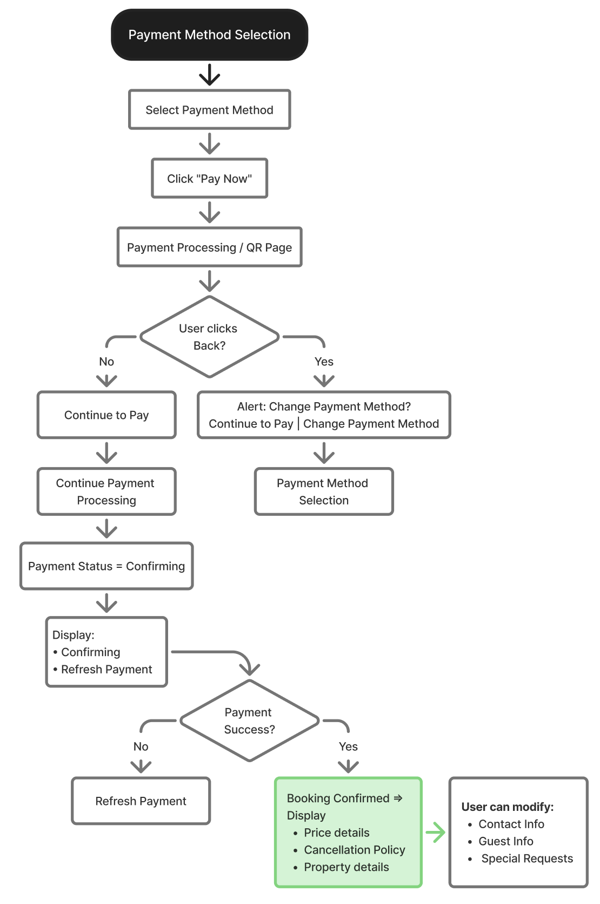
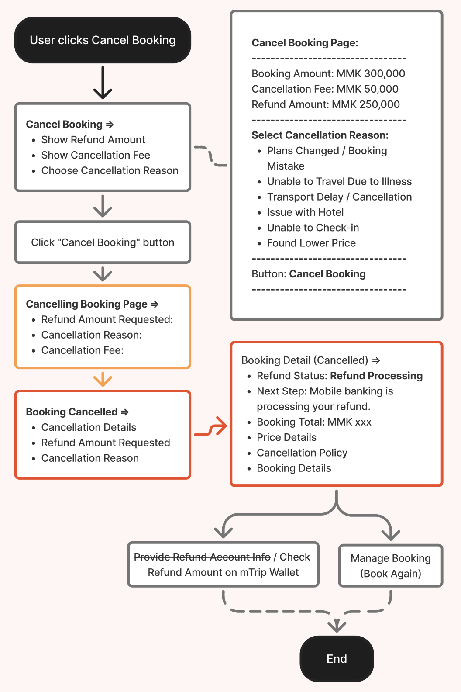
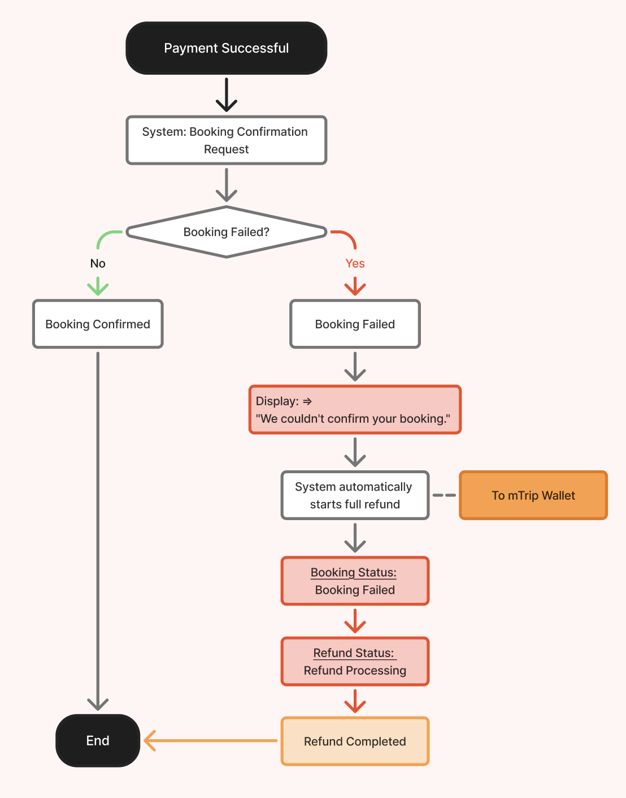
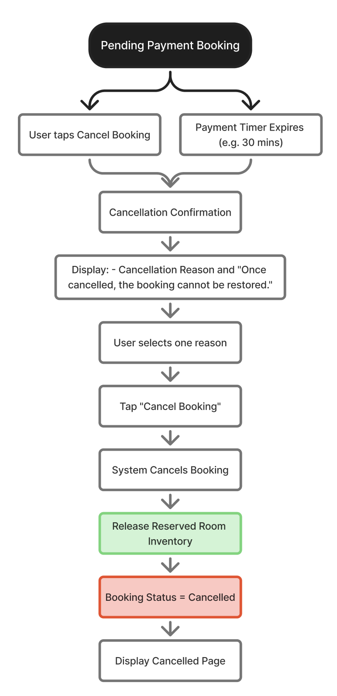

# M09-预订确认、管理与异常取消

> [!info] 原文摘录
> 来源：[[mTrip 消费者 App 知识库/08-原始资料/mTrip_ Consumer App PRD_v1.0.8_中文版|mTrip_ Consumer App PRD_v1.0.8_中文版]]，第 861–976 行（按导入快照计）。
> 下方保留原文措辞、表格、状态与重复条款，仅调整图片路径；整理标题与关联阅读置于摘录区外。

<!-- PRD_SOURCE_START:861-976 -->
## 模块 9：预订确认与预订管理

**图示：No. 1 完成支付并确认预订流程**

**预期结果**

用户在选定支付方式后发起支付流程。若支付仍在处理中用户点击“返回”按钮，系统应显示确认对话框，询问用户是继续支付还是更换支付方式。

- 若用户选择“继续支付”，支付处理继续进行，系统检查支付状态直至完成。
- 若用户选择“更换支付方式”，用户将被跳转至“支付方式选择”页面，选择其他支付方式并重新发起支付流程。

支付成功完成后，系统显示“预订确认”页面。预订确认后，用户仍可更新联系人信息、住客信息与特殊需求，但须遵循酒店的修改政策。

**核心业务规则**

**支付**

- 用户必须在点击“立即支付”前选择一种支付方式。
- 支付处理过程中，用户可返回并更换支付方式。
- 在支付网关确认交易前，支付状态保持为“确认中”。
- 用户可手动刷新支付状态。

**预订确认**

- 支付成功后，预订状态变更为“已确认”。
- 系统向注册邮箱发送预订确认。
- 用户可重新发送确认邮件。
- 预订确认后仅可修改联系人信息、住客信息与特殊需求（须遵循酒店政策）。

**图示：No. 1.1 预订取消旅程**

整体流程：支付 → 确认 → 取消 → 退款

**酒店预订取消**

取消资格依据酒店的取消政策确定。

取消页面显示：

- 取消手续费
- 退款金额
- 取消原因

用户必须在确认前选择一项取消原因。

### 退款

- 取消后，预订状态变更为“已取消”。
- 系统发起退款请求。
- 预订详情页面显示：
    - 退款状态（例如：退款处理中）
    - 下一步
    - 预订总额
    - 价格明细
    - 取消政策
    - 预订详情
- 用户仅可将退款退至其 mTrip 钱包账户。

**图示：Case No. 2（异常场景），商户导致预订确认失败的流程**

整体流程：支付成功 → 预订确认失败（由酒店 / 商户）

**异常处理——酒店无法履约**

**总体说明**

本场景描述当酒店因运营或不可预见情况无法履行已确认预订时，系统如何处理。由于此类事件较少见且通常需要人工协调，因此按异常流程管理，而非标准用户预订流程。

**可能的原因**

- 酒店超售
- 客房不可用
- 酒店维修或临时关闭
- 不可抗力（例如：自然灾害、政府限制）
- 酒店运营问题
- 供应商发起的取消

**业务规则**

- 当已确认预订无法履约时，酒店或供应商必须通知 mTrip。
- 商户运营或客户支持团队审核并核实取消请求。
- 系统应立即通过推送通知、邮件与 App 内通知告知用户。
- 客户支持可在可用房量与业务政策允许的前提下协助用户寻找替代酒店。
- 若无法安排替代预订或用户拒绝接受，该预订将被取消，并全额退款。
- 对于酒店发起的取消，不得向用户收取任何取消手续费。
- 退款将遵循标准退款处理流程与状态跟踪。
- 所有取消操作均应记录在预订历史中，以供审计。

**预期结果**

当酒店无法履行已确认预订时，用户会及时获知。商户运营团队协调解决方案：尽可能协助安排替代预订，若无合适的替代方案则发起全额退款。预订状态、退款状态与沟通记录均会更新，以确保透明度，并为用户与支持团队提供完整的跟踪。

**图示：Case No. 3 ~ 取消待支付预订（到店支付）**

待支付 → 取消 / 超时

### 预期结果

若用户在支付完成前点击“取消预订”，或支付倒计时结束，该待支付预订将被取消。

取消预订时，用户需选择取消原因并点击“取消预订”按钮。由于尚未完成支付，系统随后取消该待支付预订。

取消成功后，系统将：

- 将预订状态更新为“已取消”。
- 自动将临时占用的房量库存释放回酒店的可用房量。
- 显示“预订已取消”页面，包含取消详情与“再次预订”按钮，用户可据此返回酒店详情页并按需创建新预订。

<!-- PRD_SOURCE_END -->

---

返回：[[mTrip 消费者 App 知识库/00-知识库首页|00-知识库首页]] · [[mTrip 消费者 App 知识库/09-导入记录/原文章节映射|原文章节映射]] · [[00-mTrip 产品知识库|产品知识库总入口]]

## 关联阅读

- [[mTrip 消费者 App 知识库/06-规划与治理/待澄清事项|待澄清事项]]
- [[mTrip 消费者 App 知识库/04-验收标准/验收汇总说明|验收汇总说明]]
