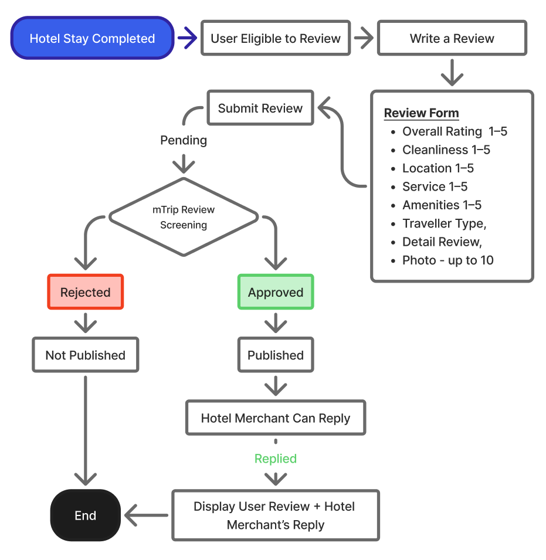

# M11-评价、评分与 AI 评价摘要

> [!info] 原文摘录
> 来源：[[mTrip 消费者 App 知识库/08-原始资料/mTrip_ Consumer App PRD_v1.0.10_中文版|mTrip_ Consumer App PRD_v1.0.10_中文版]]，第 1253–1367 行（按导入快照计）。
> 下方保留原文措辞、表格、状态与重复条款，仅调整图片路径；整理标题与关联阅读置于摘录区外。

<!-- PRD_SOURCE_START:1253-1367 -->
## 模块 11：评价、评分与 AI 评价摘要

### 高层说明

用户可在完成酒店住宿后提交评价与评分。评价包括总体评分、清洁度、位置、服务与设施四项分类评分、旅客类型、文字评价内容，以及最多 10 张照片。

旅客类型：

- 独自出行
- 情侣
- 家庭
- 朋友
- 商务出行

评价须经 mTrip 管理员批准后方可发布。

酒店商户仅可回复已发布的评价。

**用户评价与评分流程图**

**评价与评分权限矩阵表**

| 操作方 | 可提交 | 可批准/驳回 | 可编辑 | 可回复 | 可删除 |
|---|---|---|---|---|---|
| 用户 | ✅ | — | ❌ | ❌ | ❌ |
| mTrip 管理员 | — | ✅ | ❌ | — | ✅ |
| 酒店商户 | — | ❌ | ❌ | ✅ | ❌ |

**酒店评分与标签标准**

| 分数区间 | 展示标签 | 标准 / 含义 |
|---|---|---|
| 9.0–10.0 | 卓越 | 出色的体验 |
| 8.0–8.9 | 优秀 | 优秀的体验 |
| 7.0–7.9 | 很好 | 很好的体验 |
| 6.0–6.9 | 良好 | 总体良好的体验 |
| 5.0–5.9 | 一般 | 可接受的体验 |
| 4.0–4.9 | 低于平均 | 低于预期标准 |
| 3.0–3.9 | 较差 | 存在多项问题 |
| 2.0–2.9 | 很差 | 存在严重问题 |
| 1.0–1.9 | 极差 | 体验极差 |

展示标签 = 根据最终总体评分所在区间分配的标签。

无已批准评价时：不显示数值评分，改为显示“新 · 暂无评价”。

评分仅根据已批准并已发布的评价计算。

**评价评分计算**

每位用户使用 5 个评分维度对酒店进行评分，每个维度分值为 1 至 5 分。

| 维度 | 分值范围 |
|---|---|
| 总体 | 1–5 |
| 清洁度 | 1–5 |
| 位置 | 1–5 |
| 服务 | 1–5 |
| 设施 | 1–5 |
| 最高总分 | 25 |

**计算每位用户的评价得分**

系统将该用户在全部 5 个维度的评分相加。

公式：用户评价得分 =（维度总分 ÷ 25）× 10

计算结果由 5 分制维度评分转换为 10 分制评价得分。

示例：

| 维度 | 用户评分 |
|---|---|
| 总体 | 5 |
| 清洁度 | 4 |
| 位置 | 5 |
| 服务 | 4 |
| 设施 | 4 |
| 合计 | 22 / 25 |

计算：（22 ÷ 25）× 10 = 8.8

因此，该用户的评价得分为 8.8 / 10。

**计算酒店总体评分**

酒店总体评分按全部已批准用户评价得分的平均值计算。

公式：酒店总体评分 = 全部用户评价得分之和 ÷ 已批准评价数量

示例：

| 用户 | 用户评价得分 |
|---|---|
| 用户 1 | 8.8 |
| 用户 2 | 9.2 |
| 用户 3 | 7.6 |
| 用户 4 | 8.4 |

计算：（8.8 + 9.2 + 7.6 + 8.4）÷ 4 = 8.5

因此：酒店总体评分 = 8.5 / 10

酒店评分显示保留 1 位小数。

**酒店评分的评价适用范围**

- 仅已批准并已发布的评价计入酒店评分计算。
- 已驳回、未发布或已删除的评价不计入。
- 若酒店没有已批准的评价，不显示数值评分，改为显示“新 · 暂无评价”。
- 首条已批准评价发布后，酒店评分使用该条评价计算。
- 每当新的已批准评价发布或现有已批准评价被移除时，酒店评分将重新计算。

<!-- PRD_SOURCE_END -->

---

返回：[[mTrip 消费者 App 知识库/00-知识库首页|00-知识库首页]] · [[mTrip 消费者 App 知识库/09-导入记录/原文章节映射|原文章节映射]] · [[00-mTrip 产品知识库|产品知识库总入口]]

## 关联阅读

- [[mTrip 消费者 App 知识库/06-规划与治理/待澄清事项|待澄清事项]]
- [[mTrip 消费者 App 知识库/04-验收标准/验收汇总说明|验收汇总说明]]
