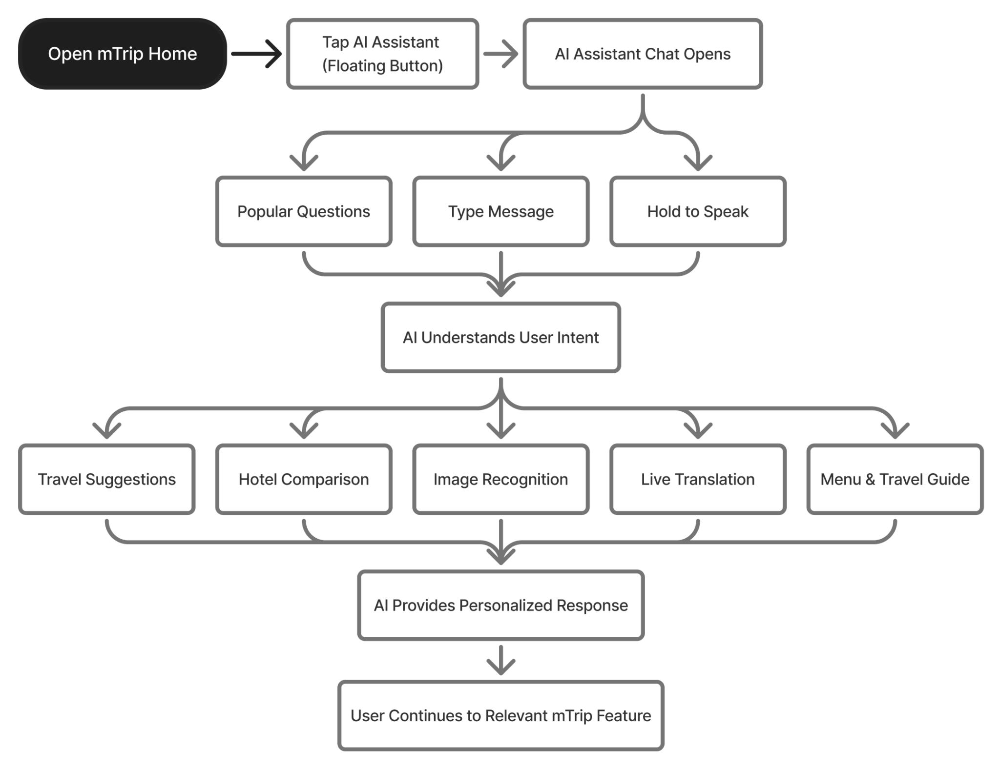

# M12-AI 酒店助手（阶段2）

> [!info] 原文摘录
> 来源：[[mTrip 消费者 App 知识库/08-原始资料/mTrip_ Consumer App PRD_v1.0.8_中文版|mTrip_ Consumer App PRD_v1.0.8_中文版]]，第 1235–1248 行（按导入快照计）。
> 下方保留原文措辞、表格、状态与重复条款，仅调整图片路径；整理标题与关联阅读置于摘录区外。

<!-- PRD_SOURCE_START:1235-1248 -->
## 模块 12：AI 酒店助手（第二阶段 | 不包含在首个版本中）

**图 3：AI 助手用户旅程**

### 高层旅程

启动 AI → 提问或选择问题 → AI 理解意图 → AI 提供协助 → 继续进入相关服务

### 预期成果

用户可与 mTrip AI 助手成功交互，获取个性化旅行推荐、比较酒店、翻译语言、识别图像并获得智能旅行协助，从而顺畅地在 mTrip 各项服务之间流转。

<!-- PRD_SOURCE_END -->

---

返回：[[mTrip 消费者 App 知识库/00-知识库首页|00-知识库首页]] · [[mTrip 消费者 App 知识库/09-导入记录/原文章节映射|原文章节映射]] · [[00-mTrip 产品知识库|产品知识库总入口]]

## 关联阅读

- [[mTrip 消费者 App 知识库/06-规划与治理/待澄清事项|待澄清事项]]
- [[mTrip 消费者 App 知识库/04-验收标准/验收汇总说明|验收汇总说明]]
