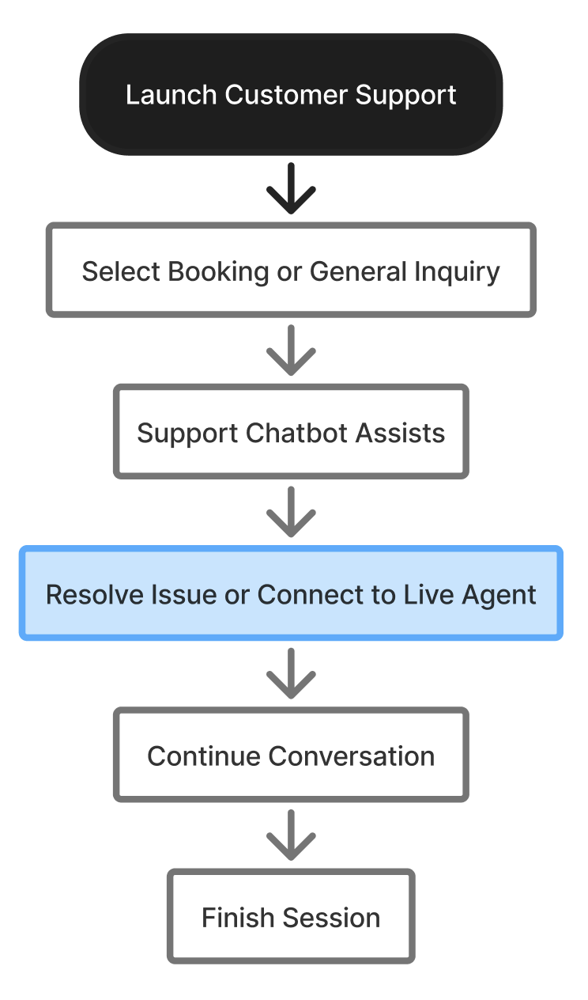

# M13-在线客服与客户支持

> [!info] 原文摘录
> 来源：[[mTrip 消费者 App 知识库/08-原始资料/mTrip_ Consumer App PRD_v1.0.9_中文版|mTrip_ Consumer App PRD_v1.0.9_中文版]]，第 1246–1302 行（按导入快照计）。
> 下方保留原文措辞、表格、状态与重复条款，仅调整图片路径；整理标题与关联阅读置于摘录区外。

<!-- PRD_SOURCE_START:1246-1302 -->
## 模块 13：在线聊天与客户支持

### 概述

客户支持聊天模块为入住前、入住期间和入住后的酒店预订咨询提供快速帮助。该模块以聊天机器人/AI 助手处理常见问题为起点。若问题未解决，用户可连接人工客服。聊天会话保持活跃，并可从“消息”中恢复。

**mTrip 支持聊天 – 入口**

用户可通过以下入口进入 mTrip 支持聊天：

- 酒店预订详情页：点击“在线支持聊天”按钮，打开 mTrip 支持聊天，获取与预订相关的协助。
- 首页：点击标有“与我们聊天”的悬浮聊天气泡，打开 mTrip 支持聊天。
- 更多 → 联系我们：点击“与 mTrip 聊天”，打开 mTrip 支持聊天。

### 目标

- 为常见预订咨询提供快速的自助支持。
- 通过自动回复减少客户支持工作量。
- 使用户能够快速获取与具体预订相关的支持。
- 提供向人工客服的顺畅升级。
- 保留聊天记录，支持持续会话。

**高层用户旅程**

**客户支持模块的功能需求**

| 功能 | 需求 |
|---|---|
| 欢迎页 | 打开支持聊天时显示欢迎消息。 |
| 预订选择 | 允许用户选择当前或历史预订，以获取与上下文相关的支持。 |
| 一般咨询 | 允许用户在不选择预订的情况下发起支持会话。 |
| 推荐问题 | 显示与所选预订或一般咨询相关的预置常见问题。 |
| 聊天机器人 | 为常见客户支持问题提供自动回复。 |
| 人工客服 | 在需要额外协助时，允许用户连接人工客服。 |
| 聊天记录 | 保存聊天记录，并允许用户继续之前的会话。 |
| 结束会话 | 允许用户结束当前支持会话。 |
| 反馈 | 允许用户在会话结束后对支持体验进行评分。 |
| 最近浏览的酒店 | 在支持过程中显示最近浏览的酒店，便于快速参考。 |

**人工客服升级**

用户可随时通过选择“联系客户支持”连接人工客服。系统在以下情形还应建议升级：

- 聊天机器人无法回答用户的问题。
- 用户要求与客服人员通话。
- 咨询涉及支付争议、投诉或特殊请求。
- 需要人工介入才能解决问题。

**会话管理**

- 用户退出聊天页面后，聊天会话应保持活跃。
- 用户可在“消息”中继续之前的会话。
- 用户登录后，全部聊天记录应在各设备间同步。
- 用户可随时选择“结束会话”来结束支持会话。

<!-- PRD_SOURCE_END -->

---

返回：[[mTrip 消费者 App 知识库/00-知识库首页|00-知识库首页]] · [[mTrip 消费者 App 知识库/09-导入记录/原文章节映射|原文章节映射]] · [[00-mTrip 产品知识库|产品知识库总入口]]

## 关联阅读

- [[mTrip 消费者 App 知识库/06-规划与治理/待澄清事项|待澄清事项]]
- [[mTrip 消费者 App 知识库/04-验收标准/验收汇总说明|验收汇总说明]]
