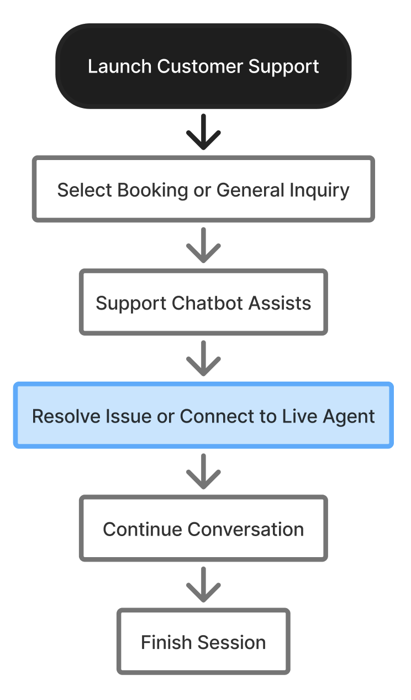

# M13-在线客服与客户支持

> [!info] 原文摘录
> 来源：[[mTrip 消费者 App 知识库/08-原始资料/mTrip_ Consumer App PRD_v1.0.6_中文版|mTrip_ Consumer App PRD_v1.0.6_中文版]]，第 1654–1724 行（按导入快照计）。
> 下方保留原文措辞、表格、状态与重复条款，仅调整图片路径；整理标题与关联阅读置于摘录区外。

<!-- PRD_SOURCE_START:1654-1724 -->
模块 13：在线客服与客户支持

概述

客户支持聊天模块为酒店预订相关咨询提供快速帮助，覆盖入住前、入住期间及入住后。该模块首先通过聊天机器人 / AI 协助处理常见问题。若问题未解决，用户可转接人工客服。聊天会话保持活跃，并可从「消息」中恢复。

mTrip 支持聊天 – 入口

用户可通过以下入口访问 mTrip 支持聊天：

- 酒店预订详情页：点击「在线支持聊天」按钮，打开 mTrip 支持聊天以获取与预订相关的协助。

- 首页：点击标有「与我们聊天」的悬浮聊天按钮，打开 mTrip 支持聊天。

- 「更多」>「联系我们」：点击「与 mTrip 聊天」，打开 mTrip 支持聊天。

## 目标

- 针对常见预订咨询提供快速自助支持。

- 通过自动回复降低客户支持工作量。

- 使用户能够快速获取与具体预订相关的支持。

- 提供向人工客户支持的顺畅转接。

- 保留聊天记录以支持持续会话。

整体用户旅程

### 客户支持模块的功能需求

<!--TABLE_START-->
| 功能 | 需求 |
|---|---|
| 欢迎页面 | 打开支持聊天时显示欢迎消息。 |
| 预订选择 | 允许用户选择当前或历史预订，以获取结合上下文的支持。 |
| 一般咨询 | 允许用户在不选择预订的情况下发起支持会话。 |
| 推荐问题 | 显示与所选预订或一般咨询相关的预定义常见问题。 |
| 聊天机器人 | 针对常见客户支持问题提供自动回复。 |
| 人工客服 | 在需要额外协助时，允许用户转接人工客服。 |
| 聊天记录 | 保存聊天记录，并允许用户继续此前的会话。 |
| 结束会话 | 允许用户结束当前支持会话。 |
| 反馈 | 允许用户在会话结束后对支持体验进行评分。 |
| 最近浏览的酒店 | 展示最近浏览的酒店，以便在支持过程中快速参考。 |
<!--TABLE_END-->

## 人工客服转接

用户可随时通过选择「联系客户支持」转接人工客服。在以下情况下，系统还应建议转接：

- 聊天机器人无法回答用户的问题。

- 用户要求与客服人员通话。

- 咨询涉及支付争议、投诉或特殊要求。

- 需要人工介入才能解决问题。

### 会话管理

- 用户退出聊天页面后，聊天会话应保持活跃。

- 用户可从「消息」板块继续此前的会话。

- 用户登录后，所有聊天记录应在用户的各设备间同步。

- 用户可随时通过选择「结束会话」结束支持会话。

<!-- PRD_SOURCE_END -->

---

返回：[[mTrip 消费者 App 知识库/00-知识库首页|00-知识库首页]] · [[mTrip 消费者 App 知识库/09-导入记录/原文章节映射|原文章节映射]] · [[00-mTrip 产品知识库|产品知识库总入口]]

## 关联阅读

- [[mTrip 消费者 App 知识库/06-规划与治理/待澄清事项|待澄清事项]]
- [[mTrip 消费者 App 知识库/04-验收标准/验收汇总说明|验收汇总说明]]
