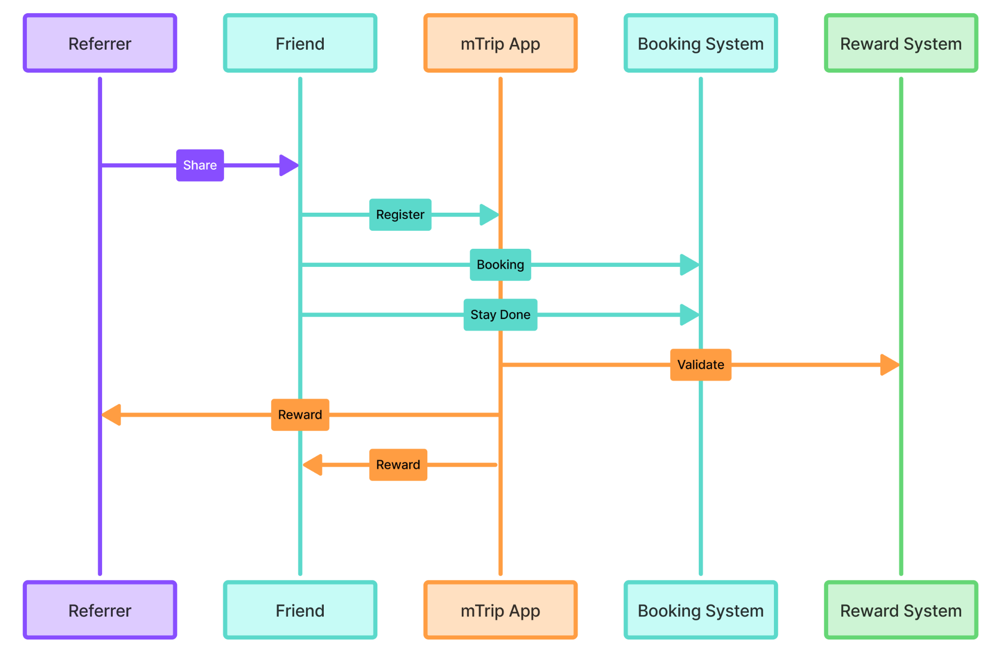
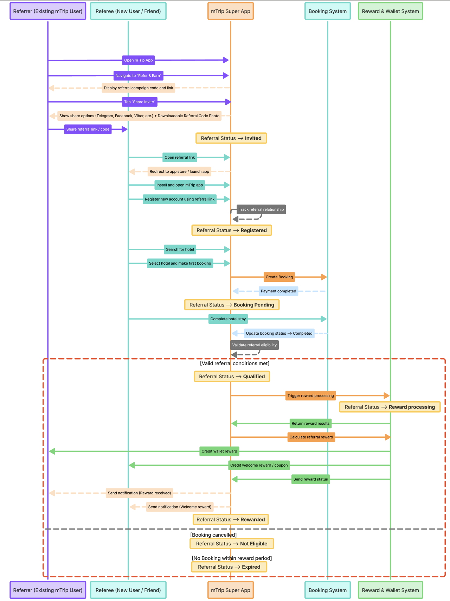

# M14-联盟与推荐计划

> [!info] 原文摘录
> 来源：[[mTrip 消费者 App 知识库/08-原始资料/mTrip_ Consumer App PRD_v1.0.8_中文版|mTrip_ Consumer App PRD_v1.0.8_中文版]]，第 1306–1344 行（按导入快照计）。
> 下方保留原文措辞、表格、状态与重复条款，仅调整图片路径；整理标题与关联阅读置于摘录区外。

<!-- PRD_SOURCE_START:1306-1344 -->
## 模块 14：联盟与推荐计划

**推荐有奖功能概述**

推荐有奖功能允许 mTrip 用户通过专属推荐码或推荐链接邀请好友。其目标是通过可信推荐提升用户获取，并在被邀请的好友完成首次酒店预订后，对推荐人与新用户双方给予奖励。

用户可通过即时通讯应用或社交媒体分享推荐链接，也可手动分享推荐码。该功能跟踪推荐的全过程，从邀请到奖励发放。条件满足后，奖励将发放至用户的 mTrip 钱包，供后续预订使用。

推荐有奖功能以简洁与可扩展为设计原则，支持营销活动及其他推荐计划，同时在 mTrip 旅行超级 App 内提供顺畅的用户体验。

**mTrip 推荐有奖 – 用户推荐用户旅程（整体流程）**

**推荐链接与推荐码处理**

| 场景 | 系统行为 |
|---|---|
| 用户分享推荐链接 | 每位用户均会被分配一个预先生成的专属推荐链接，可直接分享。好友打开该链接后，将显示 mTrip 网页注册/登录页，并在注册过程中自动预填推荐码。（若用户通过推荐链接注册，则无法从输入框中删除推荐码） |
| 用户分享推荐码 | 好友在 mTrip 网页端或移动端 App 注册时手动输入推荐码。系统将在完成注册前校验该推荐码。 |
| 现有用户 | 推荐权益仅适用于符合推荐活动规则的新用户注册。 |
| 推荐关系绑定 | 注册成功后，推荐关系将永久绑定至新用户账户，并在所有活动条件满足后发放奖励。 |

#### mTrip 推荐有奖 – 推荐旅程（整体流程）

mTrip 推荐有奖推荐旅程描述了从邀请到奖励发放的完整推荐流程。现有用户将专属推荐链接或推荐码分享给好友，好友随后在 mTrip 完成注册并完成首次符合条件的酒店预订。系统跟踪每条推荐在注册、预订、完成入住及奖励资格等各环节的进展。所有推荐条件满足后，奖励将自动发放至推荐人的 mTrip 钱包，从而提供透明、顺畅的推荐体验。

**推荐计划时序图（端到端）**

#### 推荐计划时序图（端到端）

推荐计划时序图展示了在推荐过程中，推荐人、被推荐用户、mTrip 平台、酒店预订系统与钱包服务之间的交互关系。该图说明了推荐关系如何形成、各环节如何校验资格，以及被推荐用户完成首次成功酒店预订后奖励如何自动发放。

该流程确保奖励仅针对真实有效的预订发放，同时为各方保持透明度与自动化。

推荐计划可通过管理员后台完全配置。管理员可轻松调整推荐人与被推荐用户的奖励金额、设置资格条件、定义有效预订条件、管理推荐有效期、设定奖励过期时间、确定活动时长，并修改其他计划规则，而无需进行系统变更。

<!-- PRD_SOURCE_END -->

---

返回：[[mTrip 消费者 App 知识库/00-知识库首页|00-知识库首页]] · [[mTrip 消费者 App 知识库/09-导入记录/原文章节映射|原文章节映射]] · [[00-mTrip 产品知识库|产品知识库总入口]]

## 关联阅读

- [[mTrip 消费者 App 知识库/06-规划与治理/待澄清事项|待澄清事项]]
- [[mTrip 消费者 App 知识库/04-验收标准/验收汇总说明|验收汇总说明]]
