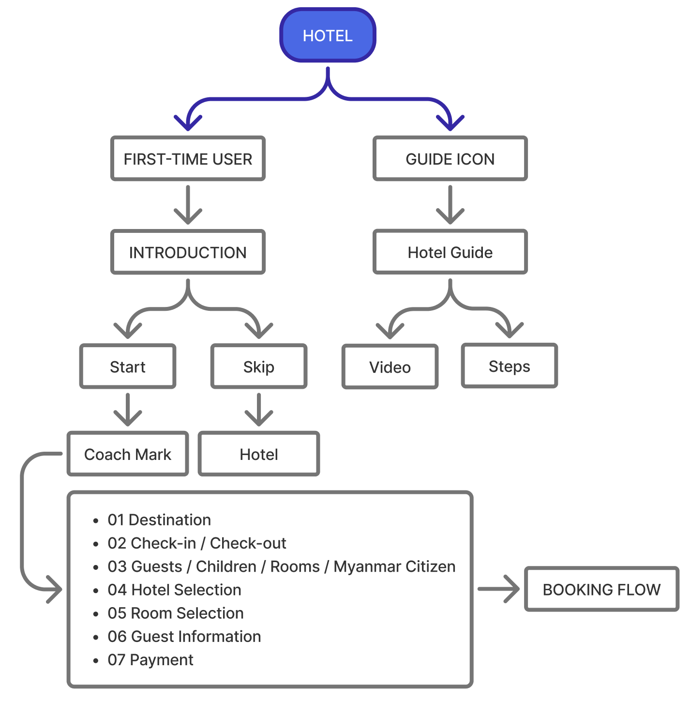

# M16-用户引导与教程

> [!info] 原文摘录
> 来源：[[mTrip 消费者 App 知识库/08-原始资料/mTrip_ Consumer App PRD_v1.0.10_中文版|mTrip_ Consumer App PRD_v1.0.10_中文版]]，第 1576–1708 行（按导入快照计）。
> 下方保留原文措辞、表格、状态与重复条款，仅调整图片路径；整理标题与关联阅读置于摘录区外。

<!-- PRD_SOURCE_START:1576-1708 -->
## 模块 16：用户引导与教程

### 模块目标

通过提供场景化的入驻引导、实用信息提示和可复用的教程内容，帮助用户理解并自信使用 mTrip 用户端 App 的各项功能。该模块专为数字经验有限的用户设计，支持在酒店、美食及未来应用功能之间提供一致的学习体验。

### 16.1 酒店预订引导提示（Coach Mark）

**需求**

为首次使用酒店预订功能的用户提供交互式引导提示（Coach Mark）入驻体验。

### 目标

引导首次使用的用户走完酒店预订旅程的关键步骤，帮助其在不具备 App 使用经验的情况下了解如何搜索并完成酒店预订。

**说明**

用户首次进入酒店预订功能时，系统将展示一系列场景化引导提示，突出显示酒店预订旅程的主要元素。

引导提示流程包含 7 个主要引导步骤，覆盖从进入酒店功能到完成预订流程的关键操作。

引导提示应：

- 突出显示每一步对应的 UI 元素。
- 提供简短标题和简单说明。
- 清晰展示用户在引导中的进度。
- 允许用户进入下一步。
- 提供“跳过”选项，用户可随时退出引导。
- 仅在用户首次使用酒店预订体验时展示该引导。
- 引导完成或跳过后不再打扰用户。

**重新进入引导**

完成或跳过引导提示后，用户可通过酒店搜索页上的指南图标再次进入酒店预订指南。

指南入口将提供以下内容：

- 酒店预订教程视频
- 分步酒店预订指南

**图示：酒店功能 — 用户引导与引导提示 UI 说明**

### 16.2 缅甸公民信息提示气泡

**需求**

为酒店搜索页展示的“缅甸公民”选项提供场景化信息提示。

### 目标

帮助用户在搜索酒店前了解“缅甸公民”选项的用途及可能影响。

**说明**

将在“缅甸公民”选项附近提供两条信息提示气泡 / 提示消息。

提示气泡应：

- 说明“缅甸公民”选项的含义。
- 帮助用户理解选择该选项为何可能影响展示的酒店价格或可用房量。
- 使用简单易懂的语言。
- 在不打断酒店搜索流程的前提下可访问。
- 允许用户在阅读后关闭或忽略该信息。

提示气泡内容应与系统实际实现的酒店价格和资格规则保持一致。

| 元素 | 缅甸公民提示气泡的最终文案 |
|---|---|
| 目标 | “缅甸公民”复选框 + ⓘ |
| 标题 | “缅甸公民”是什么意思？ |
| 说明 | 若您是缅甸公民，请选择此选项。酒店房价和条件可能因国籍而异。 |
| 关闭 / 行动按钮 | 知道了 |

### 16.3 教程与视频指南

**需求**

提供集中的教程页面，用户可在此访问 mTrip 用户端 App 各功能的教学视频和分步指南。

### 目标

为用户提供可复用的学习中心，使其可随时学习如何使用酒店、美食及其他支持的功能，而不仅依赖首次入驻引导。

**入口**

用户可通过以下路径进入教程页面：

个人资料 / 设置 → 教程

**说明**

教程页面将按功能分类组织学习内容。

初始分类可包括：

- 酒店
- 美食
- 其他 / 未来功能

每个分类将包含相关教程内容，以双列网格布局展示，每个教程以视频卡片形式呈现。

每个视频卡片应包含：

- 视频缩略图
- 播放标识
- 教程标题
- 所属分类

用户可选择教程以打开视频详情 / 观看视频页面，并在其中观看教程。

**酒店教程内容**

酒店分类应包含与酒店预订旅程相关的内容，包括：

- 酒店预订指南视频
- 分步酒店预订指南
- 未来新增的其他相关酒店教程

**可扩展性**

教程模块应设计为可复用的内容结构，以便在不改动整体页面结构的情况下新增分类、视频和指南。

该模块应支持未来扩展至 mTrip 用户端 App 的其他功能，如美食及其他服务。

**模块级用户体验**

三项功能共同构成统一的用户引导体系：

首次使用用户 → 酒店引导提示 → 了解预订流程再次使用用户 → 酒店指南图标 → 视频 + 分步指南随时 → 设置 → 教程 → 酒店 / 美食 / 其他教程该方式既能在用户首次体验时提供场景化引导，也提供用户需要帮助时可随时访问的自助学习内容。

<!-- PRD_SOURCE_END -->

---

返回：[[mTrip 消费者 App 知识库/00-知识库首页|00-知识库首页]] · [[mTrip 消费者 App 知识库/09-导入记录/原文章节映射|原文章节映射]] · [[00-mTrip 产品知识库|产品知识库总入口]]

## 关联阅读

- [[mTrip 消费者 App 知识库/06-规划与治理/待澄清事项|待澄清事项]]
- [[mTrip 消费者 App 知识库/04-验收标准/验收汇总说明|验收汇总说明]]
