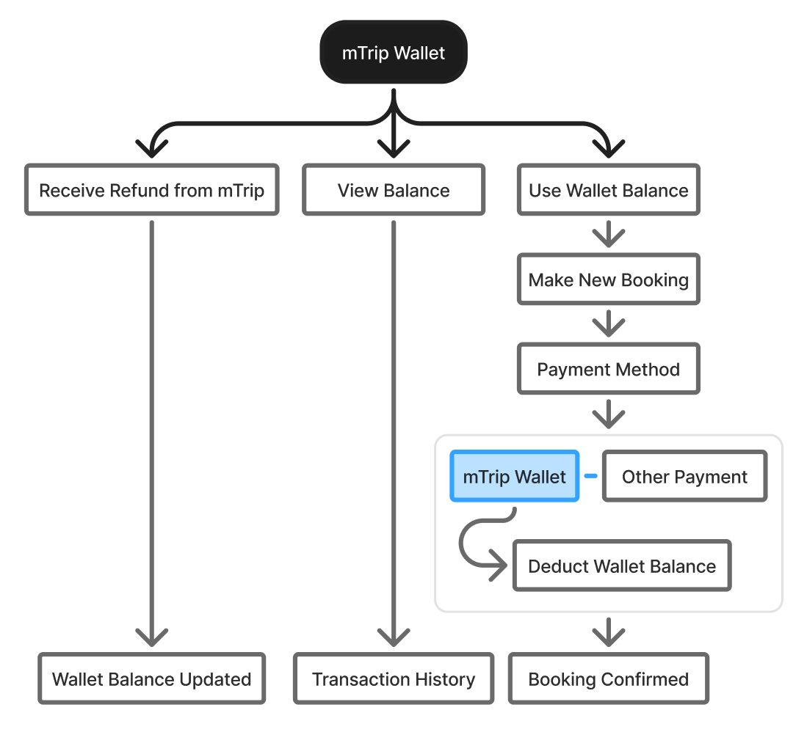

# M18-mTrip 钱包

> [!info] 原文摘录
> 来源：[[mTrip 消费者 App 知识库/08-原始资料/mTrip_ Consumer App PRD_v1.0.6_中文版|mTrip_ Consumer App PRD_v1.0.6_中文版]]，第 2257–2680 行（按导入快照计）。
> 下方保留原文措辞、表格、状态与重复条款，仅调整图片路径；整理标题与关联阅读置于摘录区外。

<!-- PRD_SOURCE_START:2257-2680 -->
## 模块 18：mTrip 钱包

### 18.1 目的

mTrip 钱包是用于存放 mTrip 交易退款的一个临时预订抵扣金钱包。

它可用于符合条件的 mTrip 交易，例如：

- 酒店预订

- 用车预订

- 其他受支持的 mTrip 服务

重要提示：mTrip 钱包不是普通的电子钱包。用户不能充值、提现、充入、转账或提取资金。

18.2 钱包规则

<!--TABLE_START-->
| 规则 | 需求 |
|---|---|
| 钱包类型 | 仅限退款/预订抵扣金 |
| 币种 | MMK |
| 充值 | 不支持 |
| 提现 | 不支持 |
| 充入 | 不支持 |
| 转账 | 不支持 |
| 退款 | 符合条件的退款将存入钱包 |
| 使用 | 可用于符合条件的 mTrip 交易 |
| 有效期 | 可由管理后台配置 |
| 默认示例 | 6 个月（可由管理后台配置） |
| 过期金额 | 作废且不可使用 |
| 余额 | 1 钱包抵扣金 = 1 MMK |
<!--TABLE_END-->

钱包提示：“mTrip 钱包是预订抵扣金，不是电子钱包。退款将存入您的余额，供您下次预订使用。1 抵扣金 = 1 MMK。”

### 18.3 钱包余额

钱包页面显示：

- 当前钱包余额

- 币种：MMK

- 钱包信息提示

- 全部

- 退款

- 消费

- 已过期

- 交易历史

- “？”图标 → mTrip 钱包如何运作

#### 余额示例

钱包余额

MMK 150,000

### 18.4 钱包有效期

每笔退入钱包的金额都有各自的有效期。有效期时长由 mTrip 管理后台控制。

示例：

退款金额：MMK 100,000

退款日期：2026 年 9 月 24 日

有效期设置：6 个月

到期日期：2027 年 3 月 24 日

当钱包金额到达有效期时：

钱包抵扣金

↓

已到有效期

↓

金额已过期

↓

金额作废

↓

用户无法使用该金额

#### 管理后台配置

管理员可以配置钱包有效期，例如：

- 6 个月

- 1 年

具体有效期应可在管理后台中配置。

18.5 结算时使用钱包支付

钱包余额可用于支付符合条件的 mTrip 交易。

系统会自动应用可用钱包金额，最高不超过已配置的可用上限。

如果用户不想使用钱包余额，可以将钱包使用开关切换为 OFF。

#### 支付逻辑

预订金额

↓

检查钱包余额

↓

检查管理后台可用限额

↓

计算钱包金额

↓

自动应用钱包

↓

剩余金额 → 其他支付方式

<!--TABLE_START-->
| 场景 | 预订金额 | 钱包余额 | 钱包使用金额 | 其他支付方式 |
|---|---|---|---|---|
| 钱包可全额覆盖预订 | MMK 100,000 | MMK 150,000 | MMK 100,000 | MMK 0 |
| 钱包可部分覆盖预订 | MMK 250,000 | MMK 100,000 | MMK 100,000 | MMK 150,000 |
| 大额预订 | MMK 500,000 | MMK 300,000 | MMK 300,000 | MMK 200,000 |
<!--TABLE_END-->

#### 示例：管理后台可用限额

如果管理员配置：

钱包最高可用金额 = MMK 100,000

并且：

预订金额 = MMK 250,000

钱包余额 = MMK 200,000

则：

钱包使用金额 = MMK 100,000

其他支付 = MMK 150,000

用户可以将钱包使用开关切换为 OFF：

使用 mTrip 钱包

[ ON ]

→ 钱包金额将自动应用。

使用 mTrip 钱包

[ OFF ]

→ 本次交易不使用钱包金额。

### 18.6 钱包交易类型

钱包支持四类交易：

<!--TABLE_START-->
| 标签页 | 说明 |
|---|---|
| 全部 | 全部钱包交易 |
| 退款 | 退入钱包的退款金额 |
| 消费 | 用于 mTrip 交易的钱包金额 |
| 已过期 | 已过期的钱包金额 |
<!--TABLE_END-->

### 18.7 交易历史

系统显示 6 个月的交易历史。

<!--TABLE_START-->
| 月份 | 显示 |
|---|---|
| 2026 年 9 月 | 当月 |
| 2026 年 8 月 | 前 1 个月（仅 8 月） |
| 2026 年 7 月 | 前 2 个月（仅 7 月） |
| 2026 年 6 月 | 前 3 个月（仅 6 月） |
| 2026 年 5 月 | 前 4 个月（仅 5 月） |
| 2026 年 4 月 | 前 5 个月（仅 4 月） |
<!--TABLE_END-->

用户可以按月筛选交易历史。

#### 交易列表

初始应至少显示 10 条交易记录。

每张交易卡片显示：

- 日期与时间

- 交易类型

- 金额（+ / -）

- 关联预订 ID

### 18.8 交易详情

当用户点击某笔交易时，显示交易详情页面。

<!--TABLE_START-->
| 字段 | 示例数据 |
|---|---|
| 状态 | 已完成 |
| mTrip 钱包交易 ID | MT023923923 |
| 日期与时间 | 2026 年 9 月 24 日 上午 10:10 |
| 交易类型 | 酒店住宿 / 用车 |
| 交易名称 | 取消退款 / 支付 |
| 关联预订 ID | MT394394934 |
| 物业名称（酒店预订） | Rosewood Yangon |
| 描述 | 酒店预订的钱包支付 |
| 金额 | + / - MMK 100,000 |
<!--TABLE_END-->

#### 复制功能

用户可以点击「交易详情历史」页面上的「复制」图标进行复制：

- mTrip 钱包交易 ID

- 酒店预订 ID

- 用车预订 ID

### 18.9 退款流程

符合条件的 mTrip 取消

↓

退款已处理

↓

退款 → mTrip 钱包

↓

钱包余额已更新

↓

交易已创建

↓

已分配有效期

示例：

取消退款

↓

+ MMK 100,000

↓

钱包余额

MMK 150,000 → MMK 250,000

### 18.10 钱包消费流程

用户创建预订

↓

支付页面

↓

是否有可用钱包余额？

↓

是

↓

检查管理后台可用限额

↓

自动应用钱包金额

↓

用户可切换为 OFF

↓

剩余金额

↓

其他支付方式

↓

支付完成

↓

钱包交易 = 消费

### 18.11 到期流程

钱包退款抵扣金

↓

已分配有效期

↓

是否已到有效期？

↙ ↘

否 是

↓ ↓

可用 过期金额

↓

作废金额

↓

创建「已过期」交易

### 18.12 管理后台需求

管理后台应允许管理员：

- 配置钱包抵扣金的有效期。

- 为每种受支持的交易类型配置钱包最高可用金额/限额。

- 查看钱包退款交易。

- 查看钱包消费交易。

- 查看已过期的钱包金额。

- 按照 mTrip 交易/退款流程控制退款进入钱包的分配。

配置示例：

<!--TABLE_START-->
| 设置 | 示例 |
|---|---|
| 钱包交易有效期 | 6 个月 |
| 酒店/用车钱包最高可用金额 | MMK 100,000 |
| 钱包使用方式 | 自动应用 |
| 用户覆盖 | 允许 ON/OFF |
<!--TABLE_END-->

### 18.13 mTrip 钱包关键业务规则

- 钱包仅限退款抵扣金。

- 用户不能充值、提现、充入、转账或提取钱包余额。

- 符合条件的退款将自动存入钱包。

- 每笔退款抵扣金都有有效期。

- 已过期的钱包抵扣金将作废。

- 有效期时长由管理员控制。

- 每种受支持交易的最高可用钱包金额由管理员控制。

- 适用时，钱包金额在结算时自动抵扣。

- 用户可在支付前关闭钱包抵扣。（默认：开启）

- 钱包仅可用于符合条件的 mTrip 交易。

- 钱包交易历史按月展示。系统优先显示当前月份。若当前月份的交易少于 10 笔，系统继续显示上月的交易，直至至少可展示 10 笔交易。

- 交易历史支持按全部 / 退款 / 消费 / 已过期筛选。

- 交易详情必须显示相关预订信息。

- 钱包交易必须具有唯一的 mTrip 钱包交易 ID。

mTrip 钱包 - 整体工作流程图

<!-- PRD_SOURCE_END -->

---

返回：[[mTrip 消费者 App 知识库/00-知识库首页|00-知识库首页]] · [[mTrip 消费者 App 知识库/09-导入记录/原文章节映射|原文章节映射]] · [[00-mTrip 产品知识库|产品知识库总入口]]

## 关联阅读

- [[mTrip 消费者 App 知识库/06-规划与治理/待澄清事项|待澄清事项]]
- [[mTrip 消费者 App 知识库/04-验收标准/验收汇总说明|验收汇总说明]]
