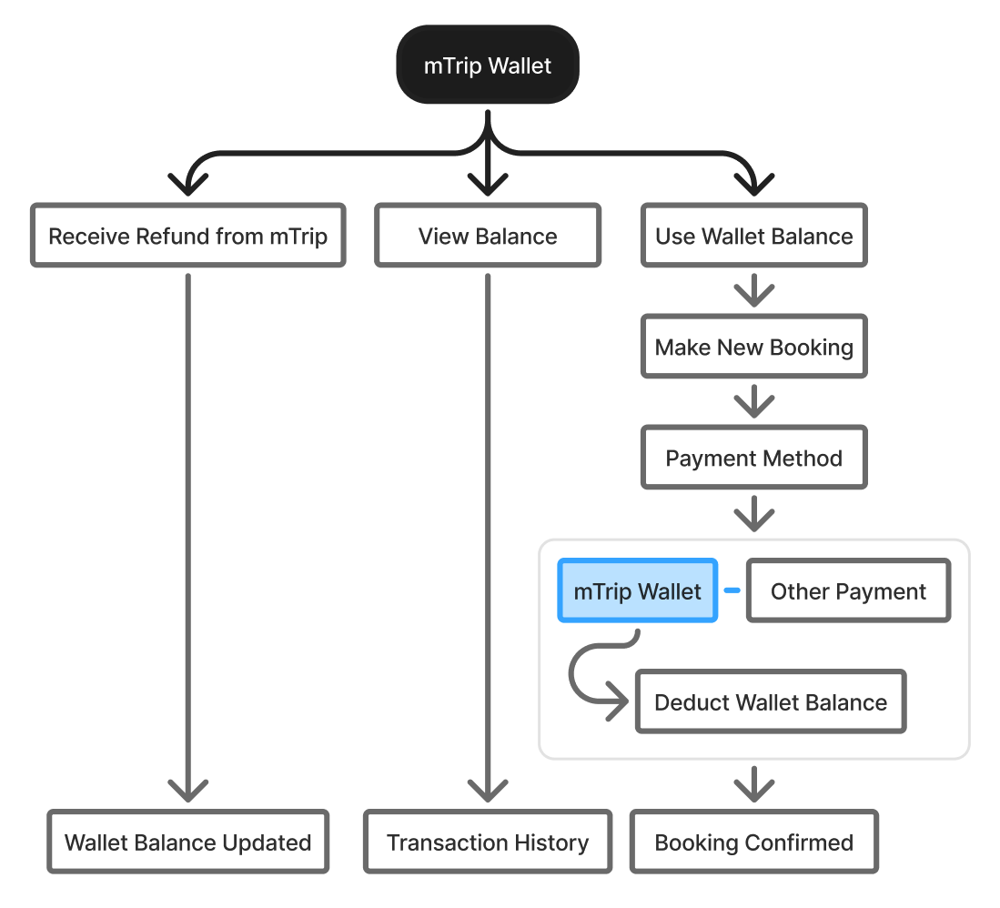
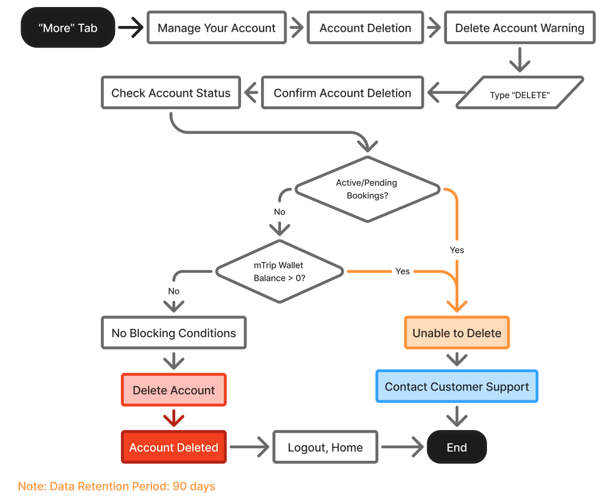
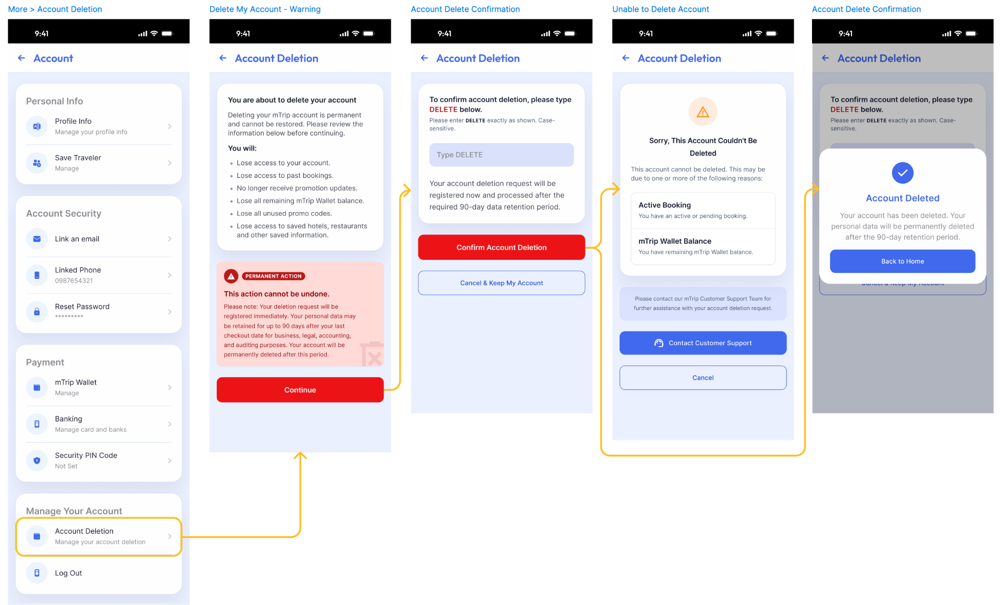

# M19-账户删除与余额没收

> [!info] 原文摘录
> 来源：[[mTrip 消费者 App 知识库/08-原始资料/mTrip_ Consumer App PRD_v1.0.10_中文版|mTrip_ Consumer App PRD_v1.0.10_中文版]]，第 2140–2242 行（按导入快照计）。
> 下方保留原文措辞、表格、状态与重复条款，仅调整图片路径；整理标题与关联阅读置于摘录区外。

<!-- PRD_SOURCE_START:2140-2242 -->
## 模块 19：附加功能：mTrip 账号注销

### 1. 入口

更多 → 账号（设置、安全、支付）→ 管理你的账号 → 账号注销

### 2. 账号注销流程

- 用户查看账号注销警告，并点击“继续”。
- 用户输入 DELETE（区分大小写）。
- 用户点击“确认账号注销”。
- 系统检查：
    - 进行中 / 待处理的预订
    - mTrip 钱包余额 > 0
- 若满足任一条件 → 阻止注销，用户可点击“联系客服”。
- 若均不满足 → 账号注销成功。
- 用户将被自动登出，并跳转至“登录 / 注册”页面。

**mTrip 账号注销流程示意图**

**mTrip 账号注销 UI 页面流程**

### 3. 取消

用户可点击“取消并保留我的账号”来终止该流程。账号保持有效，不会执行注销。

### 4. 数据保留

注销成功后，相关账号数据将依据 mTrip 的数据保留政策保留 90 天。

### 5. mTrip 钱包余额

若用户在 mTrip 钱包余额大于 0 时申请注销账号，该余额将被作废，且账号注销后无法退还、转移或找回，但须遵守适用条款与法律。

### 6. 新账号

账号注销后，用户可创建一个新的 mTrip 账号。新账号按新账号处理，不会自动恢复已注销账号的数据、钱包余额或权益。

### 7. 业务规则

| 条件 | 结果 |
|---|---|
| 存在待支付预订 | 阻止注销 |
| 存在已确认预订且退房日期未过 | 阻止注销 |
| 存在已入住预订 | 阻止注销 |
| 存在退款中的记录（无论预订状态如何） | 阻止注销 |
| mTrip 钱包余额超过超级管理员配置的最低余额阈值 | 阻止注销；用户须联系客服协助处理 |
| 客服 / 经授权的超级管理员在钱包仍有余额的情况下批准注销 | 余额作废 → 允许注销 |
| 存在已确认预订但退房日期已过 | 允许注销 |
| 存在已退房 / 已取消的预订，且所有相关支付/财务流程均已完成 | 允许注销 |
| 存在未入住（No-Show）预订，且所有相关支付/财务流程均已完成 | 允许注销 |
| 无阻止性预订，且 mTrip 钱包余额等于或低于超级管理员配置的最低余额阈值 | 允许注销 |
| 注销成功 | 登出 → 登录 / 注册 |

**其他业务规则**

- 预订资格必须依据预订状态与计划退房日期判定。
- 退房日期已过的已确认预订不得阻止账号注销，即使商户尚未将其状态更新为已退房或未入住（No-Show）。
- 系统不得仅为便于账号注销而自动更改预订状态。
- 任何处于退款中的预订必须持续阻止注销，直至退款流程完成。
- 历史预订记录必须依据适用的数据保留政策予以保留。
- 最低钱包余额阈值必须可由超级管理员配置。
- 账号注销资格必须通过比较用户当前的 mTrip 钱包余额与已配置的最低余额阈值来判定。
- 若钱包余额等于或低于已配置阈值，用户可在无需额外审批的情况下继续注销账号。
- 若钱包余额超过已配置阈值，默认必须阻止账号注销，用户须联系客服协助处理。
- 客服可就符合条件的情形提交钱包余额作废审批申请，并按超级管理员的经办-复核（maker-checker）审批流程处理。
- 任何剩余钱包余额不得仅因等于或低于已配置阈值而自动作废。

**示例：最低钱包余额阈值**

假设：超级管理员将最低钱包余额阈值配置为 500 MMK。

| 用户钱包余额 | 已配置阈值 | 账号注销 |
|---|---|---|
| 0 MMK | 500 MMK | 允许 |
| 100 MMK | 500 MMK | 允许 |
| 500 MMK | 500 MMK | 允许 |
| 501 MMK | 500 MMK | 阻止 |
| 1,000 MMK | 500 MMK | 阻止 |

**mTrip 钱包余额阈值补充说明**

- 该阈值可由超级管理员配置。
- 等于或低于该阈值的钱包余额可直接注销账号，无需额外审批。
- 超过该阈值的钱包余额需要客服协助，并经授权的钱包余额作废审批。
- 用户提交账号注销申请时，系统必须检查最新的钱包余额。

### 8. 钱包余额与欺诈防范

若用户的 mTrip 钱包余额大于 0，必须阻止账号注销。

用户必须联系客服进行核实与后续处理。

若客服/管理员批准该账号注销，剩余钱包余额将被作废，并记录至内部“已作废 mTrip 钱包余额台账”，用于账务与审计。

已作废的余额不可转移、退还、找回或由用户使用。

<!-- PRD_SOURCE_END -->

---

返回：[[mTrip 消费者 App 知识库/00-知识库首页|00-知识库首页]] · [[mTrip 消费者 App 知识库/09-导入记录/原文章节映射|原文章节映射]] · [[00-mTrip 产品知识库|产品知识库总入口]]

## 关联阅读

- [[mTrip 消费者 App 知识库/03-功能模块/M19.1-App 更新与强制更新|M19.1-App 更新与强制更新]]
- [[mTrip 消费者 App 知识库/03-功能模块/M19.2-关联邮箱与关联手机号|M19.2-关联邮箱与关联手机号]]
- [[mTrip 消费者 App 知识库/03-功能模块/M19.3-联系我们|M19.3-联系我们]]
- [[mTrip 消费者 App 知识库/03-功能模块/M19.4-忘记密码|M19.4-忘记密码]]
- [[mTrip 消费者 App 知识库/03-功能模块/M19.5-管理支付卡|M19.5-管理支付卡]]
- [[mTrip 消费者 App 知识库/03-功能模块/M19.6-重置密码与设置新密码|M19.6-重置密码与设置新密码]]
- [[mTrip 消费者 App 知识库/06-规划与治理/待澄清事项|待澄清事项]]
- [[mTrip 消费者 App 知识库/04-验收标准/验收汇总说明|验收汇总说明]]
