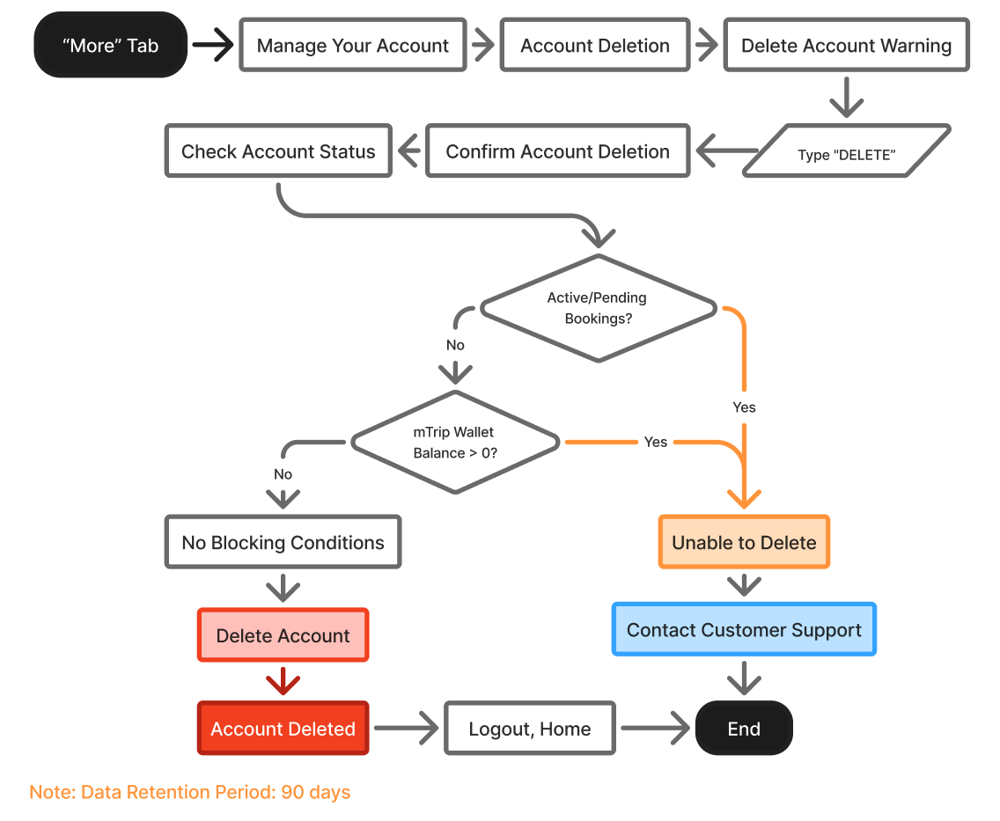
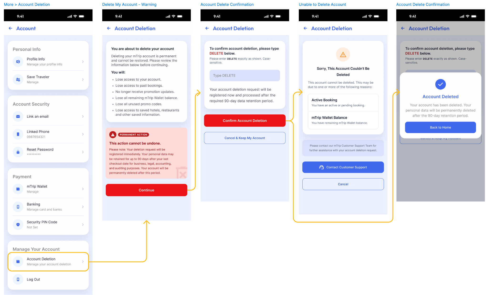

# M19-账户删除与余额没收

> [!info] 原文摘录
> 来源：[[mTrip 消费者 App 知识库/08-原始资料/mTrip_ Consumer App PRD_v1.0.6_中文版|mTrip_ Consumer App PRD_v1.0.6_中文版]]，第 2681–2754 行（按导入快照计）。
> 下方保留原文措辞、表格、状态与重复条款，仅调整图片路径；整理标题与关联阅读置于摘录区外。

<!-- PRD_SOURCE_START:2681-2754 -->
## 模块 19：附加功能：mTrip 账户删除

1. 入口

「更多」→「账户」（设置、安全、支付）→「管理您的账户」→「账户删除」

#### 2. 账户删除流程

- 用户查看账户删除警告并点击「继续」。

- 用户输入 DELETE（区分大小写）。

- 用户点击「确认账户删除」。

- 系统检查：

  - 进行中 / 待处理的预订

  - mTrip 钱包余额 > 0

- 若满足任一条件 → 阻止删除，用户可点击「联系客户支持」。

- 若不满足任何条件 → 账户删除成功。

- 用户被自动登出并跳转至「登录 / 注册」页面。

mTrip 账户删除流程图

mTrip 账户删除 UI 页面流程

3. 取消

用户可点击「取消并保留我的账户」来取消该流程。

账户保持有效，不执行任何删除操作。

4. 数据保留

删除成功后，相关账户数据将依据 mTrip 的数据保留政策保留 90 天。

5. mTrip 钱包余额

若用户在其 mTrip 钱包余额大于 0 时申请删除账户，该余额将被没收，且在账户删除后无法退款、转移或找回，但须遵守适用条款与法律。

6. 新账户

账户删除后，用户可创建一个新的 mTrip 账户。该新账户被视为新账户，不会自动恢复已删除账户的数据、钱包余额或权益。

7. 业务规则

<!--TABLE_START-->
| 条件 | 结果 |
|---|---|
| 存在进行中 / 待处理的预订 | 阻止删除 |
| mTrip 钱包余额 > 0 | 默认阻止删除 |
| 客户支持在仍有余额的情况下批准删除 | 余额被没收 → 允许删除 |
| 无进行中/待处理的预订 + 钱包余额 = 0 | 允许删除 |
| 删除成功 | 登出 → 登录 / 注册 |
<!--TABLE_END-->

8. 钱包余额与欺诈防范

若用户的 mTrip 钱包余额大于 0，必须阻止账户删除。

用户必须联系客户支持进行核实与后续处理。

若客户支持/管理后台批准删除账户，剩余钱包余额将被没收，并记入内部「已没收 mTrip 钱包余额台账」，用于会计核算与审计。

被没收的余额不可由用户转移、退款、找回或使用。

<!-- PRD_SOURCE_END -->

---

返回：[[mTrip 消费者 App 知识库/00-知识库首页|00-知识库首页]] · [[mTrip 消费者 App 知识库/09-导入记录/原文章节映射|原文章节映射]] · [[00-mTrip 产品知识库|产品知识库总入口]]

## 关联阅读

- [[mTrip 消费者 App 知识库/03-功能模块/M19.1-App 更新与强制更新|M19.1-App 更新与强制更新]]
- [[mTrip 消费者 App 知识库/03-功能模块/M19.2-关联邮箱与关联手机号|M19.2-关联邮箱与关联手机号]]
- [[mTrip 消费者 App 知识库/03-功能模块/M19.3-联系我们|M19.3-联系我们]]
- [[mTrip 消费者 App 知识库/03-功能模块/M19.4-忘记密码|M19.4-忘记密码]]
- [[mTrip 消费者 App 知识库/03-功能模块/M19.5-管理支付卡|M19.5-管理支付卡]]
- [[mTrip 消费者 App 知识库/03-功能模块/M19.6-重置密码与设置新密码|M19.6-重置密码与设置新密码]]
- [[mTrip 消费者 App 知识库/06-规划与治理/待澄清事项|待澄清事项]]
- [[mTrip 消费者 App 知识库/04-验收标准/验收汇总说明|验收汇总说明]]
