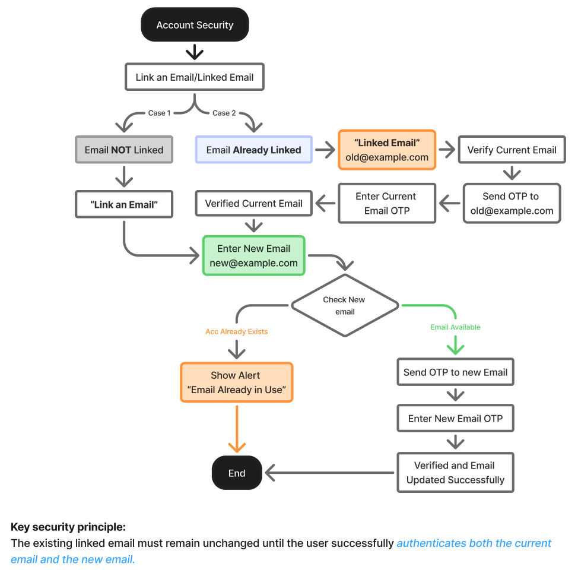
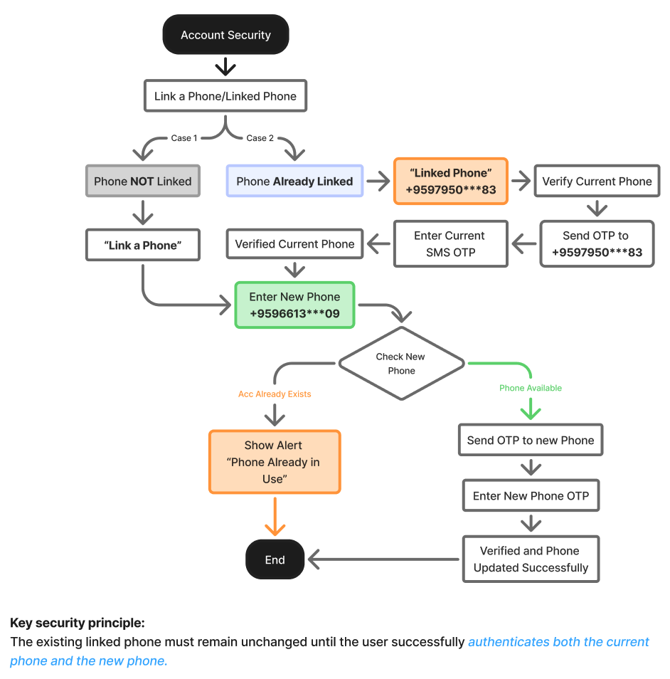

# M19.2-关联邮箱与关联手机号

> [!info] 原文摘录
> 来源：[[mTrip 消费者 App 知识库/08-原始资料/mTrip_ Consumer App PRD_v1.0.8_中文版|mTrip_ Consumer App PRD_v1.0.8_中文版]]，第 2101–2146 行（按导入快照计）。
> 下方保留原文措辞、表格、状态与重复条款，仅调整图片路径；整理标题与关联阅读置于摘录区外。

<!-- PRD_SOURCE_START:2101-2146 -->
### 19.2 关联邮箱、关联手机号、联系我们

#### 关联邮箱 / 关联手机号

mTrip App 必须在“账户安全”下提供“关联邮箱”和“关联手机号”功能，允许用户添加或更新与 mTrip 账户关联的邮箱地址或手机号。

MVP 要求：“关联邮箱”与“关联手机号”两项功能均为 MVP 版本的必做项，必须在 mTrip App MVP 发布前完成开发与测试。

##### 关联邮箱

- 用户可通过“更多 > 账户 > 账户安全 > 关联邮箱”进入。
- 若当前未关联邮箱，用户输入新邮箱地址，并通过邮箱一次性验证码（OTP）完成验证。
- 若已关联邮箱且用户希望变更，系统必须先验证新邮箱地址，再完成变更。
- 若新邮箱已关联至其他 mTrip 账户，系统必须阻止该变更，并告知用户该邮箱已与其他账户关联。
- 若用户输入的邮箱与已关联邮箱相同，系统应显示行内校验提示，且不发送一次性验证码（OTP）。
- 一次性验证码（OTP）错误或已过期时，必须允许用户重试或重新获取验证码。
- 若用户在验证完成前退出或取消流程，原邮箱必须保持不变。
- 若在需要验证时用户无法访问当前关联的邮箱，系统应提供相应的账户找回/客服流程。

##### 关联手机号

- 用户可通过“更多 > 账户 > 账户安全 > 关联手机号”进入。
- 若当前未关联手机号，用户输入手机号，并通过短信一次性验证码（OTP）完成验证。
- 若已关联手机号且用户希望变更，系统必须先验证新手机号，再完成变更。
- 若新手机号已关联至其他 mTrip 账户，系统必须阻止该变更，并告知用户该手机号已与其他账户关联。
- 若用户输入的手机号与已关联手机号相同，系统应显示行内校验提示，且不发送一次性验证码（OTP）。
- 对于错误或已过期的一次性验证码（OTP），必须允许用户重试或重新获取新的 OTP。
- 如果用户在验证完成前退出或取消流程，现有手机号必须保持不变。
- 系统必须支持 +95 缅甸手机号格式，并在发送 OTP 前校验手机号。
- 如果社交登录服务商未提供受支持的邮箱地址或手机号，系统必须通过相应的“关联邮箱”或“关联手机号”流程处理缺失信息。

#### 通用规则

- 只有在验证成功完成后，新的邮箱地址或手机号才能保存到账户。
- 不得用未验证的邮箱地址或手机号替换已关联的信息。
- 系统必须防止同一邮箱地址或手机号被关联到多个 mTrip 账户。
- 系统应在两个功能中对 OTP 重发、OTP 错误、OTP 过期和验证失败等状态做一致处理。

**流程图：关联邮箱（情况 1：未关联邮箱 | 情况 2：已关联邮箱）**

**流程图：关联手机号（情况 1：未关联手机号 | 情况 2：已关联手机号）**

<!-- PRD_SOURCE_END -->

---

返回：[[mTrip 消费者 App 知识库/00-知识库首页|00-知识库首页]] · [[mTrip 消费者 App 知识库/09-导入记录/原文章节映射|原文章节映射]] · [[00-mTrip 产品知识库|产品知识库总入口]]

## 关联阅读

- [[mTrip 消费者 App 知识库/03-功能模块/M19-账户删除与余额没收|M19-账户删除与余额没收]]
- [[mTrip 消费者 App 知识库/03-功能模块/M19.1-App 更新与强制更新|M19.1-App 更新与强制更新]]
- [[mTrip 消费者 App 知识库/03-功能模块/M19.3-联系我们|M19.3-联系我们]]
- [[mTrip 消费者 App 知识库/03-功能模块/M19.4-忘记密码|M19.4-忘记密码]]
- [[mTrip 消费者 App 知识库/03-功能模块/M19.5-管理支付卡|M19.5-管理支付卡]]
- [[mTrip 消费者 App 知识库/03-功能模块/M19.6-重置密码与设置新密码|M19.6-重置密码与设置新密码]]
- [[mTrip 消费者 App 知识库/06-规划与治理/待澄清事项|待澄清事项]]
- [[mTrip 消费者 App 知识库/04-验收标准/验收汇总说明|验收汇总说明]]
