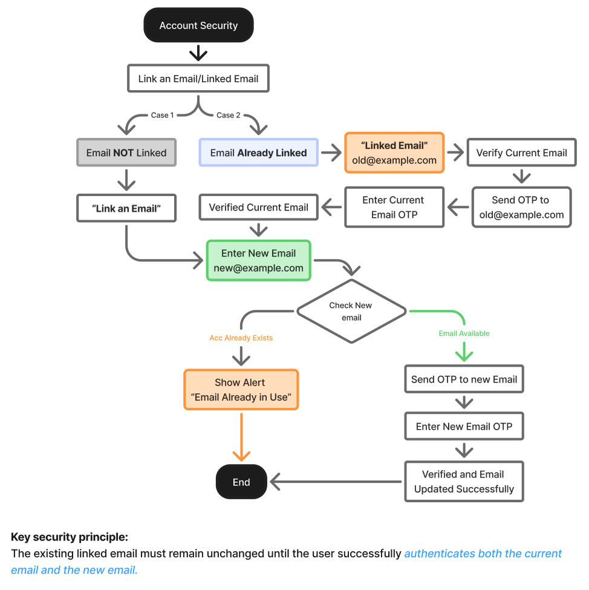
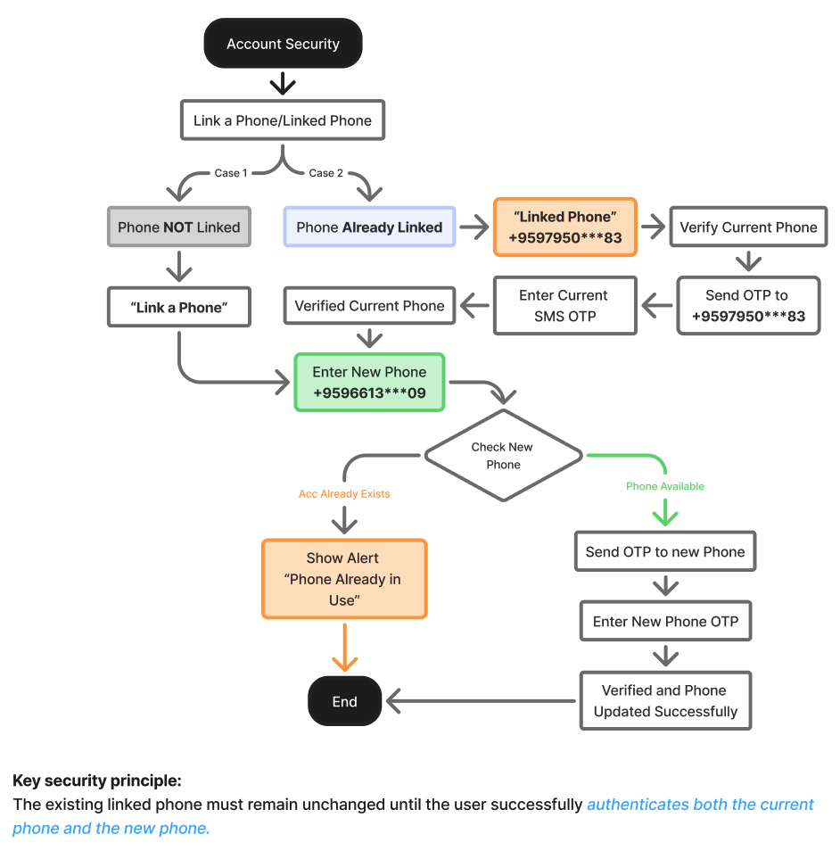

# M19.2-关联邮箱与关联手机号

> [!info] 原文摘录
> 来源：[[mTrip 消费者 App 知识库/08-原始资料/mTrip_ Consumer App PRD_v1.0.6_中文版|mTrip_ Consumer App PRD_v1.0.6_中文版]]，第 2775–2838 行（按导入快照计）。
> 下方保留原文措辞、表格、状态与重复条款，仅调整图片路径；整理标题与关联阅读置于摘录区外。

<!-- PRD_SOURCE_START:2775-2838 -->
### 19. 2 关联邮箱、关联手机号、联系我们

#### 关联邮箱 / 关联手机号

mTrip App 必须在「账户安全」下提供「关联邮箱」与「关联手机号」功能，允许用户添加或更新与其 mTrip 账户关联的邮箱地址或手机号。

MVP 需求：关联邮箱与关联手机号两项功能均为 MVP 发布的必备项，必须在 mTrip App MVP 上线前完成实现与测试。

##### 关联邮箱

- 用户可通过「更多」>「账户」>「账户安全」>「关联邮箱」进入。

- 若当前未关联邮箱，用户输入新的邮箱地址，并通过邮箱 OTP 进行验证。

- 若已关联邮箱且用户希望更改，系统必须先在完成更改前验证新的邮箱地址。

- 若新邮箱已关联至另一个 mTrip 账户，系统必须阻止该更改，并告知用户该邮箱已与其他账户关联。

- 若用户输入的邮箱地址与已关联的邮箱相同，系统应显示行内校验提示，且不发送 OTP。

- OTP 错误或已过期时，必须允许用户重试或重新请求新的 OTP。

- 若用户在验证完成前退出或取消该流程，现有邮箱必须保持不变。

- 若在需要验证时用户无法访问当前已关联的邮箱，系统应提供相应的账户找回/客户支持流程。

##### 关联手机号

- 用户可通过「更多」>「账户」>「账户安全」>「关联手机号」进入。

- 若当前未关联手机号，用户输入手机号，并通过短信 OTP 进行验证。

- 若已关联手机号且用户希望更改，系统必须先在完成更改前验证新的手机号。

- 若新手机号已关联至另一个 mTrip 账户，系统必须阻止该更改，并告知用户该手机号已与其他账户关联。

- 若用户输入的手机号与已关联的手机号相同，系统应显示行内校验提示，且不发送 OTP。

- OTP 错误或已过期时，必须允许用户重试或重新请求新的 OTP。

- 若用户在验证完成前退出或取消该流程，现有手机号必须保持不变。

- 系统必须支持 +95 缅甸手机号格式，并在发送 OTP 前校验手机号。

- 若社交登录服务商未提供受支持的邮箱地址或手机号，系统必须通过相应的「关联邮箱」或「关联手机号」流程处理缺失信息。

##### 通用规则

- 必须先成功完成验证，新的邮箱或手机号才能保存至账户。

- 现有已关联信息不得被未经验证的邮箱地址或手机号替换。

- 系统必须防止同一邮箱地址或手机号关联至多个 mTrip 账户。

- 系统应在两项功能中一致地处理 OTP 重发、OTP 错误、OTP 过期与验证失败状态。

流程图：关联邮箱（情况 1：未关联邮箱 | 情况 2：已关联邮箱）

流程图：关联手机号（情况 1：未关联手机号 | 情况 2：已关联手机号）

<!-- PRD_SOURCE_END -->

---

返回：[[mTrip 消费者 App 知识库/00-知识库首页|00-知识库首页]] · [[mTrip 消费者 App 知识库/09-导入记录/原文章节映射|原文章节映射]] · [[00-mTrip 产品知识库|产品知识库总入口]]

## 关联阅读

- [[mTrip 消费者 App 知识库/03-功能模块/M19-账户删除与余额没收|M19-账户删除与余额没收]]
- [[mTrip 消费者 App 知识库/03-功能模块/M19.1-App 更新与强制更新|M19.1-App 更新与强制更新]]
- [[mTrip 消费者 App 知识库/03-功能模块/M19.3-联系我们|M19.3-联系我们]]
- [[mTrip 消费者 App 知识库/03-功能模块/M19.4-忘记密码|M19.4-忘记密码]]
- [[mTrip 消费者 App 知识库/03-功能模块/M19.5-管理支付卡|M19.5-管理支付卡]]
- [[mTrip 消费者 App 知识库/03-功能模块/M19.6-重置密码与设置新密码|M19.6-重置密码与设置新密码]]
- [[mTrip 消费者 App 知识库/06-规划与治理/待澄清事项|待澄清事项]]
- [[mTrip 消费者 App 知识库/04-验收标准/验收汇总说明|验收汇总说明]]
