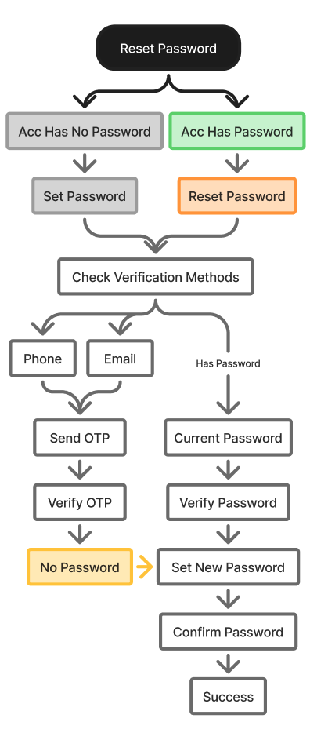

# M19.6-重置密码与设置新密码

> [!info] 原文摘录
> 来源：[[mTrip 消费者 App 知识库/08-原始资料/mTrip_ Consumer App PRD_v1.0.10_中文版|mTrip_ Consumer App PRD_v1.0.10_中文版]]，第 2471–2568 行（按导入快照计）。
> 下方保留原文措辞、表格、状态与重复条款，仅调整图片路径；整理标题与关联阅读置于摘录区外。

<!-- PRD_SOURCE_START:2471-2568 -->
### 19.6 重置密码 / 设置新密码

“重置密码 / 设置新密码”功能允许用户通过可用的验证方式验证账户身份，从而修改或重置 mTrip 账户密码。

**入口：更多 → 账户 → 账户安全 → 密码管理**

### 1. 密码管理

用户进入“密码管理”时，系统必须判断该账户当前是否已设置密码。

| 账户状态 | 可用操作 |
|---|---|
| 无密码 | 设置密码 |
| 有密码 | 重置密码 |

- 无密码：用户可为账户创建密码。
- 有密码：用户可重置/修改现有密码。

### 2. 验证方式

重置密码时，用户必须选择一种可用的验证方式：

- 通过邮箱验证
- 通过手机号验证
- 通过当前密码验证

系统必须仅显示该用户账户可用的验证方式。

### 3. 通过邮箱验证

若用户选择邮箱：

- 系统显示用户已关联的邮箱地址。
- 用户请求获取一次性验证码（OTP）。
- 系统向已关联的邮箱地址发送验证码。
- 用户输入验证码。
- 若验证码有效，用户可继续设置新密码。
- 若验证码错误或已失效，用户可重试或重新获取验证码。

### 4. 通过手机号验证

若用户选择手机号：

- 系统显示用户已关联的手机号。
- 用户请求获取一次性验证码（OTP）。
- 系统向已关联的手机号发送验证码。
- 用户输入验证码。
- 若验证码有效，用户可继续设置新密码。
- 若验证码错误或已失效，用户可重试或重新获取验证码。

### 5. 通过当前密码验证

若用户选择当前密码：

- 用户输入当前密码。
- 系统校验密码。
- 若当前密码正确，用户可继续设置新密码。
- 若密码错误，系统显示相应错误提示，且不允许用户继续。

### 6. 设置新密码

验证成功后，系统必须显示“设置新密码”页面。

用户必须输入：

- 新密码
- 确认密码

系统必须校验：

- 新密码符合既定的密码规则。
- 新密码与确认密码一致。
- 在密码策略要求的情况下，新密码不得与当前密码相同。

仅当所有校验要求均满足时，用户方可保存新密码。

### 7. 密码更新成功

新密码保存成功后：

- 显示密码更新成功提示。
- 用户可继续使用该账户。
- 对于从登录页面发起的密码重置，将用户跳转至登录页面，以便使用新密码登录。
- 对于从“账户安全”发起的密码修改，将用户返回相应的“账户安全”页面。

### 8. 验证与安全规则

- 在所选验证方式成功完成之前，系统不得允许修改密码。
- 如果用户在完成验证前退出流程，现有密码必须保持不变。
- 一次性验证码（OTP）必须有有效期并支持重新发送。
- 错误或已过期的一次性验证码（OTP）不得让用户继续操作。
- 系统不得展示或泄露用户的密码。
- 密码修改成功后，系统应按账户安全政策的要求使其他活跃登录会话/设备失效；当前会话在密码修改流程完成前保持有效。

**流程图：重置密码功能主流程**

<!-- PRD_SOURCE_END -->

---

返回：[[mTrip 消费者 App 知识库/00-知识库首页|00-知识库首页]] · [[mTrip 消费者 App 知识库/09-导入记录/原文章节映射|原文章节映射]] · [[00-mTrip 产品知识库|产品知识库总入口]]

## 关联阅读

- [[mTrip 消费者 App 知识库/03-功能模块/M19-账户删除与余额没收|M19-账户删除与余额没收]]
- [[mTrip 消费者 App 知识库/03-功能模块/M19.1-App 更新与强制更新|M19.1-App 更新与强制更新]]
- [[mTrip 消费者 App 知识库/03-功能模块/M19.2-关联邮箱与关联手机号|M19.2-关联邮箱与关联手机号]]
- [[mTrip 消费者 App 知识库/03-功能模块/M19.3-联系我们|M19.3-联系我们]]
- [[mTrip 消费者 App 知识库/03-功能模块/M19.4-忘记密码|M19.4-忘记密码]]
- [[mTrip 消费者 App 知识库/03-功能模块/M19.5-管理支付卡|M19.5-管理支付卡]]
- [[mTrip 消费者 App 知识库/06-规划与治理/待澄清事项|待澄清事项]]
- [[mTrip 消费者 App 知识库/04-验收标准/验收汇总说明|验收汇总说明]]
