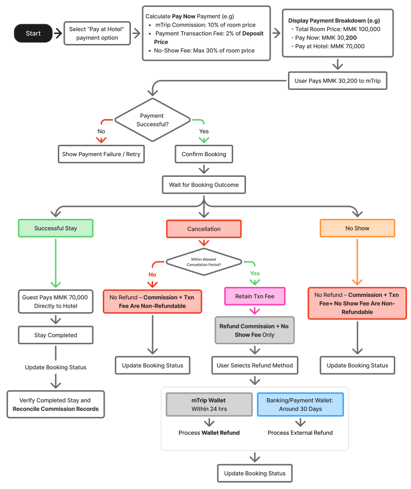

# M20-到店支付

> [!info] 原文摘录
> 来源：[[mTrip 消费者 App 知识库/08-原始资料/mTrip_ Consumer App PRD_v1.0.8_中文版|mTrip_ Consumer App PRD_v1.0.8_中文版]]，第 2419–2507 行（按导入快照计）。
> 下方保留原文措辞、表格、状态与重复条款，仅调整图片路径；整理标题与关联阅读置于摘录区外。

<!-- PRD_SOURCE_START:2419-2507 -->
## 模块 20：到店支付

**1. 概述**

到店支付允许用户通过向 mTrip 支付所需的前置金额来预订客房。剩余房费直接支付给酒店。

前置付款由以下部分组成：

- mTrip 佣金
- 付款交易手续费
- 酒店配置的未入住费（可选）

酒店可通过商户 Web 门户启用或关闭未入住费，并配置其费率，最高不得超过全额房费的 30%。

预订周期结束后，系统自动执行结算，保留 mTrip 的佣金金额与交易手续费，并将已收取的未入住费分配给酒店，具体遵循适用的预订与退款政策。

**2. 付款规则**

| 项目 | 业务规则 |
|---|---|
| 全额房费 | 在 mTrip 佣金与交易手续费之前的客房费用总额。 |
| mTrip 佣金 | 全额房费的配置百分比。 |
| 交易手续费 | 仅按佣金金额计算的配置百分比。 |
| 未入住费 | 酒店通过商户 Web 门户配置的可选费用。 |
| 未入住费上限 | 全额房费的最高 30%。 |
| 现付金额 | 佣金金额 + 交易手续费 + 未入住费。 |
| 到店支付金额 | 全额房费 -（现付金额 - 交易手续费） |
| 未入住费接收方 | 通过结算 100% 分配给酒店。 |
| mTrip 收入 | 佣金金额 + 交易手续费 |
| 结算时点 | 预订周期结束后自动执行。 |

补充规则：

- 若酒店关闭未入住费，则该费用为零。
- 未入住费必须与佣金金额、交易手续费分开计算。
- 未入住费不得超过全额房费的 30%。
- 系统必须将适用的未入住费配置与预订一并保存。
- 任何配置变更不得在未告知的情况下改变既有预订的费用条款。
- 系统必须在付款前向用户展示费用明细。

#### 计算公式

- 佣金金额 = 全额房费 × 佣金费率（%）
- 交易手续费 = 佣金金额 × 交易手续费费率（%）
- 现付金额 = 佣金金额 + 交易手续费 + 未入住费
- 到店支付金额 = 全额房费 −（现付金额 - 交易手续费）

#### 示例计算

假设全额房费为 100,000 MMK，示例佣金费率为 10%，示例交易手续费费率为 2%：

| 项目 | 计算（示例） | 金额 |
|---|---|---|
| 全额房费 | — | 100,000 MMK |
| mTrip 佣金（示例 10%） | 100,000 × 10% | 10,000 MMK |
| 交易手续费（示例 2%） | 10,000 × 2% | 200 MMK |
| 未入住费 | 100,000 x 20% | 20,000 MMK |
| 现付金额 | 10,000 + 200+ 20,000 | 30,200 MMK |
| 到店支付金额（线下） | 100,000 − (30,200 -200) | 70,000 MMK |
| 用户需支付总额（现付 + 到店支付） | 30,200 + 70,000 | 100,200 MMK |

重要说明：用户支付总额为 100,200 MMK，因为其中 200 MMK 交易手续费是平台额外收取的费用。100,000 MMK 的房费拆分为 10,000 MMK 佣金、20,000 MMK 未入住费以及到店支付的 70,000 MMK。

**3. 取消与退款**

- 在取消截止时间之前：用户可取消预订并选择退款方式。
- mTrip 钱包：退款在 24 小时内处理。
- 银行账户 / 支付钱包：退款约需 30 天。
- 取消截止时间之后：佣金与交易手续费不予退还。
- 未入住（No-Show）：前置付款不予退还。

退款方式选择仅适用于以到店支付方式完成的预订。可退金额取决于适用的取消政策。

到店支付付款方式工作流程图

**4. 管理员自动对账**

住宿完成后，系统自动核验前置付款与佣金记录。核验通过则状态变为“已对账”；核验失败则将该预订标记为待管理员审核。系统需在住宿完成后结算未入住费。

**5. 错误处理**

- 前置付款失败：不确认预订；允许重试付款。
- 退款失败：标记为“失败”，并允许管理员审核与安全重试。
- 重复处理：防止重复退款与重复对账。

酒店发起的取消（到店支付）：无论取消截止时间如何，将前置付款全额退还至用户的 mTrip 钱包。无需选择退款方式。

<!-- PRD_SOURCE_END -->

---

返回：[[mTrip 消费者 App 知识库/00-知识库首页|00-知识库首页]] · [[mTrip 消费者 App 知识库/09-导入记录/原文章节映射|原文章节映射]] · [[00-mTrip 产品知识库|产品知识库总入口]]

## 关联阅读

- [[mTrip 消费者 App 知识库/06-规划与治理/待澄清事项|待澄清事项]]
- [[mTrip 消费者 App 知识库/04-验收标准/验收汇总说明|验收汇总说明]]
