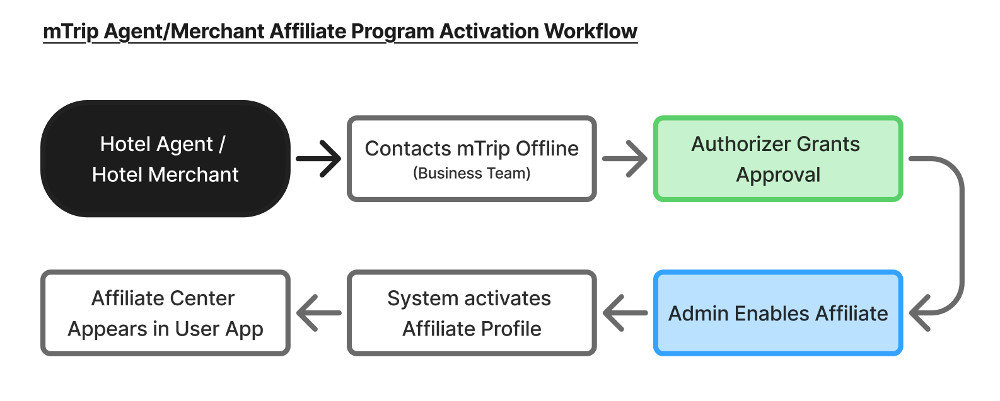
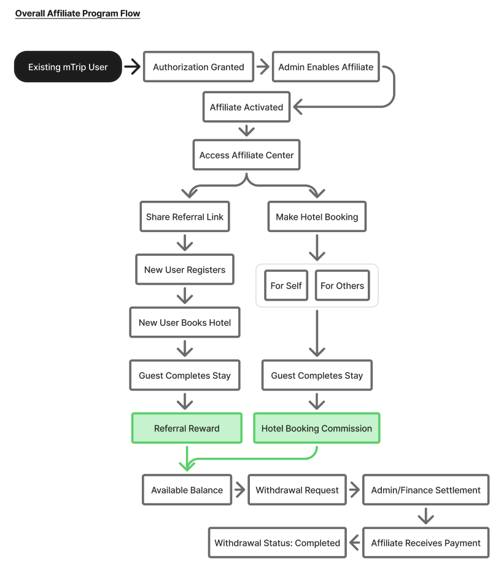

# 联盟推广 M01-账户与激活

> [!info] 原文摘录
> 来源：[[mTrip 消费者 App 知识库/08-原始资料/mTrip_ Consumer App PRD_v1.0.10_中文版|mTrip_ Consumer App PRD_v1.0.10_中文版]]，第 2804–2867 行（按导入快照计）。
> 原文措辞和重复条款保留；仅调整图片相对路径。

<!-- PRD_SOURCE_START:2804-2867 -->
## 联盟推广计划（v1.0.9 新增）

### 模块 1：联盟账户管理

#### 1.1 联盟激活

#### 概述

该功能允许管理员为现有 mTrip 用户账户启用联盟推广功能，用户无需创建单独账户或重新注册。

启用后，用户可通过现有 mTrip 账户访问“联盟中心”，管理推荐链接、跟踪业绩、查看佣金并申请提现。

管理员应对联盟激活与账户状态拥有控制权。

#### 功能需求

- 系统应允许管理员在授权通过后，为现有 mTrip 用户账户启用联盟推广功能。
- 联盟访问申请应通过 mTrip 业务团队线下处理，无需提供 App 内申请功能。
- 当管理员启用联盟推广功能时，系统应自动创建联盟档案并将其关联至用户现有的 mTrip User ID。
- 系统应在联盟激活时生成唯一的联盟 ID。
- 系统应仅在用户具有“活跃”联盟推广员状态时，才在 mTrip 用户端 App 中显示联盟中心。
- 状态为“未激活”“已暂停”或“已停用”的用户不得访问联盟推广功能。
- 管理员应能通过管理员后台激活、暂停和停用联盟推广员账户。
- 系统应显示联盟推广员状态和激活日期。
- 系统应避免为同一 mTrip 用户 ID 重复创建联盟推广员档案。
- 联盟推广员账户的所有状态变更均应记录在系统中，以供审计。

#### 验收标准

- 仅在获得授权后，管理员才能为已有 mTrip 用户启用联盟推广功能。
- 系统自动创建联盟推广员档案，并将其关联至正确的已有 mTrip 用户 ID。
- 联盟推广员档案激活时，系统生成唯一的联盟推广员 ID。
- “活跃”状态的联盟推广员可通过其现有的 mTrip 用户端 App 账户访问联盟中心。
- 对于不具备“活跃”联盟推广员状态的用户，不显示联盟中心。
- 不具备“活跃”联盟推广员状态的用户无法访问联盟推广功能。
- 管理员可通过管理员后台激活、暂停和停用联盟推广员账户。
- 系统避免为同一 mTrip 用户 ID 重复创建联盟推广员档案。
- 联盟推广员状态与激活日期显示正确。
- 联盟推广员的所有状态变更均记录在审计日志中。

#### 1.2 联盟推广员状态

| 状态 | 说明 |
|---|---|
| 未激活 | 联盟推广功能尚未启用 |
| 活跃 | 联盟推广员可使用全部可用功能 |
| 已暂停 | 联盟推广员暂时无法生成新的符合条件的推荐，也无法提现 |
| 已停用 | 联盟推广参与已结束 |

#### 1.3 联盟推广员档案

系统应显示：

- 联盟推广员 ID
- 用户 ID
- 联盟推广员姓名
- 电话号码
- 激活日期
- 联盟推广员状态

<!-- PRD_SOURCE_END -->

---

返回：[[mTrip 消费者 App 知识库/00-知识库首页|知识库首页]] · [[mTrip 消费者 App 知识库/09-导入记录/原文章节映射|原文章节映射]]

## 关联阅读

- [[mTrip 消费者 App 知识库/09-导入记录/v1.0.8至v1.0.9差异与跨端影响|版本差异与跨端影响]]
- [[mTrip 商户 App 知识库/03-功能模块/M05-经营工作台、收益与结算|商户端 M5]]
- [[mTrip 超级管理后台知识库/03-功能模块/M15-联盟与达人管理|后台 M15]]
