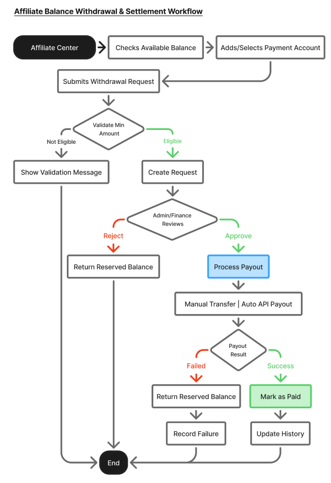

# 联盟推广 M06-提现与结算

> [!info] 原文摘录
> 来源：[[mTrip 消费者 App 知识库/08-原始资料/mTrip_ Consumer App PRD_v1.0.10_中文版|mTrip_ Consumer App PRD_v1.0.10_中文版]]，第 3129–3194 行（按导入快照计）。
> 原文措辞和重复条款保留；仅调整图片相对路径。

<!-- PRD_SOURCE_START:3129-3194 -->
### 模块 6：提现申请与结算

#### 6.1 提现配置

管理员应能够配置：

- 最低提现金额
- 支持的支付方式
- 提现处理方式（人工 / 自动）
- 提现处理规则

#### 6.2 提交提现申请

- 联盟推广用户应能够使用其可提现余额提交提现申请。
- 联盟推广用户应选择已验证的银行账户或钱包账户。
- 系统应校验可提现余额与最低提现要求。
- 提交成功后，申请金额应从可提现余额中预留。
- 联盟推广用户不得对同一金额重复提现。

#### 6.3 提现审批

- 管理员应能够审核提现申请。
- 管理员应能够通过或驳回申请。
- 管理员驳回申请时应提供驳回原因。
- 已通过的申请应进入已配置的结算流程。

#### 6.4 结算处理

系统应支持两种结算方式：

**方案 A：人工结算**

- 管理员通过提现申请。
- 财务 / 管理员人工完成付款转账。
- 管理员登记付款凭证或交易编号。
- 管理员确认付款成功。
- 系统将提现状态更新为“成功”。

**方案 B：自动结算**

- 管理员通过提现申请。
- 系统通过已集成的银行 / 钱包打款服务商发起转账。
- 系统接收交易响应。
- 系统根据打款结果更新提现状态。

#### 6.5 提现状态

| 状态 | 说明 |
|---|---|
| 待审批 | 等待管理员审批 |
| 已通过 | 已通过，等待结算 |
| 处理中 | 已发起付款转账 |
| 成功 | 付款已成功完成 |
| 已驳回 | 提现申请已驳回 |
| 失败 | 付款转账失败 |
| 已取消 | 申请在处理前已取消 |

#### 6.6 提现失败处理

- 失败的提现不得标记为已成功支付。
- 确认付款失败时，系统应将预留金额退回联盟推广用户的可提现余额。
- 系统应记录失败原因与交易凭证。
- 系统在重试失败交易时应防止重复打款。

<!-- PRD_SOURCE_END -->

---

返回：[[mTrip 消费者 App 知识库/00-知识库首页|知识库首页]] · [[mTrip 消费者 App 知识库/09-导入记录/原文章节映射|原文章节映射]]

## 关联阅读

- [[mTrip 消费者 App 知识库/09-导入记录/v1.0.8至v1.0.9差异与跨端影响|版本差异与跨端影响]]
- [[mTrip 商户 App 知识库/03-功能模块/M05-经营工作台、收益与结算|商户端 M5]]
- [[mTrip 超级管理后台知识库/03-功能模块/M15-联盟与达人管理|后台 M15]]
