# mTrip 产品需求文档（PRD）

## 消费者 App（酒店预订功能）- v1.0.6

作者：Mr. Aung Phyo Maw (Mario)

团队：产品团队

<!--TABLE_START-->
| 产品经理 | Mr. Aung Khant Kyaw |
|---|---|
| 工程负责人/团队负责人 | Mr. Li Sir |
| 设计师 | Mr. Chit Ko Ko |
| 审批人/签署 | Mr. Kaung Htet Oo |
<!--TABLE_END-->

PM 迭代计划：mTrip 迭代计划

PRD 状态：进行中

### 目录

- 消费者 App（酒店预订功能）- v1.0.6
  - 目录
  - 概述
  - 问题
  - 目标
  - 约束条件
  - 用户画像
  - 使用旅程与平台工作流
    - 多酒店预订功能说明
    - 多酒店预订 — 添加更多住宿
    - 多酒店预订 — 轻量模式限制
    - 模块 2：酒店搜索与发现 + 长住
    - 表 2：智能与增长功能（未来路线图）
  - 功能需求
- 「长住优惠」的入口 | 「长住」
- 功能需求
  - 1. 长住入口
  - 2. 长住优惠搜索页面
  - 3. 入住时长校验
  - 4. 长住折扣梯度
  - 5. 搜索结果展示
  - 7. 长住优惠券
    - 酒店列表排序
  - 概述
    - 促销中心
    - 我的优惠券
    - 优惠券使用
  - 功能需求
    - 添加旅客
    - 扫描护照
    - 旅客列表
    - 删除旅客
  - 业务规则
    - 模块 7：功能 3 轻量模式（全局 UI 体验）
- 模块 7 - 功能 2：收藏的酒店
  - 功能概览
  - 功能需求
    - 收藏的酒店列表
    - 删除收藏的酒店
  - 业务规则
  - mTrip 活动费用记录示例
  - 业务规则
  - 退款
    - 预期结果
- 业务规则
- 模块 10.1：预订风险管理与申诉
    - 级别 1 – 警告
    - 级别 2 – 账户暂停
    - 申诉流程
    - 已封禁账户
    - 欺诈检测规则
  - 退款政策与平台费透明度
- 图：预订取消流程（+ 平台费）
- 取消、退款与平台费政策
  - 整体旅程
  - 预期结果
- 目标
  - 客户支持模块的功能需求
- 人工客服转接
  - 会话管理
    - mTrip 推荐有礼——推荐旅程（整体工作流）
    - 推荐计划时序图（端到端）
  - 业务需求
  - 主题管理
  - 用户体验
  - 通过管理后台进行动态主题管理的验收标准
- 模块 16 – 用户引导与教程
  - 模块目标
  - 16.1 酒店预订引导提示（Coach Mark）
    - 需求
    - 目标
    - 描述
    - 重新进入引导
    - 图：酒店功能 — 用户引导与引导提示（Coach Mark）UI 说明
  - 16.2 缅甸公民信息提示气泡
    - 需求
    - 目标
    - 说明
  - 16.3 教程与视频指南
    - 需求
    - 目标
    - 入口
    - 说明
    - 酒店教程内容
    - 可扩展性
  - 模块级用户体验
    - 17.1：预订取消入口
  - 17.3：设置个人资料
    - 多客房场景
    - 预订类型示例
    - 固定金额优惠券的折扣分摊
    - 重要规则
- 模块 18：mTrip 钱包
  - 18.1 目的
  - 18.3 钱包余额
    - 余额示例
  - 18.4 钱包有效期
    - 管理后台配置
    - 支付逻辑
    - 示例：管理后台可用限额
  - 18.6 钱包交易类型
  - 18.7 交易历史
    - 交易列表
  - 18.8 交易详情
    - 复制功能
  - 18.9 退款流程
  - 18.10 钱包消费流程
  - 18.11 到期流程
  - 18.12 管理后台需求
  - 18.13 mTrip 钱包关键业务规则
- 模块 19：附加功能：mTrip 账户删除
    - 2. 账户删除流程
  - 19. 1 App 更新与强制更新
  - 19. 2 关联邮箱、关联手机号、联系我们
    - 关联邮箱 / 关联手机号
  - 19.3 联系我们页面（「更多」>「联系我们」）
  - 19.4 登录页面的「忘记密码？」功能
  - 19.5 管理支付卡
  - 19.6 重置密码 / 设置新密码
- 模块 20：到店支付
  - 验收标准
  - 设计
  - 技术考量 -（可选）
  - 成功指标
  - 待解决问题
  - 问答
  - 功能时间线与阶段规划
- PRD 检查清单：

### 概述

本产品需求文档（PRD）阐述了用户 App 的 mTrip 酒店预订功能。首个版本面向缅甸旅客与酒店合作伙伴，确保预订流程顺畅且易用。用户可以查找酒店、选择房型、应用折扣，并通过多种方式付款。符合条件的取消订单退款将退回 mTrip 钱包。入住结束后，用户可以管理其酒店评价与评分。本 PRD 详细说明了从酒店搜索到入住后反馈的用户旅程。

### 问题

缅甸的旅客难以找到一个本地酒店预订平台，能够同时提供真实评价、详细酒店信息、优惠价格、特惠活动以及顺畅的预订流程。这使用户难以选择符合自身需求与预算的酒店，同时许多本地酒店缺乏线上曝光与触达旅客的机会。这些问题降低了用户信任、增加了预订的繁琐程度，也为 mTrip 提供了一个机会，即为缅甸市场打造一个可靠的酒店预订平台。

### 目标

- 提供顺畅且直观的酒店预订体验，使用户能够快速、轻松地搜索、比较并预订住宿。

- 通过 AI 驱动的功能提升预订信心，提供个性化酒店推荐、AI 生成评价摘要以及经核实的真实住客评价。

- 通过整合旅游保险、安全支付等增值服务，以及提升客户满意度、预订转化率和用户留存的现代化用户体验，构建值得信赖的端到端旅行平台。

### 约束条件

- MVP 范围与时间线有限 —— 首个版本聚焦核心酒店预订能力，高级功能与未来生态服务规划在后续阶段。

- 依赖第三方集成 —— 酒店库存、定价、支付网关、旅游保险和通知等功能依赖外部合作伙伴与 API，这可能影响交付时间线。

- AI 功能成熟度与数据可得性 —— AI 推荐与评价摘要取决于酒店、评价和用户数据的可得性与质量，并将随平台发展持续改进。

### 用户画像

本产品的目标用户画像有哪些，其中哪个是核心用户画像？

<!--TABLE_START-->
| 核心用户画像 | 核心用户画像描述 |
|---|---|
| 休闲旅客 | 为度假预订酒店，希望获得快速、简便且可信赖的预订体验。 |
| 商务旅客 | 为工作预订酒店，重视速度、灵活性与便利性。 |
| 家庭 / 团体旅客 | 为多位住客预订住宿，需要一种简便的方式来管理团体预订。 |
<!--TABLE_END-->

### 使用旅程与平台工作流

场景 1：搜索并预订酒店

用户搜索目的地、比较酒店、选择房型、完成支付，并收到预订确认。

场景 2：借助 AI 发现酒店

用户收到 AI 驱动的酒店推荐，查看 AI 生成的摘要，并根据自身偏好选择最合适的酒店。

场景 3：管理已有预订

用户查看预订详情，修改或取消预订（若允许），访问预订确认，并接收状态更新与通知。

模块 1：整体酒店预订旅程与预订生命周期 + 多酒店预订

图：端到端酒店预订用户旅程流程（消费者 App）

图：端到端酒店搜索与发现工作流

Figma UI：端到端酒店预订流程（页面 1 至 10）

概要说明

本指南阐述了 mTrip 超级 App 中酒店预订的端到端用户流程，涵盖步骤 1 至 10。

- 点击「酒店」图标以进入酒店预订功能。

- 通过输入目的地、出行日期、住客人数以及缅甸公民价格偏好来搜索酒店。

- 根据搜索条件查看酒店列表。

- 选择一家酒店以查看详细信息。

- 选择您偏好的房型。

- 填写预订的住客信息。

- 在继续之前检查并确认您的信息。

- 完成支付流程。

- 收到预订确认。

- 进入「我的预订」页面进行预订管理。

在整个过程中，所选的缅甸公民价格偏好将始终生效，确保从搜索到预订管理的体验顺畅一致。

模块 1.1：多酒店预订

多酒店功能：单次结算 → 独立预订交易

#### 多酒店预订功能说明

多酒店预订功能允许用户在一次结算中预订多个不同目的地或不同入住时段的酒店。用户完成一次支付交易，系统则为每家所选酒店创建独立的酒店预订交易。支付完成后，每笔预订独立管理，包括预订确认、修改、取消、退款、结算和预订历史。

注：本功能在开发前需与工程团队进行技术可行性评估。

多酒店预订的功能需求

<!--TABLE_START-->
| 模块 | 需求 | 业务规则 |
|---|---|---|
| 行程管理 | 系统应创建一个 行程 ID，用于归集所有已选酒店预订。 | 一个 行程 可包含一笔或多笔酒店预订。 |
| 预订 | 系统应为每笔酒店预订生成唯一的预订 ID。 | 每笔预订独立遵循现有预订生命周期。 |
| 结算 | 用户应对所有已选酒店完成一次结算。 | 支付前，所有已选酒店在同一个确认页面中展示。 |
| 支付 | 用户应对所有酒店预订进行一次支付。 | 一次支付交易关联一个 行程 ID。 |
| 支付成功 | 系统应在支付成功后创建各笔独立的酒店预订。 | 仅在支付确认后才开始创建预订。 |
| 预订失败 | 若某一笔酒店预订无法确认，失败的预订不应影响已成功创建的预订。 | 仅对失败的预订进行退款。 |
| 预订管理 | 支付后，用户应分别管理每笔酒店预订。 | 独立查看、修改、取消和跟踪每笔预订。 |
| 促销优惠券 | 系统应允许在结算时使用一张促销优惠券。 | 优惠券折扣应按比例分摊至所有酒店预订。 |
| 折扣分摊 | 系统应存储每笔预订所分摊的折扣金额。 | 用于退款计算、商家结算和报表。 |
| 取消 | 用户可取消单笔酒店预订。 | 取消政策遵循各酒店的政策。 |
| 退款 | 仅对已取消的预订处理退款。 | 退款仅退至客户的 mTrip 钱包。 |
| 商家结算 | 商家结算应针对每笔预订独立处理。 | 在符合条件的预订完成后，按约定的结算周期进行结算。 |
| 佣金 | 平台佣金应按每笔预订单独计算。 | 佣金遵循商家合同。 |
| 通知 | 系统应针对每笔酒店预订发送预订确认。 | 支付确认仅发送一次；预订确认分别发送。 |
| 行程历史 | 用户应可查看同一 行程 下的所有酒店预订。 | 行程 页面展示所有预订状态。 |
| 客户支持 | 客服团队应可按 行程 ID 或预订 ID 查询预订。 | 各笔预订可独立处理。 |
<!--TABLE_END-->

多酒店预订的促销优惠券需求

<!--TABLE_START-->
| 需求 | 说明 |
|---|---|
| 优惠券范围 | 整笔结算可使用一张优惠券。 |
| 分摊方式 | 优惠券折扣应按预订金额比例分摊至所有酒店预订。 |
| 预订金额 | 每笔预订应存储各自的原始金额、折扣金额和最终应付金额。 |
| 退款计算 | 退款金额应使用折扣后的预订金额计算。 |
| 结算 | 商家结算应根据促销承担规则使用最终预订金额。 |
<!--TABLE_END-->

多酒店预订的商家结算需求

<!--TABLE_START-->
| 需求 | 说明 |
|---|---|
| 结算单位 | 结算按预订 ID 处理。 |
| 结算时间 | 预订符合打款条件后进行处理（以业务政策为准）。 |
| 结算金额 | 结算金额 = 预订金额 − 佣金 − 平台承担的促销（如适用）。 |
| 结算状态 | 每笔预订维护各自的结算状态。 |
| 结算报表 | 财务应按预订和商家生成结算报表。 |
<!--TABLE_END-->

多酒店预订的退款需求

<!--TABLE_START-->
| 需求 | 说明 |
|---|---|
| 退款范围 | 退款仅适用于已取消或失败的预订。 |
| 退款方式 | 退款应仅退至客户的 mTrip 钱包。 |
| 退款状态 | 每笔预订分别跟踪退款状态。 |
| 部分退款 | 同一 行程 下的其他酒店预订不受影响。 |
<!--TABLE_END-->

多酒店预订的预订失败需求

<!--TABLE_START-->
| 需求 | 描述 |
|---|---|
| 部分成功 | 若另一笔预订失败，成功的预订仍保持确认状态。 |
| 预订失败 | 失败的预订状态设置为「预订失败」。 |
| 退款 | 系统自动针对失败的预订金额发起退款。 |
| 用户通知 | 通知客户哪些预订失败、哪些预订已成功确认。 |
<!--TABLE_END-->

多酒店预订的行程管理需求

<!--TABLE_START-->
| 需求 | 描述 |
|---|---|
| 行程摘要 | 在一个行程下展示所有酒店预订。 |
| 行程时间线 | 按入住时间顺序展示预订。 |
| 预订状态 | 展示每家酒店的预订状态。 |
| 酒店管理 | 用户可单独管理每笔酒店预订。 |
<!--TABLE_END-->

流程图：多酒店预订结算（单次支付 + 分别预订）

#### 多酒店预订 — 添加更多住宿

多酒店预订体验已更新，引入了可展开和折叠的「添加更多住宿」卡片，使用户更轻松地在单次预订中管理并添加多个酒店住宿。

用户可添加的住宿数量上限由管理后台配置控制。例如，若最大住宿数量上限配置为 3 个住宿，则用户可在单次预订中最多添加 3 个住宿。

一旦达到配置的最大住宿数量，「添加更多住宿」选项将被隐藏或禁用，以防止用户添加更多住宿。

若用户删除一个或多个先前添加的住宿，「添加更多住宿」选项将再次可用，允许用户再添加一个住宿，直至达到配置的最大上限。

流程：酒店预订 → 添加更多住宿 → 展开 / 折叠 → 添加额外住宿

用户可以持续添加住宿，直至达到管理后台中配置的最大数量。

#### 多酒店预订 — 轻量模式限制

为保持预订体验对需要更简洁界面的用户而言简单易用，多酒店预订已在轻量模式中禁用。

多酒店预订仅在完整模式中可用。

模式行为：

- 轻量/简易模式：仅支持单酒店预订

- 完整/标准模式：支持单酒店预订和多酒店预订

#### 模块 2：酒店搜索与发现 + 长住

场景 1：搜索并预订酒店 - 用户旅程流程

搜索 → 发现 → 选择 → 定制 → 结算 → 支付 → 确认 → 预订后

预期结果

用户成功完成酒店预订旅程，收到确认的预订，并可通过 mTrip App 访问预订详情、通知和预订后服务。

表 1：用户体验与互动功能

<!--TABLE_START-->
| 用户功能 | 沟通 |
|---|---|
| • 收藏的酒店 / • 保存的住客信息 / • 用户偏好 / （语言、货币、计量单位） | • 通知 / • 在线客服与客户支持 |
<!--TABLE_END-->

#### 表 2：智能与增长功能（未来路线图）

<!--TABLE_START-->
| 互动 | AI 服务（未来） |
|---|---|
| • 联盟与推荐计划 | • AI 酒店助手 / • AI 评价摘要 |
<!--TABLE_END-->

### 功能需求

<!--TABLE_START-->
| 功能 | 描述 |
|---|---|
| 功能 1： / 酒店发现与预订 | 使用户能够通过无缝的端到端预订旅程搜索、比较和预订酒店，包括酒店搜索、筛选、房型选择、住客信息、价格、支付和预订确认。 |
| 功能 2： / 预订管理与旅行服务 | 允许用户管理预订、接收通知、收藏喜爱的酒店、访问在线客户支持、购买旅行保险，并参与联盟与推荐计划。 |
| 功能 3： / AI 驱动的旅行体验 | 通过 AI 酒店推荐、AI 生成的评价摘要以及 AI 酒店助手帮助用户做出明智的预订决策，从而提升用户体验。 |
<!--TABLE_END-->

模块 2.1 - 长住优惠

概述

长住优惠功能使用户能够发现并预订享有长住专属折扣的住宿。与标准酒店预订入口不同，长住作为 mTrip 首页上的专属入口提供，以提升曝光度并推广长住活动。

预订旅程与现有酒店预订流程基本保持一致，使用户能够享受熟悉的预订体验，同时根据其入住时长自动获得符合条件的长住折扣。

目标

- 通过首页专属入口推广长住住宿。

- 通过展示有吸引力的折扣梯度鼓励更长的预订。

- 复用现有酒店预订工作流以降低复杂性。

- 自动计算并应用符合条件的长住折扣。

- 支持长住专属促销和优惠券。

## 「长住优惠」的入口 | 「长住」

mTrip 首页应展示一个独立的「长住」图标按钮，作为独立服务，与现有的酒店入口分开。

选择长住入口应将用户导航至长住优惠搜索体验。

用户流程图

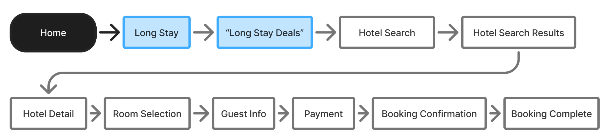

## 功能需求

### 1. 长住入口

系统应在首页提供独立的「长住」图标入口。

该入口应：

- 在视觉上与标准酒店服务分开。

- 将用户导航至长住优惠页面。

- 允许未来的活动横幅与推广内容。

### 2. 长住优惠搜索页面

系统应展示标题为「长住优惠」的独立搜索页面。

搜索表单应复用现有的酒店搜索体验，包括：

- 目的地

- 入住日期

- 退房日期

- 住客与客房选择

- 缅甸公民选择

### 3. 入住时长校验

系统应在用户选择入住日期与退房日期后自动计算总入住时长。

计算得出的时长应决定该预订是否符合长住优惠资格。

示例：

<!--TABLE_START-->
| 入住时长 | 是否符合资格 |
|---|---|
| 2 晚 | 否 |
| 5 晚 | 否 |
| 7 晚 | 是 |
| 14 晚 | 是 |
| 30 晚 | 是 |
<!--TABLE_END-->

最低合格时长应可通过管理后台配置。

### 4. 长住折扣梯度

系统应支持基于入住时长的可配置折扣梯度。

示例配置：

<!--TABLE_START-->
| 入住时长 | 折扣 |
|---|---|
| 7 晚 | 立减 30% |
| 14 晚 | 立减 35% |
| 30 晚 | 立减 45% |
| 60 晚 | 立减 50% |
<!--TABLE_END-->

系统应自动确定最高的合格梯度。

折扣百分比与合格时长应可配置。

### 5. 搜索结果展示

符合条件的酒店应直接在酒店卡片上展示长住促销信息。

示例信息：

- 长住优惠徽章

- 立减 XX%

- 原价

- 折扣价

- 节省总额

不参与长住优惠的酒店应继续展示其常规价格。

6. 酒店详情页面

对于符合条件的预订，酒店详情页面应展示：

- 长住优惠徽章

- 符合条件的折扣百分比

- 原价

- 折扣价

- 节省总额

### 7. 长住优惠券

系统应支持长住专属优惠券。

符合条件的用户可以：

- 领取长住优惠券

- 查看可用的长住优惠券

- 在结算时使用符合条件的优惠券

优惠券校验应遵循现有的促销与优惠券模块。

8. 结算

结算流程应与标准酒店预订流程完全一致。

如果该预订符合长住优惠资格，价格汇总应展示：

- 原价

- 长住折扣

- 优惠券折扣（如适用）

- 最终应付金额

所有折扣应在支付前计算完成。

9. 长住优惠的业务规则

<!--TABLE_START-->
| 规则 | 描述 |
|---|---|
| BR-01 | 长住应通过首页的专属入口进入。「长住」 |
| BR-02 | 预订流程应复用标准酒店预订旅程。 |
| BR-03 | 入住时长应基于入住日期与退房日期自动计算。 |
| BR-04 | 仅当预订满足所配置的最低入住时长时，长住折扣才应生效。 |
| BR-05 | 折扣梯度应可通过管理后台配置。 |
| BR-06 | 应自动应用最高的合格折扣梯度。 |
| BR-07 | 长住折扣应体现在搜索结果、酒店详情、结算与预订确认中。 |
| BR-08 | 长住优惠券应遵循现有的优惠券资格与校验规则。 |
| BR-09 | 未配置长住优惠的酒店应继续展示标准价格。 |
| BR-10 | 长住折扣与优惠券可根据促销模块中定义的活动配置进行叠加或互斥。 |
<!--TABLE_END-->

模块 3：酒店列表、筛选与排序

酒店筛选

酒店筛选功能让用户能够根据自身偏好与需求快速细化酒店搜索结果。用户可以同时应用多个筛选条件，包括：

- 价格范围

- 星级评分

- 物业类型

- 设施与服务

- 含早餐

- 住客评价分数

- 免费取消

- 到店支付

- 床型

- 客房特色/景观

- 位置（街区/镇区）

- 卧室数量

系统会根据所选条件动态更新搜索结果，帮助用户高效找到符合其预算与需求的酒店。

为便于未来灵活调整，所有筛选选项与条件均可通过 mTrip 管理后台配置。管理员可以：

- 管理筛选值

- 添加新选项

- 修改现有筛选条件

- 停用或重新排序各值

这可确保在无需更新 App 的情况下适应不断变化的业务需求、商家供给与市场趋势。

#### 酒店列表排序

酒店列表排序功能允许用户根据其偏好的优先级重新排序酒店搜索结果，从而更轻松地找到最合适的住宿。用户一次只能选择一种排序选项。选择后，酒店列表将刷新，同时保留用户现有的搜索条件和已应用的筛选条件。

支持的排序选项包括：

- 最低价格

- 最高价格

- 距离最近

- 星级评分（从高到低）

- 住客评分最高

为支持未来的业务与运营灵活性，所有排序选项及其显示顺序均应可通过 mTrip 管理后台配置。管理员可以添加、修改、重新排序或禁用排序选项，而无需更新移动应用。

模块 4：酒店详情与房型选择 + 与物业/酒店聊天

酒店详情与房型选择模块提供关键信息，以支持明智的预订决策：

- 全面的酒店详情：描述、图片库、带地图的地址、设施、政策

- 入住/退房时间及提前入住选项

- 已验证的住客评价

用户可以：

- 浏览并比较房型

- 查看各房型的详细信息：照片、名称、床型、面积、入住人数、设施、早餐、取消政策、价格

该模块确保信息准确、透明，便于用户轻松比较并选择合适的住宿。

酒店详情页面包含以下信息：

- 酒店描述

- 酒店照片

- 酒店地址

- 交互式 Google 地图

- 设施与服务

- 酒店政策

- 入住时间

- 退房时间

- 提前入住可用性

- 住客评价与评分

每个房型选项显示以下信息：

- 房型名称

- 房型照片

- 床型

- 客房面积

- 最多入住人数

- 客房设施

- 含早餐

- 取消政策

- 客房价格与预订操作

为支持未来的业务与运营灵活性，酒店信息、房型详情、设施、政策、房型属性及展示内容均应可通过 mTrip 商家后台配置，并由商家管理；而管理配置与审核则应可通过 mTrip 管理后台进行。

模块 4.1 与物业/酒店聊天

「与物业聊天」在酒店详情页提供，允许用户在预订前或预订后与酒店联系。

主要功能包括：

  - 「入住/退房政策是什么？」

  - 「是否有免费停车？」

  - 「是否提供机场接送？」

- 预设常见问题，例如：

- 用户可以发送预定义消息，也可以自行输入。

- 会话历史会被保存，便于用户再次访问时参考。

该功能提供了一种快速处理酒店相关咨询的方式。

模块 5：住客信息

住客信息

住客信息模块使用户能够在支付前输入酒店预订所需的必要住客信息。它支持多位住客，可根据客房入住人数添加住客资料。「主要住客」的信息会从已登录用户的个人资料中自动填充，并支持编辑。

用户还可以从已保存的常旅客列表中选择，避免重复输入数据。必填的住客信息包括：

- 名字、姓氏

- 电话号码

- 电子邮箱地址

系统会在进入支付前校验必填字段。住客信息将被安全存储以用于预订，已保存的资料可通过「常旅客信息」功能进行管理，以供日后使用。

模块 6：定价、促销与保险 + 我的优惠券

图：mTrip 旅行保险工作流（阶段 2 | 不包含在 MVP 首次发布中）

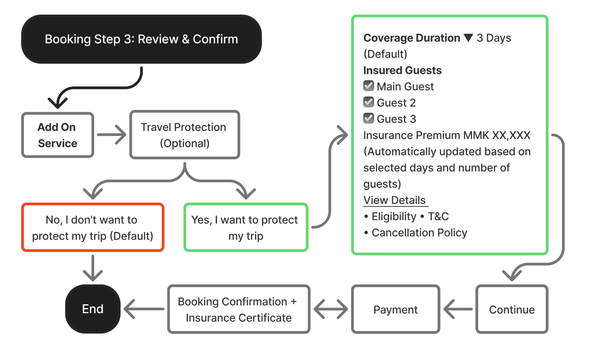

整体用户旅程流程

附加服务 → 选择旅行保险 → 选择保障时长与住客 → 查看保险详情 → 支付 → 预订与保险确认

预期结果

mTrip 保险附加服务允许用户在酒店预订过程中购买旅行保险。用户可在添加前查看保障范围、保费和权益。若选择该服务，保费将计入总额，并显示在「预订摘要」、「支付」和「确认」页面中。预订完成后，保险将与订单记录关联，以便日后查询与支持。该功能通过提供旅行保障增强用户信心，并通过保险合作创造收入机会。

模块 6.1：我的优惠券（促销优惠券 + App 内落地页 - web）

### 概述

促销与「我的优惠券」功能允许用户在 mTrip 超级 App 中查找、领取、管理和使用优惠券。它为缅甸用户提供友好的使用体验，减少手动操作步骤，提升优惠券使用率与预订率。

促销中心包含一个嵌入 mTrip App 内的动态网页落地页，可在无需更新 App 的情况下实时更新活动页面、横幅和营销内容。

已领取的优惠券会保存在「我的优惠券」中，符合条件的优惠券将在酒店结算时自动应用，以获得最大折扣。用户可以在支付前修改或移除优惠券。

核心功能需求

#### 促销中心

- 在 mTrip 应用中提供一个可交互的促销落地页。

- 展示活动横幅与促销活动。

- 支持季节性、每周、每月及特殊事件活动。

- 允许用户浏览可用的促销活动。

- 允许用户直接从活动页面领取优惠券。

- 用户选择「立即使用」时，将其跳转至相关预订流程。

#### 我的优惠券

用户应能够：

- 查看所有已领取的优惠券。

- 使用优惠码手动添加优惠券。

- 查看优惠券详情。

- 管理「可用」「已使用」与「不可用」优惠券。

- 使用「立即使用」跳转至相关预订流程。

#### 优惠券使用

- 在酒店结算时自动校验符合条件的优惠券。

- 自动应用最优可用优惠券。

- 在结算页面显示已应用的优惠券。

- 在价格明细中显示折扣。

- 允许用户在支付前更换或移除已应用的优惠券。

- 标准预订无需手动选择优惠券。

图：mTrip 超级 App – 我的优惠券流程

模块 7：预订偏好与收藏项 + 轻量模式功能

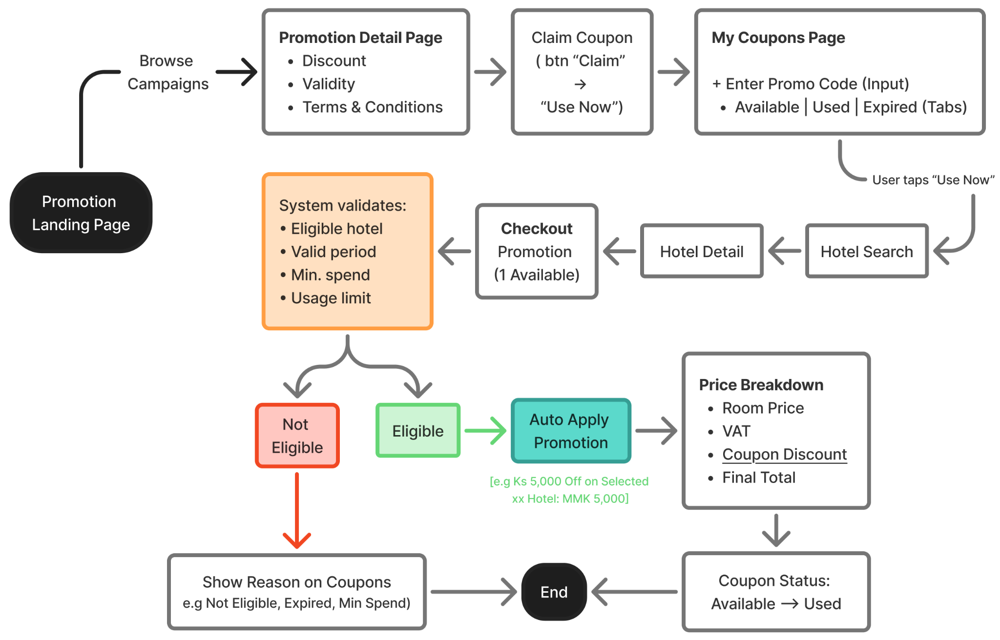

常旅客信息管理

功能概览

常旅客信息功能允许用户安全地保存和管理旅客信息，以便在酒店、航班及未来旅行服务中更快捷地完成预订。用户可手动输入旅客详情，或扫描护照以自动填充支持的字段。

### 功能需求

<!--TABLE_START-->
| 模块 | 需求 |
|---|---|
| 功能名称 | 常旅客信息 |
| 位置 | 账户 → 常旅客信息 |
| 描述 | 用户可添加、查看、编辑和删除已保存的旅客资料，以供未来预订使用。 |
<!--TABLE_END-->

#### 添加旅客

系统应允许用户创建新的旅客资料。

必填字段

- 国籍

- 名

- 姓

- 证件类型

  - NRC

  - 护照

  - 其他证件

- 证件号码

- 有效期（适用于 护照 或适用的证件类型）

#### 扫描护照

系统应提供「扫描护照」按钮。

护照扫描成功后，系统应自动填充：

- 护照号码

- 护照有效期

- 名

- 姓

用户可在保存前手动编辑任何自动填充的信息。

#### 旅客列表

系统应以列表形式显示所有已保存的旅客资料。

每位旅客卡片应显示：

- 全名

- 国籍

- 证件类型

- 证件号码（部分掩码）

用户可点击旅客卡片查看其详情。

#### 删除旅客

系统应支持两种删除旅客资料的方式。

##### 方式 1 — 滑动删除

- 用户将旅客卡片向左滑动。

- 显示「删除」操作。

- 用户点击「删除」。

- 旅客资料被永久删除。

- 显示一条轻提示消息：

已删除

- 旅客卡片从列表中移除。

##### 方式 2 — 从详情页删除

- 用户打开旅客资料。

- 滚动至底部。

- 点击「删除旅客」。

- 系统删除该旅客资料。

- 轻提示消息：

已删除

- 用户返回旅客列表。

- 已删除的旅客不再显示。

### 业务规则

- 用户可保存多个旅客资料。

- 旅客信息安全存储在用户账户内。

- 护照扫描为可选操作。

- 自动填充的信息可在保存前编辑。

- 已删除的旅客资料无法恢复。

#### 模块 7：功能 3 轻量模式（全局 UI 体验）

轻量模式是 mTrip 消费者 App 中的一项易用功能，旨在为数字经验有限的用户（尤其是缅甸用户）简化界面。它提供更大的触控区域、更好的可读性以及更少的干扰，同时保持与标准界面相同的功能与服务。

用户可通过两个入口在轻量模式与完整版本模式之间切换：

- 首页 – 悬浮操作按钮（FAB）

  - 首页提供专用的 FAB，便于快速访问。

  - 用户可点击 FAB 在轻量模式与完整版本模式之间切换。

  - FAB 会反映用户当前模式，并提供随时来回切换的简便方式。

- 个人资料 > 设置

  - 用户可从「个人资料」>「设置」手动启用或禁用轻量模式。

  - 这为偏好通过 App 设置管理模式的用户提供了第二入口。

轻量模式一旦启用，将在整个 App 中全局生效，直到用户切换回完整版本模式。所选模式在所有支持的页面与 MVP 功能中保持一致。

轻量模式作为全局展示层实现，这意味着它不会移除或改变底层功能或服务。所有 MVP 功能均应支持轻量模式，以确保 mTrip 消费者 App 具备一致、可访问且易用的体验。

## 模块 7 - 功能 2：收藏的酒店

### 功能概览

收藏的酒店功能允许用户管理其喜爱的酒店，以便快速访问和未来预订。

### 功能需求

<!--TABLE_START-->
| 模块 | 需求 |
|---|---|
| 功能名称 | 收藏的酒店 |
| 位置 | 「账户」>「收藏的酒店」 |
| 描述 | 展示用户收藏的全部酒店。 |
<!--TABLE_END-->

#### 收藏的酒店列表

系统应在一个纵向列表中展示全部收藏的酒店。

每张酒店卡片应展示：

- 酒店图片

- 酒店名称

- 位置

- 星级评分（如有）

用户可以点击酒店卡片以打开酒店详情页。

#### 删除收藏的酒店

系统应支持滑动删除。

##### 滑动操作

- 用户将酒店卡片向左滑动。

- 出现「删除」图标。

- 用户点击「删除」图标。

- 该酒店从收藏列表中移除。

- 显示一条轻提示：

已从「收藏的酒店」中移除

- 该酒店卡片从列表中消失。

### 业务规则

- 用户可收藏无限数量的酒店。

- 已删除的酒店可从酒店详情页再次收藏。

- 从「收藏的酒店」中移除酒店不会影响任何预订或预订历史。

- 收藏的酒店会通过用户账户在受支持的设备之间同步。

模块 8：支付（结算）

概述

活动资金与结算工作流使 mTrip 能够高效追踪并分配促销成本。优惠券兑换成功后，将自动更新活动预算并为财务与商家准备结算数据，确保清晰可见性并简化财务对账。

酒店预订功能整合了支付、促销与结算工作流，应用符合条件的促销、处理支付并为商家准备结算数据。它在保持准确记录的同时实现实时预算追踪与自动化成本分配，为客户带来顺畅的预订体验。

### mTrip 活动费用记录示例

<!--TABLE_START-->
| 预订号 | 活动 | 折扣（MMK） | mTrip 承担 | 商家承担 | 合作方承担 | 状态 |
|---|---|---|---|---|---|---|
| BK10001 | 新用户活动 | 20,000 | 20,000 | 0 | 0 | 已完成 |
| BK10015 | 夏日促销 | 30,000 | 15,000 | 15,000 | 0 | 已完成 |
| BK10032 | 酒店周 | 40,000 | 0 | 40,000 | 0 | 已完成 |
| BK10058 | 银行合作方促销 | 50,000 | 0 | 0 | 50,000 | 已完成 |
<!--TABLE_END-->

结算架构图（系统架构）

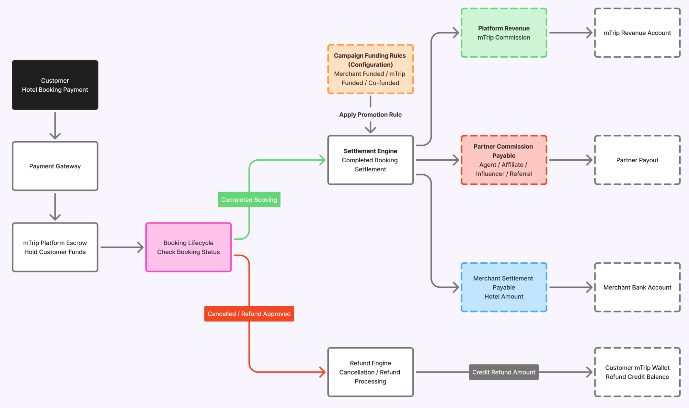

概要说明

预订完成后，结算引擎应用促销资金规则，并将资金分配到平台佣金、应付合作方佣金与应付商家结算账户，同时由退款引擎处理取消与退款。

结算决策流程（业务规则）

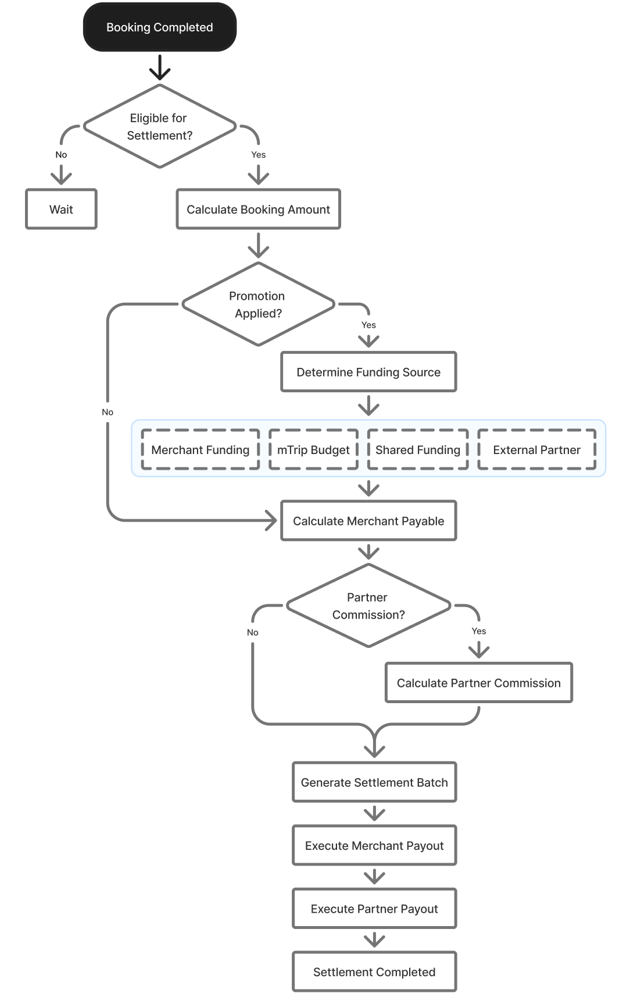

财务结算矩阵

<!--TABLE_START-->
| 场景 | 客户支付 | 酒店结算 | mTrip 佣金 | 客户退款 |
|---|---|---|---|---|
| 酒店预订成功 | 酒店预订金额 | 酒店金额 − 佣金 / （例如 MMK 50,000 −10%） | 根据商家协议扣减佣金（例如 10%） | 不适用 |
| 客户取消（免费取消） | 已支付 | 不结算 | 无佣金 | 100% 退款至 mTrip 钱包 |
| 客户取消（部分可退） | 已支付 | 按酒店取消政策结算 | 按商家协议收取佣金 | 部分退款至 mTrip 钱包 |
| 客户取消（不可退款） | 已支付 | 按酒店取消政策结算 | 按商家协议保留佣金 | 不退款 |
| 酒店取消预订 | 已支付 | 不结算 | 无佣金 | 100% 退款至 mTrip 钱包 |
| 支付失败 | 支付未成功 | 不结算 | 无佣金 | 不扣款 |
<!--TABLE_END-->

8.3 退款结算矩阵

<!--TABLE_START-->
| 场景 | 退款金额 | 退款方式 | 结算操作 |
|---|---|---|---|
| 客户取消（免费取消） | 100% | mTrip 钱包 | 不向酒店商家结算 |
| 客户取消（部分可退） | 按酒店取消政策 | mTrip 钱包 | 按可退款金额调整结算 |
| 客户取消（不可退款） | 不退款 | 不适用 | 酒店结算按商家协议继续执行 |
| 酒店取消预订 | 100% | mTrip 钱包 | 酒店结算取消 |
| 支付失败 | 100%（若已扣款）或不扣款 | 原路退回或自动撤销 | 不结算 |
<!--TABLE_END-->

### 业务规则

- 客户就酒店预订向 mTrip 进行单笔支付。

- mTrip 在将剩余金额结算给酒店商家之前扣减约定佣金。

- 商家结算按配置的结算周期处理（例如每周、每两周或每月）。

- 酒店结算仅在住客退房后针对已完成的预订处理。

- 退款资格遵循酒店的取消政策。

- 所有已批准的退款均记入客户的 mTrip 钱包。

- 已取消且全额退款的预订不计入商家结算。

- 应为财务与酒店商家生成结算报表以便对账。

- 每个酒店商家应拥有可通过管理后台独立配置的结算周期。

- 系统应支持不同酒店商家使用不同的结算周期（例如每日、每周、每两周、每月或指定结算日期）。

- 结算引擎应根据每个商家配置的结算计划自动处理结算，且不影响其他商家。

- 结算批次应根据每个商家配置的结算周期归集符合条件的预订交易。

- 系统应为每笔财务交易维护会计分录，包括预订支付、佣金、商家应付款、结算打款、退款、调整、税费、手续费及促销交易。

- 促销相关交易应记录促销资金来源（例如商家出资、mTrip 出资、共同出资或合作伙伴出资），以确保结算与会计处理的准确性。

- 当促销被应用时，系统应在确定商家最终结算金额之前，根据配置的出资责任自动计算并分摊促销成本。

- 每笔财务交易应生成可审计的会计记录，以支持对账、财务报告与审计。

- 系统应为每笔预订交易维护完整的审计追踪，涵盖结算计算、调整、打款状态、促销出资及会计历史。

- 结算引擎应根据配置的佣金与结算规则支持多个应付方（例如酒店商家、代理商、联盟或外部合作伙伴）。

结算业务场景

场景 1 — 成功预订（共同出资促销）

<!--TABLE_START-->
| 相关方 / 余额 | 借方（-） | 贷方（+） | 余额 / 结果 | 备注 |
|---|---|---|---|---|
| 客户 | 950,000 | - | -950,000 | 客户支付 |
| 平台托管账户 | - | 950,000 | +950,000 | 持有客户付款 |
| 商家结算应付款 | 875,000 | - | 应付 875,000 | 酒店在扣除佣金与商家出资促销后收到款项 |
| 平台收入 | - | 75,000 | +75,000 | 10% 佣金（100,000）- 25,000 mTrip 促销分摊 |
| 合作伙伴佣金应付款 | 30,000 | - | 应付 30,000 | 来自 mTrip 收入的 3% 代理商佣金 |
| 商家活动出资 | 25,000 | - | 商家补贴 | 商家出资促销 |
| mTrip 活动费用 | 25,000 | - | 营销费用 | mTrip 出资促销 |
<!--TABLE_END-->

场景 2 — 客户在结算前取消

<!--TABLE_START-->
| 相关方 / 余额 | 借方（-） | 贷方（+） | 备注 |
|---|---|---|---|
| 平台托管账户 | 950,000 | - | 冲销托管 |
| 客户钱包 | - | 950,000 | 退款至 mTrip 钱包 |
| 商家结算 | 0 | 0 | 不结算 |
| 平台收入 | 0 | 0 | 不确认收入 |
| 合作伙伴佣金 | 0 | 0 | 无佣金 |
| 活动预算 | 视业务规则而定 | 通常无消耗 |  |
<!--TABLE_END-->

场景 3 — 商家出资促销

促销金额 = 100,000 MMK

<!--TABLE_START-->
| 相关方 | 影响 |
|---|---|
| 客户 | 支付 900,000 |
| 商家 | 促销成本 100,000 |
| mTrip | 仍赚取 100,000 佣金 |
| 代理商 | 获得 30,000 |
| 商家实收 | 800,000 |
<!--TABLE_END-->

场景 4 — mTrip 出资促销

促销金额 = 100,000 MMK

<!--TABLE_START-->
| 相关方 | 影响 |
|---|---|
| 客户 | 支付 900,000 |
| 商家 | 收到 900,000 |
| mTrip | 佣金 100,000 - 促销 100,000 = 0 |
| 代理商 | 30,000（若仍适用） |
| 营销 | 费用 100,000 |
<!--TABLE_END-->

场景 5 — 推荐奖励（50,000 MMK 钱包入账）

<!--TABLE_START-->
| 相关方 | 借方（-） | 贷方（+） | 备注 |
|---|---|---|---|
| mTrip 营销 / 奖励预算 | 50,000 | - | 推荐活动费用 |
| 客户钱包 | - | 50,000 | 成功预订后发放钱包入账 |
<!--TABLE_END-->

模块 9：预订确认与预订管理

图 1：完成支付与预订确认工作流程

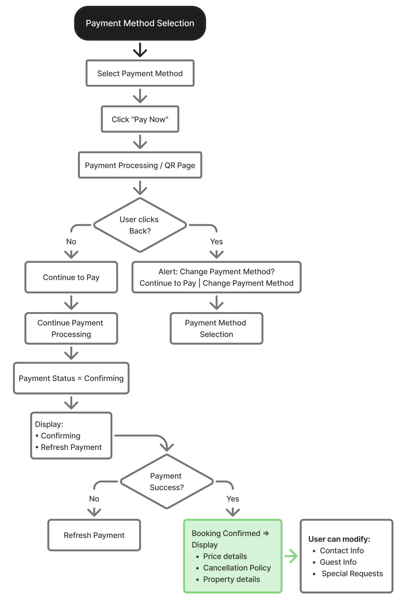

预期结果

用户在选择支付方式后发起支付流程。若用户在支付仍在处理中时点击「返回」按钮，系统将显示确认对话框，询问用户是继续支付还是更改支付方式。

- 若用户选择「继续支付」，支付处理将继续进行，系统将检查支付状态直至完成。

- 若用户选择「更改支付方式」，用户将被跳转至「支付方式选择」页面，选择其他支付方式并重新发起支付流程。

支付成功完成后，系统将显示「预订确认」页面。预订确认后，用户仍可更新联系人信息、住客信息与特殊要求，但须遵守酒店的修改政策。

关键业务规则

支付

- 用户必须在点击「立即支付」前选择一种支付方式。

- 在支付处理过程中，用户可以返回并更改支付方式。

- 在支付网关确认交易之前，支付状态保持为「确认中」。

- 用户可以手动刷新支付状态。

预订确认

- 支付成功后，预订状态变更为「已确认」。

- 系统将向注册邮箱发送预订确认。

- 用户可以重新发送确认邮件。

- 确认后仅可修改联系人信息、住客信息和特殊要求（受酒店政策约束）。

图 1.1：预订取消旅程

整体流程：支付 → 确认 → 取消 → 退款

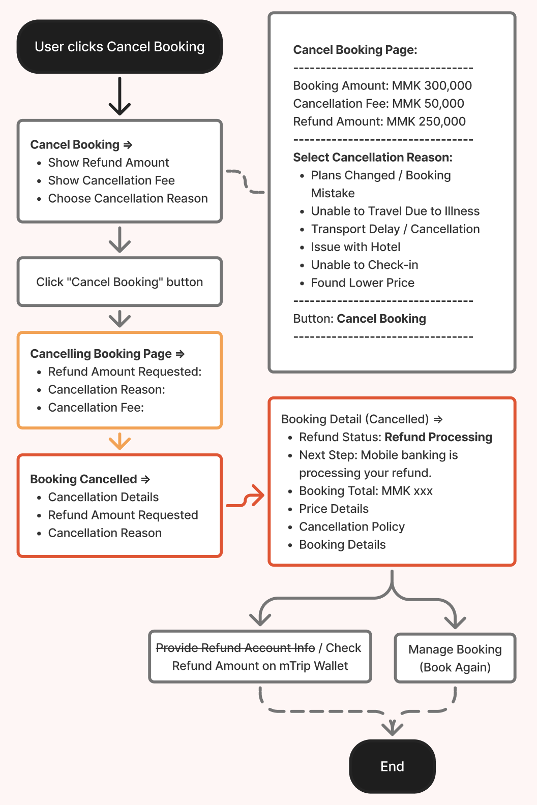

酒店预订取消

取消资格以酒店的取消政策为准。

取消页面显示：

- 取消费用

- 退款金额

- 取消原因

用户在确认前必须选择一个取消原因。

### 退款

- 取消后，预订状态变更为「已取消」。

- 系统发起退款申请。

- 预订详情页面显示：

  - 退款状态（例如：退款处理中）

  - 下一步

  - 预订总额

  - 价格明细

  - 取消政策

  - 预订详情

- 用户仅可将退款退回其 mTrip 钱包账户。

图：案例 2（异常情况）——预订确认失败（由酒店商家导致）工作流程

整体流程：支付成功 → 预订确认失败（由酒店商家导致）

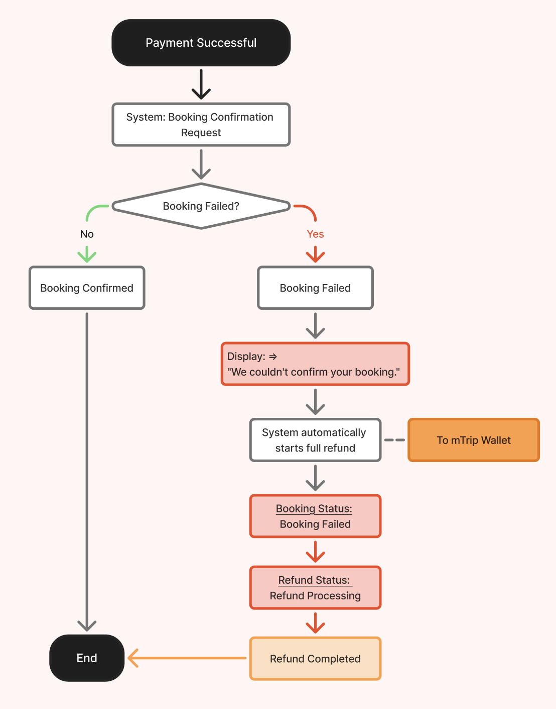

异常处理 —— 酒店无法履行预订

概要说明

本场景描述当酒店因运营或不可预见的情况而无法履行已确认的预订时，系统如何处理此类情况。由于这些事件并不常见且通常需要人工协调，因此将其作为异常流程而非标准用户预订流程进行管理。

可能原因

- 酒店超售

- 客房不可用

- 酒店维修或临时停业

- 不可抗力（例如：自然灾害、政府限制）

- 酒店运营问题

- 供应商发起的取消

业务规则

- 当已确认的预订无法履行时，酒店或供应商必须通知 mTrip。

- 运营团队或客户支持团队审核并核实取消申请。

- 系统将立即通过推送通知、邮件和 App 内通知告知客户。

- 客户支持可协助客户寻找替代酒店，具体视房源情况与业务政策而定。

- 若无法安排替代预订或用户拒绝该安排，该预订将被取消并启动全额退款。

- 对于酒店发起的取消，不得向客户收取取消费用。

- 退款将遵循标准退款处理流程与状态跟踪。

- 所有取消操作均应记录在预订历史中，以供审计。

预期结果

当酒店无法履行已确认的预订时，客户会及时获知。运营团队负责协调解决，尽可能协助安排替代预订；若无法找到合适的替代方案，则启动全额退款。预订状态、退款状态和沟通记录都会更新，以确保透明度，并为客户和支持团队提供完整的跟踪信息。

图：案例 3 ~ 取消待支付预订（到店支付）

待支付 → 取消 / 超时

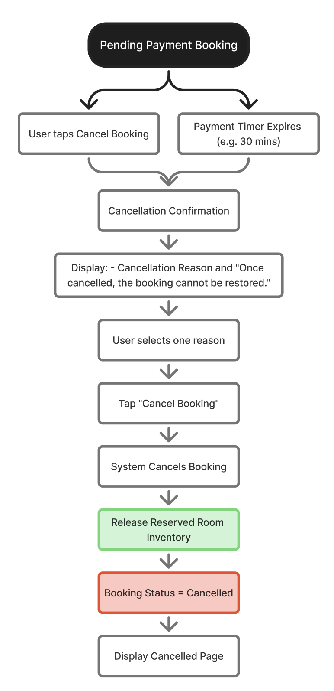

#### 预期结果

若用户点击「取消预订」，或在支付完成前支付倒计时结束，该待支付预订将被取消。

取消预订时，用户需选择取消原因并点击「取消预订」按钮。由于尚未完成支付，系统随后将取消该待支付预订。

取消成功后，系统将：

- 将预订状态更新为「已取消」。

- 自动将临时预留的客房库存释放回酒店的可售库存。

- 显示「预订已取消」页面，包含取消详情和「再次预订」按钮，用户可返回酒店详情页并按需创建新预订。

模块 10：通知中心 + 预订风险管理与申诉

通知渠道概述

通知管理模块通过多种沟通渠道及时推送更新，在酒店预订生命周期的各个阶段让用户保持知情。

通知基于预定义的预订事件自动触发，并可根据事件类型与业务需求，通过推送通知、App 内通知、短信和邮件发送。

通知系统的目标是：

- 让用户及时了解重要的预订更新。

- 提升用户参与度与预订后体验。

- 通过主动沟通减少客户支持咨询。

- 在需要时支持呼叫中心跟进等额外运营服务。

通知渠道矩阵

<!--TABLE_START-->
| 事件 | 推送 | App 内 | 短信 | 邮件 | 附加服务 |
|---|---|---|---|---|---|
| 酒店预订已确认 | ✅ | ✅ | ✅ | ✅ | 客服跟进 |
| 酒店预订已取消 | ✅ | ✅ | ✅ | ✅ | 客服跟进 |
| 「撰写评价」请求 | ✅ | ✅ | 可选 | ✅ | — |
<!--TABLE_END-->

通知事件规范

<!--TABLE_START-->
| 事件 | 触发条件 | 推送通知 | App 内通知 | 短信 | 邮件 |
|---|---|---|---|---|---|
| 酒店预订已确认 | 支付成功且预订状态变更为「已确认」。 | 通知用户酒店预订已确认，并提供预订详情的快捷入口。 | 在「我的预订」中展示预订确认信息及预订凭证链接。 | 发送包含预订 ID 的确认消息。 | 发送确认邮件，内含预订摘要与预订凭证。 |
| 酒店预订已取消 | 预订被用户或酒店取消。 | 通知用户预订已取消。 | 展示取消状态与退款信息。 | 发送取消确认信息，并附退款参考编号。 | 发送取消确认邮件，内含退款金额、退款方式及预计处理时间。 |
| 评价请求 | 退房后 1 天且尚未提交评价时自动触发。 | 邀请用户对本次入住进行评分与评价。 | 展示提交酒店评价的提醒。 | （可选）通过短信发送提醒。 | 发送邮件，请用户分享其酒店体验。 |
<!--TABLE_END-->

## 业务规则

- 通知应由系统事件自动触发。

- 单个事件可同时触发多个通知渠道。

- 推送与App 内通知应对所有用户默认开启。

- 短信通知仅应在重要的预订相关事件时发送，或按业务配置开启时发送。

- 邮件通知应包含预订详情，并视情况包含可下载的预订凭证。

- 每个已完成的预订，用户应仅收到一次「撰写评价」请求。

- 若用户已提交评价，则不应再发送评价请求通知。

- 通知模板应支持本地化与多语言。

- 通知内容应支持动态变量（例如：酒店名称、预订 ID、入住日期、住客姓名、退款金额）。

## 模块 10.1：预订风险管理与申诉

用户欺诈管理

为保护 mTrip 平台免遭滥用，同时维持公平的用户体验，系统应基于用户行为、预订模式与取消历史，实施可配置的多级欺诈管理机制。欺诈检测规则通过 mTrip 管理后台配置的阈值自动评估，同时由运营或风险管理团队审核被标记的账户，并在必要时执行人工处置操作。

#### 级别 1 – 警告

超过所配置欺诈阈值的用户，将收到关于异常预订或取消活动的App 内警告。此阶段不施加任何功能限制，用户的活动将继续受到监控。

#### 级别 2 – 账户暂停

若用户的欺诈分值达到下一个配置阈值，系统应自动实施账户暂停。被暂停的用户在通过成功申诉或管理决定解除暂停之前，无法使用 App。

#### 申诉流程

处于账户暂停状态的用户可通过应用提交申诉，并提供：

- 书面说明。

- 辅助附件（照片或文件）。[可附上截图或文件（最大 20 MB）。]

运营或风险管理团队应结合用户的预订历史与欺诈指标审核申诉。基于审核结果，管理员可：

- 解除功能限制。

- 维持限制。

- 若确认存在欺诈活动，则将账户升级为「已封禁」状态。

用户应在App 内收到申诉结果通知。

#### 已封禁账户

对于已确认或屡次发生的欺诈活动，管理员可永久封禁用户账户。一旦封禁：

- 登录时应显示账户暂停提示。

- 所有应用功能应被禁用。

- 用户仅可退出登录。

#### 欺诈检测规则

欺诈检测引擎应支持可配置的规则与阈值，包括但不限于：

- 在可配置的时间段内过度频繁地取消预订。

- 取消率超过所配置的阈值。

- 同一入住日期对同一酒店的多次预订超过所配置的阈值。

- 由运营或风险管理团队定义的其他欺诈规则。

mTrip 管理后台应提供欺诈管理能力，包括：

- 欺诈阈值与规则配置。

- 被标记用户看板。

- 欺诈级别（警告、功能限制、已封禁）。

- 欺诈触发历史与原因。

- 预订与取消历史。

- 同一酒店 / 同一入住日期的预订检测。

- 申诉审核队列，包含已提交的说明与附件。

- 管理操作：批准申诉、维持限制、解除限制、暂停用户或封禁用户。

欺诈管理状态流转：正常 → 警告 → 功能限制 → 申诉 →（已批准 → 正常）/（已拒绝 → 受限）/（已升级 → 已封禁）

### 退款政策与平台费透明度

为提升透明度，mTrip 应提供在线退款政策，用户可在预订前与预订后访问。在结算过程中，用户应能够访问「什么是平台费？」或「便利费」信息链接，以了解退款的计算方式。

退款政策应明确说明以下内容：

- 首次预订支付时不收取平台费。

- 仅当客户主动发起预订取消时，才依据平台费政策扣除平台费。

- 如适用，酒店取消费用由酒店的取消政策决定。

- 剩余符合条件的退款金额将存入客户的 mTrip 钱包。

- 退款处理通常需要 3–7 个工作日。

- 可提供退款示例，以帮助用户理解退款计算方式。

该信息可确保用户在确认预订前了解退款政策，提升整个预订流程的透明度，并有助于减少与退款相关的争议。

## 图：预订取消流程（+ 平台费）

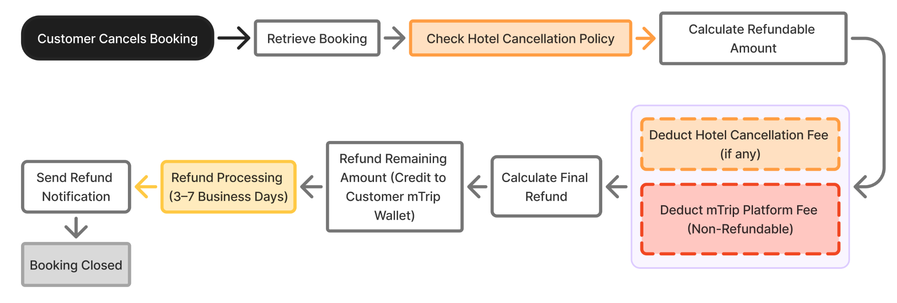

## 取消、退款与平台费政策

酒店预订在结算时不收取平台费；客户仅需支付酒店金额。

若预订被取消，系统应依据酒店的取消政策计算可退款金额。在处理退款前，系统应扣除适用的平台费（便利费）以及任何酒店取消费用（如适用）。剩余符合条件的退款金额随后将存入客户的 mTrip 钱包。

退款仅退至 mTrip 钱包，可能需要 3–7 个工作日。退款完成后，客户将收到通知。

平台费适用情形

<!--TABLE_START-->
| 场景 | 平台费 | 业务规则 |
|---|---|---|
| 预订支付完成（预订生效） | 0（不收取） | 客户成功完成酒店预订支付时不收取平台费。预订在入住、完成或取消前保持生效。 |
| 客户主动取消 | ✅ 适用 | 在退款至客户 mTrip 钱包前，应从可退款金额中扣除平台费。 |
| 支付超时（预订未确认） | ❌ 不适用 | 若因支付超时在确认前自动取消预订，则不收取平台费。 |
| 酒店拒绝 | ❌ 不适用 | 若酒店无法接受或确认预订，则不收取平台费。 |
| 系统预订失败 | ❌ 不适用 | 若因系统或技术问题导致预订失败，则不收取平台费。 |
| 商家主动取消 | ❌ 不适用 | 若商家或酒店取消已确认的预订，则不收取平台费。 |
<!--TABLE_END-->

模块 11：评价、评分与 AI 评价摘要

概要说明

用户在完成酒店入住后可提交评价与评分。评价包括综合评分、清洁度、位置、服务与设施的分项评分、旅客类型、文字评价内容以及最多 10 张照片。

旅客类型：

- 独自出行

- 情侣

- 家庭

- 朋友

- 商务

评价须经 mTrip 管理员批准后方可发布。

酒店商家仅可回复已发布的评价。

用户评价与评分工作流程图

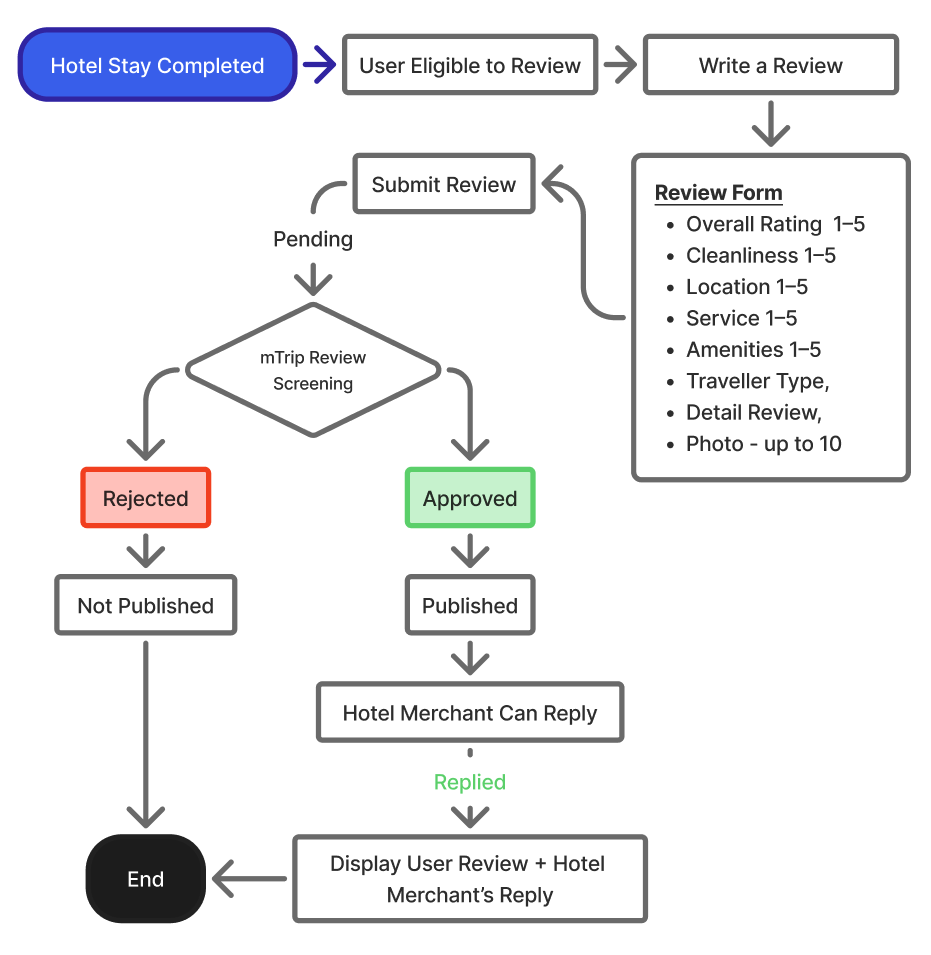

评价与评分权限矩阵表

<!--TABLE_START-->
| 操作主体 | 可提交 | 可批准/拒绝 | 可编辑 | 可回复 | 可删除 |
|---|---|---|---|---|---|
| 客户 | ✅ | — | ❌ | ❌ | ❌ |
| mTrip 管理员 | — | ✅ | ❌ | — | ✅ |
| 酒店商家 | — | ❌ | ❌ | ✅ | ❌ |
<!--TABLE_END-->

酒店评分分值与标签标准

<!--TABLE_START-->
| 分数区间 | 显示标签 | 标准 / 含义 |
|---|---|---|
| 9.0–10.0 | 卓越 | 卓越的体验 |
| 8.0–8.9 | 优秀 | 优秀的体验 |
| 7.0–7.9 | 很好 | 很好的体验 |
| 6.0–6.9 | 好 | 总体良好的体验 |
| 5.0–5.9 | 一般 | 尚可接受的体验 |
| 4.0–4.9 | 低于一般 | 低于预期标准 |
| 3.0–3.9 | 差 | 存在多个问题 |
| 2.0–2.9 | 很差 | 存在严重问题 |
| 1.0–1.9 | 极差 | 体验极差 |
<!--TABLE_END-->

显示标签 = 根据最终综合评分所属的分数区间赋予的标签。

无已通过审核的评价时：显示「新酒店 · 暂无评价」，而非数值评分。

评分仅依据已通过审核并已发布的评价计算。

评价得分计算

每位用户通过 5 个评分维度对酒店进行评分，每个维度按 1 至 5 分计分。

<!--TABLE_START-->
| 类别 | 分数区间 |
|---|---|
| 总体 | 1–5 |
| 清洁度 | 1–5 |
| 位置 | 1–5 |
| 服务 | 1–5 |
| 设施 | 1–5 |
| 最高总分 | 25 |
<!--TABLE_END-->

##### 计算每位用户的评价得分

系统将用户在全部 5 个类别中的评分相加。

公式：用户评价得分 =（类别总分 ÷ 25）× 10

结果由 5 分制类别评分转换为 10 分制评价得分。

示例：

<!--TABLE_START-->
| 类别 | 用户评分 |
|---|---|
| 总体 | 5 |
| 清洁度 | 4 |
| 位置 | 5 |
| 服务 | 4 |
| 设施 | 4 |
| 合计 | 22 / 25 |
<!--TABLE_END-->

计算：（22 ÷ 25）× 10 = 8.8

因此，该用户的评价得分为 8.8 / 10。

##### 计算酒店综合评分

酒店综合评分根据所有已通过审核的用户评价得分的平均值计算。

公式：酒店综合评分 = 所有用户评价得分之和 ÷ 已通过审核的评价数量

示例：

<!--TABLE_START-->
| 用户 | 用户评价得分 |
|---|---|
| 用户 1 | 8.8 |
| 用户 2 | 9.2 |
| 用户 3 | 7.6 |
| 用户 4 | 8.4 |
<!--TABLE_END-->

计算：（8.8 + 9.2 + 7.6 + 8.4）÷ 4 = 8.5

因此：酒店综合评分 = 8.5 / 10

酒店评分保留 1 位小数展示。

##### 酒店评分的评价纳入条件

- 仅已通过审核并发布的评价纳入酒店评分计算。

- 已拒绝、未发布或已删除的评价不纳入计算。

- 若酒店没有已通过审核的评价，则显示「新酒店 · 暂无评价」，而不显示数值评分。

- 当首条已通过审核的评价发布后，酒店评分将使用该评价进行计算。

- 每当有新的已通过审核的评价发布，或现有的已通过审核的评价被移除时，酒店评分将重新计算。

模块 12：AI 酒店助手（阶段 2 | 不包含在首次发布中）

图 3：AI 助手用户旅程

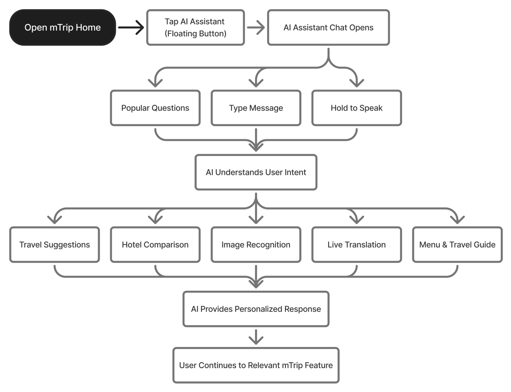

### 整体旅程

启动 AI → 提问或选择问题 → AI 理解意图 → AI 提供协助 → 继续进入相关服务

### 预期结果

用户成功与 mTrip AI 助手交互，以获取个性化旅行推荐、比较酒店、翻译语言、识别图片并获取智能旅行协助，从而实现在 mTrip 各项服务间的顺畅导航。

模块 13：在线客服与客户支持

概述

客户支持聊天模块为酒店预订相关咨询提供快速帮助，覆盖入住前、入住期间及入住后。该模块首先通过聊天机器人 / AI 协助处理常见问题。若问题未解决，用户可转接人工客服。聊天会话保持活跃，并可从「消息」中恢复。

mTrip 支持聊天 – 入口

用户可通过以下入口访问 mTrip 支持聊天：

- 酒店预订详情页：点击「在线支持聊天」按钮，打开 mTrip 支持聊天以获取与预订相关的协助。

- 首页：点击标有「与我们聊天」的悬浮聊天按钮，打开 mTrip 支持聊天。

- 「更多」>「联系我们」：点击「与 mTrip 聊天」，打开 mTrip 支持聊天。

## 目标

- 针对常见预订咨询提供快速自助支持。

- 通过自动回复降低客户支持工作量。

- 使用户能够快速获取与具体预订相关的支持。

- 提供向人工客户支持的顺畅转接。

- 保留聊天记录以支持持续会话。

整体用户旅程

### 客户支持模块的功能需求

<!--TABLE_START-->
| 功能 | 需求 |
|---|---|
| 欢迎页面 | 打开支持聊天时显示欢迎消息。 |
| 预订选择 | 允许用户选择当前或历史预订，以获取结合上下文的支持。 |
| 一般咨询 | 允许用户在不选择预订的情况下发起支持会话。 |
| 推荐问题 | 显示与所选预订或一般咨询相关的预定义常见问题。 |
| 聊天机器人 | 针对常见客户支持问题提供自动回复。 |
| 人工客服 | 在需要额外协助时，允许用户转接人工客服。 |
| 聊天记录 | 保存聊天记录，并允许用户继续此前的会话。 |
| 结束会话 | 允许用户结束当前支持会话。 |
| 反馈 | 允许用户在会话结束后对支持体验进行评分。 |
| 最近浏览的酒店 | 展示最近浏览的酒店，以便在支持过程中快速参考。 |
<!--TABLE_END-->

## 人工客服转接

用户可随时通过选择「联系客户支持」转接人工客服。在以下情况下，系统还应建议转接：

- 聊天机器人无法回答用户的问题。

- 用户要求与客服人员通话。

- 咨询涉及支付争议、投诉或特殊要求。

- 需要人工介入才能解决问题。

### 会话管理

- 用户退出聊天页面后，聊天会话应保持活跃。

- 用户可从「消息」板块继续此前的会话。

- 用户登录后，所有聊天记录应在用户的各设备间同步。

- 用户可随时通过选择「结束会话」结束支持会话。

模块 14：联盟与推荐计划

推荐有礼功能概览

推荐有礼功能允许 mTrip 用户通过专属推荐码或推荐链接邀请好友。其目标是通过可信的推荐提升用户获取，在被邀请的好友完成首次酒店预订后，对推荐人与新用户双方给予奖励。

用户可通过即时通讯应用或社交媒体分享其推荐链接，也可手动分享其推荐码。该功能会跟踪从邀请到奖励发放的整个推荐旅程。一旦满足条件，奖励将发放至用户的 mTrip 钱包，用于后续预订。

推荐有礼功能以简洁与可扩展为设计原则，支持营销活动及更多推荐计划，同时在 mTrip 旅游超级 App 内确保流畅的用户体验。

mTrip 推荐有礼——用户对用户推荐旅程（整体工作流）

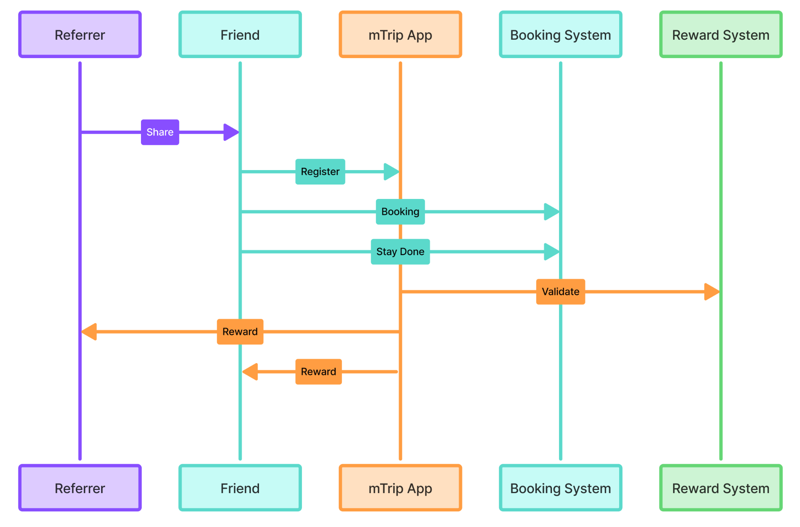

推荐链接与推荐码处理

<!--TABLE_START-->
| 场景 | 系统行为 |
|---|---|
| 用户分享推荐链接 | 每位用户都会被分配一个预先生成的专属推荐链接，可直接分享。当好友打开该链接时，将显示 mTrip Web 注册/登录页面，并在注册过程中自动预填推荐码。（若用户通过推荐链接注册，则用户无法从输入框中删除该推荐码） |
| 用户分享推荐码 | 好友在 mTrip Web 或移动 App 上注册时手动输入推荐码。系统会在完成注册前校验该推荐码。 |
| 存量用户 | 根据推荐活动规则，推荐权益仅适用于符合条件的新用户注册。 |
| 推荐关系绑定 | 注册成功后，推荐关系将永久绑定至新用户的账户，且在满足全部活动条件后发放奖励。 |
<!--TABLE_END-->

#### mTrip 推荐有礼——推荐旅程（整体工作流）

mTrip 推荐有礼推荐旅程描述了从邀请到奖励发放的完整推荐流程。存量用户将专属推荐链接或推荐码分享给好友，好友随后在 mTrip 上注册并完成其首次符合条件的酒店预订。系统会跟踪每一次推荐在注册、预订、入住完成及奖励资格各环节的进度。一旦满足全部推荐条件，奖励将自动发放至推荐人的 mTrip 钱包，从而提供透明且顺畅的推荐体验。

推荐计划时序图（端到端）

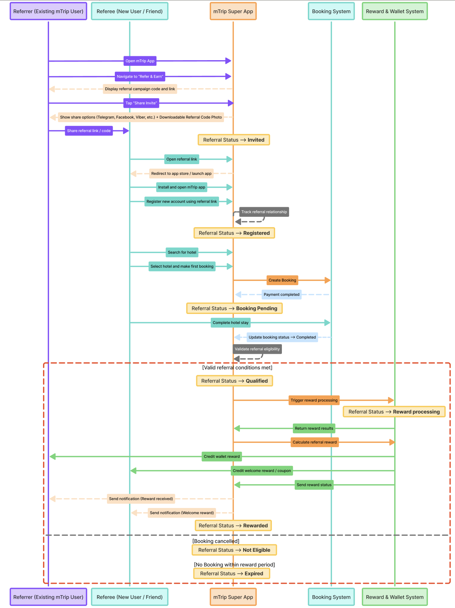

#### 推荐计划时序图（端到端）

推荐计划时序图勾勒了推荐过程中推荐人、被推荐用户、mTrip 平台、酒店预订系统与钱包服务之间的交互。它展示了推荐关系如何形成、各步骤如何校验资格，以及在被推荐用户首次成功完成酒店预订后奖励如何自动发放。

该流程确保奖励仅针对合法预订发放，为所有相关方维持透明度与自动化。

推荐计划可通过管理后台完全配置。管理员可轻松调整推荐人与被推荐用户双方的奖励金额、设置资格条件、定义符合条件的预订条件、管理推荐有效期、设定奖励有效期、确定活动时长，并修改其他计划规则，而无需进行系统变更。

模块 15：动态 App 主题管理

概述

动态季节主题管理模块允许 mTrip 超级 App 根据设定的季节性与促销主题轻松更换外观，而不影响其主要功能。该模块包含可通过管理后台管理的默认主题，管理员还可创建、排期并管理自定义主题。变更将按照设定的时间表自动发生，为用户提供顺畅且富有吸引力的体验。

### 业务需求

系统应提供预定义的默认主题（可由管理员自定义），包括：

- 默认 mTrip 主题

- 缅甸新年（泼水节）主题

- 点灯节主题

- 圣诞节主题

- 新年快乐主题

- 中国新年主题

支持的主题页面

启用中的主题应支持更新以下应用程序页面与 UI 组件：

<!--TABLE_START-->
| 页面 | 主题元素 |
|---|---|
| 启动页 | 默认启动页或节日启动页 |
| 应用 Logo | 默认 Logo 或节日 Logo（App Store / Play Store 图标更新可能需要发布新的 App 版本） |
| 登录与注册 | 背景图 / 插图 |
| 首页 | 顶部背景 / 主视觉横幅 |
| 服务菜单 | 酒店、餐厅预订、高端交通与旅游套餐的主题图标 |
| 底部导航栏 | 导航图标、图标强调色、导航背景（可配置） |
| 预订确认 | 顶部背景横幅 / 庆祝插图 |
| 预订凭证 / 发票 | 顶部横幅与底部品牌标识 |
| 酒店搜索页 | 顶部促销横幅背景 |
<!--TABLE_END-->

主题更新应仅修改视觉素材，同时保持现有的 App 布局、导航与功能不变。

管理员还应能够为营销活动、促销活动、目的地活动、合作、周年庆或未来的节日活动创建不限数量的自定义主题。

每个主题应支持：

- 主题名称

- 主题描述

- 主题缩略图 / 预览图

- 主题状态（草稿、已排期、启用、停用）

- 开始日期与时间

- 结束日期与时间

- 主题优先级（当多个主题重叠时）

管理员应能够在发布前预览完整主题、将主题保存为草稿、安排未来启用、编辑现有主题、复制主题、启用或停用主题，并在没有启用主题时自动回退到默认 mTrip 主题。

### 主题管理

- 系统应按照配置的排期自动启用和停用主题。

- 如果同时有多个主题处于启用状态，系统应展示配置优先级最高的主题。

- 如果主题素材不可用或加载失败，App 应自动展示相应的默认素材。

### 用户体验

不要求用户手动选择或切换主题。App 应自动获取并展示当前启用的主题。主题更新不应中断用户会话，也不应影响预订、支付、导航或任何其他 App 功能。

### 通过管理后台进行动态主题管理的验收标准

- 提供内置的默认节日主题，且可配置。

- 管理员可以创建、编辑、复制、预览、排期、启用和停用自定义主题。

- 主题支持可配置的启用时段与优先级。

- 支持的 App 页面自动展示启用的主题。

- 当没有启用的主题或素材时，展示默认素材。

- 主题更新仅影响品牌标识与视觉呈现。

- 更改 App Store 与 Play Store 图标时可能需要发布新的 App 版本；所有其他主题素材通过配置的主题动态更新。

—-----------—-----------—-----------—-----------—-----------—-----------—-----------—-----------—-----------—-----

## 模块 16 – 用户引导与教程

### 模块目标

通过提供情境化的新手引导、实用信息提示与可复用的教程内容，帮助用户理解并自信地使用 mTrip 消费者 App 的各项功能。该模块特别针对数字经验有限的用户设计，并支持在酒店、餐饮及未来 App 功能之间提供一致的学习体验。

### 16.1 酒店预订引导提示（Coach Mark）

#### 需求

为首次使用酒店预订功能的用户提供交互式引导提示（Coach Mark）新手体验。

#### 目标

引导首次使用的用户完成酒店预订旅程的关键步骤，帮助其了解如何搜索并完成酒店预订，而无需事先了解该 App。

#### 描述

当用户首次使用酒店预订功能时，系统将展示一系列情境化引导提示（Coach Mark），突出显示酒店预订旅程的主要元素。

引导提示流程将包含 7 个主要引导步骤，覆盖从进入酒店功能到完成预订流程的关键操作。

引导提示应：

- 突出显示每一步相关的 UI 元素。

- 提供简短的标题和简要说明。

- 清晰指示用户在引导中的进度。

- 允许用户进入下一步。

- 提供「跳过」选项，以便用户随时退出引导。

- 仅在用户首次体验酒店预订时展示引导。

- 在新手引导完成或跳过后，避免再次打扰用户。

#### 重新进入引导

在完成或跳过引导提示（Coach Mark）后，用户可以通过酒店搜索页上的「引导」图标再次访问酒店预订指南。

引导入口将提供以下内容的访问：

- 酒店预订教程视频

- 分步酒店预订指南

#### 图：酒店功能 — 用户引导与引导提示（Coach Mark）UI 说明

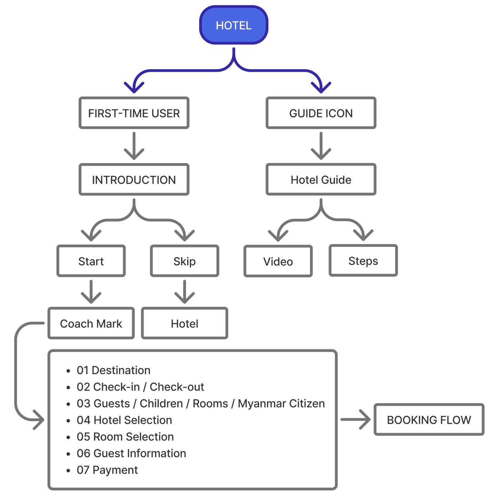

### 16.2 缅甸公民信息提示气泡

#### 需求

为酒店搜索页面显示的「缅甸公民」选项提供情境信息提示。

#### 目标

帮助用户在搜索酒店之前理解「缅甸公民」选项的用途及潜在影响。

#### 说明

将围绕「缅甸公民」选项提供两条信息提示气泡/提示信息。

提示气泡应：

- 说明「缅甸公民」选项代表什么。

- 帮助用户理解为何选择该选项可能会影响所显示的酒店价格或可订状态。

- 使用简单易懂的语言。

- 可在不打断酒店搜索流程的情况下访问。

- 允许用户在阅读后关闭或忽略该信息。

提示气泡内容应与系统实际实施的酒店定价及资格规则保持一致。

<!--TABLE_START-->
| 元素 | 缅甸公民提示气泡的最终文案 |
|---|---|
| 目标 | 「缅甸公民」复选框 + ⓘ |
| 标题 | 「缅甸公民」是什么意思？ |
| 描述 | 如果您是缅甸公民，请选择此选项。酒店房价及条件可能因公民身份而异。 |
| 关闭 / 行动号召 | 知道了 |
<!--TABLE_END-->

### 16.3 教程与视频指南

#### 需求

提供一个集中的「教程」页面，用户可在其中访问 mTrip 消费者 App 不同功能的教学视频与分步指南。

#### 目标

为用户提供一个可重复使用的学习中心，使其可随时学习如何使用酒店、餐饮及其他支持的功能，而不必仅依赖首次使用的引导。

#### 入口

用户可通过以下方式访问「教程」页面：

「个人资料」/「设置」→「教程」

#### 说明

「教程」页面将按功能类别组织学习内容。

初始类别可包括：

- 酒店

- 餐饮

- 其他 / 未来功能

每个类别将包含相关的教程内容，以双列网格布局显示，每个教程以视频卡片的形式呈现。

每个视频卡片应包含：

- 视频缩略图

- 播放指示

- 教程标题

- 相关类别

用户可选择某个教程以打开「视频详情 / 观看视频」页面，并在其中观看该教程。

#### 酒店教程内容

「酒店」类别应包含与酒店预订旅程相关的内容，包括：

- 酒店预订指南视频

- 酒店预订分步指南

- 未来新增的其他相关酒店教程

#### 可扩展性

「教程」模块应设计为可重复使用的内容结构，以便在不改变整体页面结构的情况下新增类别、视频与指南。

该模块应支持未来扩展至 mTrip 消费者 App 的其他功能，例如餐饮及其他服务。

### 模块级用户体验

三项功能共同构成统一的用户引导体系：

首次使用的用户 → 酒店引导提示（Coach Mark）→ 了解预订流程

回访用户 → 酒店指南图标 → 视频 + 分步指南

随时 →「设置」→「教程」→ 酒店 / 餐饮 / 其他教程

此方式既可在用户首次体验时提供情境化引导，也可提供用户随时需要帮助时都能访问的自助学习。

模块 17 – 酒店预订 UI、UX 与功能更新（2026 年 9 月 4 日）

本模块记录在上一版 PRD/设计基线之后对酒店预订功能所做的重大 UI、UX、功能及流程变更。最新批准的 Figma 设计及本 PRD 中更新后的需求应被视为开发与 QA 的当前唯一事实来源。

酒店预订 UI 与功能更新变更日志

<!--TABLE_START-->
| 序号 | 领域/功能 | 变更说明 | 更新后的流程/行为 | 状态 |
|---|---|---|---|---|
| 1 | 酒店预订状态 | 更新「酒店预订状态」页面，清晰区分酒店预订状态与支付状态。（查看更新后的 UI） | 酒店预订状态：确认中 → 已确认 / 支付状态：待支付 → 已支付 | 已更新 |
| 2 | 注册/登录 | 在初始注册入口页面将邮箱输入框替换为姓名输入框。更新「注册/登录」按钮设计与 CTA 呈现。 | 注册入口 → 更新后的认证 UI 输入（移除邮箱，新增姓名输入） | 已更新 |
| 3 | App 初始加载——语言选择 | 在 App 初始加载/进入体验中新增独立的「语言选择」页面。 | App 加载 → 语言选择 → 轻量模式/完整模式选择 | 新增 |
| 4 | App 初始加载——轻量/完整模式 | 将轻量模式设为语言选择后的默认体验，不再显示初始的轻量模式/完整模式选择弹窗。 | App 加载 → 语言选择 → App 首页→ 轻量模式 | 新增 |
| 5 | 预订 ID | 在关键的预订相关页面新增唯一预订 ID，以便更轻松地识别与查询预订。 / 预订 ID：MT-2025-123456 | 预订确认 → 预订详情 → 预订历史 / 已完成预订 → 显示预订 ID | 已更新 |
| 6 | 全局卡片/矩形圆角 | 统一酒店功能与 App 功能卡片/矩形 UI 组件的圆角。将圆角更新为 24px，以保持 App 内视觉风格一致。 | 原圆角 → 24px 标准圆角 | 已更新 |
| 7 | 退款方式页面 | 更新「退款摘要」下退款方式卡片与预计退款时间线卡片的字体排版，包括标题与正文文字，以提升可读性与视觉一致性。 | 原字体排版 → 更新后的标题/正文字体排版（调整了标题与正文的字号） | 已更新 |
| 8 | 预订确认——轻量模式与完整模式 | 更新轻量模式与完整模式下的「预订确认」页面，以与最新预订信息及 UX 设计保持一致。 | 预订完成 → 更新后的「预订确认」页面 | 已更新 |
| 9 | 确认页取消预订 | 从「预订确认」页面移除「取消预订」按钮。用户现在仅可从该页面访问预订详情。修改或取消预订在「我的选择」中管理。 | 预订确认 → 查看详情 → 我的选择 / 预订详情 → 修改预订 / 取消预订 | 已更新 |
| 10 | 需登录账户提醒 | 更新用户未登录时尝试访问酒店预订功能所显示的需登录账户提醒的标题与内容。 | 标题：需登录账户！内容：是否立即前往登录/注册页面？确认 → 注册/登录页面 | 已更新 |
| 11 | 设置个人资料——第 1 步与第 2 步 | 从「设置个人资料」第 1 步和第 2 步中移除「跳过」按钮。新增确认提醒，允许用户立即完成设置或稍后设置。 | 设置个人资料 → 现在设置个人资料？ → 稍后 / 立即设置 | 已更新 |
| 12 | 设置个人资料提醒 | 新增个人资料设置提醒，内容如下：标题：现在设置个人资料？内容：只需填写一次信息，即可让今后的预订更快捷、更轻松。按钮：稍后 / 立即设置 | —稍后 → 跳过第 1 步与第 2 步 / — 立即设置 → 完成第 1 步 → 完成第 2 步 | 新增 |
| 13 | 关联邮箱——账户安全 | 在「设置」>「账户」>「账户安全」下新增「关联邮箱」页面。未关联邮箱的用户将看到「关联邮箱」选项。 | 设置 → 账户 → 账户安全 → 关联邮箱 → 输入邮箱 → 发送验证码 | 新增 |
| 14 | 关联邮箱——验证 | 新增邮箱关联页面，允许用户输入邮箱地址并接收验证码。 | 关联邮箱 → 输入邮箱 → 发送验证码 → 邮箱验证 | 新增 |
| 15 | 酒店评价——有用/举报 | 从酒店用户评价列表页面移除「有用」（点赞）互动按钮与「举报评价」图标。 | 原评价操作 → 仅评价内容 | 已更新 |
| 16 | 多酒店预订——添加更多住宿 | 通过引入可展开/折叠的「添加更多住宿」卡片更新多酒店预订体验，使额外酒店住宿更易管理。 / 多住宿上限：用户可添加的最大住宿数量由管理后台配置控制。 / 例如，若最大住宿上限配置为 3 个住宿，则用户可在单次预订中最多添加 3 个住宿。达到最大上限后，「添加更多住宿」按钮将被隐藏或禁用。 / 当用户移除一个或多个先前添加的住宿后，「添加更多住宿」选项将重新可用。 | 酒店预订 → 添加更多住宿 → 展开 / 折叠 → 添加额外住宿 / 用户可根据管理后台配置的最大住宿上限添加多个住宿。达到配置的最大上限后，「添加更多住宿」按钮将被隐藏/禁用。若用户移除已添加的住宿，该按钮将重新可用，直至达到最大上限。 | 已更新 |
| 17 | 多酒店预订——轻量模式限制 | 在轻量模式中禁用/移除多酒店预订。该功能仅在完整模式中可用。 | 轻量模式 → 仅限单酒店预订 / 完整模式 → 可使用多酒店预订 | 已更新 |
| 18 | 服务条款/隐私政策/房屋规则协议 | 更新「查看并确认」步骤中显示的协议内容。已移除此前的复选框/确认交互。 / 隐私政策、条款与条件以及促销优惠券中心页面必须以内嵌网页链接的形式在 mTrip App 中实现，以便 App 始终展示并与 mTrip 网站发布的最新版本保持同步。 | 第 3 步（共 4 步）：查看并确认 → 显示协议文字 → 继续 / 确认 | 已更新 |
| 19 | 预订协议内容 | 更新协议文字，以清晰传达用户的接受及 mTrip 的中介角色。 | 「继续即表示我同意服务条款、隐私政策以及该物业的房屋规则。我理解 mTrip 作为本次预订的中介代理。」 | 已更新 |
| 20 | 协议交互 | 用户不再需要手动勾选复选框或通过额外提醒确认协议。协议在「查看并确认」步骤中作为说明性文字呈现。 | 查看并确认 → 阅读协议 → 继续 / 确认 / （已移除复选框） | 已更新 |
| 21 | 选择客房（相同或不同房型） | 此前：用户只能预订一间客房。 / 更新后：用户现在可以选择并预订多间客房，房型可相同或不同。 | 选择客房 → 选择多间客房（相同或不同房型） | 已更新 |
<!--TABLE_END-->

#### 17.1：预订取消入口

原：预订确认 → 取消预订

更新后：预订确认 → 查看详情 → 我的选择 / 预订详情 → 修改预订 / 取消预订

需求：

- 「取消预订」按钮应不再显示在预订确认页面。

- 预订确认页面应提供「查看详情」按钮。

- 希望修改或取消预订的用户应通过「我的选择」进入该预订。

- 「修改预订」和「取消预订」操作应可在相应的预订详情页面中使用。

17.2：轻量模式 / 完整模式

更新后的入口流程：App 启动 → 语言选择 → 轻量模式 / 完整模式选择 → 首页

模式可用性

<!--TABLE_START-->
| 功能 | 轻量模式 | 完整模式 |
|---|---|---|
| 酒店搜索 | ✓ | ✓ |
| 酒店预订 | ✓ | ✓ |
| 单酒店预订 | ✓ | ✓ |
| 多酒店预订 | — | ✓ |
<!--TABLE_END-->

### 17.3：设置个人资料

原：

设置个人资料第 1 步 → 跳过

设置个人资料第 2 步 → 跳过

更新后：设置个人资料 → 是否立即设置个人资料？

稍后

→ 跳过第 1 步和第 2 步

→ 继续前往下一个目的地

立即设置

→ 第 1 步 → 第 2 步 → 完成个人资料设置

提示标题：「是否立即设置个人资料？」

提示内容：「只需添加一次您的信息，即可让您今后的预订更快捷、更轻松。」

提示按钮：「稍后」|「立即设置」

17.4 多客房选择 – 客房数量同步

在酒店搜索页面选择的客房数量与房型列表 / 房型选择页面上的客房数量相关联。

当用户点击「选择」选择房型时，客房数量按钮将自动使用酒店搜索中所请求的相同客房数量。这可避免要求用户手动重新输入客房数量。

<!--TABLE_START-->
| 搜索页面客房数量 | 选择前的房型列表 | 用户操作 | 点击「选择」后 |
|---|---|---|---|
| 1 间房 | 选择 | 点击选择 | − 1 + |
| 2 间房 | 选择 | 点击选择 | − 2 + |
| 3 间房 | 选择 | 点击选择 | − 3 + |
| 4 间房 | 选择 | 点击选择 | − 4 + |
<!--TABLE_END-->

普通单客房场景

对于普通的单客房预订：

- 用户在酒店搜索页面选择 1 间房。

- 用户搜索酒店并打开房型选择页面。

- 每个可用户型都会显示「选择」按钮。

- 用户点击所需房型的「选择」。

- 「选择」按钮变为客房数量控件 − 1 +。

- 客房数量初始化为 1，依据酒店搜索页面所选的客房数量。

#### 多客房场景

例如，如果用户以 2 间房进行搜索，则所选房型在点击「选择」后将自动以 2 间房开始。

关键规则：初始客房数量始终与酒店搜索期间所选的客房数量同步。随后用户可使用 − / + 控件调整数量，但须符合客房总数要求。

适用于轻量模式与完整模式：两种模式都将使用相同的「选择」→ − N + 交互，以保持一致并避免用户在选房时产生困惑。

17.5 促销优惠券资格与管理后台配置

优惠券资格由管理后台控制。管理员可根据促销需求为每张优惠券配置条件。

系统应在应用优惠券之前，根据所配置的条件校验该预订。

<!--TABLE_START-->
| 优惠券条件 | 管理后台配置示例 | 系统行为 |
|---|---|---|
| 指定房型 | 选择特定房型 | 仅对所选房型应用折扣。 |
| 指定酒店 | 选择特定酒店 | 仅对所选酒店应用折扣。 |
| 多客房 | 最低客房数 = 2 | 当预订包含 2 间或以上客房时，优惠券符合资格。 |
| 多酒店 | 最低酒店数 = 2 | 当预订包含 2 家或以上酒店时，优惠券符合资格。 |
| 最低预订金额 | 最低 = 200,000 MMK | 当符合条件的预订金额达到所配置的金额时，优惠券符合资格。 |
| 早鸟 | 至少在入住前 30 天预订 | 当预订满足所配置的提前预订期时，优惠券符合资格。 |
| 长住 | 最低入住 = 5 晚 | 当达到所配置的最低入住时长时，优惠券符合资格。 |
| 指定入住日期 | 选择特定日期/时段 | 仅对所配置入住时段内的预订，优惠券符合资格。 |
| 最高折扣 | 最高 = 50,000 MMK | 折扣不得超过所配置的最高金额。 |
<!--TABLE_END-->

#### 预订类型示例

同一笔预订可以同时满足多个条件。

<!--TABLE_START-->
| 预订场景 | 可能的优惠券条件 |
|---|---|
| 1 家酒店 + 1 间房 | 指定房型、指定酒店、最低预订金额、早鸟等 |
| 1 家酒店 + 多间客房 | 指定房型、指定酒店、多客房、最低预订金额等 |
| 多家酒店 + 每家酒店 1 间房 | 指定酒店、多酒店、最低预订金额、早鸟等 |
| 多家酒店 + 多间客房 | 指定房型、指定酒店、多客房、多酒店及其他所配置条件 |
<!--TABLE_END-->

重要提示：预订类型本身并不能自动决定优惠券是否可用。可用性规则由管理后台配置决定。

例如，管理员可以配置：

- 优惠券 A：仅限酒店 A

- 优惠券 B：仅限豪华房

- 优惠券 C：至少 2 间客房

- 优惠券 D：至少 2 家酒店

- 优惠券 E：酒店 A + 至少 2 间客房

- 优惠券 F：至少 2 家酒店 + 最低预订金额 500,000 MMK

系统应评估所有已配置的条件，仅在预订满足所需条件时才应用该优惠券。

17.6 优惠券分配与折扣分摊

当优惠券可用时，系统应根据优惠券配置确定由哪些客房或酒店享受折扣。

对于多客房或多酒店预订，优惠券折扣不应应用于不符合条件的客房或酒店。

<!--TABLE_START-->
| 优惠券场景 | 预订示例 | 优惠券分配规则 |
|---|---|---|
| 指定客房优惠券 | 酒店 A：豪华房 × 2 + 套房 × 1 | 仅将优惠券应用于符合条件的豪华房。套房不享受该折扣。 |
| 指定酒店优惠券 | 一个预订中包含酒店 A + 酒店 B | 仅将优惠券应用于所选酒店下符合条件的客房。不要将其应用于其他酒店。 |
| 多客房优惠券 | 同一酒店内 2 间或以上客房 | 若满足最低客房数条件，则按照优惠券规则应用已配置的折扣。 |
| 多酒店优惠券 | 酒店 A + 酒店 B | 若满足最低酒店数条件，则将已配置的折扣应用于符合条件的预订金额。 |
| 多客房 + 指定客房 | 豪华房 × 2 + 套房 × 1 | 同时检查两个条件。若符合条件，则仅将折扣应用于所选房型。 |
| 多酒店 + 指定酒店 | 酒店 A + 酒店 B | 仅将折扣应用于已配置的酒店。其他酒店不参与。 |
| 预订级优惠券 | 多个酒店与客房 | 根据已配置的优惠券条件，将折扣应用于符合条件的预订金额。 |
| 最高折扣 | 10% 折扣，最高 30,000 MMK | 先计算折扣，再将折扣上限设为已配置的最高金额。 |
<!--TABLE_END-->

#### 固定金额优惠券的折扣分摊

对于适用于多间符合条件客房的固定金额优惠券，折扣应根据符合条件的客房价格按比例分摊。

示例：

- 客房 A = 50,000 MMK

- 客房 B = 150,000 MMK

- 符合条件的合计 = 200,000 MMK

- 优惠券折扣 = 20,000 MMK

<!--TABLE_START-->
| 客房 | 客房价格 | 折扣分摊 | 最终价格 |
|---|---|---|---|
| 客房 A | 50,000 MMK | 5,000 MMK | 45,000 MMK |
| 客房 B | 150,000 MMK | 15,000 MMK | 135,000 MMK |
| 合计 | 200,000 MMK | 20,000 MMK | 180,000 MMK |
<!--TABLE_END-->

分摊公式：

客房折扣 = 优惠券折扣总额 × （符合条件的客房价格 ÷ 符合条件的客房价格总额）

当优惠券配置为适用于多间符合条件的客房时，应使用此按比例分摊的方式。

#### 重要规则

- 优惠券折扣必须仅应用于符合条件的客房/酒店。

- 不符合条件的客房/酒店不得享受优惠券折扣的任何部分。

- 对于覆盖多间符合条件客房的固定金额优惠券，应根据符合条件的客房价格按比例分摊。

- 如果优惠券设有最高折扣金额，系统不得超过已配置的上限。

- 价格明细应清晰展示优惠券折扣以及其所应用的客房/酒店。

- 在需要时，具体分摊方式可由管理后台控制。

## 模块 18：mTrip 钱包

### 18.1 目的

mTrip 钱包是用于存放 mTrip 交易退款的一个临时预订抵扣金钱包。

它可用于符合条件的 mTrip 交易，例如：

- 酒店预订

- 用车预订

- 其他受支持的 mTrip 服务

重要提示：mTrip 钱包不是普通的电子钱包。用户不能充值、提现、充入、转账或提取资金。

18.2 钱包规则

<!--TABLE_START-->
| 规则 | 需求 |
|---|---|
| 钱包类型 | 仅限退款/预订抵扣金 |
| 币种 | MMK |
| 充值 | 不支持 |
| 提现 | 不支持 |
| 充入 | 不支持 |
| 转账 | 不支持 |
| 退款 | 符合条件的退款将存入钱包 |
| 使用 | 可用于符合条件的 mTrip 交易 |
| 有效期 | 可由管理后台配置 |
| 默认示例 | 6 个月（可由管理后台配置） |
| 过期金额 | 作废且不可使用 |
| 余额 | 1 钱包抵扣金 = 1 MMK |
<!--TABLE_END-->

钱包提示：“mTrip 钱包是预订抵扣金，不是电子钱包。退款将存入您的余额，供您下次预订使用。1 抵扣金 = 1 MMK。”

### 18.3 钱包余额

钱包页面显示：

- 当前钱包余额

- 币种：MMK

- 钱包信息提示

- 全部

- 退款

- 消费

- 已过期

- 交易历史

- “？”图标 → mTrip 钱包如何运作

#### 余额示例

钱包余额

MMK 150,000

### 18.4 钱包有效期

每笔退入钱包的金额都有各自的有效期。有效期时长由 mTrip 管理后台控制。

示例：

退款金额：MMK 100,000

退款日期：2026 年 9 月 24 日

有效期设置：6 个月

到期日期：2027 年 3 月 24 日

当钱包金额到达有效期时：

钱包抵扣金

↓

已到有效期

↓

金额已过期

↓

金额作废

↓

用户无法使用该金额

#### 管理后台配置

管理员可以配置钱包有效期，例如：

- 6 个月

- 1 年

具体有效期应可在管理后台中配置。

18.5 结算时使用钱包支付

钱包余额可用于支付符合条件的 mTrip 交易。

系统会自动应用可用钱包金额，最高不超过已配置的可用上限。

如果用户不想使用钱包余额，可以将钱包使用开关切换为 OFF。

#### 支付逻辑

预订金额

↓

检查钱包余额

↓

检查管理后台可用限额

↓

计算钱包金额

↓

自动应用钱包

↓

剩余金额 → 其他支付方式

<!--TABLE_START-->
| 场景 | 预订金额 | 钱包余额 | 钱包使用金额 | 其他支付方式 |
|---|---|---|---|---|
| 钱包可全额覆盖预订 | MMK 100,000 | MMK 150,000 | MMK 100,000 | MMK 0 |
| 钱包可部分覆盖预订 | MMK 250,000 | MMK 100,000 | MMK 100,000 | MMK 150,000 |
| 大额预订 | MMK 500,000 | MMK 300,000 | MMK 300,000 | MMK 200,000 |
<!--TABLE_END-->

#### 示例：管理后台可用限额

如果管理员配置：

钱包最高可用金额 = MMK 100,000

并且：

预订金额 = MMK 250,000

钱包余额 = MMK 200,000

则：

钱包使用金额 = MMK 100,000

其他支付 = MMK 150,000

用户可以将钱包使用开关切换为 OFF：

使用 mTrip 钱包

[ ON ]

→ 钱包金额将自动应用。

使用 mTrip 钱包

[ OFF ]

→ 本次交易不使用钱包金额。

### 18.6 钱包交易类型

钱包支持四类交易：

<!--TABLE_START-->
| 标签页 | 说明 |
|---|---|
| 全部 | 全部钱包交易 |
| 退款 | 退入钱包的退款金额 |
| 消费 | 用于 mTrip 交易的钱包金额 |
| 已过期 | 已过期的钱包金额 |
<!--TABLE_END-->

### 18.7 交易历史

系统显示 6 个月的交易历史。

<!--TABLE_START-->
| 月份 | 显示 |
|---|---|
| 2026 年 9 月 | 当月 |
| 2026 年 8 月 | 前 1 个月（仅 8 月） |
| 2026 年 7 月 | 前 2 个月（仅 7 月） |
| 2026 年 6 月 | 前 3 个月（仅 6 月） |
| 2026 年 5 月 | 前 4 个月（仅 5 月） |
| 2026 年 4 月 | 前 5 个月（仅 4 月） |
<!--TABLE_END-->

用户可以按月筛选交易历史。

#### 交易列表

初始应至少显示 10 条交易记录。

每张交易卡片显示：

- 日期与时间

- 交易类型

- 金额（+ / -）

- 关联预订 ID

### 18.8 交易详情

当用户点击某笔交易时，显示交易详情页面。

<!--TABLE_START-->
| 字段 | 示例数据 |
|---|---|
| 状态 | 已完成 |
| mTrip 钱包交易 ID | MT023923923 |
| 日期与时间 | 2026 年 9 月 24 日 上午 10:10 |
| 交易类型 | 酒店住宿 / 用车 |
| 交易名称 | 取消退款 / 支付 |
| 关联预订 ID | MT394394934 |
| 物业名称（酒店预订） | Rosewood Yangon |
| 描述 | 酒店预订的钱包支付 |
| 金额 | + / - MMK 100,000 |
<!--TABLE_END-->

#### 复制功能

用户可以点击「交易详情历史」页面上的「复制」图标进行复制：

- mTrip 钱包交易 ID

- 酒店预订 ID

- 用车预订 ID

### 18.9 退款流程

符合条件的 mTrip 取消

↓

退款已处理

↓

退款 → mTrip 钱包

↓

钱包余额已更新

↓

交易已创建

↓

已分配有效期

示例：

取消退款

↓

+ MMK 100,000

↓

钱包余额

MMK 150,000 → MMK 250,000

### 18.10 钱包消费流程

用户创建预订

↓

支付页面

↓

是否有可用钱包余额？

↓

是

↓

检查管理后台可用限额

↓

自动应用钱包金额

↓

用户可切换为 OFF

↓

剩余金额

↓

其他支付方式

↓

支付完成

↓

钱包交易 = 消费

### 18.11 到期流程

钱包退款抵扣金

↓

已分配有效期

↓

是否已到有效期？

↙ ↘

否 是

↓ ↓

可用 过期金额

↓

作废金额

↓

创建「已过期」交易

### 18.12 管理后台需求

管理后台应允许管理员：

- 配置钱包抵扣金的有效期。

- 为每种受支持的交易类型配置钱包最高可用金额/限额。

- 查看钱包退款交易。

- 查看钱包消费交易。

- 查看已过期的钱包金额。

- 按照 mTrip 交易/退款流程控制退款进入钱包的分配。

配置示例：

<!--TABLE_START-->
| 设置 | 示例 |
|---|---|
| 钱包交易有效期 | 6 个月 |
| 酒店/用车钱包最高可用金额 | MMK 100,000 |
| 钱包使用方式 | 自动应用 |
| 用户覆盖 | 允许 ON/OFF |
<!--TABLE_END-->

### 18.13 mTrip 钱包关键业务规则

- 钱包仅限退款抵扣金。

- 用户不能充值、提现、充入、转账或提取钱包余额。

- 符合条件的退款将自动存入钱包。

- 每笔退款抵扣金都有有效期。

- 已过期的钱包抵扣金将作废。

- 有效期时长由管理员控制。

- 每种受支持交易的最高可用钱包金额由管理员控制。

- 适用时，钱包金额在结算时自动抵扣。

- 用户可在支付前关闭钱包抵扣。（默认：开启）

- 钱包仅可用于符合条件的 mTrip 交易。

- 钱包交易历史按月展示。系统优先显示当前月份。若当前月份的交易少于 10 笔，系统继续显示上月的交易，直至至少可展示 10 笔交易。

- 交易历史支持按全部 / 退款 / 消费 / 已过期筛选。

- 交易详情必须显示相关预订信息。

- 钱包交易必须具有唯一的 mTrip 钱包交易 ID。

mTrip 钱包 - 整体工作流程图

## 模块 19：附加功能：mTrip 账户删除

1. 入口

「更多」→「账户」（设置、安全、支付）→「管理您的账户」→「账户删除」

#### 2. 账户删除流程

- 用户查看账户删除警告并点击「继续」。

- 用户输入 DELETE（区分大小写）。

- 用户点击「确认账户删除」。

- 系统检查：

  - 进行中 / 待处理的预订

  - mTrip 钱包余额 > 0

- 若满足任一条件 → 阻止删除，用户可点击「联系客户支持」。

- 若不满足任何条件 → 账户删除成功。

- 用户被自动登出并跳转至「登录 / 注册」页面。

mTrip 账户删除流程图

mTrip 账户删除 UI 页面流程

3. 取消

用户可点击「取消并保留我的账户」来取消该流程。

账户保持有效，不执行任何删除操作。

4. 数据保留

删除成功后，相关账户数据将依据 mTrip 的数据保留政策保留 90 天。

5. mTrip 钱包余额

若用户在其 mTrip 钱包余额大于 0 时申请删除账户，该余额将被没收，且在账户删除后无法退款、转移或找回，但须遵守适用条款与法律。

6. 新账户

账户删除后，用户可创建一个新的 mTrip 账户。该新账户被视为新账户，不会自动恢复已删除账户的数据、钱包余额或权益。

7. 业务规则

<!--TABLE_START-->
| 条件 | 结果 |
|---|---|
| 存在进行中 / 待处理的预订 | 阻止删除 |
| mTrip 钱包余额 > 0 | 默认阻止删除 |
| 客户支持在仍有余额的情况下批准删除 | 余额被没收 → 允许删除 |
| 无进行中/待处理的预订 + 钱包余额 = 0 | 允许删除 |
| 删除成功 | 登出 → 登录 / 注册 |
<!--TABLE_END-->

8. 钱包余额与欺诈防范

若用户的 mTrip 钱包余额大于 0，必须阻止账户删除。

用户必须联系客户支持进行核实与后续处理。

若客户支持/管理后台批准删除账户，剩余钱包余额将被没收，并记入内部「已没收 mTrip 钱包余额台账」，用于会计核算与审计。

被没收的余额不可由用户转移、退款、找回或使用。

### 19. 1 App 更新与强制更新

mTrip App 必须同时支持 Android 与 iOS 的常规App 内更新和强制更新。

MVP 需求：强制更新功能为 MVP 发布的必备项，必须在 mTrip App MVP 上线前完成 Android 与 iOS 两个平台的实现与测试。

- 常规 App 更新：在平台支持的情况下，App 应支持App 内更新流程，使用户无需手动离开 App 即可更新至最新可用版本。对于 Android，实现应遵循 Google Play App 内更新，按适用情况支持灵活更新和/或立即更新。

- 强制更新：当已安装的 App 版本低于系统配置的最低支持版本时，App 必须要求用户更新后才能继续使用 mTrip。

- 平台专属提示：触发强制更新时，Android 与 iOS 必须使用各自平台适配的提示/UI。

- Android：在适用情况下，强制更新应使用 Google Play 立即更新流程。

- iOS：App 必须显示强制更新提示，并引导用户前往 mTrip App Store 页面安装最新受支持版本。

- 最低支持版本：最低支持的 App 版本必须可分别针对 Android 与 iOS 进行配置。

- 更新配置：系统应支持在不单纯为了变更最低版本而发布新版本的情况下，管理最低支持版本与强制更新要求。

### 19. 2 关联邮箱、关联手机号、联系我们

#### 关联邮箱 / 关联手机号

mTrip App 必须在「账户安全」下提供「关联邮箱」与「关联手机号」功能，允许用户添加或更新与其 mTrip 账户关联的邮箱地址或手机号。

MVP 需求：关联邮箱与关联手机号两项功能均为 MVP 发布的必备项，必须在 mTrip App MVP 上线前完成实现与测试。

##### 关联邮箱

- 用户可通过「更多」>「账户」>「账户安全」>「关联邮箱」进入。

- 若当前未关联邮箱，用户输入新的邮箱地址，并通过邮箱 OTP 进行验证。

- 若已关联邮箱且用户希望更改，系统必须先在完成更改前验证新的邮箱地址。

- 若新邮箱已关联至另一个 mTrip 账户，系统必须阻止该更改，并告知用户该邮箱已与其他账户关联。

- 若用户输入的邮箱地址与已关联的邮箱相同，系统应显示行内校验提示，且不发送 OTP。

- OTP 错误或已过期时，必须允许用户重试或重新请求新的 OTP。

- 若用户在验证完成前退出或取消该流程，现有邮箱必须保持不变。

- 若在需要验证时用户无法访问当前已关联的邮箱，系统应提供相应的账户找回/客户支持流程。

##### 关联手机号

- 用户可通过「更多」>「账户」>「账户安全」>「关联手机号」进入。

- 若当前未关联手机号，用户输入手机号，并通过短信 OTP 进行验证。

- 若已关联手机号且用户希望更改，系统必须先在完成更改前验证新的手机号。

- 若新手机号已关联至另一个 mTrip 账户，系统必须阻止该更改，并告知用户该手机号已与其他账户关联。

- 若用户输入的手机号与已关联的手机号相同，系统应显示行内校验提示，且不发送 OTP。

- OTP 错误或已过期时，必须允许用户重试或重新请求新的 OTP。

- 若用户在验证完成前退出或取消该流程，现有手机号必须保持不变。

- 系统必须支持 +95 缅甸手机号格式，并在发送 OTP 前校验手机号。

- 若社交登录服务商未提供受支持的邮箱地址或手机号，系统必须通过相应的「关联邮箱」或「关联手机号」流程处理缺失信息。

##### 通用规则

- 必须先成功完成验证，新的邮箱或手机号才能保存至账户。

- 现有已关联信息不得被未经验证的邮箱地址或手机号替换。

- 系统必须防止同一邮箱地址或手机号关联至多个 mTrip 账户。

- 系统应在两项功能中一致地处理 OTP 重发、OTP 错误、OTP 过期与验证失败状态。

流程图：关联邮箱（情况 1：未关联邮箱 | 情况 2：已关联邮箱）

流程图：关联手机号（情况 1：未关联手机号 | 情况 2：已关联手机号）

### 19.3 联系我们页面（「更多」>「联系我们」）

联系我们页面为用户提供直接联系 mTrip 支持团队的方式及相关信息。App 内无需额外的支持页面。

该页面必须包含以下内容：

<!--TABLE_START-->
| 联系方式 | 展示信息 | 操作 |
|---|---|---|
| mTrip 网站 | mTrip 网站 URL | 「前往链接」按钮 → 打开 mTrip 网站 |
| mTrip 支持邮箱 | mTrip 官方支持邮箱 | 「发送邮件」按钮 → 打开设备原生邮件应用并填入支持邮箱地址 |
| mTrip 热线 | mTrip 官方热线电话号码 | 「拨打」按钮 → 打开设备原生电话拨号界面并填入热线号码 |
<!--TABLE_END-->

##### 「联系我们」页面的功能需求

- 「前往链接」按钮必须使用设备默认浏览器打开 mTrip 网站。

- 「发送邮件」按钮必须将用户跳转至设备原生邮件应用。

- 「拨打」按钮必须将用户跳转至设备原生电话拨号界面，并预先填入 mTrip 热线号码。

- mTrip App 内无需额外的「联系我们」、「帮助中心」、FAQ 或支持页面。

- 网站 URL、支持邮箱地址与热线号码应可配置，以便在不更改页面布局的情况下进行更新。

- 若用户设备上缺少所需的原生应用，系统应妥善处理该操作并显示相应提示。

### 19.4 登录页面的「忘记密码？」功能

「忘记密码？」功能允许忘记密码的用户验证其账户身份并创建新密码。

入口：「登录」页面 →「忘记密码？」

##### 流程

- 选择验证方式

  - 用户在「登录」页面点击「忘记密码？」。

  - 用户选择一种可用的验证方式：

    - 邮箱

    - 手机号

  - 所选的邮箱地址或手机号用于验证用户的账户身份。

- 账户验证

  - 用户输入所选的邮箱地址或手机号。

  - 系统检查是否存在使用所提供信息的 mTrip 账户。

  - 若账户存在，系统向所选验证方式发送 OTP。

  - 如果账户不存在，系统将显示相应的错误提示，并且不会继续执行 OTP 验证。

- OTP 验证

  - 用户输入收到的 OTP。

  - OTP 有效 → 继续设置新密码。

  - OTP 无效或已过期 → 显示相应的错误提示，并允许用户重试或重新获取 OTP。

- 设置新密码

  - 用户输入：

    - 新密码

    - 确认密码

  - 系统校验密码要求，并确认两个密码字段一致。

  - 提交成功后，用户的密码即完成更新。

- 完成

  - 密码修改成功后，系统将用户重定向至登录页面。

  - 用户可以使用更新后的密码登录。

##### 「忘记密码？」功能的需求：

- 忘记密码流程不得要求用户提供当前密码。

- 必须先成功完成 OTP 验证，才能修改密码。

- 如果 OTP 验证或密码重置未成功完成，则原密码必须保持不变。

- 新密码与确认密码必须一致，才能更新密码。

- 该功能必须同时支持邮箱和手机号两种验证方式。

- 重置完成后，更新后的密码必须可立即用于登录。

### 19.5 管理支付卡

管理支付卡功能允许用户安全地保存、查看和移除支付卡，以便用于支持的 mTrip 交易。

入口：「更多」→「管理支付卡」

1. 管理支付卡页面

- 页面标题必须为「管理支付卡」。

- 必须提供「添加」按钮，以便用户添加新的支付卡。

- 如果用户没有已保存的支付卡，页面必须显示空状态：

  - 您尚未添加任何支付方式。

- 如果用户已有保存的支付卡，则这些卡必须显示在「支付方式」区块下。

- 每张已保存的卡必须显示卡类型和卡号后 4 位。

- 用户可以点击已保存的卡或「>」图标，打开该卡详情页面。

2. 添加新卡

当用户点击「添加」时，系统必须打开「添加新卡」页面。

该页面必须包含以下字段：

<!--TABLE_START-->
| 输入字段名称 | 输入 / 占位文本 |
|---|---|
| 卡号 | 1234 1234 1234 1234 |
| 有效期 | MM/YY |
| 安全码 | CVV/CVC + 提示气泡图标 |
| 持卡人姓名 | 卡上的完整姓名 |
<!--TABLE_END-->

安全说明：「您的卡片信息已加密，安全可靠。mTrip 不会存储您的安全码（CVV/CVC）。」

3. 安全码提示气泡

必须在「安全码」旁提供提示气泡/帮助弹窗。

标题：「如何找到安全码？」

内容：「您的安全码即 CVV/CVC，是卡片背面的 3 位数字。对于 American Express 卡，它是卡片正面的 4 位数字。」

按钮：「知道了」（点击「知道了」将关闭提示气泡。）

4. 卡片校验与保存

- 系统必须在允许保存卡片之前校验所有必填卡片信息。

- 卡号必须是有效的受支持卡号。

- 有效期必须有效且未过期。

- 安全码必须符合所支持卡类型的要求。

- 必须填写持卡人姓名。

- 系统必须通过受支持的支付服务商安全地处理并令牌化/存储该支付卡。

- 卡片保存后，不得显示完整卡号和安全码（CVV/CVC）。

- 仅应向用户显示卡类型和后 4 位。

5. 已保存卡片的展示

卡片成功保存后：

- 用户返回「管理支付卡」页面。

- 已保存的卡必须显示在「支付方式」下。

- 该卡必须仅显示卡类型和后 4 位。

- 用户可以点击该卡或「>」查看其详情。

6. 支付卡详情

卡片详情页面必须以卡片式 UI 展示已保存的卡。

卡号必须脱敏，仅显示后 4 位。

示例：

Visa •••• 1234

用户必须拥有「操作」选项，其中包含：

操作 → 移除支付方式

7. 移除支付方式

当用户选择「移除支付方式」时，系统必须显示确认弹窗。

弹窗标题：移除此支付方式？

提示信息：使用此支付方式的任何未支付订单或订阅都将被取消。

操作：

- 「取消」——关闭弹窗并保留该支付方式。

- 「移除」——移除所选的支付方式。

只有在用户点击「移除」确认后，才能移除该支付方式。

8. 移除成功

移除成功后：

- 显示成功提示：

- Visa 卡已移除

- （卡类型应动态显示。）

- 已移除的卡不得再显示在「支付方式」下。

- 如果没有其他已保存的支付方式，则显示：

- 您尚未添加任何支付方式。

- 「添加」按钮必须保持可用，以便用户再次添加新的支付方式。

9. 安全要求

- 卡片信息必须使用支付服务商的安全卡片令牌化机制进行传输和存储。

- mTrip 不得存储安全码（CVV/CVC）。

- 卡片保存后，不得显示完整卡号。

- 已保存的卡片信息仅可由通过身份验证的账户所有者访问。

- 支付卡数据必须符合适用的支付安全要求以及所选支付服务商的对接要求。

### 19.6 重置密码 / 设置新密码

重置密码 / 设置新密码功能允许用户通过可用的验证方式验证账户身份，从而修改或重置其 mTrip 账户密码。

入口：「更多」→「账户」→「账户安全」→「密码管理」

1. 密码管理

当用户进入「密码管理」时，系统必须判断该账户当前是否已设置密码。

<!--TABLE_START-->
| 账户状态 | 可执行操作 |
|---|---|
| 无密码 | 设置密码 |
| 有密码 | 重置密码 |
<!--TABLE_END-->

- 无密码：用户可为账户创建密码。

- 有密码：用户可重置/修改其现有密码。

2. 验证方式

对于重置密码，用户必须选择一种可用的验证方式：

- 通过邮箱验证

- 通过手机号验证

- 通过当前密码验证

系统必须仅显示该用户账户可用的验证方式。

3. 通过邮箱验证

如果用户选择邮箱：

- 系统显示用户已关联的邮箱地址。

- 用户请求 OTP。

- 系统向已关联的邮箱地址发送 OTP。

- 用户输入 OTP。

- 如果 OTP 有效，用户可继续进入「设置新密码」。

- 如果 OTP 错误或已过期，用户可重试或请求新的 OTP。

4. 通过手机号验证

如果用户选择手机号：

- 系统显示用户已关联的手机号。

- 用户请求 OTP。

- 系统向已关联的手机号发送 OTP。

- 用户输入 OTP。

- 如果 OTP 有效，用户可继续进入「设置新密码」。

- 如果 OTP 错误或已过期，用户可重试或请求新的 OTP。

5. 通过当前密码验证

如果用户选择当前密码：

- 用户输入其当前密码。

- 系统校验该密码。

- 如果当前密码正确，用户可继续进入「设置新密码」。

- 如果密码不正确，系统显示相应的错误提示，并且不允许用户继续操作。

6. 设置新密码

验证成功后，系统必须显示「设置新密码」页面。

用户必须输入：

- 新密码

- 确认密码

系统必须校验：

- 新密码符合既定的密码要求。

- 新密码与确认密码一致。

- 在密码策略要求的情况下，新密码与当前密码不同。

仅当所有校验要求均满足时，用户方可保存新密码。

7. 密码更新成功

新密码成功保存后：

- 显示密码更新成功提示。

- 用户可继续使用该账户。

- 对于从「登录」页面发起的密码重置，将用户重定向至「登录」页面，以便其使用新密码登录。

- 对于从「账户安全」发起的密码修改，将用户返回至相应的「账户安全」页面。

8. 验证与安全规则

- 在所选验证方式成功完成之前，系统不得允许修改密码。

- 如果用户在完成验证之前退出该流程，现有密码必须保持不变。

- OTP 必须具有有效期并支持重新发送。

- OTP 错误或已过期时，不得允许用户继续操作。

- 系统不得显示或泄露用户的密码。

- 密码修改成功后，在账户安全策略要求的情况下，系统应使其他活跃的登录会话/设备失效，而当前会话在密码修改流程完成前保持活跃。

流程图：重置密码功能主流程

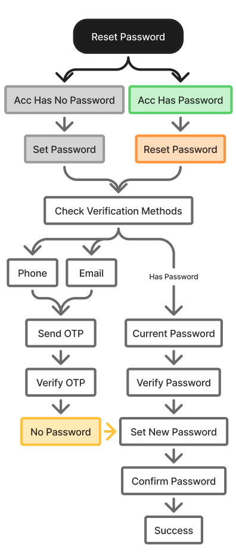

## 模块 20：到店支付

1. 概述

用户可选择「到店支付」，即预先支付 mTrip 佣金与交易手续费。剩余房费直接支付给酒店。

2. 支付规则

- mTrip 佣金：全额房费的 10%。

- 交易手续费：全额房费的 2%。

- 预付款项：佣金 + 交易手续费。

- 到店支付金额：全额房费的 90%。

- 仅当预付款支付成功且酒店确认预订后，该预订才会被确认。

3. 取消与退款

- 在取消截止时间之内：用户可取消预订并选择其退款方式。

- mTrip 钱包：退款在 24 小时内处理。

- 银行账户 / 支付钱包：退款可能约需 30 天。

- 超过取消截止时间后：佣金与交易手续费不予退还。

- 未入住（No-show）：预付款项不予退还。

退款方式选择仅适用于以「到店支付」方式完成的预订。可退款金额取决于适用的取消政策。

到店支付付款方式工作流程图

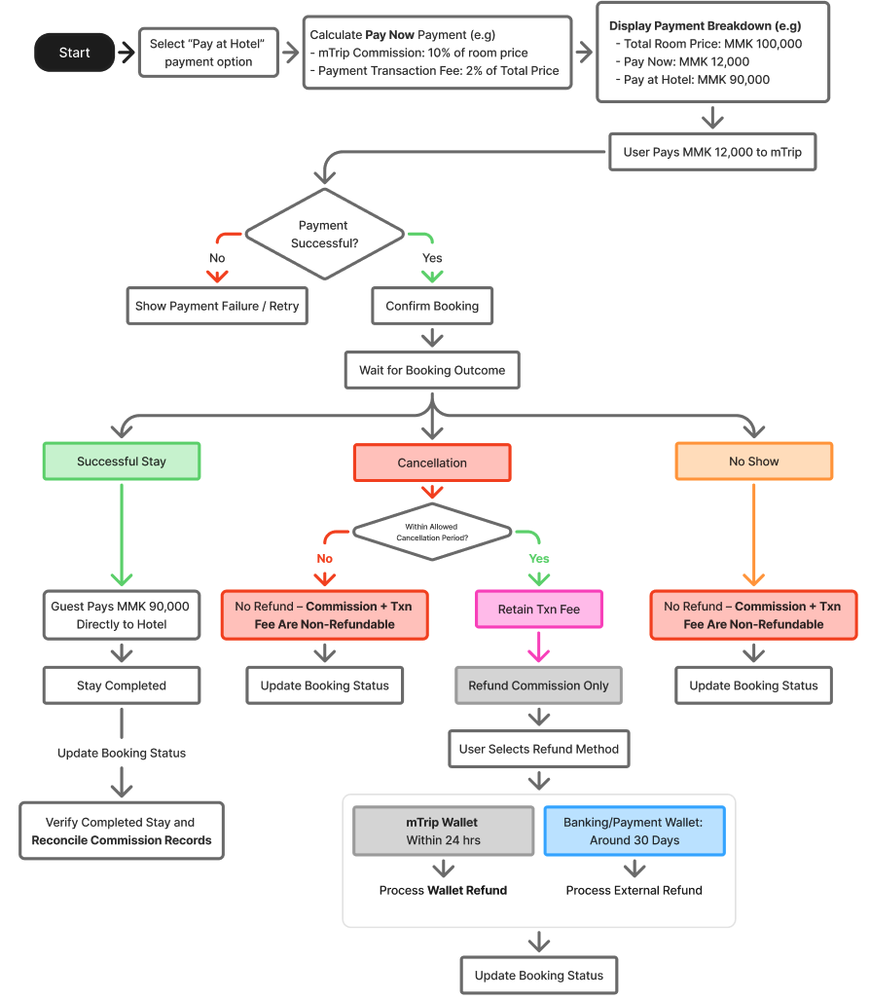

4. 管理后台自动对账

住宿完成后，系统将自动核验预付款与佣金记录。若核验成功，状态变为「已对账」。若核验失败，该预订将被标记为待管理后台审核。

5. 异常处理

- 预付款失败：不确认预订；允许重新支付。

- 退款失败：标记为「失败」并允许管理后台审核与安全重试。

- 重复处理：防止重复退款与重复对账。

酒店发起的取消（到店支付）：无论是否在取消截止时间前，均将预付款全额退还至用户的 mTrip 钱包。无需选择退款方式。

### 验收标准

以下标准定义了 mTrip 平台第一阶段核心模块的需求：

1. 入驻与 KYC（P1-01）

- 注册：OTP 必须在 30 秒内收到；无效号码显示错误；已验证用户跳转至资料设置。

- SSO：Google OAuth 完成；关联已有账户；若为首次登录则创建新账户。

- KYC 二级（Tier 2）：ID 上传通过；自拍活体检测通过；状态在 24 小时内反映。

- 商家提交：证件上传流程；状态跟踪（待审核/已通过/已拒绝）；显示拒绝原因。

2. 酒店预订（P1-02）

- 搜索：结果在 3 秒内显示；筛选可访问；地图切换可用。

- 筛选：即时应用筛选；隐藏不匹配的结果；筛选标签显示已启用数量。

- 详情：图库可滑动；列出所有房型及价格；政策、客房 360 度全景功能清晰展示。

- 凭证：支付后 10 秒内生成 PDF；通过短信、电子邮件发送并可在 App 中查看。

- 取消：截止时间前取消按钮可用；确认弹窗；立即发起退款。

3. 餐饮服务（P1-03）

- 发现：请求 GPS 权限；结果按距离排序；优先显示营业中的餐厅。

- 定制：按商品显示规格组；加入购物车前强制完成必选项。

- 跟踪：分配骑手后显示实时地图；状态栏在每个节点更新；ETA 可见。

- 商家管理：按商品切换售罄状态；即时同步至用户 App；可选次日自动恢复。

4. 统一搜索（P1-05）

- 全局搜索：即时显示建议；结果按类别（酒店/餐厅）分组。

- 个性化：首页信息流包含「附近」与「为你推荐」板块；推荐内容根据历史预订变化。

注：所有功能的早期草图均包含在链接的设计文件中。后续阶段的详细需求将随项目推进补充。

### 设计

包含所需的早期草图，并在整个项目过程中，在实际设计可用后链接至相应设计。

原型：mTrip 原型设计（用户 App）

### 技术考量 -（可选）

链接至工程技术方案文档。

### 成功指标

哪些成功指标表明你正在实现项目的内部目标？你将如何衡量成功？你可以使用任何你偏好的目标设定与跟踪体系（OKR、KPI 等）。

注：链接至分析需求与方案文档。

### 待解决问题

你还需要明确哪些因素？可能出现哪些问题，你计划如何应对？

### 问答

关于该产品的常见问题及你已确定的答案是什么？这里是记录关键决策的好地方。

<!--TABLE_START-->
| 提问人 | 问题 | 回答 |
|---|---|---|
|  | 发票格式（PDF） |  |
|  |  |  |
|  |  |  |
<!--TABLE_END-->

### 功能时间线与阶段规划

<!--TABLE_START-->
| 功能 | 状态 | 日期 |
|---|---|---|
| 模块 1：整体酒店预订旅程与预订生命周期 + 多酒店预订 | 评审中 | 2026 年 7 月 1 日 |
| 模块 2：酒店搜索与发现 + 长住 | 评审中 |  |
| 模块 3：酒店列表、筛选与排序 | 评审中 |  |
| 模块 4：酒店详情与房型选择 + 与物业 / 酒店聊天 | 评审中 |  |
| 模块 5：住客信息 | 评审中 |  |
| 模块 6：价格、促销与保险 + 我的优惠券 | 评审中 |  |
| 模块 7：预订偏好与收藏项 + 轻量模式功能 | 评审中 |  |
| 模块 8：支付（结算） | 评审中 |  |
| 模块 9：预订确认与预订管理 | 评审中 |  |
| 模块 10：通知中心 + 预订风险管理与申诉 | 评审中 |  |
| 模块 11：评价、评分与 AI 评价摘要 | 评审中 |  |
| 模块 12：AI 酒店助手 | 评审中 |  |
| 模块 13：在线客服与客户支持 | 评审中 |  |
| 模块 14：联盟与推荐计划 | 评审中 |  |
| 模块 15：动态 App 主题管理 | 评审中 |  |
| 模块 16：用户引导与教程 | 评审中 | 2026 年 8 月 25 日 |
| 模块 17 – 酒店预订 UI、UX 与功能更新（2026 年 9 月 4 日） | 评审中 | 2026 年 9 月 7 日 |
| 模块 18 - mTrip 钱包功能 | 评审中 | 2026 年 9 月 29 日 |
| 模块 19 - 附加功能 | 评审中 | 2026 年 9 月 24 日 |
<!--TABLE_END-->

## PRD 检查清单：

以下是你的 PRD 中必须包含的主题清单：

<!--TABLE_START-->
| PRD 检查清单 |  |  |
|---|---|---|
| 序号 | 主题 | 完成状态 |
| 1. | 标题 | 已添加 |
| 2. | 作者 | 已添加 |
| 3. | 决策日志 | 待办池 |
| 4. | 变更历史 | 待办池 |
| 5. | 概述 | 已添加 |
| 6. | 成功概述 | 待办池 |
| 7. | 消息传递 | 待办池 |
| 8. | 时间线/发布规划 | 待办池 |
| 9. | 用户画像 | 评审中 |
| 10. | 用户场景 | 评审中 |
| 11. | 用户故事/功能/需求 | 评审中 |
| 12. | 纳入的功能 | 待办池 |
| 13. | 排除的功能 | 待办池 |
| 14. | 设计 | 待办池 |
| 15. | 待解决问题 | 待办池 |
| 16. | 问答 | 待办池 |
| 17. | 其他考量 | 待办池 |
<!--TABLE_END-->

变更历史

<!--TABLE_START-->
| 版本 | 日期 | 变更内容 |
|---|---|---|
| 1.0 | 2026 年 7 月 31 日 | 初始 PRD，涵盖模块 1–15。 |
| 1.0.1 | 2026 年 8 月 25 日 | - 更新模块 7，在首页新增轻量模式切换按钮。 / - 新增模块 16 作为新模块。 |
| 1.0.2 | 2026 年 9 月 11 日 | - 新增模块 17 作为新模块。 |
| 1.0.3 | 2026 年 9 月 24 日 | - 新增模块 19 作为新模块。（账户删除） |
| 1.0.4 | 2026 年 9 月 29 日 | - 新增模块 18 作为新模块。（mTrip 钱包功能） |
| 1.0.5 | 2026 年 9 月 30 日 | - 在模块 19 下新增以下子模块 / 19. 1 App 更新与强制更新 / 19. 2 关联邮箱、关联手机号 / 19.3 联系我们页面（「更多」>「联系我们」） / 19.4 登录页面的「忘记密码？」功能 / 19.5 管理支付卡 / 19.6 重置密码 / 设置新密码 |
| 1.0.6 | 2026 年 10 月 14 日 | -新增模块 20 作为新模块（到店支付） |
<!--TABLE_END-->