# mTrip 产品需求文档（PRD）

## 用户端 App（酒店预订功能）- v1.0.6

作者：Mr. Aung Phyo Maw（Mario）

团队：产品团队

| 产品经理 | Mr. Aung Khant Kyaw |
|---|---|
| 工程负责人/团队负责人 | Mr. Li Sir |
| 设计师 | Mr. Chit Ko Ko |
| 审批/签核 | Mr. Kaung Htet Oo |

PM 冲刺规划：mTrip 冲刺计划

PRD 状态：

### 目录

*（原文此处为 Word 自动生成的目录域，docx 中未保存目录条目，故此处仅有标题。）*

### 概述

本产品需求文档（PRD）阐述用户端 App 的 mTrip 酒店预订功能。首个版本面向缅甸旅客与酒店合作方，确保预订流程顺畅、易用。用户可查找酒店、选择客房、使用折扣，并通过多种方式支付。符合条件的取消所涉退款将退回 mTrip 钱包。入住结束后，用户可管理其酒店评价与评分。本文档详细说明从酒店搜索到入住后反馈的完整用户旅程。

### 问题

缅甸的旅客难以找到一家本地酒店预订平台，能够同时提供真实评价、详细酒店信息、优惠价格、特惠活动与顺畅的预订流程。这使用户难以挑选符合自身需求与预算的酒店，而许多本地酒店也缺乏线上曝光与触达旅客的机会。这些问题降低了用户信任、增加了预订的麻烦，同时也为 mTrip 提供了机会：打造一个面向缅甸市场、值得信赖的酒店预订平台。

### 目标

- 提供顺畅、直观的酒店预订体验，使用户能够快速、轻松地搜索、比较并预订住宿。
- 通过 AI 能力提升预订信心，提供个性化酒店推荐、AI 生成评价摘要以及经过验证的真实住客评价。
- 通过整合旅行保险、安全支付等增值服务以及现代化的用户体验，打造值得信赖的端到端旅行平台，提升客户满意度、预订转化率与用户留存。

### 约束条件

- MVP 范围与时间有限——首个版本聚焦核心酒店预订能力，进阶功能与后续生态服务计划在后续阶段实现。
- 依赖第三方集成——酒店房量库存、价格、支付网关、旅行保险与通知等功能依赖外部合作方与 API，可能影响交付时间。
- AI 功能成熟度与数据可得性——AI 推荐与评价摘要依赖酒店、评价与用户数据的可得性与质量，将随平台发展持续优化。

### 用户画像

本产品的目标用户画像有哪些？其中核心用户画像是哪一个？

| 核心用户画像 | 说明 |
|---|---|
| 休闲旅客 | 为度假预订酒店，期望快速、简便且可信赖的预订体验。 |
| 商务旅客 | 因出差预订酒店，重视速度、灵活性与便利性。 |
| 家庭/团体旅客 | 为多位住客预订住宿，需要便捷的方式管理团体预订。 |

### 用户旅程与平台流程

**场景 1：搜索并预订酒店**

用户搜索目的地、比较酒店、选择客房、完成支付，并收到预订确认。

**场景 2：通过 AI 发现酒店**

用户收到 AI 驱动的酒店推荐，查看 AI 生成的摘要，并依据自身偏好选择最合适的酒店。

**场景 3：管理已有预订**

用户查看预订详情、修改或取消预订（如允许）、获取预订确认，并接收状态更新与通知。

## 模块 1：酒店预订整体旅程与预订生命周期 + 多酒店预订

**图：端到端酒店预订用户旅程流程（用户端 App）**

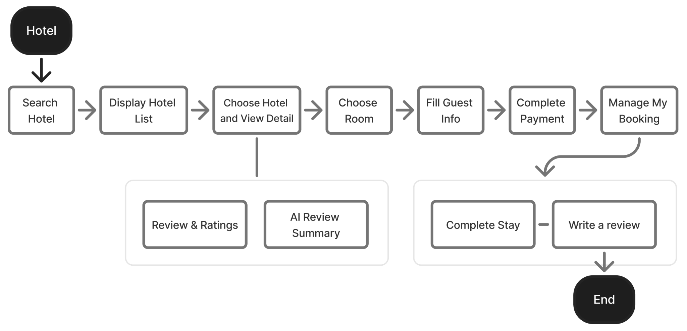

**图：端到端酒店搜索与发现流程**

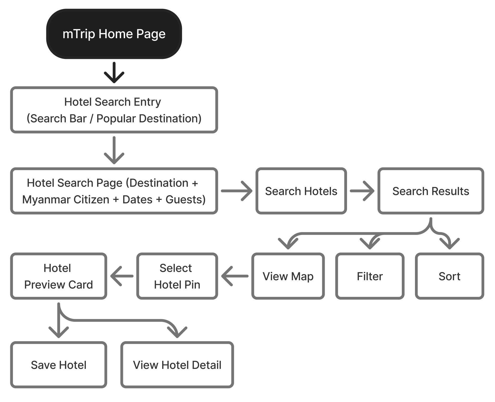

Figma UI：端到端酒店预订流程（界面 1 至 10）

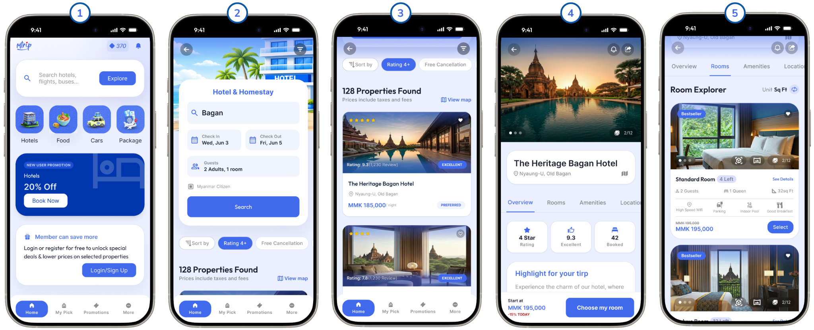

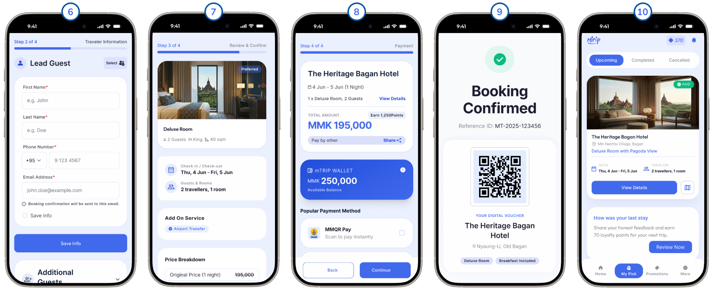

**概要说明**

本指南说明 mTrip 超级 App 中酒店预订的端到端用户流程，涵盖步骤 1 至 10。

- 点击酒店图标进入酒店预订功能。
- 输入目的地、出行日期、住客人数与缅甸公民价格偏好，搜索酒店。
- 根据搜索条件查看酒店列表。
- 选择酒店以查看详细信息。
- 选择偏好的房型。
- 填写本次预订的住客信息。
- 继续操作前核对并确认各项信息。
- 完成支付流程。
- 收到预订确认。
- 进入“我的预订”页面进行预订管理。

在整个流程中，所选的缅甸公民价格偏好始终生效，确保从搜索到预订管理的体验连贯一致。

### 模块 1.1：多酒店预订

**多酒店功能：一次结账 → 分别生成预订交易**

**支付倒计时规则（方案 A – 已确认）**

- 用户打开多酒店支付页面时，10 分钟支付倒计时必须立即开始。
- 用户停留在支付页面期间，倒计时必须持续运行。
- 若倒计时在支付完成前归零，系统必须自动将用户跳转至价格复核页面。
- 用户必须重新核对更新后的预订价格与可用房量，然后再继续支付。
- 同一结账会话中，用户刷新或重新进入支付页面时，倒计时不得重新开始。

注：倒计时时长固定为 10 分钟。

**多酒店预订功能说明**

多酒店预订功能允许用户在一次结账中预订位于不同目的地或不同入住时段的多家酒店。用户完成一次支付交易，系统则为每家所选酒店分别创建独立的酒店预订交易。支付完成后，每笔预订独立管理，包括预订确认、修改、取消、退款、结算与预订历史。

注：本功能在开发前需与工程团队进行技术可行性评估。

**多酒店预订功能需求**

| 模块 | 需求 | 业务规则 |
|---|---|---|
| 行程管理 | 系统应创建一个行程 ID，将所选的全部酒店预订归入同一行程。 | 一个行程可包含一笔或多笔酒店预订。 |
| 预订 | 系统应为每笔酒店预订生成唯一的预订编号。 | 每笔预订独立遵循既有的预订生命周期。 |
| 结账 | 用户应对所选全部酒店完成一次结账。 | 支付前，所选全部酒店在同一复核页面展示。 |
| 支付 | 用户应对全部酒店预订进行一次支付。 | 一次支付交易关联一个行程 ID。 |
| 支付成功 | 系统应在支付成功后分别创建各笔酒店预订。 | 仅在支付确认后才开始创建预订。 |
| 预订失败 | 若某笔酒店预订无法确认，该失败预订不得影响已成功创建的预订。 | 仅对失败的那笔预订退款。 |
| 预订管理 | 支付完成后，用户应分别管理各笔酒店预订。 | 可独立查看、修改、取消与跟踪每笔预订。 |
| 促销优惠券 | 系统应允许在结账时使用一张促销优惠券。 | 优惠券折扣应按比例分摊至全部酒店预订。 |
| 折扣分摊 | 系统应存储每笔预订分摊到的折扣金额。 | 用于退款计算、商户结算与报表。 |
| 取消 | 用户可取消单笔酒店预订。 | 取消政策遵循各酒店自身的政策。 |
| 退款 | 仅对已取消的预订处理退款。 | 退款仅退回客户的 mTrip 钱包。 |
| 商户结算 | 商户结算应按每笔预订独立处理。 | 符合条件的预订完成后，按约定的结算周期进行结算。 |
| 佣金 | 平台佣金应按每笔预订单独计算。 | 佣金遵循商户合同。 |
| 通知 | 系统应就每笔酒店预订发送预订确认。 | 支付确认发送一次；预订确认分别发送。 |
| 行程历史 | 用户应可查看同一行程下的全部酒店预订。 | 行程页面展示全部预订状态。 |
| 客户支持 | 支持团队应可按行程 ID 或预订编号搜索预订。 | 各笔预订可独立处理。 |

**多酒店预订的促销优惠券需求**

| 需求 | 说明 |
|---|---|
| 优惠券范围 | 一张优惠券可应用于整个结账。 |
| 分摊方式 | 优惠券折扣应按预订金额比例分摊至全部酒店预订。 |
| 预订金额 | 每笔预订应存储自身的原始金额、折扣金额与最终应付金额。 |
| 退款计算 | 退款金额应基于折扣后的预订金额计算。 |
| 结算 | 商户结算应按促销出资规则使用最终预订金额。 |

**多酒店预订的商户结算需求**

| 需求 | 说明 |
|---|---|
| 结算单位 | 结算按预订编号逐笔处理。 |
| 结算时间 | 预订进入可打款状态后处理结算（以业务政策为准）。 |
| 结算金额 | 结算金额 = 预订金额 − 佣金 − 平台承担的促销（如适用）。 |
| 结算状态 | 每笔预订维护自身的结算状态。 |
| 结算报表 | 财务应按预订与商户生成结算报表。 |

**多酒店预订的退款需求**

| 需求 | 说明 |
|---|---|
| 退款范围 | 退款仅适用于已取消或失败的预订。 |
| 退款方式 | 退款仅退回客户的 mTrip 钱包。 |
| 退款状态 | 每笔预订单独跟踪退款状态。 |
| 部分退款 | 同一行程下的其它酒店预订不受影响。 |

**多酒店预订的预订失败需求**

| 需求 | 说明 |
|---|---|
| 部分成功 | 若其它预订失败，已成功的预订仍保持确认状态。 |
| 失败预订 | 失败预订的状态置为“预订失败”。 |
| 退款 | 系统自动对失败预订的金额发起退款。 |
| 用户通知 | 通知客户哪笔预订失败、哪些预订已成功确认。 |

**多酒店预订的行程管理需求**

| 需求 | 说明 |
|---|---|
| 行程汇总 | 展示同一行程下的全部酒店预订。 |
| 行程时间线 | 按入住时间顺序展示预订。 |
| 预订状态 | 展示每家酒店的预订状态。 |
| 酒店管理 | 用户分别管理每笔酒店预订。 |

**流程图：多酒店预订结账（一次支付 + 分别生成预订）**

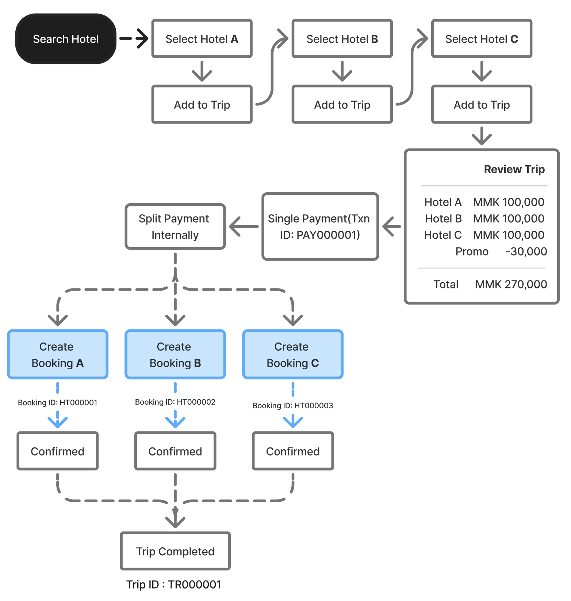

**多酒店预订——增加更多住宿**

多酒店预订体验已更新，新增可展开、可收起的“增加更多住宿”卡片，使用户更易在单次预订中管理与添加多段酒店住宿。

用户可添加的住宿数量上限由后台管理端配置控制。例如，若最大住宿数配置为 3 段，则用户在一次预订中最多可添加 3 段住宿。

达到配置的最大住宿数后，“增加更多住宿”选项将被隐藏或置为不可用，以阻止用户继续添加住宿。

若用户移除已添加的一段或多段住宿，“增加更多住宿”选项将重新可用，用户可再次添加住宿，直至达到配置的上限。

流程：酒店预订 → 增加更多住宿 → 展开/收起 → 添加额外住宿

用户可持续添加住宿，直至达到后台管理端配置的最大数量。

**多酒店预订——精简模式限制**

为让需要更简洁界面的用户获得简单、易用的预订体验，多酒店预订已在精简模式下停用。

多酒店预订仅在完整模式下可用。

**模式行为：**

- 精简/简易模式：仅支持单酒店预订
- 完整/标准模式：支持单酒店预订与多酒店预订

## 模块 2：酒店搜索与发现 + 长住

**场景 1：搜索并预订酒店——用户旅程流程**

搜索 → 发现 → 选择 → 定制 → 结账 → 支付 → 确认 → 预订后服务

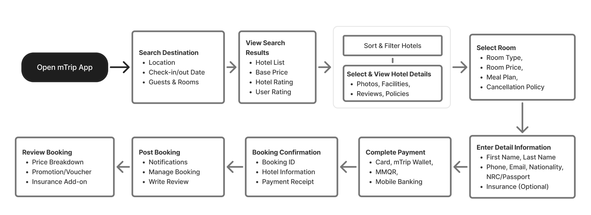

**预期结果**

用户成功完成酒店预订旅程，收到已确认的预订，并可通过 mTrip App 查看预订详情、通知与预订后服务。

**表 1：用户体验与互动功能**

| 用户功能 | 沟通与支持 |
|---|---|
| 收藏酒店、已保存住客信息、用户偏好（语言、货币、计量单位） | 通知、在线聊天与客户支持 |

**表 2：智能与增长功能（未来规划）**

| 互动 | AI 服务（未来） |
|---|---|
| 联盟与推荐计划 | AI 酒店助手、AI 评价摘要 |

### 功能需求

| 功能 | 说明 |
|---|---|
| 功能 1：酒店搜索与预订 | 支持用户通过完整的端到端预订旅程搜索、比较并预订酒店，涵盖酒店搜索、筛选、房型选择、住客信息、价格、支付与预订确认。 |
| 功能 2：预订管理与旅行服务 | 支持用户管理预订、接收通知、收藏酒店、获取人工客服支持、购买旅行保险，并参与联盟推广与推荐计划。 |
| 功能 3：AI 驱动的旅行体验 | 通过 AI 酒店推荐、AI 生成评价摘要以及 AI 酒店助手提升用户体验，帮助用户做出明智的预订决策。 |

### 模块 2.1：长住优惠

### 概述

长住优惠功能支持用户发现并预订可享长住专属折扣的住宿。与标准酒店预订入口不同，长住在 mTrip 首页设有独立入口，以提升曝光度并推广长住活动。

预订旅程与现有酒店预订流程基本一致，用户在获得熟悉的预订体验的同时，系统会根据入住时长自动为其匹配可享受的长住折扣。

### 目标

- 通过首页独立入口推广长住住宿。
- 通过展示有吸引力的折扣档位，鼓励用户延长预订天数。
- 复用现有酒店预订流程，降低复杂度。
- 自动计算并应用符合条件的长住折扣。
- 支持长住专属促销与优惠券。

**“长住优惠”入口 | “长住”**

mTrip 首页应以独立服务的形式展示“长住”图标按钮，与现有酒店入口相互独立。

用户点击长住入口后，应进入长住优惠搜索体验。

**用户流程图**

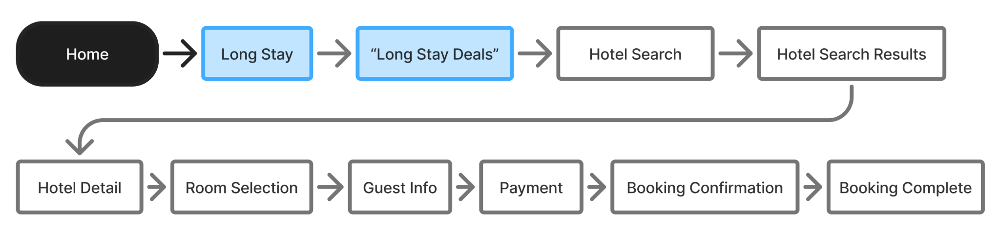

### 功能需求

### 1. 长住入口

系统应在首页提供独立的“长住”图标入口。

该入口应：

- 与标准酒店服务在视觉上相互独立。
- 将用户引导至长住优惠页面。
- 支持后续展示活动横幅与促销内容。

### 2. 长住优惠搜索页

系统应展示标题为“长住优惠”的独立搜索页。

搜索表单应复用现有酒店搜索体验，包括：

- 目的地
- 入住日期
- 退房日期
- 住客与客房选择
- 缅甸公民选择

### 3. 入住时长校验

系统应在用户选择入住日期与退房日期后，自动计算总入住时长。

系统应根据计算出的时长判断该预订是否符合长住优惠条件。

示例：

| 入住时长 | 是否符合条件 |
|---|---|
| 2 晚 | 否 |
| 5 晚 | 否 |
| 7 晚 | 是 |
| 14 晚 | 是 |
| 30 晚 | 是 |

最低达标时长应可通过管理后台配置。

### 4. 长住折扣档位

系统应支持按入住时长配置折扣档位。

示例配置：

| 入住时长 | 折扣 |
|---|---|
| 7 晚 | 省 30% |
| 14 晚 | 省 35% |
| 30 晚 | 省 45% |
| 60 晚 | 省 50% |

系统应自动判定并应用符合条件的最高档位。

折扣比例与达标时长均应可配置。

### 5. 搜索结果展示

符合条件的酒店应直接在酒店卡片上展示长住促销信息。

示例信息：

- 长住优惠标签
- 省 XX%
- 原价
- 折扣价
- 优惠总额

未参与长住优惠的酒店应继续展示其常规价格。

### 6. 酒店详情页

对于符合条件的预订，酒店详情页应展示：

- 长住优惠标签
- 可享受的折扣比例
- 原价
- 折扣价
- 优惠总额

### 7. 长住优惠券

系统应支持长住专属优惠券。

符合条件的用户可：

- 领取长住优惠券
- 查看可用的长住优惠券
- 在结账时使用符合条件的优惠券

优惠券校验应遵循现有促销与优惠券模块的规则。

### 8. 结账

结账流程应与标准酒店预订流程完全一致。

若该预订符合长住优惠条件，价格汇总应展示：

- 原价
- 长住折扣
- 优惠券折扣（如适用）
- 最终应付金额

所有折扣应在支付前完成计算。

### 9. 长住优惠业务规则

| 规则 | 说明 |
|---|---|
| BR-01 | 长住应通过首页独立入口进入，即“长住”。 |
| BR-02 | 预订流程应复用标准酒店预订旅程。 |
| BR-03 | 入住时长应根据入住日期与退房日期自动计算。 |
| BR-04 | 仅当预订满足配置的最低入住时长时，长住折扣方可适用。 |
| BR-05 | 折扣档位应可通过管理后台配置。 |
| BR-06 | 系统应自动应用符合条件的最高折扣档位。 |
| BR-07 | 长住折扣应在搜索结果、酒店详情、结账与预订确认各环节一致体现。 |
| BR-08 | 长住优惠券应遵循现有优惠券的适用资格与校验规则。 |
| BR-09 | 未配置长住优惠的酒店应继续展示标准价格。 |
| BR-10 | 长住折扣与优惠券是否可叠加，应依据促销模块中配置的活动规则确定。 |

## 模块 3：酒店列表、筛选与排序

**酒店筛选**

酒店筛选功能支持用户根据自身偏好与需求快速筛选酒店搜索结果。用户可同时应用多个筛选条件，包括：

- 价格区间
- 星级
- 门店类型
- 设施与配套
- 含早餐
- 住客评价得分
- 免费取消
- 到店支付
- 床型
- 客房特色/景观
- 位置（街区/镇区）
- 卧室数量

系统会根据所选条件动态更新搜索结果，帮助用户高效找到符合预算与需求的酒店。

为便于后续灵活调整，所有筛选项与条件均可通过 mTrip 管理后台配置。管理员可以：

- 管理筛选取值
- 新增选项
- 修改现有筛选项
- 停用或调整取值顺序

这样无需更新 App 即可适应业务需求、商户供给与市场趋势的变化。

**酒店列表排序**

酒店列表排序功能支持用户按偏好的优先级对酒店搜索结果重新排序，更便捷地找到最合适的住宿。用户每次只能选择一种排序方式。选择后酒店列表会刷新，同时保留用户当前的搜索条件与已应用的筛选条件。

支持的排序方式包括：

- 价格从低到高
- 价格从高到低
- 距离最近
- 星级（从高到低）
- 住客评分最高

为支持后续业务与运营的灵活性，所有排序方式及其展示顺序均应可通过 mTrip 管理后台配置。管理员可新增、修改、调整顺序或停用排序方式，无需更新移动端 App。

## 模块 4：酒店详情与房型选择 + 与门店/酒店聊天

酒店详情与房型选择模块提供有助于用户做出明智预订决策的关键信息：

- 全面的酒店详情：描述、图片库、地址与地图、设施、政策
- 入住/退房时间与提前入住选项
- 已验证的住客评价

用户可以：

- 浏览并比较房型
- 查看房型详情：图片、名称、床型、面积、可住人数、设施、早餐、取消政策、价格

该模块确保提供准确、透明的信息，便于用户轻松比较并选择合适的住宿。

酒店详情页包含以下信息：

- 酒店描述
- 酒店图片
- 酒店地址
- Google 交互式地图
- 设施与配套
- 酒店政策
- 入住时间
- 退房时间
- 提前入住可用性
- 住客评价与评分

每个房型选项展示以下信息：

- 房型名称
- 房型图片
- 床型
- 客房面积
- 最多可住人数
- 客房设施
- 含早餐
- 取消政策
- 客房价格与预订操作

为支持后续业务与运营的灵活性，酒店信息、房型详情、设施、政策、房型属性与展示内容均应可通过 mTrip 商户门户配置并由商户维护，同时可通过 mTrip 管理后台进行管理配置与内容审核。

### 模块 4.1：与门店/酒店聊天

与门店聊天功能在酒店详情页提供，支持用户在预订前或预订后与酒店沟通。

主要功能包括：

    - “入住/退房政策是什么？”
    - “是否提供免费停车？”
    - “是否提供机场接送？”
- 预设常见问题（FAQ），例如：
- 用户可发送预设消息，也可自行输入内容。
- 会话历史会被保存，方便用户再次访问时查看。

该功能为用户咨询酒店相关问题提供了快捷途径。

## 模块 5：住客信息

**住客信息**

住客信息模块支持用户在支付前为酒店预订填写必要的住客信息。该模块支持多位住客，可根据客房可住人数添加住客档案。主要住客的信息由当前登录用户的个人资料自动填充，并支持编辑。

用户还可从已保存的常旅客列表中选择，避免重复录入。必填的住客信息包括：

- 名字、姓氏
- 电话号码
- 电子邮箱地址

系统在进入支付前会校验必填字段。住客信息会安全存储用于预订，已保存的档案可通过常旅客功能管理，供后续使用。

## 模块 6：价格、促销与保险 + 我的优惠券

**图：mTrip 旅行保险流程（第二阶段 | 不包含在 MVP 首版中）**

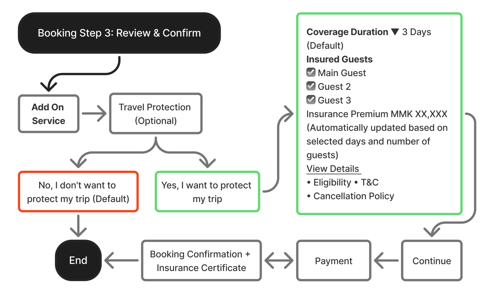

**高层级用户旅程流程**

附加服务 → 选择旅行保险 → 选择保障时长与出行人 → 查看保险详情 → 支付 → 预订与保险确认

**预期结果**

mTrip 保险附加功能支持用户在酒店预订过程中购买旅行保险。用户可在添加前查看保障范围、保费与权益。若选择购买，保费会计入总金额，并在预订摘要、支付与确认页面展示。预订完成后，保险会与该订单记录关联，便于后续查询与客服支持。该功能通过提供旅行保障提升用户信心，并通过保险合作创造收入机会。

### 模块 6.1：我的优惠券（促销优惠券 + App 内落地页 - Web）

### 概述

促销与我的优惠券功能支持用户在 mTrip 超级 App 中查找、领取、管理与核销优惠券。该功能为缅甸用户提供友好的使用体验，减少手动操作，提升优惠券使用率与预订转化率。

促销中心在 mTrip App 内包含一个动态的 Web 落地页，支持实时更新活动页面、横幅与营销内容，无需更新 App。

已领取的优惠券会保存在“我的优惠券”中，符合条件者在酒店结账时自动应用，以获得最大折扣。用户可在支付前修改或移除优惠券。

**核心功能需求**

**促销中心**

- 在 mTrip 应用内嵌提供可交互的促销落地页。
- 展示活动横幅与促销活动。
- 支持季节性、周度、月度及特别活动类促销。
- 支持用户浏览可用的促销活动。
- 允许用户直接从活动页面领取优惠券。
- 用户选择“立即使用”时，跳转至相应的预订流程。

**我的优惠券**

用户应能够：

- 查看所有已领取的优惠券。
- 使用优惠码手动添加优惠券。
- 查看优惠券详情。
- 管理“可用”“已使用”和“不可用”优惠券。
- 通过“立即使用”跳转至相关预订流程。

**优惠券应用**

- 在酒店结账时自动校验适用的优惠券。
- 自动应用最优的可用优惠券。
- 在结账页面展示已应用的优惠券。
- 在价格明细中展示折扣。
- 允许用户在支付前更换或移除已应用的优惠券。
- 标准预订无需用户手动选择优惠券。

**图：mTrip 超级 App – 我的优惠券流程**

## 模块 7：预订偏好与收藏项 + Lite 模式功能

### 常旅客信息管理

### 功能概述

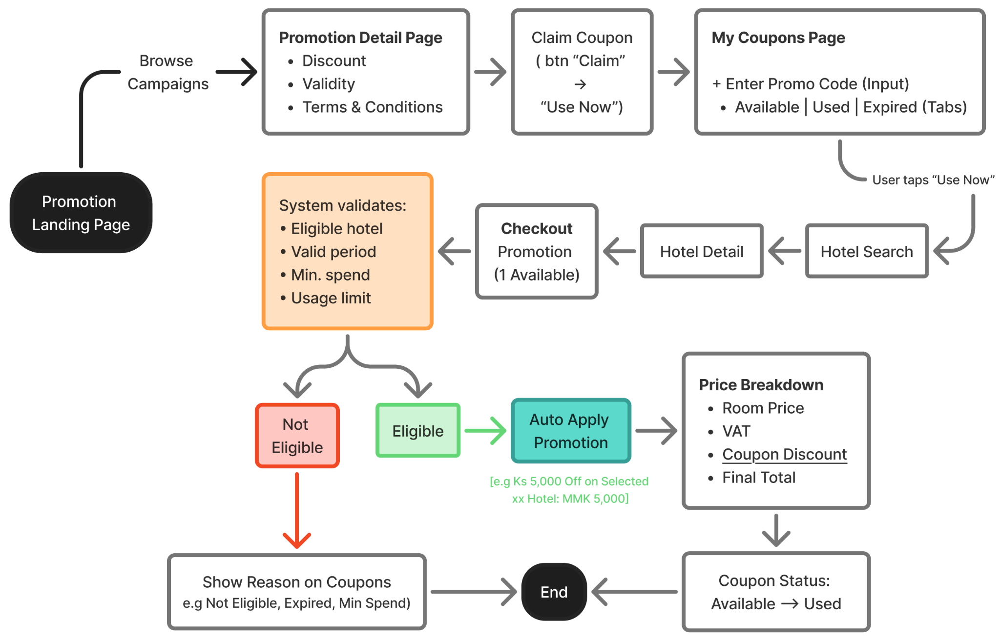

“常旅客信息”功能允许用户安全地保存和管理旅客信息，从而在酒店、机票以及未来的旅行服务中更快速地完成预订。用户可手动输入旅客信息，也可扫描护照自动填充支持的字段。

### 功能需求

| 模块 | 需求 |
|---|---|
| 功能名称 | 常旅客信息 |
| 位置 | 账户 → 常旅客信息 |
| 说明 | 用户可添加、查看、编辑和删除已保存的旅客资料，以供后续预订使用。 |

**添加旅客**

系统应允许用户创建新的旅客资料。

**必填字段**

- 国籍
- 名字
- 姓氏
- 证件类型
    - NRC
    - 护照
    - 其他证件
- 证件号码
- 有效期（护照或适用的证件类型）

**护照扫描**

系统应提供“扫描护照”按钮。

护照扫描成功后，系统应自动填充以下信息：

- 护照号码
- 护照有效期
- 名字
- 姓氏

用户可在保存前手动编辑任何自动填充的信息。

**旅客列表**

系统应以列表形式展示所有已保存的旅客资料。

每位旅客卡片应展示：

- 姓名全称
- 国籍
- 证件类型
- 证件号码（部分掩码）

用户可点击旅客卡片查看其详情。

**删除旅客**

系统应支持两种删除旅客资料的方式。

**方式 1：左滑删除**

- 用户将旅客卡片向左滑动。
- 显示“删除”操作。
- 用户点击“删除”。
- 旅客资料被永久删除。
- 显示提示消息：

已删除

- 旅客卡片从列表中移除。

**方式 2：在详情页删除**

- 用户打开旅客资料。
- 滚动至页面底部。
- 点击“删除旅客”。
- 系统删除该旅客资料。
- 提示消息：

已删除

- 用户返回旅客列表。
- 已删除的旅客不再显示。

### 业务规则

- 用户可保存多个旅客资料。
- 旅客信息安全存储在用户账户内。
- 护照扫描为可选项。
- 自动填充的信息可在保存前编辑。
- 已删除的旅客资料无法恢复。

### 模块 7：功能 3 Lite 模式（全局 UI 体验）

Lite 模式是 mTrip 用户端 App 中一项便于使用的功能，旨在为数字使用经验有限的用户（尤其是缅甸用户）简化界面。它提供更大的触控区域、更好的可读性和更少的干扰，同时保持与标准界面相同的功能与服务。

用户可通过两个入口在 Lite 模式与完整版模式之间切换：

- 首页 – 悬浮操作按钮（FAB）
    - 首页提供专用的 FAB，便于快速访问。
    - 用户可点击 FAB 在 Lite 模式与完整版模式之间切换。
    - FAB 会体现用户当前所处的模式，并提供随时来回切换的简便方式。
- 个人中心 → 设置
    - 用户可在“个人中心 → 设置”中手动开启或关闭 Lite 模式。
    - 这为偏好通过 App 设置管理模式的用户提供了次级入口。

Lite 模式启用后将在整个 App 内全局生效，直至用户切换回完整版模式。所选模式在所有受支持的页面和 MVP 功能中保持一致。

Lite 模式作为全局展示层实现，这意味着它不会移除或改变底层功能与服务。所有 MVP 功能均应支持 Lite 模式，以确保 mTrip 用户端 App 提供一致、可访问且易于使用的体验。

### 模块 7：功能 2 收藏酒店

### 功能概述

“收藏酒店”功能允许用户管理喜爱的酒店，以便快速访问和后续预订。

### 功能需求

| 模块 | 需求 |
|---|---|
| 功能名称 | 收藏酒店 |
| 位置 | 账户 → 收藏酒店 |
| 说明 | 展示用户收藏的所有酒店。 |

**收藏酒店列表**

系统应以纵向列表展示所有已收藏的酒店。

每张酒店卡片应展示：

- 酒店图片
- 酒店名称
- 位置
- 星级评分（如有）

用户可点击酒店卡片打开酒店详情页。

**删除收藏酒店**

系统应支持左滑删除。

**左滑操作**

- 用户将酒店卡片向左滑动。
- 出现“删除”图标。
- 用户点击“删除”图标。
- 酒店从收藏列表中移除。
- 显示提示消息：

已从收藏酒店中移除

- 酒店卡片从列表中消失。

### 业务规则

- 用户收藏酒店的数量不限。
- 已删除的酒店可再次从酒店详情页收藏。
- 从收藏酒店中移除酒店不影响任何预订或预订历史。
- 收藏酒店与用户账户同步，在受支持的设备间保持一致。

## 模块 8：支付（结算）

### 概述

活动费用承担与结算流程使 mTrip 能够高效追踪和分摊促销成本。优惠券成功核销后会自动更新活动预算，并为财务和商户准备结算数据，确保信息清晰可见并简化财务对账。

酒店预订功能整合了支付、促销与结算流程，应用适用的促销、处理支付，并为商户准备结算数据。它在保持记录准确的同时，支持实时预算追踪与自动化成本分摊，从而为用户带来顺畅的预订体验。

**mTrip 活动费用记录示例**

| 预订编号 | 活动 | 折扣（MMK） | mTrip 承担 | 商户承担 | 合作方承担 | 状态 |
|---|---|---|---|---|---|---|
| BK10001 | 新用户活动 | 20,000 | 20,000 | 0 | 0 | 已完成 |
| BK10015 | 夏季促销 | 30,000 | 15,000 | 15,000 | 0 | 已完成 |
| BK10032 | 酒店周 | 40,000 | 0 | 40,000 | 0 | 已完成 |
| BK10058 | 银行合作方促销 | 50,000 | 0 | 0 | 50,000 | 已完成 |

**结算架构图（系统架构）**

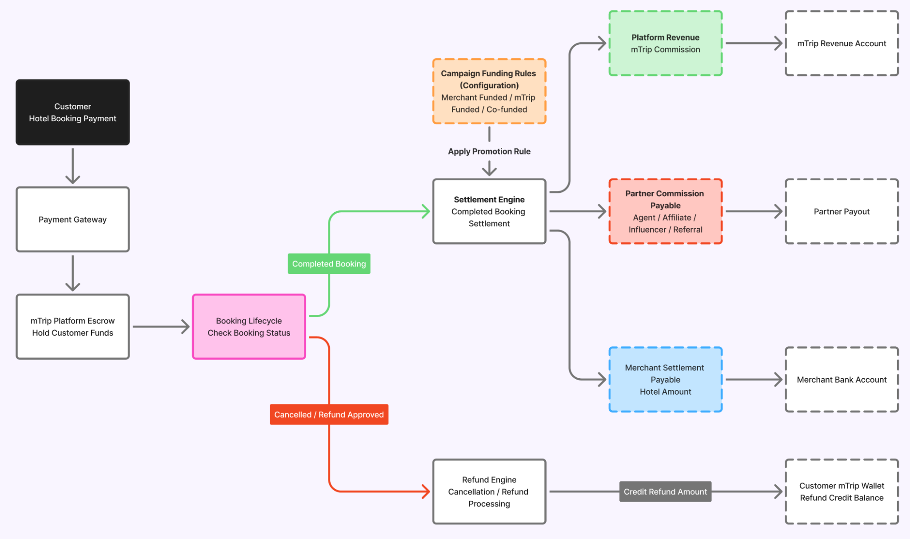

### 高层说明

预订完成后，结算引擎会应用促销费用承担规则，将资金分配到平台佣金、合作方应付佣金和商户应付结算账户，同时由退款引擎处理取消与退款。

**结算决策流程（业务规则）**

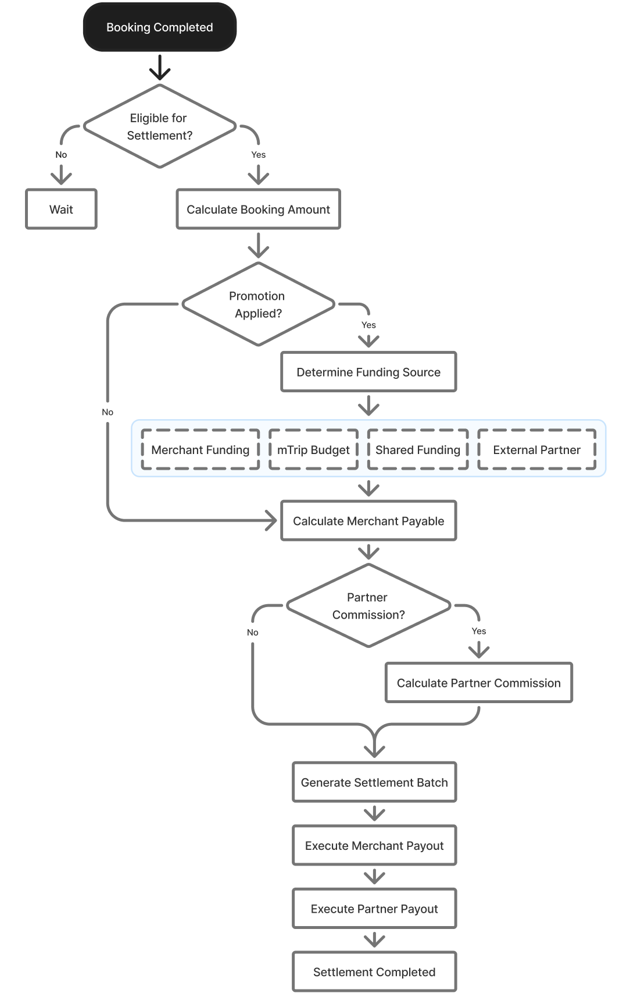

**财务结算矩阵**

| 场景 | 用户支付 | 酒店结算 | mTrip 佣金 | 用户退款 |
|---|---|---|---|---|
| 酒店预订成功 | 酒店预订金额 | 酒店金额 − 佣金（如 MMK 50,000 − 10%） | 按商户协议扣除佣金（如 10%） | 不适用 |
| 用户取消（免费取消） | 已支付 | 不结算 | 无佣金 | 100% 退款至 mTrip 钱包 |
| 用户取消（部分可退） | 已支付 | 按酒店取消政策结算 | 按商户协议收取佣金 | 部分退款至 mTrip 钱包 |
| 用户取消（不可退） | 已支付 | 按酒店取消政策结算 | 按商户协议保留佣金 | 不退款 |
| 酒店取消预订 | 已支付 | 不结算 | 无佣金 | 100% 退款至 mTrip 钱包 |
| 支付失败 | 支付未成功 | 不结算 | 无佣金 | 不收取费用 |

### 8.3 退款结算矩阵

| 场景 | 退款金额 | 退款方式 | 结算处理 |
|---|---|---|---|
| 用户取消（免费取消） | 100% | mTrip 钱包 | 不向酒店商户结算 |
| 用户取消（部分可退） | 按酒店取消政策 | mTrip 钱包 | 按可退金额调整结算 |
| 用户取消（不可退） | 不退款 | 不适用 | 酒店结算按商户协议进行 |
| 酒店取消预订 | 100% | mTrip 钱包 | 取消酒店结算 |
| 支付失败 | 100%（如已扣款）或不收取费用 | 原支付渠道冲正或自动撤销 | 不结算 |

### 业务规则

- 用户就酒店预订向 mTrip 一次性付款。
- mTrip 在向酒店商户结算剩余金额前扣除约定佣金。
- 商户结算按配置的结算周期处理（如每周、每两周或每月）。
- 酒店结算仅在住客退房后、预订已完成的情况下处理。
- 退款资格遵循酒店的取消政策。
- 所有已批准的退款均退回用户的 mTrip 钱包。
- 全额退款的已取消预订不计入商户结算。
- 应为财务和酒店商户生成结算报告，用于对账。
- 每个酒店商户应拥有可通过管理后台独立配置的结算周期。
- 系统应支持不同酒店商户采用不同的结算周期（如每日、每周、每两周、每月或指定结算日期）。
- 结算引擎应按每个商户配置的结算计划自动处理结算，且不影响其他商户。
- 结算批次应依据每个商户配置的结算周期，对符合条件的预订交易进行分组。
- 系统应为每笔财务交易维护会计分录，包括预订付款、佣金、商户应付款、结算打款、退款、调整、税费、手续费及促销交易。
- 促销相关交易应记录促销费用承担方（如商户承担、mTrip 承担、共担或合作方承担），以确保结算与会计处理准确。
- 应用促销时，系统应在确定商户最终结算金额前，按配置的费用承担责任自动计算并分摊促销成本。
- 每笔财务交易均应生成可审计的会计记录，以支持对账、财务报告和审计。
- 系统应为每笔预订交易维护完整的审计轨迹，涵盖结算计算、调整、打款状态、促销费用承担及会计历史。
- 结算引擎应基于配置的佣金与结算规则，支持多个收款方（如酒店商户、代理商、联盟推广或外部合作方）。

**结算业务场景**

**场景 1 – 预订成功（共担促销）**

| 参与方 / 余额 | 借方（-） | 贷方（+） | 余额 / 结果 | 备注 |
|---|---|---|---|---|
| 用户 | 950,000 | - | -950,000 | 用户支付 |
| 平台托管账户 | - | 950,000 | +950,000 | 持有用户付款 |
| 商户应付结算 | 875,000 | - | 应付 875,000 | 酒店在扣除佣金和商户承担的促销后收到款项 |
| 平台收入 | - | 75,000 | +75,000 | 10% 佣金（100,000）− 25,000 mTrip 促销承担 |
| 合作方应付佣金 | 30,000 | - | 应付 30,000 | 从 mTrip 收入中支付 3% 代理佣金 |
| 商户活动承担 | 25,000 | - | 商户补贴 | 商户承担的促销 |
| mTrip 活动费用 | 25,000 | - | 营销费用 | mTrip 承担的促销 |

**场景 2：客户在结算前取消**

| 相关方 / 余额 | 借方 (-) | 贷方 (+) | 备注 |
|---|---|---|---|
| 平台托管账户 | 950,000 | - | 冲销托管 |
| 客户钱包 | - | 950,000 | 退款至 mTrip 钱包 |
| 商户结算 | 0 | 0 | 无结算 |
| 平台收入 | 0 | 0 | 未确认收入 |
| 合作方佣金 | 0 | 0 | 无佣金 |
| 活动预算 | 视业务规则而定 | 通常不消耗 |  |

**场景 3：商户承担促销**

促销 = 100,000 MMK

| 相关方 | 影响 |
|---|---|
| 客户 | 支付 900,000 |
| 商户 | 促销成本 100,000 |
| mTrip | 仍获得 100,000 佣金 |
| 代理 | 获得 30,000 |
| 商户实收 | 800,000 |

**场景 4：mTrip 承担促销**

促销 = 100,000 MMK

| 相关方 | 影响 |
|---|---|
| 客户 | 支付 900,000 |
| 商户 | 收到 900,000 |
| mTrip | 佣金 100,000 - 促销 100,000 = 0 |
| 代理 | 30,000（如仍适用） |
| 市场 | 支出 100,000 |

**场景 5：推荐奖励（50,000 MMK 钱包余额）**

| 相关方 | 借方 (-) | 贷方 (+) | 备注 |
|---|---|---|---|
| mTrip 市场 / 奖励预算 | 50,000 | - | 推荐活动支出 |
| 客户钱包 | - | 50,000 | 预订成功后发放钱包余额 |

## 模块 9：预订确认与预订管理

**图 1：完成支付与预订确认流程**

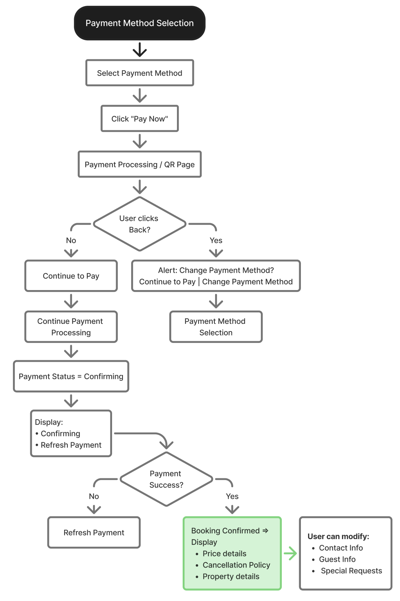

**预期结果**

用户在选择支付方式后发起支付流程。若支付仍在处理中用户点击“返回”按钮，系统应显示确认弹窗，询问用户是继续支付还是更换支付方式。

- 若用户选择“继续支付”，支付处理继续进行，系统持续检查支付状态直至完成。
- 若用户选择“更换支付方式”，用户将被跳转至支付方式选择页，选择其他支付方式并重新发起支付流程。

支付成功完成后，系统显示预订确认页。预订确认后，用户仍可更新联系信息、住客信息和特殊要求，但须遵守酒店的修改政策。

**核心业务规则**

**支付**

- 用户点击“立即支付”前必须选择一种支付方式。
- 支付处理过程中，用户可返回并更换支付方式。
- 在支付网关确认交易前，支付状态保持为“确认中”。
- 用户可手动刷新支付状态。

**预订确认**

- 支付成功后，预订状态变更为“已确认”。
- 预订确认信息将发送至注册邮箱。
- 用户可重新发送确认邮件。
- 确认后仅可修改联系信息、住客信息和特殊要求（须遵守酒店政策）。

**图 1.1：预订取消旅程**

整体流程：支付 → 确认 → 取消 → 退款

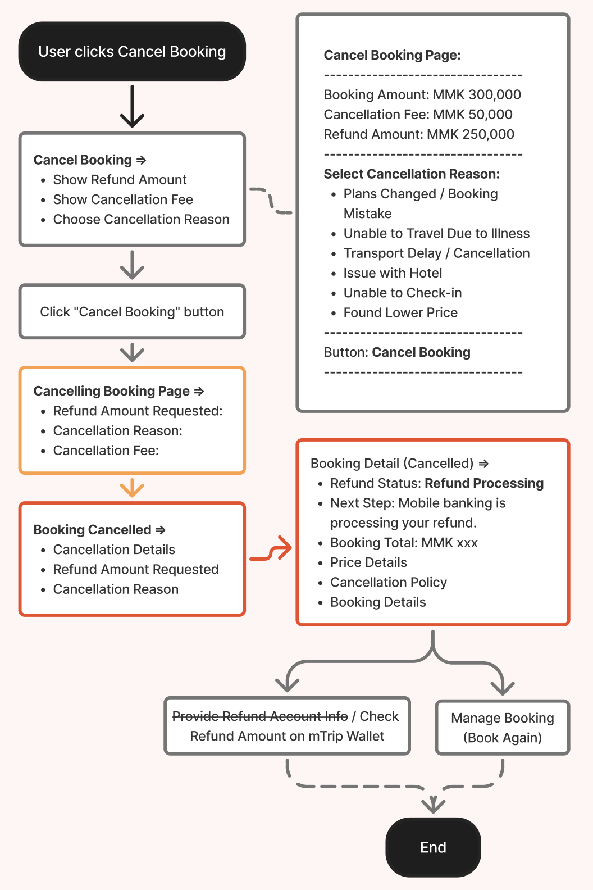

**酒店预订取消**

取消资格遵循酒店的取消政策。

取消页面展示：

- 取消手续费
- 退款金额
- 取消原因

用户在确认前必须选择一项取消原因。

**退款**

- 取消后，预订状态变更为“已取消”。
- 系统发起退款请求。
- 预订详情页展示：
    - 退款状态（例如：退款处理中）
    - 下一步
    - 预订总额
    - 价格明细
    - 取消政策
    - 预订详情
- 用户仅可退款至其 mTrip 钱包账户。

**图 2（异常场景）：商户导致的预订确认失败流程**

整体流程：支付成功 → 预订确认失败（酒店或商户）

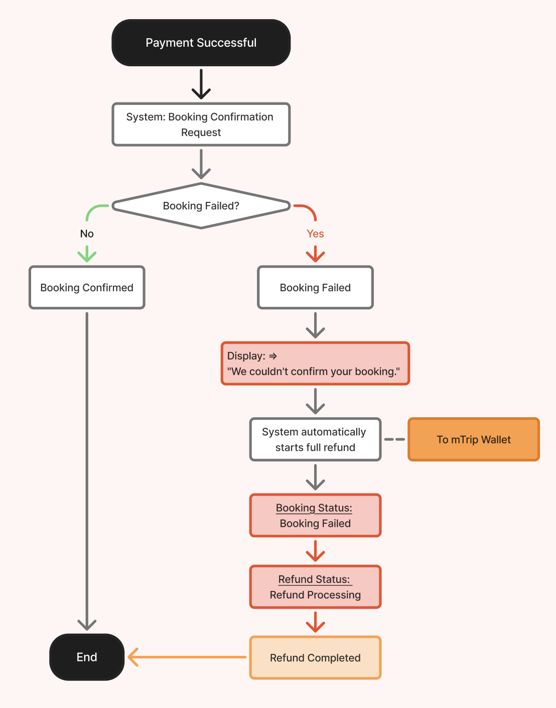

**异常处理：酒店无法履约**

### 高层说明

本场景说明当酒店因运营或不可预见情况无法履行已确认的预订时，系统如何处理。由于此类事件不常见且通常需要人工协调，因此按异常流程管理，而非标准用户预订流程。

**可能原因**

- 酒店超售
- 客房不可用
- 酒店维护或临时停业
- 不可抗力（例如：自然灾害、政府限制）
- 酒店运营问题
- 供应商发起的取消

### 业务规则

- 当已确认的预订无法履约时，酒店或供应商必须通知 mTrip。
- 运营或客户支持团队审核并核实取消请求。
- 通过推送通知、邮件和应用内通知立即通知客户。
- 客户支持可协助客户寻找替代酒店，视可用房量和业务政策而定。
- 若无法安排替代预订或客户拒绝，该预订将被取消并全额退款。
- 酒店发起的取消不得向客户收取任何取消手续费。
- 退款将遵循标准退款处理流程与状态跟踪。
- 所有取消操作均应记录在预订历史中，以供审计。

**预期结果**

当酒店无法履行已确认的预订时，客户会及时获知。运营团队协调处理方案：尽可能协助完成替代预订，若无合适替代方案则发起全额退款。预订状态、退款状态和沟通记录均会更新，以确保透明度，并为客户和支持团队提供完整的跟踪信息。

**图 3：取消待支付预订（到店支付）**

**待支付 → 取消 / 超时**

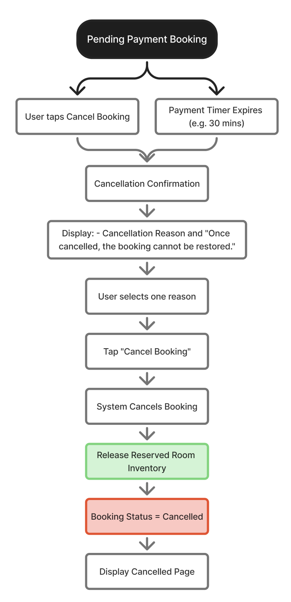

**预期结果**

若用户在支付完成前点击“取消预订”或支付倒计时结束，待支付预订将被取消。

取消预订时，用户需选择一项取消原因并点击“取消预订”按钮。由于尚未完成支付，系统随即取消该待支付预订。

取消成功后，系统将：

- 将预订状态更新为“已取消”。
- 自动将临时占用的房量库存释放回酒店的可用房量。
- 显示“预订已取消”页面，包含取消详情和“再次预订”按钮，便于用户返回酒店详情页并按需创建新预订。

## 模块 10：通知中心 + 预订风险管理与申诉

**通知渠道概述**

通知管理模块通过多种沟通渠道及时推送更新，使用户在整个酒店预订生命周期中保持知情。

通知根据预定义的预订事件自动触发，并可视事件类型和业务要求，通过推送通知、应用内通知、短信和邮件进行推送。

通知系统旨在：

- 让用户及时获知重要的预订更新。
- 提升客户互动与预订后体验。
- 通过主动沟通减少客户支持咨询。
- 在需要时支持呼叫中心跟进等额外运营服务。

**通知渠道矩阵**

| 事件 | 推送 | 应用内 | 短信 | 邮件 | 附加服务 |
|---|---|---|---|---|---|
| 酒店预订确认 | ✅ | ✅ | ✅ | ✅ | 呼叫中心跟进 |
| 酒店预订取消 | ✅ | ✅ | ✅ | ✅ | 呼叫中心跟进 |
| “撰写评价”请求 | ✅ | ✅ | 可选 | ✅ | — |

**通知事件规格**

| 事件 | 触发条件 | 推送通知 | 应用内通知 | 短信 | 邮件 |
|---|---|---|---|---|---|
| 酒店预订确认 | 支付成功且预订状态变更为“已确认”。 | 通知用户酒店预订已确认，并提供预订详情的快捷入口。 | 在“我的预订”中显示预订确认信息，并附预订凭证链接。 | 发送包含预订编号的确认短信。 | 发送包含预订摘要和预订凭证的确认邮件。 |
| 酒店预订取消 | 预订被用户或酒店取消。 | 通知用户预订已取消。 | 显示取消状态和退款信息。 | 发送包含退款参考号的取消确认短信。 | 发送包含退款金额、退款方式和预计处理时长的取消确认邮件。 |
| 评价请求 | 退房后 1 天且尚未提交评价时自动触发。 | 邀请用户对本次入住进行评分和评价。 | 显示提交酒店评价的提醒。 | （可选）通过短信发送提醒。 | 发送邮件，邀请用户分享其酒店体验。 |

### 业务规则

- 通知应由系统事件自动触发。
- 单个事件可同时触发多个通知渠道。
- 所有用户的推送通知和应用内通知应默认开启。
- 短信通知仅应针对重要的预订相关事件发送，或在业务配置开启时发送。
- 邮件通知应在适用时包含预订详情和可下载的预订凭证。
- 每个已完成预订，用户仅应收到一次“撰写评价”请求。
- 若已提交评价，则不应再发送评价请求通知。
- 通知模板应支持本地化和多语言。
- 通知内容应支持动态变量（例如：酒店名称、预订编号、入住日期、住客姓名、退款金额）。

### 模块 10.1：预订风险管理与申诉

**用户欺诈管理**

为保护 mTrip 平台免遭滥用，同时维持公平的用户体验，系统应基于用户行为、预订模式和取消历史，实施可配置的多级欺诈管理机制。欺诈检测规则通过 mTrip 管理后台配置的阈值自动评估，运营或风险管理团队负责审核被标记的账户，并在必要时执行人工处置。

### 级别 1 – 警告

超过配置欺诈阈值的用户将收到应用内警告，提示存在异常预订或取消行为。此阶段不施加任何功能限制，用户行为仍将继续被监控。

### 级别 2 – 账户暂停

若用户的欺诈评分达到下一配置阈值，系统应自动暂停其账户。被暂停的用户在申诉成功或管理员作出决定解除暂停前，无法使用 App。

**申诉流程**

账户被暂停的用户可通过应用提交申诉，并提供：

- 书面说明。
- 支持性附件（照片或文件）。（可上传截图或文件，最大 20 MB。）

运营或风险管理团队应结合用户的预订历史和欺诈指标审核申诉。审核后，管理员可以：

- 解除功能限制。
- 维持限制。
- 若确认存在欺诈行为，将账户升级为“封禁”状态。

申诉结果应在应用内通知用户。

**封禁账户**

对于已确认或屡次发生的欺诈行为，管理员可永久封禁用户账户。封禁后：

- 登录时应显示账户暂停提示。
- 所有应用功能应被禁用。
- 用户仅可退出登录。

**欺诈检测规则**

欺诈检测引擎应支持可配置的规则和阈值，包括但不限于：

- 在可配置周期内的过多预订取消。
- 取消率超过配置阈值。
- 同一入住日期对同一酒店的多笔预订超过配置阈值。
- 运营或风险管理团队定义的其他欺诈规则。

mTrip 管理后台应提供欺诈管理能力，包括：

- 欺诈阈值与规则配置。
- 被标记用户的工作台。
- 欺诈级别（警告、功能限制、封禁）。
- 欺诈触发历史与原因。
- 预订与取消历史。
- 同一酒店 / 同一入住日期预订检测。
- 申诉审核队列，包含已提交的说明与附件。
- 管理操作，包括批准申诉、维持限制、解除限制、暂停用户或封禁用户。

欺诈管理状态流转流程：正常 → 警告 → 功能限制 → 申诉 →（已通过 → 正常）/（已驳回 → 受限）/（已升级 → 封禁）

**退款政策与平台手续费透明度**

为提升透明度，mTrip 应提供在线退款政策，用户可在预订前和预订后访问。结算时，用户应能访问“什么是平台手续费？”或“便利费”信息链接，了解退款的计算方式。

退款政策应明确说明以下内容：

- 首次预订付款时不收取平台手续费。
- 仅当客户主动发起预订取消时，才根据平台手续费政策扣除平台手续费。
- 如适用，酒店取消费用由酒店的取消政策确定。
- 剩余的符合条件退款金额将存入客户的 mTrip 钱包。
- 退款处理通常需要 3–7 个工作日。
- 可提供退款示例，帮助用户理解退款的计算方式。

上述信息可确保用户在确认预订前了解退款政策，提升整个预订旅程的透明度，并有助于减少与退款相关的争议。

**图示：预订取消流程（+ 平台手续费）**

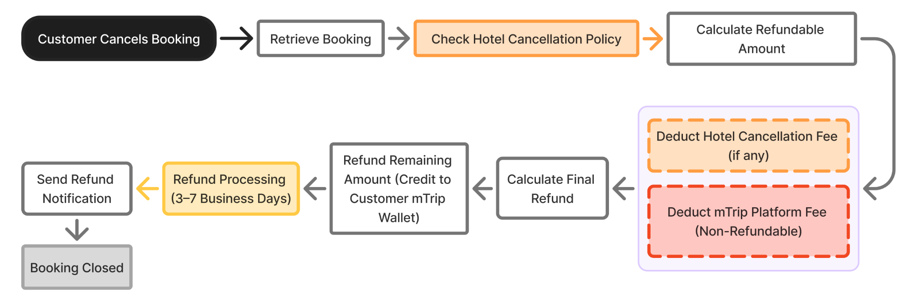

**取消、退款与平台手续费政策**

酒店预订在结算时不收取平台手续费；客户仅需支付酒店金额。

如果预订被取消，系统应根据酒店的取消政策计算可退款金额。在处理退款之前，系统应扣除适用的平台手续费（便利费）以及酒店取消费用（如适用）。剩余的符合条件退款金额随后将存入客户的 mTrip 钱包。

退款仅处理至 mTrip 钱包，可能需要 3–7 个工作日。退款完成后，客户将收到通知。

**平台手续费适用情形**

| 场景 | 平台手续费 | 业务规则 |
|---|---|---|
| 预订付款完成（预订生效中） | 0（不收取） | 客户成功完成酒店预订付款时，不收取平台手续费。预订在入住、完成或取消之前保持生效。 |
| 客户主动取消 | ✅ 适用 | 在将退款处理至客户 mTrip 钱包之前，应从可退款金额中扣除平台手续费。 |
| 支付超时（预订未确认） | ❌ 不适用 | 若预订在确认前因支付超时而自动取消，则不收取平台手续费。 |
| 酒店拒绝 | ❌ 不适用 | 若酒店无法接受或确认预订，则不收取平台手续费。 |
| 系统预订失败 | ❌ 不适用 | 若预订因系统或技术问题失败，则不收取平台手续费。 |
| 商户主动取消 | ❌ 不适用 | 若商户或酒店取消已确认的预订，则不收取平台手续费。 |

## 模块 11：评价、评分与 AI 评价摘要

### 高层说明

用户可在完成酒店住宿后提交评价与评分。评价包括总体评分、清洁度、位置、服务与设施四项分类评分、旅客类型、文字评价内容，以及最多 10 张照片。

旅客类型：

- 独自出行
- 情侣
- 家庭
- 朋友
- 商务出行

评价须经 mTrip 管理员批准后方可发布。

酒店商户仅可回复已发布的评价。

**用户评价与评分流程图**

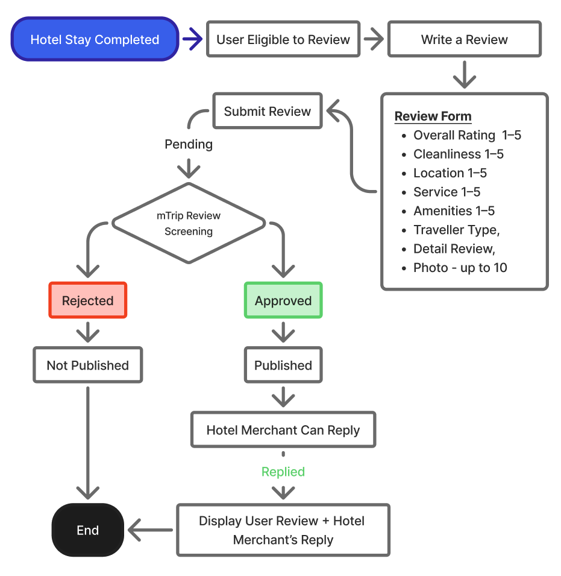

**评价与评分权限矩阵表**

| 操作方 | 可提交 | 可批准/驳回 | 可编辑 | 可回复 | 可删除 |
|---|---|---|---|---|---|
| 用户 | ✅ | — | ❌ | ❌ | ❌ |
| mTrip 管理员 | — | ✅ | ❌ | — | ✅ |
| 酒店商户 | — | ❌ | ❌ | ✅ | ❌ |

**酒店评分与标签标准**

| 分数区间 | 展示标签 | 标准 / 含义 |
|---|---|---|
| 9.0–10.0 | 卓越 | 出色的体验 |
| 8.0–8.9 | 优秀 | 优秀的体验 |
| 7.0–7.9 | 很好 | 很好的体验 |
| 6.0–6.9 | 良好 | 总体良好的体验 |
| 5.0–5.9 | 一般 | 可接受的体验 |
| 4.0–4.9 | 低于平均 | 低于预期标准 |
| 3.0–3.9 | 较差 | 存在多项问题 |
| 2.0–2.9 | 很差 | 存在严重问题 |
| 1.0–1.9 | 极差 | 体验极差 |

展示标签 = 根据最终总体评分所在区间分配的标签。

无已批准评价时：不显示数值评分，改为显示“新 · 暂无评价”。

评分仅根据已批准并已发布的评价计算。

**评价评分计算**

每位用户使用 5 个评分维度对酒店进行评分，每个维度分值为 1 至 5 分。

| 维度 | 分值范围 |
|---|---|
| 总体 | 1–5 |
| 清洁度 | 1–5 |
| 位置 | 1–5 |
| 服务 | 1–5 |
| 设施 | 1–5 |
| 最高总分 | 25 |

**计算每位用户的评价得分**

系统将该用户在全部 5 个维度的评分相加。

公式：用户评价得分 =（维度总分 ÷ 25）× 10

计算结果由 5 分制维度评分转换为 10 分制评价得分。

示例：

| 维度 | 用户评分 |
|---|---|
| 总体 | 5 |
| 清洁度 | 4 |
| 位置 | 5 |
| 服务 | 4 |
| 设施 | 4 |
| 合计 | 22 / 25 |

计算：（22 ÷ 25）× 10 = 8.8

因此，该用户的评价得分为 8.8 / 10。

**计算酒店总体评分**

酒店总体评分按全部已批准用户评价得分的平均值计算。

公式：酒店总体评分 = 全部用户评价得分之和 ÷ 已批准评价数量

示例：

| 用户 | 用户评价得分 |
|---|---|
| 用户 1 | 8.8 |
| 用户 2 | 9.2 |
| 用户 3 | 7.6 |
| 用户 4 | 8.4 |

计算：（8.8 + 9.2 + 7.6 + 8.4）÷ 4 = 8.5

因此：酒店总体评分 = 8.5 / 10

酒店评分显示保留 1 位小数。

**酒店评分的评价适用范围**

- 仅已批准并已发布的评价计入酒店评分计算。
- 已驳回、未发布或已删除的评价不计入。
- 若酒店没有已批准的评价，不显示数值评分，改为显示“新 · 暂无评价”。
- 首条已批准评价发布后，酒店评分使用该条评价计算。
- 每当新的已批准评价发布或现有已批准评价被移除时，酒店评分将重新计算。

## 模块 12：AI 酒店助手（第二阶段 | 不包含在首次发布中）

**图示 3：AI 助手用户旅程**

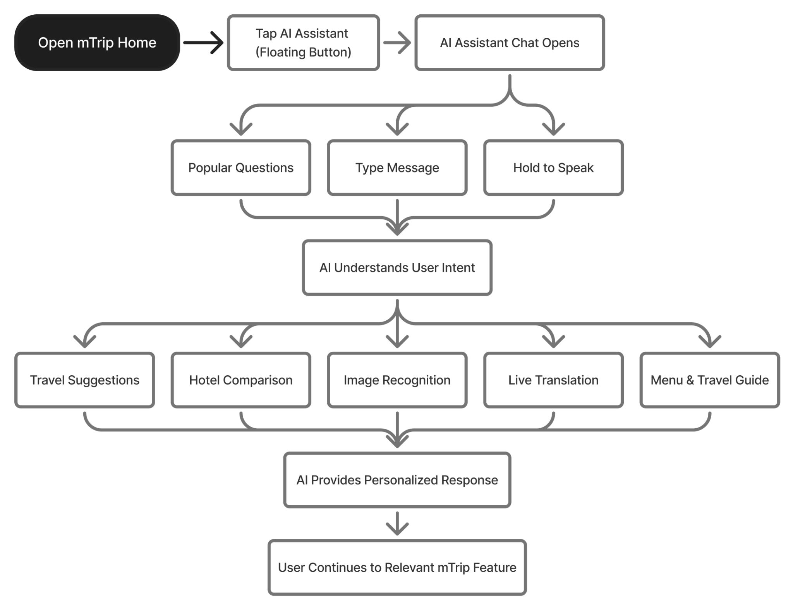

**高层旅程**

启动 AI → 提问或选择问题 → AI 理解意图 → AI 提供协助 → 继续进入相关服务

**预期成果**

用户可成功与 mTrip AI 助手交互，获取个性化旅行推荐、比较酒店、翻译语言、识别图片并使用智能旅行协助，从而在 mTrip 各项服务之间顺畅切换。

## 模块 13：在线聊天与客户支持

### 概述

客户支持聊天模块为入住前、入住期间和入住后的酒店预订咨询提供快速帮助。该模块以聊天机器人/AI 助手处理常见问题为起点。若问题未解决，用户可连接人工客服。聊天会话保持活跃，并可从“消息”中恢复。

**mTrip 支持聊天 – 入口**

用户可通过以下入口进入 mTrip 支持聊天：

- 酒店预订详情页：点击“在线支持聊天”按钮，打开 mTrip 支持聊天，获取与预订相关的协助。
- 首页：点击标有“与我们聊天”的悬浮聊天气泡，打开 mTrip 支持聊天。
- 更多 → 联系我们：点击“与 mTrip 聊天”，打开 mTrip 支持聊天。

### 目标

- 为常见预订咨询提供快速的自助支持。
- 通过自动回复减少客户支持工作量。
- 使用户能够快速获取与具体预订相关的支持。
- 提供向人工客服的顺畅升级。
- 保留聊天记录，支持持续会话。

**高层用户旅程**

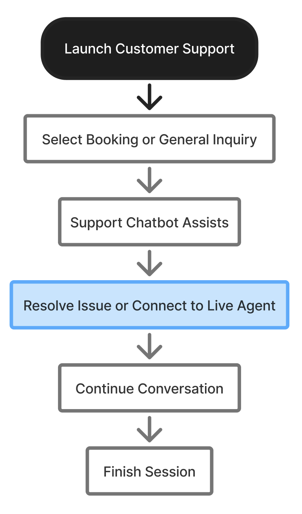

**客户支持模块的功能需求**

| 功能 | 需求 |
|---|---|
| 欢迎页 | 打开支持聊天时显示欢迎消息。 |
| 预订选择 | 允许用户选择当前或历史预订，以获取与上下文相关的支持。 |
| 一般咨询 | 允许用户在不选择预订的情况下发起支持会话。 |
| 推荐问题 | 显示与所选预订或一般咨询相关的预置常见问题。 |
| 聊天机器人 | 为常见客户支持问题提供自动回复。 |
| 人工客服 | 在需要额外协助时，允许用户连接人工客服。 |
| 聊天记录 | 保存聊天记录，并允许用户继续之前的会话。 |
| 结束会话 | 允许用户结束当前支持会话。 |
| 反馈 | 允许用户在会话结束后对支持体验进行评分。 |
| 最近浏览的酒店 | 在支持过程中显示最近浏览的酒店，便于快速参考。 |

**人工客服升级**

用户可随时通过选择“联系客户支持”连接人工客服。系统在以下情形还应建议升级：

- 聊天机器人无法回答用户的问题。
- 用户要求与客服人员通话。
- 咨询涉及支付争议、投诉或特殊请求。
- 需要人工介入才能解决问题。

**会话管理**

- 用户退出聊天页面后，聊天会话应保持活跃。
- 用户可在“消息”中继续之前的会话。
- 用户登录后，全部聊天记录应在各设备间同步。
- 用户可随时选择“结束会话”来结束支持会话。

## 模块 14：联盟与推荐计划

**推荐有奖功能概述**

推荐有奖功能允许 mTrip 用户通过专属推荐码或链接邀请好友。其目标是通过可信推荐提升用户获取，并在被邀请好友完成首次酒店预订后，同时奖励推荐人与新用户。

用户可通过即时通讯应用或社交媒体分享推荐链接，也可手动分享推荐码。该功能会跟踪推荐旅程，从邀请到奖励发放。条件满足后，奖励将存入用户的 mTrip 钱包，供后续预订使用。

推荐有奖功能以简洁和可扩展为设计原则，可支持营销活动及其他推荐计划，同时在 mTrip 旅行超级 App 内确保顺畅的用户体验。

**mTrip 推荐有奖 – 用户对用户推荐旅程（整体工作流程）**

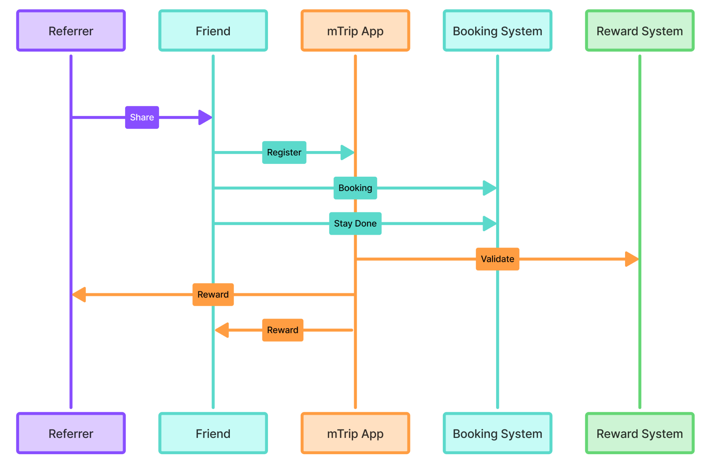

**推荐链接与推荐码处理**

| 场景 | 系统行为 |
|---|---|
| 用户分享推荐链接 | 每位用户都会被分配一个唯一的预生成推荐链接，可直接分享。好友打开该链接后，将显示 mTrip Web 注册/登录页，注册时推荐码会自动预填。（若用户通过推荐链接注册，则无法从输入框中删除推荐码） |
| 用户分享推荐码 | 好友在 mTrip Web 或移动端 App 注册时手动输入推荐码。系统会在完成注册前校验该推荐码。 |
| 已有用户 | 根据推荐活动规则，推荐权益仅适用于符合条件的新用户注册。 |
| 推荐关系绑定 | 注册成功后，推荐关系将永久绑定至新用户账户；满足全部活动条件后发放奖励。 |

**mTrip 推荐有奖 – 推荐旅程（整体工作流程）**

mTrip 推荐有奖的推荐旅程描述了从邀请到奖励发放的完整推荐流程。已有用户与好友分享专属推荐链接或推荐码，好友随后注册并在 mTrip 上完成其首次符合条件的酒店预订。系统会跟踪每笔推荐在注册、预订、完成入住和奖励资格各环节的进度。全部推荐条件满足后，奖励将自动存入推荐人的 mTrip 钱包，提供透明且顺畅的推荐体验。

**推荐计划时序图（端到端）**

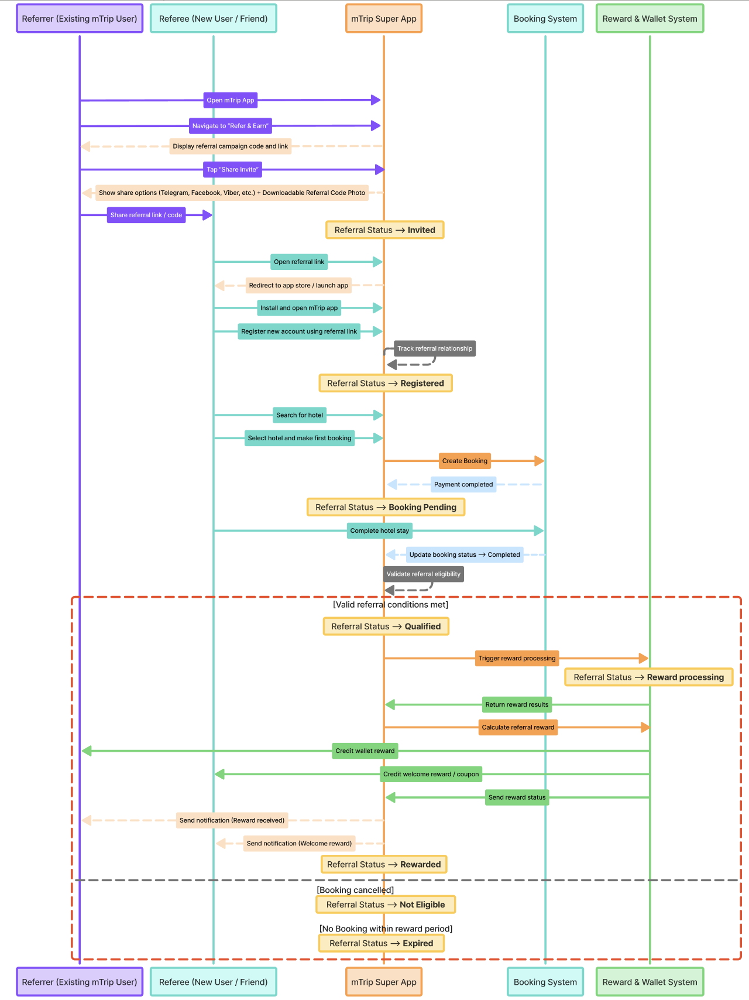

**推荐计划时序图（端到端）**

推荐计划时序图展示了推荐过程中推荐人、被推荐用户、mTrip 平台、酒店预订系统与钱包服务之间的交互。它说明了推荐关系如何建立、各环节如何校验资格，以及被推荐用户首次成功完成酒店预订后奖励如何自动发放。

该流程确保仅为真实有效的预订发放奖励，为所有相关方保持透明度与自动化。

推荐计划可通过管理后台完全配置。管理员可轻松调整推荐人与被推荐用户的奖励金额、设置资格条件、定义有效预订条件、管理推荐有效期、设置奖励过期时间、确定活动持续时间，并修改其他计划规则，无需进行系统变更。

**推荐链接与 App 下载流程**

### 1. 已安装 App

- 当用户点击推荐链接时，系统应直接打开 mTrip App。
- 系统应自动捕获推荐码，并在注册时自动预填到“推荐码”输入框。
- 用户可在完成注册前核对推荐码。

### 2. 未安装 App

- Android 用户应被重定向至 Google Play Store。
- iOS 用户应被重定向至 Apple App Store。
- 安装并打开 App 后，系统应自动从原始推荐链接中获取推荐码。
- 系统应在注册时将推荐码自动预填到“推荐码”输入框。

### 3. 推荐码恢复失败

- 若 App 在安装后无法获取推荐码，“推荐码”输入框应保持为空。
- 注册时应允许用户手动输入推荐码。
- 系统不得自动分配错误或无效的推荐码。

### 4. 其他业务规则

- 注册时应校验推荐码。
- 推荐归属应仅适用于符合条件的新用户注册。
- 每个符合条件的账户只能使用一次推荐码。

## 模块 15：动态 App 主题管理

### 概述

动态季节主题管理模块支持 mTrip 超级 App 根据设定的季节性与促销主题轻松更换外观，且不影响其主要功能。该模块包含可通过管理后台管理的默认主题，管理员还可创建、排期和管理自定义主题。变更将按设定计划自动生效，为用户带来流畅且富有吸引力的体验。

**业务需求**

系统应提供预定义的默认主题（可由管理员自定义），包括：

- 默认 mTrip 主题
- 缅甸新年（泼水节）主题
- 点灯节（Thadingyut）主题
- 圣诞节主题
- 新年主题
- 中国新年主题

**支持的主题界面**

当前生效的主题应支持更新以下应用界面和 UI 组件：

| 界面 | 主题元素 |
|---|---|
| 启动页 | 默认启动页或季节性启动页 |
| 应用 Logo | 默认 Logo 或季节性 Logo（App Store / Play Store 图标更新可能需要发布新版本 App） |
| 登录与注册 | 背景图 / 插画 |
| 首页 | 顶部背景 / 主视觉横幅 |
| 服务菜单 | 酒店、餐厅预订、高端用车和旅行套餐的主题图标 |
| 底部导航栏 | 导航图标、图标强调色、导航背景（可配置） |
| 预订确认 | 顶部背景横幅 / 庆祝插画 |
| 预订凭证 / 发票 | 顶部横幅和页脚品牌标识 |
| 酒店搜索页 | 顶部促销横幅背景 |

主题更新应仅修改视觉素材，同时保持现有应用布局、导航和功能不变。

管理员还应能够为营销活动、促销活动、目的地推广、合作、周年庆或未来季节性活动创建不限数量的自定义主题。

每个主题应支持：

- 主题名称
- 主题描述
- 主题缩略图 / 预览图
- 主题状态（草稿、已排期、生效中、未启用）
- 开始日期与时间
- 结束日期与时间
- 主题优先级（多个主题重叠时）

管理员应能够发布前预览完整主题、将主题保存为草稿、排期未来生效、编辑现有主题、复制主题、启用或停用主题，并在无生效主题时自动回退到默认 mTrip 主题。

**主题管理**

- 系统应按配置的计划自动启用和停用主题。
- 若多个主题同时生效，系统应展示配置优先级最高的主题。
- 若主题素材不可用或加载失败，应用应自动显示对应的默认素材。

### 用户体验

用户无需手动选择或切换主题。应用应自动获取并展示当前生效的主题。主题更新不得中断用户会话，也不得影响预订、支付、导航或任何其他应用功能。

**通过管理后台进行动态主题管理的验收标准**

- 内置默认季节主题可用且可配置。
- 管理员可创建、编辑、复制、预览、排期、启用和停用自定义主题。
- 主题支持可配置的生效时段和优先级。
- 支持的界面自动展示当前生效的主题。
- 无生效主题或素材时显示默认素材。
- 主题更新仅影响品牌与视觉呈现。
- App Store 与 Play Store 图标变更时可能需要发布新版本应用；其他所有主题素材通过配置的主题动态更新。

—-----------—-----------—-----------—-----------—-----------—-----------—-----------—-----------—-----------—-----

## 模块 16：用户引导与教程

### 模块目标

通过提供场景化的入驻引导、实用信息提示和可复用的教程内容，帮助用户理解并自信使用 mTrip 用户端 App 的各项功能。该模块专为数字经验有限的用户设计，支持在酒店、美食及未来应用功能之间提供一致的学习体验。

### 16.1 酒店预订引导提示（Coach Mark）

**需求**

为首次使用酒店预订功能的用户提供交互式引导提示（Coach Mark）入驻体验。

### 目标

引导首次使用的用户走完酒店预订旅程的关键步骤，帮助其在不具备 App 使用经验的情况下了解如何搜索并完成酒店预订。

**说明**

用户首次进入酒店预订功能时，系统将展示一系列场景化引导提示，突出显示酒店预订旅程的主要元素。

引导提示流程包含 7 个主要引导步骤，覆盖从进入酒店功能到完成预订流程的关键操作。

引导提示应：

- 突出显示每一步对应的 UI 元素。
- 提供简短标题和简单说明。
- 清晰展示用户在引导中的进度。
- 允许用户进入下一步。
- 提供“跳过”选项，用户可随时退出引导。
- 仅在用户首次使用酒店预订体验时展示该引导。
- 引导完成或跳过后不再打扰用户。

**重新进入引导**

完成或跳过引导提示后，用户可通过酒店搜索页上的指南图标再次进入酒店预订指南。

指南入口将提供以下内容：

- 酒店预订教程视频
- 分步酒店预订指南

**图示：酒店功能 — 用户引导与引导提示 UI 说明**

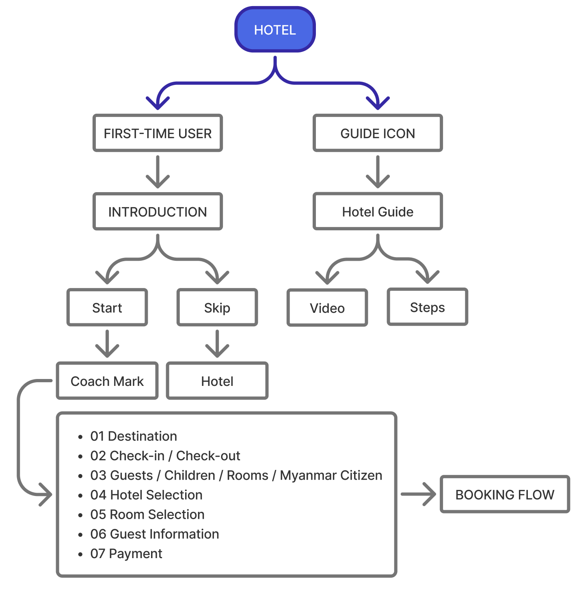

### 16.2 缅甸公民信息提示气泡

**需求**

为酒店搜索页展示的“缅甸公民”选项提供场景化信息提示。

### 目标

帮助用户在搜索酒店前了解“缅甸公民”选项的用途及可能影响。

**说明**

将在“缅甸公民”选项附近提供两条信息提示气泡 / 提示消息。

提示气泡应：

- 说明“缅甸公民”选项的含义。
- 帮助用户理解选择该选项为何可能影响展示的酒店价格或可用房量。
- 使用简单易懂的语言。
- 在不打断酒店搜索流程的前提下可访问。
- 允许用户在阅读后关闭或忽略该信息。

提示气泡内容应与系统实际实现的酒店价格和资格规则保持一致。

| 元素 | 缅甸公民提示气泡的最终文案 |
|---|---|
| 目标 | “缅甸公民”复选框 + ⓘ |
| 标题 | “缅甸公民”是什么意思？ |
| 说明 | 若您是缅甸公民，请选择此选项。酒店房价和条件可能因国籍而异。 |
| 关闭 / 行动按钮 | 知道了 |

### 16.3 教程与视频指南

**需求**

提供集中的教程页面，用户可在此访问 mTrip 用户端 App 各功能的教学视频和分步指南。

### 目标

为用户提供可复用的学习中心，使其可随时学习如何使用酒店、美食及其他支持的功能，而不仅依赖首次入驻引导。

**入口**

用户可通过以下路径进入教程页面：

个人资料 / 设置 → 教程

**说明**

教程页面将按功能分类组织学习内容。

初始分类可包括：

- 酒店
- 美食
- 其他 / 未来功能

每个分类将包含相关教程内容，以双列网格布局展示，每个教程以视频卡片形式呈现。

每个视频卡片应包含：

- 视频缩略图
- 播放标识
- 教程标题
- 所属分类

用户可选择教程以打开视频详情 / 观看视频页面，并在其中观看教程。

**酒店教程内容**

酒店分类应包含与酒店预订旅程相关的内容，包括：

- 酒店预订指南视频
- 分步酒店预订指南
- 未来新增的其他相关酒店教程

**可扩展性**

教程模块应设计为可复用的内容结构，以便在不改动整体页面结构的情况下新增分类、视频和指南。

该模块应支持未来扩展至 mTrip 用户端 App 的其他功能，如美食及其他服务。

**模块级用户体验**

三项功能共同构成统一的用户引导体系：

首次使用用户 → 酒店引导提示 → 了解预订流程再次使用用户 → 酒店指南图标 → 视频 + 分步指南随时 → 设置 → 教程 → 酒店 / 美食 / 其他教程该方式既能在用户首次体验时提供场景化引导，也提供用户需要帮助时可随时访问的自助学习内容。

## 模块 17：酒店预订 UI、UX 与功能更新（2026 年 9 月 4 日）

本模块记录酒店预订功能在上一个 PRD / 设计基线之后发生的主要 UI、UX、功能和流程变更。最新已确认的 Figma 设计及本 PRD 中的更新需求应作为开发与测试的当前事实来源。

**酒店预订 UI 与功能更新变更记录**

| 序号 | 模块 / 功能 | 变更说明 | 更新后的流程 / 行为 | 状态 |
|---|---|---|---|---|
| 1 | 酒店预订状态 | 更新“酒店预订状态”页面，明确区分酒店预订状态与支付状态。（查看更新后的 UI） | 酒店预订状态：确认中 → 已确认 / 支付状态：待支付 → 已支付 | 已更新 |
| 2 | 注册 / 登录 | 在初始注册入口页面将邮箱输入框替换为姓名输入框。更新注册 / 登录按钮设计与行动号召（CTA）呈现。 | 注册入口 → 更新后的身份验证 UI 输入（移除邮箱，新增姓名输入） | 已更新 |
| 3 | 应用初始加载 — 语言选择 | 在应用初始加载 / 入口体验中新增独立语言选择页面。 | App 加载 → 语言选择 → 精简模式 / 完整模式选择 | 已新增 |
| 4 | 应用初始加载 — 精简 / 完整模式 | 将精简模式设为语言选择后的默认体验，不再弹出初始精简模式 / 完整模式选择弹窗。 | App 加载 → 语言选择 → App 首页 → 精简模式 | 已新增 |
| 5 | 预订编号 | 在关键预订相关页面新增唯一预订编号，便于识别和引用预订。预订编号：MT-2025-123456 | 预订确认 → 预订详情 → 预订历史 / 已完成预订 → 展示预订编号 | 已更新 |
| 6 | 全局卡片 / 矩形圆角 | 统一酒店功能与 App 功能卡片 / 矩形 UI 组件的圆角。圆角更新为 24px，以保持全应用视觉风格一致。 | 原圆角 → 24px 标准化圆角 | 已更新 |
| 7 | 退款方式页面 | 更新“退款摘要”下退款方式卡片与预计退款时间线卡片的字体排版，含标题与正文文本，以提升可读性与视觉一致性。 | 原排版 → 更新后的标题 / 正文排版（标题与正文字号已调整） | 已更新 |
| 8 | 预订确认 — 精简模式与完整模式 | 更新精简模式与完整模式下的预订确认页面，以匹配最新预订信息与 UX 设计。 | 预订完成 → 更新后的预订确认页面 | 已更新 |
| 9 | 确认页取消预订 | 从预订确认页面移除“取消预订”按钮。用户现在只能在该页面查看预订详情。修改或取消需在“我的选择”中操作。 | 预订确认 → 查看详情 → 我的选择 / 预订详情 → 修改预订 / 取消预订 | 已更新 |
| 10 | 需登录账户提醒 | 更新用户未登录时尝试访问酒店预订功能所显示的需登录提醒的标题与内容。 | 标题：需登录账户！内容：立即前往登录 / 注册页面？确认 → 注册 / 登录页面 | 已更新 |
| 11 | 设置个人资料 — 第 1 步与第 2 步 | 移除设置个人资料第 1 步和第 2 步中的“跳过”按钮。新增确认提醒，允许用户立即完成设置或稍后完成。 | 设置个人资料 → 立即设置个人资料？ → 稍后 / 立即设置 | 已更新 |
| 12 | 设置个人资料提醒 | 新增个人资料设置提醒，内容如下：标题：立即设置个人资料？内容：只需填写一次信息，即可让后续预订更快捷、更轻松。按钮：稍后 / 立即设置 | — 稍后 → 跳过第 1 步与第 2 步　— 立即设置 → 完成第 1 步 → 完成第 2 步 | 已新增 |
| 13 | 绑定邮箱 — 账户安全 | 在“设置 → 账户 → 账户安全”下新增“绑定邮箱”页面。未绑定邮箱的用户将看到“绑定邮箱”选项。 | 设置 → 账户 → 账户安全 → 绑定邮箱 → 输入邮箱 → 发送验证码 | 已新增 |
| 14 | 绑定邮箱 — 验证 | 新增邮箱绑定页面，允许用户输入邮箱地址并接收验证码。 | 绑定邮箱 → 邮箱输入 → 发送验证码 → 邮箱验证 | 已新增 |
| 15 | 酒店评价 — 有用 / 举报 | 从酒店用户评价列表页移除“有用”（点赞）反应按钮和“举报评价”图标。 | 原评价操作 → 仅评价内容 | 已更新 |
| 16 | 多酒店预订 — 增加住宿 | 更新多酒店预订体验，引入可展开 / 收起的“增加住宿”卡片，使额外酒店住宿更易管理。多段住宿上限：用户可添加的最大住宿数量由后台管理端配置控制。例如，若最大住宿上限配置为 3 段住宿，则用户在一次预订中最多可添加 3 段住宿。达到最大上限后，“增加住宿”按钮将被隐藏或禁用。当用户移除一段或多段已添加住宿后，“增加住宿”选项将再次可用。 | 酒店预订 → 增加住宿 → 展开 / 收起 → 添加额外住宿　用户可根据后台管理端配置的最大住宿上限添加多段住宿。达到配置的最大上限后，“增加住宿”按钮隐藏 / 禁用。若用户移除已添加的住宿，该按钮将再次可用，直至达到最大上限。 | 已更新 |
| 17 | 多酒店预订 — 精简模式限制 | 在精简模式下禁用 / 移除多酒店预订。该功能仅在完整模式下可用。 | 精简模式 → 仅支持单酒店预订 / 完整模式 → 可使用多酒店预订 | 已更新 |
| 18 | 服务条款 / 隐私政策 / 入住规则同意 | 更新“复核并确认”步骤展示的同意内容。已移除原有的复选框 / 确认交互。隐私政策、条款与条件和促销优惠券中心页面必须以 Web 内嵌链接形式在 mTrip App 内实现，确保应用始终展示并同步 mTrip 网站发布的最新版本。 | 第 3 步（共 4 步）：复核并确认 → 展示协议文本 → 继续 / 确认 | 已更新 |
| 19 | 预订协议内容 | 更新协议文本，清晰传达用户的接受行为及 mTrip 的中介角色。 | “继续即表示我同意服务条款、隐私政策及该门店的入住规则。我了解 mTrip 作为本次预订的中介代理。” | 已更新 |
| 20 | 协议交互 | 用户不再需要手动勾选复选框或通过额外弹窗确认协议。协议以信息文本形式呈现在“复核并确认”步骤。 | 复核并确认 → 阅读协议 → 继续 / 确认（已移除复选框） | 已更新 |
| 21 | 选择客房（相同或不同房型） | 原：用户只能预订一间客房。现：用户现在可选择并预订多间客房，房型可相同或不同。 | 选择客房 → 选择多间客房（相同或不同房型） | 已更新 |

### 17.1 预订取消入口

原：预订确认 → 取消预订

更新后：预订确认 → 查看详情 → 我的选择（My Picks）/ 预订详情 → 修改预订 / 取消预订

需求：

- 预订确认页面不再显示“取消预订”按钮。
- 预订确认页面应提供“查看详情”按钮。
- 希望修改或取消预订的用户应通过“我的选择”（My Picks）进入该预订。
- “修改预订”和“取消预订”操作应在相应的预订详情页面提供。

### 17.2 精简模式 / 完整模式

更新后的进入流程：App 启动 → 语言选择 → 精简模式 / 完整模式选择 → 首页

**模式可用性**

| 功能 | 精简模式 | 完整模式 |
|---|---|---|
| 酒店搜索 | ✓ | ✓ |
| 酒店预订 | ✓ | ✓ |
| 单酒店预订 | ✓ | ✓ |
| 多酒店预订 | — | ✓ |

### 17.3 设置个人资料

原：

设置个人资料步骤 1 → 跳过设置个人资料步骤 2 → 跳过

更新后：设置个人资料 → 是否立即设置个人资料？

稍后→ 跳过步骤 1 和步骤 2→ 继续前往下一目的地

立即设置→ 步骤 1 → 步骤 2 → 完成个人资料设置

弹窗标题：“是否立即设置个人资料？”

弹窗内容：“只需填写一次信息，即可让后续预订更快捷、更轻松。”

弹窗按钮：“稍后” | “立即设置”

### 17.4 多房选择：房间数量同步

酒店搜索页面选择的房间数量，与房型列表 / 房型选择页面上的房间数量联动。

当用户点击“选择”选定某个房型时，房间数量控件将自动采用与酒店搜索时相同的房间数量，从而避免用户手动重新输入房间数。

| 搜索页房间数量 | 选择前的房型列表 | 用户操作 | 点击“选择”后 |
|---|---|---|---|
| 1 间 | 选择 | 点击“选择” | − 1 + |
| 2 间 | 选择 | 点击“选择” | − 2 + |
| 3 间 | 选择 | 点击“选择” | − 3 + |
| 4 间 | 选择 | 点击“选择” | − 4 + |

**普通单房场景**

对于普通单房预订：

- 用户在酒店搜索页面选择 1 间。
- 用户搜索酒店并打开房型选择页面。
- 每个可用房型均显示“选择”按钮。
- 用户点击目标房型的“选择”。
- “选择”按钮变为房间数量控件 − 1 +。
- 房间数量依据酒店搜索时选择的房间数初始化为 1。

**多房场景**

例如，若用户以 2 间房进行搜索，则点击“选择”后，所选房型将自动以 2 间房开始。

关键规则：初始房间数量始终与酒店搜索时选择的房间数同步。用户随后可通过 − / + 控件调整数量，但须符合总房间需求。

适用于精简模式与完整模式：两种模式均使用相同的“选择”→ − N + 交互，以保持一致，避免用户在选择房间时产生困惑。

### 17.5 促销优惠券适用条件与管理端配置

优惠券的适用条件由管理端后台控制。管理员可根据促销需求为每张优惠券配置条件。

系统应在应用优惠券前，依据已配置的条件校验该预订。

| 优惠券条件 | 管理端配置示例 | 系统行为 |
|---|---|---|
| 指定房型 | 选择一个或多个特定房型 | 仅对所选房型应用折扣。 |
| 指定酒店 | 选择一家或多家特定酒店 | 仅对所选酒店应用折扣。 |
| 多房间 | 最少房间数 = 2 | 当预订包含 2 间及以上房间时，优惠券可用。 |
| 多酒店 | 最少酒店数 = 2 | 当预订包含 2 家及以上酒店时，优惠券可用。 |
| 最低预订金额 | 最低 = 200,000 MMK | 当符合条件的预订金额达到配置金额时，优惠券可用。 |
| 提前预订（Early Bird） | 入住前至少提前 30 天预订 | 当预订满足配置的提前预订期时，优惠券可用。 |
| 长住 | 最少入住 5 晚 | 当达到配置的最少入住晚数时，优惠券可用。 |
| 指定入住日期 | 选择特定日期 / 时段 | 仅对配置入住时段内的预订，优惠券可用。 |
| 最高折扣 | 上限 = 50,000 MMK | 折扣不得超过配置的上限金额。 |

**预订类型示例**

同一预订可同时满足多个条件。

| 预订场景 | 可能的优惠券条件 |
|---|---|
| 1 家酒店 + 1 间房 | 指定房型、指定酒店、最低预订金额、提前预订等 |
| 1 家酒店 + 多间房 | 指定房型、指定酒店、多房间、最低预订金额等 |
| 多家酒店 + 每家 1 间房 | 指定酒店、多酒店、最低预订金额、提前预订等 |
| 多家酒店 + 多间房 | 指定房型、指定酒店、多房间、多酒店及其他已配置条件 |

重要：预订类型本身并不自动决定优惠券是否可用。适用规则由管理端配置决定。

例如，管理员可配置：

- 优惠券 A：仅限酒店 A
- 优惠券 B：仅限豪华房
- 优惠券 C：最少 2 间房
- 优惠券 D：最少 2 家酒店
- 优惠券 E：酒店 A + 最少 2 间房
- 优惠券 F：最少 2 家酒店 + 最低预订金额 500,000 MMK

系统应评估所有已配置条件，仅在预订满足所需条件时才应用优惠券。

### 17.6 优惠券分配与折扣分摊

优惠券可用时，系统应依据优惠券配置确定由哪些房间或酒店享受折扣。

对于多房间或多酒店预订，优惠券折扣不应应用于不符合条件的房间或酒店。

| 优惠券场景 | 预订示例 | 优惠券分配规则 |
|---|---|---|
| 指定房型优惠券 | 酒店 A：豪华房 × 2 + 套房 × 1 | 仅对符合条件的豪华房应用优惠券，套房不享受折扣。 |
| 指定酒店优惠券 | 同一预订中包含酒店 A + 酒店 B | 仅对所选酒店下符合条件的房间应用优惠券，不应用于其他酒店。 |
| 多房间优惠券 | 同一酒店内 2 间及以上房间 | 若满足最少房间数条件，按优惠券规则应用配置的折扣。 |
| 多酒店优惠券 | 酒店 A + 酒店 B | 若满足最少酒店数条件，对符合条件的预订金额应用配置的折扣。 |
| 多房间 + 指定房型 | 豪华房 × 2 + 套房 × 1 | 同时校验两个条件；若均符合，仅对所选房型应用折扣。 |
| 多酒店 + 指定酒店 | 酒店 A + 酒店 B | 仅对配置的酒店应用折扣，其他酒店不予应用。 |
| 预订级优惠券 | 多家酒店与多间房 | 依据已配置的优惠券条件，对符合条件的预订金额应用折扣。 |
| 最高折扣 | 10% 折扣，上限 30,000 MMK | 先计算折扣，再将折扣限制在配置的上限金额内。 |

**固定金额优惠券的折扣分摊**

对于适用于多个符合条件房间的固定金额优惠券，折扣应按符合条件房间的价格比例分摊。

示例：

- 房间 A = 50,000 MMK
- 房间 B = 150,000 MMK
- 符合条件合计 = 200,000 MMK
- 优惠券折扣 = 20,000 MMK

| 房间 | 房间价格 | 折扣分摊 | 最终价格 |
|---|---|---|---|
| 房间 A | 50,000 MMK | 5,000 MMK | 45,000 MMK |
| 房间 B | 150,000 MMK | 15,000 MMK | 135,000 MMK |
| 合计 | 200,000 MMK | 20,000 MMK | 180,000 MMK |

分摊公式：

房间折扣 = 优惠券折扣总额 ×（符合条件房间价格 ÷ 符合条件房间价格合计）

当优惠券配置为适用于多个符合条件的房间时，应采用该比例分摊方式。

**重要规则**

- 优惠券折扣只能应用于符合条件的房间 / 酒店。
- 不符合条件的房间 / 酒店不得获得优惠券折扣的任何部分。
- 对于覆盖多个符合条件房间的固定金额优惠券，按符合条件房间价格进行比例分摊。
- 若优惠券设有最高折扣金额，系统不得超过配置的上限。
- 价格明细应清晰展示优惠券折扣及其所应用的房间 / 酒店。
- 如有需要，具体的分摊方式可由管理端后台控制。

## 模块 18：mTrip 钱包

### 18.1 目的

mTrip 钱包是临时性的预订余额钱包，用于存放 mTrip 交易的退款。

它可用于符合条件的 mTrip 交易，例如：

- 酒店预订
- 租车预订
- 其他支持的 mTrip 服务

重要：mTrip 钱包不是普通电子钱包。用户无法存入现金、提取现金、充值、转账或提现。

### 18.2 钱包规则

| 规则 | 要求 |
|---|---|
| 钱包类型 | 仅用于退款 / 预订余额 |
| 币种 | MMK |
| 现金存入 | 不支持 |
| 现金提取 | 不支持 |
| 充值 | 不支持 |
| 转账 | 不支持 |
| 退款 | 符合条件的退款将存入钱包 |
| 使用 | 可用于符合条件的 mTrip 交易 |
| 有效期 | 由管理端后台配置 |
| 默认示例 | 6 个月（可由管理端后台配置） |
| 过期金额 | 作废，无法使用 |
| 余额 | 1 钱包余额 = 1 MMK |

钱包提示语：“mTrip 钱包是预订余额，不是电子钱包。退款将存入您的余额，供下次预订使用。1 余额 = 1 MMK。”

### 18.3 钱包余额

钱包页面显示：

- 当前钱包余额
- 币种：MMK
- 钱包说明提示
- 全部
- 退款
- 消费
- 已过期
- 交易记录
- “?”图标 → mTrip 钱包使用说明

**余额示例**

钱包余额：MMK 150,000

### 18.4 钱包有效期

每笔退回到钱包的金额都有各自的有效期。有效期时长由 mTrip 管理端后台控制。

示例：

退款金额：MMK 100,000

退款日期：2026 年 9 月 24 日

有效期设置：6 个月

到期日期：2027 年 3 月 24 日

当钱包金额到达有效期时：

钱包余额 ↓ 到达到期日期 ↓ 金额过期 ↓ 金额作废 ↓ 用户无法使用该金额

**管理端配置**

管理员可配置钱包有效期，例如：

- 6 个月
- 1 年

具体有效期时长应可在管理端后台配置。

### 18.5 结账时使用钱包支付

钱包余额可用于支付符合条件的 mTrip 交易。

系统会自动应用可用钱包金额，最高不超过配置的可抵扣上限。

如用户不希望使用钱包余额，可将钱包使用开关关闭。

**支付逻辑**

预订金额 ↓ 校验钱包余额 ↓ 校验管理端可抵扣上限 ↓ 计算钱包金额 ↓ 自动应用钱包 ↓ 剩余金额 → 其他支付方式

| 场景 | 预订金额 | 钱包余额 | 使用钱包 | 其他支付 |
|---|---|---|---|---|
| 钱包可全额支付预订 | MMK 100,000 | MMK 150,000 | MMK 100,000 | MMK 0 |
| 钱包可部分支付预订 | MMK 250,000 | MMK 100,000 | MMK 100,000 | MMK 150,000 |
| 大额预订 | MMK 500,000 | MMK 300,000 | MMK 300,000 | MMK 200,000 |

**示例：管理端后台可抵扣上限**

若管理员配置：

钱包最高可抵扣金额 = MMK 100,000

且：

预订金额 = MMK 250,000钱包余额 = MMK 200,000

则：

使用钱包 = MMK 100,000其他支付 = MMK 150,000

用户可关闭钱包使用：

使用 mTrip 钱包[ ON ]→ 自动应用钱包金额。

使用 mTrip 钱包[ OFF ]→ 本次交易不使用钱包金额。

### 18.6 钱包交易类型

钱包支持四类交易：

| 标签页 | 说明 |
|---|---|
| 全部 | 所有钱包交易 |
| 退款 | 存入钱包的退款金额 |
| 消费 | 用于 mTrip 交易的钱包金额 |
| 已过期 | 已过期的钱包金额 |

### 18.7 交易记录

系统显示 6 个月的交易记录。

| 月份 | 显示 |
|---|---|
| 2026 年 9 月 | 当前月份 |
| 2026 年 8 月 | 往前 1 个月（仅 8 月） |
| 2026 年 7 月 | 往前 2 个月（仅 7 月） |
| 2026 年 6 月 | 往前 3 个月（仅 6 月） |
| 2026 年 5 月 | 往前 4 个月（仅 5 月） |
| 2026 年 4 月 | 往前 5 个月（仅 4 月） |

用户可按月筛选交易记录。

**交易列表**

初始应至少显示 10 条交易记录。

每条交易卡片显示：

- 日期与时间
- 交易类型
- 金额（+ / -）
- 相关预订编号

### 18.8 交易详情

当用户点击某笔交易时，显示“交易详情”页面。

| 字段 | 示例数据 |
|---|---|
| 状态 | 已完成 |
| mTrip 钱包交易编号 | MT023923923 |
| 日期与时间 | 2026 年 9 月 24 日 10:10 |
| 交易类型 | 酒店住宿 / 用车 |
| 交易名称 | 取消退款 / 支付 |
| 关联预订编号 | MT394394934 |
| 门店名称（酒店预订） | Rosewood Yangon |
| 说明 | 酒店预订的钱包支付 |
| 金额 | + / - MMK 100,000 |

**复制功能**

用户可点击“交易详情历史”页面上的“复制”图标进行复制：

- mTrip 钱包交易编号
- 酒店预订编号
- 用车预订编号

### 18.9 退款流程

符合条件的 mTrip 取消 ↓ 退款已处理 ↓ 退款 → mTrip 钱包 ↓ 钱包余额已更新 ↓ 已创建交易 ↓ 已分配到期日

**示例**

取消退款 ↓ - MMK 100,000 ↓ 钱包余额：MMK 150,000 → MMK 250,000

### 18.10 钱包消费流程

用户创建预订 ↓ 支付页面 ↓ 钱包余额是否可用？ ↓ 是 ↓ 校验管理员设定的适用限额 ↓ 自动使用钱包金额 ↓ 用户可关闭 ↓ 剩余金额 ↓ 其他支付方式 ↓ 支付完成 ↓ 钱包交易 = 消费

### 18.11 到期流程

钱包退款余额 ↓ 已分配到期日 ↓ 是否到达到期日？

↙               ↘否              是 ↓                     ↓ 可用    到期金额 ↓ 作废金额 ↓ 创建“已过期”交易

### 18.12 管理后台要求

管理后台应允许管理员：

- 配置钱包余额的到期期限。
- 为每种支持的交易类型配置钱包可用的最高金额/限额。
- 查看钱包退款交易。
- 查看钱包消费交易。
- 查看已过期的钱包金额。
- 按照 mTrip 的交易/退款流程控制退款钱包的分配。

**配置示例**

| 设置项 | 示例 |
|---|---|
| 钱包交易到期时间 | 6 个月 |
| 酒店/用车钱包最高可用额度 | MMK 100,000 |
| 钱包使用方式 | 自动使用 |
| 用户可覆盖 | 允许开启/关闭 |

### 18.13 mTrip 钱包关键业务规则

- 钱包仅用于退款余额。
- 用户不得对钱包余额进行现金存入、现金取出、充值、转账或提现。
- 符合条件的退款将自动存入钱包。
- 每笔退款余额均有到期日。
- 到期的钱包余额将作废。
- 管理员控制到期期限。
- 管理员控制每种支持的交易可用的最高钱包金额。
- 适用时，钱包金额在结账时自动使用。
- 用户可在支付前关闭钱包使用。（默认：开启）
- 钱包仅可用于符合条件的 mTrip 交易。
- 钱包交易历史按月份展示。系统优先展示当月。若当月交易少于 10 笔，系统将继续展示上月的交易，直至至少展示 10 笔交易。
- 交易历史支持按“全部 / 退款 / 消费 / 已过期”筛选。
- 交易详情必须展示关联的预订信息。
- 钱包交易必须具有唯一的 mTrip 钱包交易编号。

**mTrip 钱包 - 整体流程示意图**

## 模块 19：附加功能：mTrip 账号注销

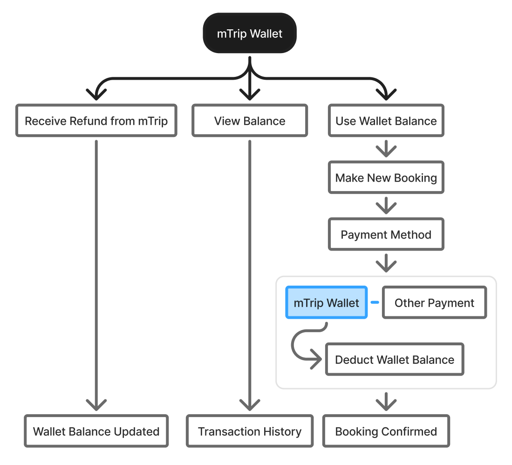

### 1. 入口

更多 → 账号（设置、安全、支付）→ 管理你的账号 → 账号注销

### 2. 账号注销流程

- 用户查看账号注销警告，并点击“继续”。
- 用户输入 DELETE（区分大小写）。
- 用户点击“确认账号注销”。
- 系统检查：
    - 进行中 / 待处理的预订
    - mTrip 钱包余额 > 0
- 若满足任一条件 → 阻止注销，用户可点击“联系客服”。
- 若均不满足 → 账号注销成功。
- 用户将被自动登出，并跳转至“登录 / 注册”页面。

**mTrip 账号注销流程示意图**

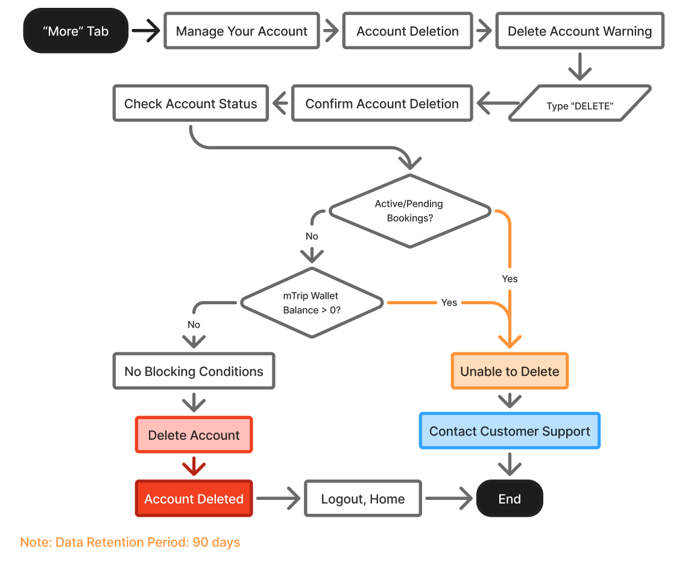

**mTrip 账号注销 UI 页面流程**

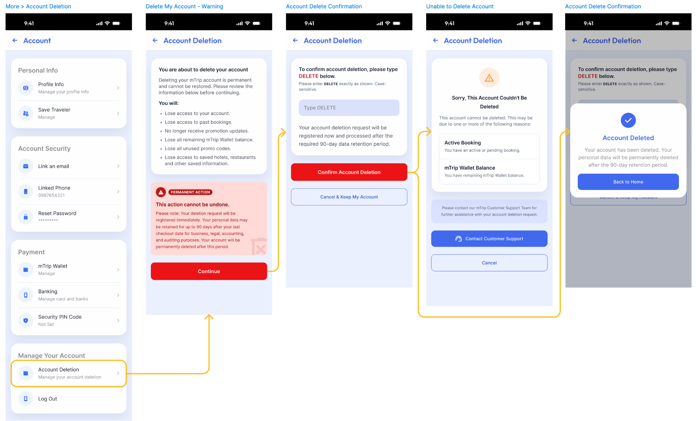

### 3. 取消

用户可点击“取消并保留我的账号”来终止该流程。账号保持有效，不会执行注销。

### 4. 数据保留

注销成功后，相关账号数据将依据 mTrip 的数据保留政策保留 90 天。

### 5. mTrip 钱包余额

若用户在 mTrip 钱包余额大于 0 时申请注销账号，该余额将被作废，且账号注销后无法退还、转移或找回，但须遵守适用条款与法律。

### 6. 新账号

账号注销后，用户可创建一个新的 mTrip 账号。新账号按新账号处理，不会自动恢复已注销账号的数据、钱包余额或权益。

### 7. 业务规则

| 条件 | 结果 |
|---|---|
| 存在待支付预订 | 阻止注销 |
| 存在已确认预订且退房日期未过 | 阻止注销 |
| 存在已入住预订 | 阻止注销 |
| 存在退款中的记录（无论预订状态如何） | 阻止注销 |
| mTrip 钱包余额超过超级管理员配置的最低余额阈值 | 阻止注销；用户须联系客服协助处理 |
| 客服 / 经授权的超级管理员在钱包仍有余额的情况下批准注销 | 余额作废 → 允许注销 |
| 存在已确认预订但退房日期已过 | 允许注销 |
| 存在已退房 / 已取消的预订，且所有相关支付/财务流程均已完成 | 允许注销 |
| 存在未入住（No-Show）预订，且所有相关支付/财务流程均已完成 | 允许注销 |
| 无阻止性预订，且 mTrip 钱包余额等于或低于超级管理员配置的最低余额阈值 | 允许注销 |
| 注销成功 | 登出 → 登录 / 注册 |

**其他业务规则**

- 预订资格必须依据预订状态与计划退房日期判定。
- 退房日期已过的已确认预订不得阻止账号注销，即使商户尚未将其状态更新为已退房或未入住（No-Show）。
- 系统不得仅为便于账号注销而自动更改预订状态。
- 任何处于退款中的预订必须持续阻止注销，直至退款流程完成。
- 历史预订记录必须依据适用的数据保留政策予以保留。
- 最低钱包余额阈值必须可由超级管理员配置。
- 账号注销资格必须通过比较用户当前的 mTrip 钱包余额与已配置的最低余额阈值来判定。
- 若钱包余额等于或低于已配置阈值，用户可在无需额外审批的情况下继续注销账号。
- 若钱包余额超过已配置阈值，默认必须阻止账号注销，用户须联系客服协助处理。
- 客服可就符合条件的情形提交钱包余额作废审批申请，并按超级管理员的经办-复核（maker-checker）审批流程处理。
- 任何剩余钱包余额不得仅因等于或低于已配置阈值而自动作废。

**示例：最低钱包余额阈值**

假设：超级管理员将最低钱包余额阈值配置为 500 MMK。

| 用户钱包余额 | 已配置阈值 | 账号注销 |
|---|---|---|
| 0 MMK | 500 MMK | 允许 |
| 100 MMK | 500 MMK | 允许 |
| 500 MMK | 500 MMK | 允许 |
| 501 MMK | 500 MMK | 阻止 |
| 1,000 MMK | 500 MMK | 阻止 |

**mTrip 钱包余额阈值补充说明**

- 该阈值可由超级管理员配置。
- 等于或低于该阈值的钱包余额可直接注销账号，无需额外审批。
- 超过该阈值的钱包余额需要客服协助，并经授权的钱包余额作废审批。
- 用户提交账号注销申请时，系统必须检查最新的钱包余额。

### 8. 钱包余额与欺诈防范

若用户的 mTrip 钱包余额大于 0，必须阻止账号注销。

用户必须联系客服进行核实与后续处理。

若客服/管理员批准该账号注销，剩余钱包余额将被作废，并记录至内部“已作废 mTrip 钱包余额台账”，用于账务与审计。

已作废的余额不可转移、退还、找回或由用户使用。

### 19.1 App 更新与强制更新

mTrip App 必须同时支持 Android 与 iOS 的应用内常规更新和强制更新。

MVP 要求：强制更新功能为 MVP 版本的必需要求，必须在 mTrip App MVP 上线前完成 Android 与 iOS 两个平台的实现与测试。

- 常规 App 更新：在平台支持的情况下，App 应支持应用内更新流程，使用户无需手动离开 App 即可更新至最新可用版本。对于 Android，实现应遵循 Google Play In-App Updates，并按适用情况支持 Flexible Update 和/或 Immediate Update。
- 强制更新：当已安装的 App 版本低于系统配置的最低支持版本时，App 必须要求用户更新后方可继续使用 mTrip。
- 平台差异化提示：触发强制更新时，Android 与 iOS 必须使用各自平台适配的提示/UI。
- Android：在适用情况下，强制更新应使用 Google Play Immediate Update 流程。
- iOS：App 必须显示强制更新提示，并引导用户前往 mTrip 的 App Store 页面安装最新的受支持版本。
- 最低支持版本：最低支持的 App 版本必须可按 Android 与 iOS 分别配置。
- 更新配置：系统应支持管理最低支持版本及强制更新要求，而无需仅为变更最低版本而发布新的 App 版本。

### 19.2 关联邮箱、关联手机号与联系我们

**关联邮箱 / 关联手机号**

mTrip App 必须在“账号安全”下提供“关联邮箱”和“关联手机号”功能，使用户可以添加或更新其 mTrip 账号关联的邮箱地址或手机号。

MVP 要求：“关联邮箱”与“关联手机号”两项功能均为 MVP 版本的必需要求，必须在 mTrip App MVP 上线前完成实现与测试。

**关联邮箱**

- 用户可通过“更多 → 账号 → 账号安全 → 关联邮箱”进入。
- 若当前未关联邮箱，用户输入新的邮箱地址，并通过邮箱一次性验证码（OTP）完成验证。
- 若已关联邮箱且用户希望变更，系统必须先验证新的邮箱地址，再完成变更。
- 若新邮箱已关联至其他 mTrip 账号，系统必须阻止该变更，并告知用户该邮箱已关联其他账号。
- 若用户输入的是已关联的同一邮箱地址，系统应显示行内校验提示，且不发送 OTP。
- OTP 错误或已过期时，必须允许用户重试或重新获取 OTP。
- 若用户在验证完成前退出或取消流程，原邮箱必须保持不变。
- 若在需要验证时用户无法访问当前关联的邮箱，系统应提供相应的账号找回/客服流程。

**关联手机号**

- 用户可通过“更多 → 账号 → 账号安全 → 关联手机号”进入。
- 若当前未关联手机号，用户输入手机号，并通过短信一次性验证码（OTP）完成验证。
- 若已关联手机号且用户希望变更，系统必须先验证新的手机号，再完成变更。
- 若新手机号已关联至其他 mTrip 账号，系统必须阻止该变更，并告知用户该手机号已关联其他账号。
- 若用户输入的是已关联的同一手机号，系统应显示行内校验提示，且不发送 OTP。
- 验证码错误或已失效时，必须允许用户重试或重新获取一次性验证码（OTP）。
- 若用户在验证完成前退出或取消该流程，原有手机号必须保持不变。
- 系统必须支持 +95 缅甸手机号格式，并在发送一次性验证码（OTP）前校验手机号。
- 若社交登录渠道未提供受支持的邮箱地址或手机号，系统必须通过相应的“关联邮箱”或“关联手机号”流程处理该信息缺失情况。

**通用规则**

- 新的邮箱地址或手机号保存至账户前，必须成功完成验证。
- 不得用未验证的邮箱地址或手机号替换已关联的信息。
- 系统必须防止同一邮箱地址或手机号被关联至多个 mTrip 账号。
- 系统应在“关联邮箱”与“关联手机号”两项功能中一致地处理验证码重发、验证码错误、验证码失效及验证失败等状态。

**流程图：关联邮箱（场景 1：未关联邮箱｜场景 2：已关联邮箱）**

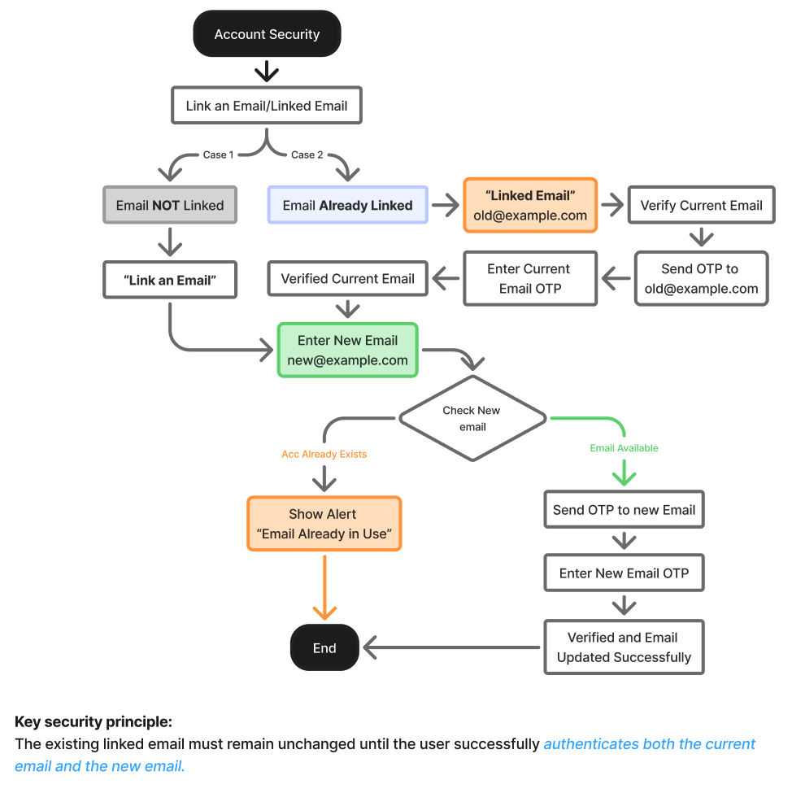

**流程图：关联手机号（场景 1：未关联手机号｜场景 2：已关联手机号）**

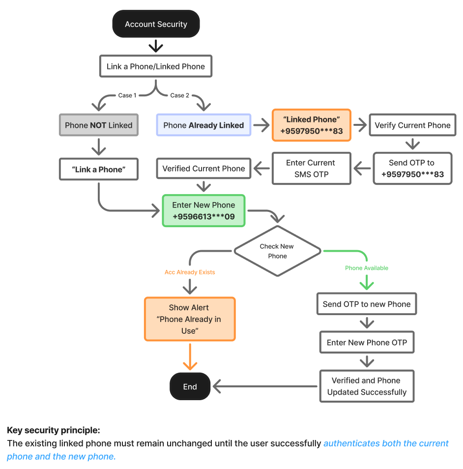

### 19.3 联系我们页面（更多 → 联系我们）

“联系我们”页面为用户提供直接联系 mTrip 支持团队的方式及相关信息。App 内无需额外的支持页面。

该页面必须包含以下内容：

| 联系方式 | 展示信息 | 操作 |
|---|---|---|
| mTrip 网站 | mTrip 网站 URL | “前往链接”按钮 → 打开 mTrip 网站 |
| mTrip 支持邮箱 | 官方 mTrip 支持邮箱 | “发送邮件”按钮 → 打开设备原生邮件 App，并预填支持邮箱地址 |
| mTrip 服务热线 | 官方 mTrip 服务热线电话号码 | “呼叫”按钮 → 打开设备原生拨号界面，并预填热线号码 |

**“联系我们”页面的功能要求**

- “前往链接”按钮必须使用设备默认浏览器打开 mTrip 网站。
- “发送邮件”按钮必须将用户跳转至设备原生邮件应用。
- “呼叫”按钮必须将用户跳转至设备原生拨号界面，并预填 mTrip 服务热线号码。
- mTrip App 内无需额外的联系我们、帮助中心、常见问题或支持页面。
- 网站 URL、支持邮箱地址及热线号码应可配置，以便在不改动页面布局的情况下进行更新。
- 若用户设备上缺少所需的原生应用，系统应妥善处理该操作并显示相应提示。

### 19.4 登录页面的“忘记密码？”功能

“忘记密码？”功能允许忘记密码的用户验证账户身份并设置新密码。

**入口：登录页面 → 忘记密码？**

**流程**

- 选择验证方式
    - 用户在登录页面点击“忘记密码？”。
    - 用户选择一种可用的验证方式：
        - 邮箱
        - 手机号
    - 系统使用所选邮箱地址或手机号验证用户账户身份。
- 账户验证
    - 用户输入所选邮箱地址或手机号。
    - 系统检查是否存在使用该信息的 mTrip 账户。
    - 若账户存在，系统向所选验证方式发送一次性验证码（OTP）。
    - 若账户不存在，系统显示相应错误提示，且不进入验证码验证环节。
- 验证码验证
    - 用户输入收到的验证码。
    - 验证码有效 → 继续设置新密码。
    - 验证码无效或已失效 → 显示相应错误提示，并允许用户重试或重新获取验证码。
- 设置新密码
    - 用户输入：
        - 新密码
        - 确认密码
    - 系统校验密码规则，并确认两次输入的密码一致。
    - 提交成功后，用户密码即完成更新。
- 完成
    - 密码修改成功后，系统将用户跳转至登录页面。
    - 用户可使用更新后的密码登录。

**“忘记密码？”功能的要求**

- “忘记密码”流程不得要求用户输入当前密码。
- 修改密码前必须成功完成验证码验证。
- 若验证码验证或密码重置未成功完成，原有密码必须保持不变。
- 更新密码前，“新密码”与“确认密码”必须一致。
- 该功能必须同时支持邮箱与手机号两种验证方式。
- 重置完成后，更新后的密码必须可立即用于登录。

### 19.5 管理支付卡

“管理支付卡”功能允许用户安全地保存、查看和移除支付卡，以用于 mTrip 支持的交易。

**入口：更多 → 管理支付卡**

### 1. 管理支付卡页面

- 页面标题必须为“管理支付卡”。
- 页面必须提供“添加”按钮，供用户新增支付卡。
- 若用户没有已保存的支付卡，页面必须显示空状态：
    - 您尚未添加任何支付方式。
- 若用户已有保存的支付卡，卡片必须显示在“支付方式”区块下。
- 每张已保存的卡片必须显示卡片类型及卡号后 4 位。
- 用户可点击已保存的卡片或“>”图标打开卡片详情页。

### 2. 添加新卡

用户点击“添加”时，系统必须打开“添加新卡”页面。

该页面必须包含以下字段：

| 输入字段名称 | 输入 / 占位提示文案 |
|---|---|
| 卡号 | 1234 1234 1234 1234 |
| 有效期 | MM/YY |
| 安全码 | CVV/CVC + 提示气泡图标 |
| 持卡人姓名 | 卡面上的完整姓名 |

安全说明：“您的卡片信息已加密且安全。mTrip 不会存储您的安全码（CVV/CVC）。”

### 3. 安全码提示气泡

“安全码”旁必须提供提示气泡/帮助弹窗。

标题：“如何找到安全码？”

内容：“安全码即 CVV/CVC，是卡片背面的 3 位数字。对于 American Express 卡，则为卡片正面的 4 位数字。”

按钮：“知道了”（点击“知道了”关闭提示气泡。）

### 4. 卡片校验与保存

- 系统必须在允许保存卡片前校验所有必填的卡片信息。
- 卡号必须为受支持的有效卡号。
- 有效期必须有效且未过期。
- 安全码必须符合所支持卡类型的要求。
- 必须填写持卡人姓名。
- 系统必须通过受支持的支付服务商安全地处理支付卡，并对其进行令牌化/存储。
- 卡片保存后，不得显示完整卡号及安全码（CVV/CVC）。
- 仅应向用户显示卡片类型及后 4 位数字。

### 5. 已保存卡片的展示

卡片保存成功后：

- 用户返回“管理支付卡”页面。
- 已保存的卡片必须显示在“支付方式”下。
- 卡片仅显示卡片类型及后 4 位数字。
- 用户可点击卡片或“>”查看其详情。

### 6. 支付卡详情

卡片详情页必须以卡片样式界面展示已保存的卡片。

卡号必须脱敏，仅显示后 4 位数字。

示例：

Visa •••• 1234用户必须可使用“操作”选项，包含：

操作 → 移除支付方式

### 7. 移除支付方式

用户选择“移除支付方式”时，系统必须显示确认弹窗。

弹窗标题：移除此支付方式？

提示内容：使用此支付方式的任何未支付订单或订阅将被取消。

操作：

- “取消” — 关闭弹窗并保留该支付方式。
- “移除” — 移除所选支付方式。

仅在用户点击“移除”确认后，方可移除该支付方式。

### 8. 移除成功

移除成功后：

- 显示成功提示：“Visa 卡已移除”（卡片类型应动态显示。）
- 已移除的卡片不得再显示在“支付方式”下。
- 若已无其他已保存的支付方式，则显示：“您尚未添加任何支付方式。”
- “添加”按钮必须保持可用，以便用户再次新增支付方式。

### 9. 安全要求

- 卡片信息必须使用支付服务商的安全卡片令牌化机制进行传输和存储。
- mTrip 不得存储安全码（CVV/CVC）。
- 卡片保存后不得显示完整卡号。
- 已保存的卡片信息仅可由通过身份验证的账户所有者访问。
- 支付卡数据必须符合适用的支付安全要求及所选支付服务商的接入要求。

### 19.6 重置密码 / 设置新密码

“重置密码 / 设置新密码”功能允许用户通过可用的验证方式验证账户身份，从而修改或重置 mTrip 账户密码。

**入口：更多 → 账户 → 账户安全 → 密码管理**

### 1. 密码管理

用户进入“密码管理”时，系统必须判断该账户当前是否已设置密码。

| 账户状态 | 可用操作 |
|---|---|
| 无密码 | 设置密码 |
| 有密码 | 重置密码 |

- 无密码：用户可为账户创建密码。
- 有密码：用户可重置/修改现有密码。

### 2. 验证方式

重置密码时，用户必须选择一种可用的验证方式：

- 通过邮箱验证
- 通过手机号验证
- 通过当前密码验证

系统必须仅显示该用户账户可用的验证方式。

### 3. 通过邮箱验证

若用户选择邮箱：

- 系统显示用户已关联的邮箱地址。
- 用户请求获取一次性验证码（OTP）。
- 系统向已关联的邮箱地址发送验证码。
- 用户输入验证码。
- 若验证码有效，用户可继续设置新密码。
- 若验证码错误或已失效，用户可重试或重新获取验证码。

### 4. 通过手机号验证

若用户选择手机号：

- 系统显示用户已关联的手机号。
- 用户请求获取一次性验证码（OTP）。
- 系统向已关联的手机号发送验证码。
- 用户输入验证码。
- 若验证码有效，用户可继续设置新密码。
- 若验证码错误或已失效，用户可重试或重新获取验证码。

### 5. 通过当前密码验证

若用户选择当前密码：

- 用户输入当前密码。
- 系统校验密码。
- 若当前密码正确，用户可继续设置新密码。
- 若密码错误，系统显示相应错误提示，且不允许用户继续。

### 6. 设置新密码

验证成功后，系统必须显示“设置新密码”页面。

用户必须输入：

- 新密码
- 确认密码

系统必须校验：

- 新密码符合既定的密码规则。
- 新密码与确认密码一致。
- 在密码策略要求的情况下，新密码不得与当前密码相同。

仅当所有校验要求均满足时，用户方可保存新密码。

### 7. 密码更新成功

新密码保存成功后：

- 显示密码更新成功提示。
- 用户可继续使用该账户。
- 对于从登录页面发起的密码重置，将用户跳转至登录页面，以便使用新密码登录。
- 对于从“账户安全”发起的密码修改，将用户返回相应的“账户安全”页面。

### 8. 验证与安全规则

- 在所选验证方式成功完成之前，系统不得允许修改密码。
- 如果用户在完成验证前退出流程，现有密码必须保持不变。
- 一次性验证码（OTP）必须有有效期并支持重新发送。
- 错误或已过期的一次性验证码（OTP）不得让用户继续操作。
- 系统不得展示或泄露用户的密码。
- 密码修改成功后，系统应按账户安全政策的要求使其他活跃登录会话/设备失效；当前会话在密码修改流程完成前保持有效。

**流程图：重置密码功能主流程**

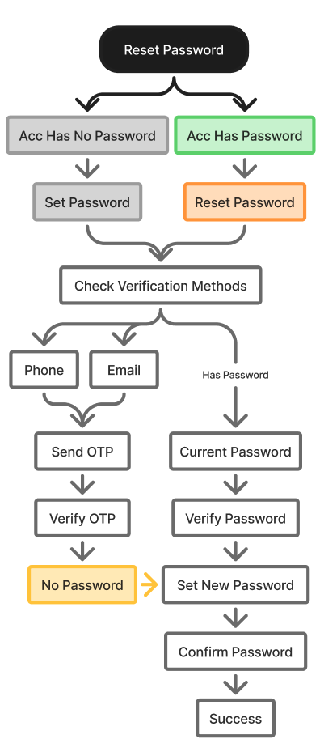

## 模块 20：到店支付

### 20.1. 概述

到店支付允许用户向 mTrip 支付所需预付金额以预订酒店客房，剩余客房费用直接支付给酒店。

预付金额包括：

- mTrip 佣金
- 支付交易手续费
- 酒店配置的未入住（No-Show）费用（可选）

酒店可通过商户 Web 门户启用或停用未入住（No-Show）费用并配置其比例，最高不超过客房总价的 30%。

预订期结束后，系统自动执行结算，保留 mTrip 的佣金金额与交易手续费，并将收取的未入住（No-Show）费用分配给酒店，具体以适用的预订与退款政策为准。

### 20.2. 支付规则

| 项目 | 业务规则 |
|---|---|
| 客房总价 | 扣除 mTrip 佣金和交易手续费之前的客房费用总额。 |
| mTrip 佣金 | 客房总价的配置百分比。 |
| 交易手续费 | 仅基于佣金金额的配置百分比。 |
| 未入住（No-Show）费用 | 酒店通过商户 Web 门户配置的可选费用。 |
| 未入住（No-Show）费用上限 | 最多为客房总价的 30%。 |
| 现付金额 | 佣金金额 + 交易手续费 + 未入住（No-Show）费用。 |
| 到店支付金额 | 客房总价 -（现付金额 - 交易手续费） |
| 未入住（No-Show）费用收款方 | 通过结算 100% 分配给酒店。 |
| mTrip 收入 | 佣金金额 + 交易手续费 |
| 结算时点 | 在预订期结束后自动运行。 |

附加规则：

- 如果酒店停用未入住（No-Show）费用，该费用为零。
- 未入住（No-Show）费用必须与佣金金额、交易手续费分开计算。
- 未入住（No-Show）费用不得超过客房总价的 30%。
- 系统必须将适用的未入住（No-Show）费用配置与预订一并保存。
- 任何配置变更都不得在用户不知情的情况下改变已有预订的费用条款。
- 系统必须在支付前向用户展示费用明细。

**计算公式**

- 佣金金额 = 客房总价 × 佣金比例（%）
- 交易手续费 = 佣金金额 × 交易手续费比例（%）
- 现付金额 = 佣金金额 + 交易手续费 + 未入住（No-Show）费用
- 到店支付金额 = 客房总价 −（现付金额 - 交易手续费）

### 20.2.1 示例计算

假设客房总价为 100,000 MMK，示例佣金比例为 10%，示例交易手续费比例为 2%：

| 项目 | 计算（示例） | 金额 |
|---|---|---|
| 客房总价 | — | 100,000 MMK |
| mTrip 佣金（示例 10%） | 100,000 × 10% | 10,000 MMK |
| 交易手续费（示例 2%） | 10,000 × 2% | 200 MMK |
| 未入住（No-Show）费用 | 100,000 x 20% | 20,000 MMK |
| 现付金额 | 10,000 + 200+ 20,000 | 30,200 MMK |
| 到店支付金额（线下） | 100,000 − (30,200 -200) | 70,000 MMK |
| 用户需支付总额（现付 + 到店支付） | 30,200 + 70,000 | 100,200 MMK |

重要说明：用户支付总额为 100,200 MMK，因为 200 MMK 交易手续费是额外的平台收费。100,000 MMK 的客房价格拆分为 10,000 MMK 佣金、20,000 MMK 未入住（No-Show）费用，以及 70,000 MMK 在酒店支付。

### 20.3. 取消与退款

- 在取消截止时间之前：用户可取消预订并选择退款方式。
- mTrip 钱包：退款在 24 小时内处理。
- 银行账户 / 支付钱包：退款可能需要约 30 天。
- 超过取消截止时间：佣金和交易手续费不予退款。
- 未入住（No-Show）：预付金额不予退款。

退款方式选择仅适用于到店支付方式完成的预订。可退款金额取决于适用的取消政策。

**到店支付方式工作流程图**

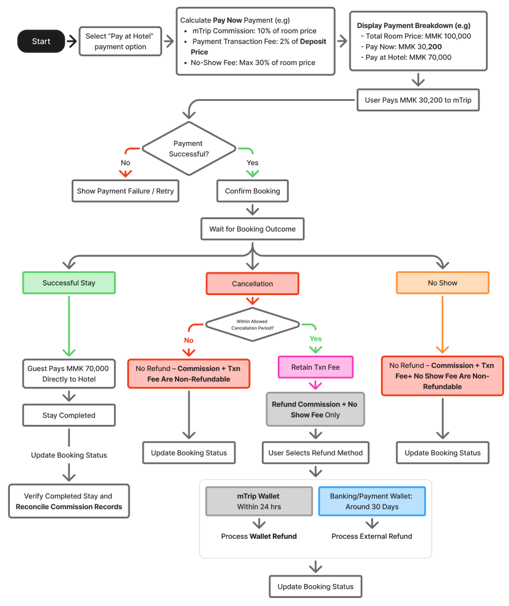

### 20.4. 管理员自动对账

住宿完成后，系统自动核验预付金额与佣金记录。若核验成功，状态变为“已对账”；若核验失败，该预订被标记为需管理员审核。系统需在住宿完成后结算未入住（No-Show）费用。

### 4.1. 错误处理

- 预付支付失败：不确认预订；允许重试支付。
- 退款失败：标记为“失败”，并允许管理员审核与安全重试。
- 重复处理：防止重复退款与重复对账。

酒店发起的取消（到店支付）：将预付金额全额退还至用户的 mTrip 钱包，不受取消截止时间限制，无需选择退款方式。

### 20.5. 退款处理

系统必须根据支付方式的退款能力支持两种退款处理方式：

### 5.1 自动退款

- 对于支持自动退款的支付方式，系统必须自动向客户的原始支付方式发起退款。
- 系统必须接收支付服务商的响应，并据此更新退款交易状态。

### 5.2 人工退款

- 对于不支持自动退款的支付方式，财务人员必须人工将退款金额转账给客户。
- 财务人员必须在完成转账后，于管理员后台人工更新退款状态。

### 5.3 退款记录

- 两种退款方式都必须保留退款交易参考号、退款金额、支付方式、退款状态、处理日期与退款历史。
- 系统必须为每笔退款保留完整记录，以便追踪与对账。

## 验收标准

这些标准定义了 mTrip 平台第一阶段核心模块的要求：

### 1. 入驻与实名认证（KYC）（P1-01）

- 注册：一次性验证码（OTP）必须在 30 秒内收到；无效号码显示错误；已验证用户跳转至资料设置。
- SSO：完成 Google OAuth；关联既有账户；首次登录时创建新账户。
- 实名认证（KYC）二级：身份证件上传成功；自拍活体检测通过；二级状态在 24 小时内生效。
- 供应商提交：文件上传流程；状态跟踪（审核中/已通过/已驳回）；显示驳回原因。

### 2. 酒店预订（P1-02）

- 搜索：结果在 3 秒内展示；筛选可用；地图切换可用。
- 筛选：筛选即时生效；不符合条件的结果隐藏；筛选标签显示已选数量。
- 详情：图集可滑动；列出所有房型及价格；政策、客房 360 度全景功能清晰展示。
- 代金券：支付后 10 秒内生成 PDF；通过短信、邮件发送并可在 App 内查看。
- 取消：截止时间前“取消”按钮可用；有确认弹窗；立即发起退款。

### 3. 餐厅服务（P1-03）

- 发现：请求 GPS 权限；结果按距离排序；营业中的餐厅优先展示。
- 定制：按菜品展示选项组；加入购物车前强制完成必选项。
- 追踪：分配骑手后展示实时地图；状态栏在每个节点更新；预计送达时间可见。
- 商户管理：按菜品切换售罄状态；即时同步至用户端 App；支持次日自动恢复选项。

### 4. 统一搜索（P1-05）

- 全局搜索：建议即时出现；结果按类别（酒店/餐厅）分组。
- 个性化：首页信息流包含“附近”与“为你推荐”板块；推荐随历史预订变化。

说明：所有功能的早期草图均已包含在链接的设计文件中。后续阶段的详细需求将随项目推进补充。

## 设计

包含所需的早期草图，并在项目全过程中，在设计可用后链接到实际设计。

**原型：mTrip 原型设计（用户端 App）**

## 技术考量（可选）

链接到工程技术方案文档。

## 成功指标

哪些成功指标表明项目正在实现内部目标？如何衡量成功？可使用任意偏好的目标设定与跟踪体系（OKR、KPI 等）。

说明：链接到分析需求与方案文档。

## 待定问题

还有哪些因素需要明确？可能出现哪些问题，计划如何应对？

## 问答

产品的常见问题及已确定的答案是什么？此处适合记录关键决策。

| 提问人 | 问题 | 回答 |
|---|---|---|
|  | 发票格式（PDF） |  |
|  |  |  |
|  |  |  |

## 功能时间线与分期

| 功能 | 状态 | 日期 |
|---|---|---|
| 模块 1：整体酒店预订旅程与预订生命周期 + 多酒店预订 |  | 2026年7月1日 |
| 模块 2：酒店搜索与发现 + 长住 |  |  |
| 模块 3：酒店列表、筛选与排序 |  |  |
| 模块 4：酒店详情与客房选择 + 与门店 / 酒店聊天 |  |  |
| 模块 5：住客信息 |  |  |
| 模块 6：价格、促销与保险 + 我的优惠券 |  |  |
| 模块 7：预订偏好与收藏内容 + 精简模式功能 |  |  |
| 模块 8：支付（结算） |  |  |
| 模块 9：预订确认与预订管理 |  |  |
| 模块 10：通知中心 + 预订风险管理与申诉 |  |  |
| 模块 11：评价、评分与 AI 评价摘要 |  |  |
| 模块 12：AI 酒店助手 |  |  |
| 模块 13：实时聊天与客户支持 |  |  |
| 模块 14：联盟与推荐计划 |  |  |
| 模块 15：App 动态主题管理 |  |  |
| 模块 16：用户引导与教程 |  | 2026年8月25日 |
| 模块 17：酒店预订 UI、UX 与功能更新（2026 年 9 月 4 日） |  | 2026年9月7日 |
| 模块 18：mTrip 钱包功能 |  | 2026年9月29日 |
| 模块 19：附加功能 |  | 2026年9月24日 |

## PRD 检查清单

以下是 PRD 中必须包含的主题清单：

| 序号 | 主题 | 完成 |
|---|---|---|
| 1. | 标题 |  |
| 2. | 作者 |  |
| 3. | 决策日志 |  |
| 4. | 变更记录 |  |
| 5. | 概述 |  |
| 6. | 成功概述 |  |
| 7. | 消息传递 |  |
| 8. | 时间线/发布计划 |  |
| 9. | 用户画像 |  |
| 10. | 用户场景 |  |
| 11. | 用户故事/功能/需求 |  |
| 12. | 包含功能 |  |
| 13. | 不包含功能 |  |
| 14. | 设计 |  |
| 15. | 待定问题 |  |
| 16. | 问答 |  |
| 17. | 其他考量 |  |

## 变更记录

| 版本 | 日期 | 变更内容 |
|---|---|---|
| 1.0 | 2026 年 7 月 31 日 | 初始 PRD，涵盖模块 1–15。 |
| 1.0.1 | 2026 年 8 月 25 日 | 更新模块 7，在首页新增精简模式切换按钮。 - 新增模块 16。 |
| 1.0.2 | 2026 年 9 月 11 日 | 新增模块 17。 |
| 1.0.3 | 2026 年 9 月 24 日 | 新增模块 19（账号注销）。 |
| 1.0.4 | 2026 年 9 月 29 日 | 新增模块 18（mTrip 钱包功能）。 |
| 1.0.5 | 2026 年 9 月 30 日 | 在模块 19 下新增以下子模块： - 19.1 App 更新与强制更新 - 19.2 关联邮箱、关联手机号 - 19.3 联系我们页面（更多 → 联系我们） - 19.4 登录页“忘记密码？”功能 - 19.5 管理支付卡 - 19.6 重置密码 / 设置新密码 |
| 1.0.6 | 2026 年 10 月 14 日 | 新增模块 20（到店支付）。 |
| 1.0.7 | 2026 年 10 月 23 日 | 更新模块 20：到店支付（将收取未入住（No-Show）费用） |
| 1.0.8 | 2026 年 11 月 20 日 | 模块 19：附加功能：mTrip 账号注销（业务规则）、账号注销的钱包余额阈值；模块 1.1：多酒店支付倒计时：方案 A：10 分钟 |
| 1.0.9 | 2026 年 11 月 23 日 | 联盟推广计划 |

## 联盟推广计划（v1.0.9 新增）

### 模块 1：联盟账户管理

#### 1.1 联盟激活

#### 概述

该功能允许管理员为现有 mTrip 用户账户启用联盟推广功能，用户无需创建单独账户或重新注册。

启用后，用户可通过现有 mTrip 账户访问“联盟中心”，管理推荐链接、跟踪业绩、查看佣金并申请提现。

管理员应对联盟激活与账户状态拥有控制权。

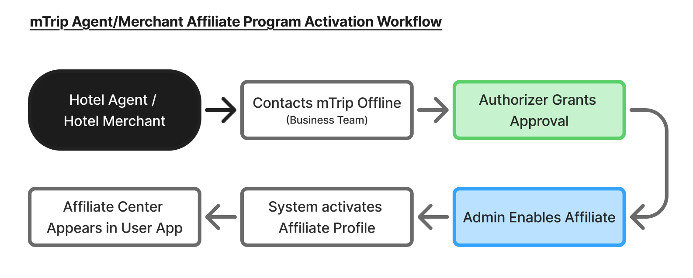

#### 功能需求

- 系统应允许管理员在授权通过后，为现有 mTrip 用户账户启用联盟推广功能。
- 联盟访问申请应通过 mTrip 业务团队线下处理，无需提供 App 内申请功能。
- 当管理员启用联盟推广功能时，系统应自动创建联盟档案并将其关联至用户现有的 mTrip User ID。
- 系统应在联盟激活时生成唯一的联盟 ID。
- 系统应仅在用户具有“活跃”联盟推广员状态时，才在 mTrip 用户端 App 中显示联盟中心。
- 状态为“未激活”“已暂停”或“已停用”的用户不得访问联盟推广功能。
- 管理员应能通过管理员后台激活、暂停和停用联盟推广员账户。
- 系统应显示联盟推广员状态和激活日期。
- 系统应避免为同一 mTrip 用户 ID 重复创建联盟推广员档案。
- 联盟推广员账户的所有状态变更均应记录在系统中，以供审计。

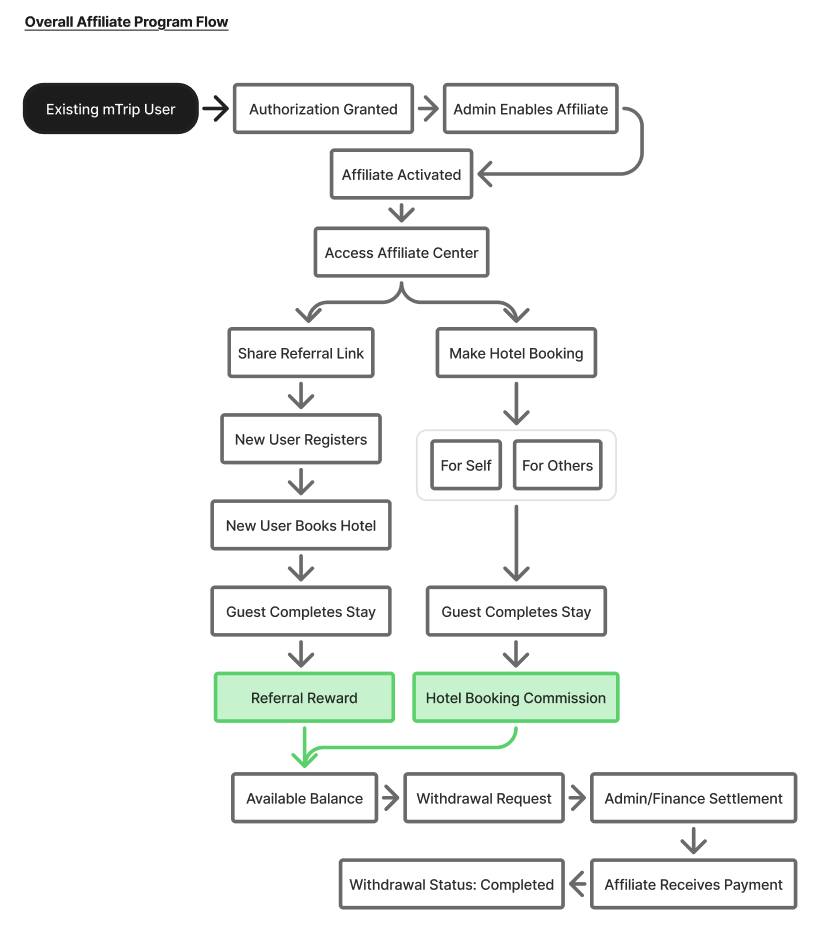

#### 验收标准

- 仅在获得授权后，管理员才能为已有 mTrip 用户启用联盟推广功能。
- 系统自动创建联盟推广员档案，并将其关联至正确的已有 mTrip 用户 ID。
- 联盟推广员档案激活时，系统生成唯一的联盟推广员 ID。
- “活跃”状态的联盟推广员可通过其现有的 mTrip 用户端 App 账户访问联盟中心。
- 对于不具备“活跃”联盟推广员状态的用户，不显示联盟中心。
- 不具备“活跃”联盟推广员状态的用户无法访问联盟推广功能。
- 管理员可通过管理员后台激活、暂停和停用联盟推广员账户。
- 系统避免为同一 mTrip 用户 ID 重复创建联盟推广员档案。
- 联盟推广员状态与激活日期显示正确。
- 联盟推广员的所有状态变更均记录在审计日志中。

#### 1.2 联盟推广员状态

| 状态 | 说明 |
|---|---|
| 未激活 | 联盟推广功能尚未启用 |
| 活跃 | 联盟推广员可使用全部可用功能 |
| 已暂停 | 联盟推广员暂时无法生成新的符合条件的推荐，也无法提现 |
| 已停用 | 联盟推广参与已结束 |

#### 1.3 联盟推广员档案

系统应显示：

- 联盟推广员 ID
- 用户 ID
- 联盟推广员姓名
- 电话号码
- 激活日期
- 联盟推广员状态

### 模块 2：推荐链接与追踪

#### 2.1 推荐链接生成

- 系统应为每位联盟推广员生成唯一的联盟推广员推荐 ID。
- 联盟推广员应能生成并分享推荐链接。
- 推荐链接应支持：
    - mTrip 通用注册链接
    - 指定酒店详情链接
- 每条推荐链接均应包含联盟推广员推荐 ID。
- 系统应追踪推荐点击、注册及符合条件的预订。

#### 2.2 推荐归因与佣金资格

- 系统应对普通 mTrip 用户和“活跃”联盟推广员使用现有的 mTrip 推荐链接与推荐码机制。
- 对于新用户，系统应将其归因至新用户账户注册时所填推荐码对应的推荐人。
- 推荐码仅可在新账户注册时使用。账户创建后，用户不得添加、更改或替换推荐码。
- 系统应根据被推荐用户成功注册时推荐人的联盟推广员状态，确定适用的推荐奖励计划：
- 普通 mTrip 用户：现有推荐计划。
- “活跃”联盟推广员：联盟推广计划。
- 系统应在用户账户记录中永久保留原始推荐归因。
- 联盟推广计划下的被推荐新用户，仅在完成符合条件的酒店预订且住客完成酒店入住后，方可产生注册推荐奖励。
- 身为酒店代理的“活跃”联盟推广员，应就从其本人 mTrip 账户完成符合条件的预订赚取酒店预订佣金，无论该预订是为本人还是为他人预订。
- 酒店预订佣金仅在住客完成酒店入住后发放。
- 已取消、已退款或未完成的预订不符合佣金奖励条件，适用佣金调整规则的情形除外。
- 联盟推广员后续状态变更，不应自动改变现有推荐记录原已分配的推荐计划。
- 若联盟推广员在成功推荐新用户后变为“已暂停”，原推荐归因及已分配的联盟推广计划应保持不变。
- 若被推荐用户随后在作为推荐人的联盟推广员处于“已暂停”期间完成符合条件的酒店入住，相关推荐奖励应置为“暂缓（On Hold）”，由管理员审核。
- 管理员应能审核暂缓的推荐奖励，并依据适用的资格规则和暂停情形予以批准或驳回。
- 若批准，该奖励应进入正常的佣金核验流程；若驳回，系统应将该奖励标记为“已驳回”并记录驳回原因。

**奖励场景**

- 推荐奖励：为 mTrip 带来新用户 → 新用户完成酒店预订 → 联盟推广员获得奖励。
- 酒店代理佣金：“活跃”联盟推广员通过其本人账户完成酒店预订 → 住客完成入住 → 联盟推广员获得佣金。

#### 2.3 推荐追踪规则

- 系统不应将现有 mTrip 账户计为新注册。
- 一个客户账户应仅归因至一个推荐人。
- 账户创建后，推荐码不可添加、更改或替换。
- 未使用推荐码注册的用户不符合注册推荐奖励条件。
- 一个被推荐的客户账户应仅产生一次注册推荐奖励。
- 自我推荐不符合注册推荐奖励条件。
- 自我推荐限制不应妨碍“活跃”酒店代理就从其本人账户完成的符合条件的预订赚取酒店预订佣金，包括为本人或其他住客完成的预订。
- 酒店预订佣金应按每个符合条件的预订编号独立追踪。
- 系统应避免为同一预订编号和佣金类型生成重复的佣金记录。
- 管理员应能查看推荐记录并调查可疑行为。

#### 2.4 联盟推广推荐链接与二维码

#### 概述

该功能允许“活跃”联盟推广员向潜在新用户分享其推荐链接或二维码。新用户打开推荐链接或扫描二维码时，系统应在账户注册过程中自动填入该联盟推广员的推荐码。

#### 业务规则

- 系统应使用“活跃”联盟推广员的现有推荐码生成推荐链接。
- 系统应生成与同一推荐链接关联的二维码。
- “活跃”联盟推广员应能：
    - 查看其推荐链接。
    - 复制其推荐链接。
    - 查看其二维码。
    - 将二维码下载为图片。
- 二维码应包含联盟推广员的推荐链接。扫描二维码应与打开推荐链接效果相同。
- 新用户打开推荐链接或扫描二维码时，系统应将用户跳转至 mTrip 注册流程。
- 新账户注册过程中，应自动在推荐码字段中填入该联盟推广员的推荐码。
- 新用户在完成注册前应能查看已应用的推荐码。
- 推荐归因仅在账户注册成功后才保存。
- 模块 2 中规定的相同推荐归因规则与奖励资格规则，应同时适用于推荐链接和二维码。
- 系统不得为二维码另设推荐码或归因机制。

**联盟中心 UI 要求**

| UI 元素 | 要求 |
|---|---|
| 推荐链接 | 显示联盟推广员的推荐链接 |
| 复制链接 | 允许联盟推广员复制推荐链接 |
| 查看二维码 | 放大显示二维码 |
| 下载二维码 | 允许联盟推广员将二维码下载为图片 |

例如：

- 联盟推广员推荐码：MT7K9P2X
- 推荐链接：https://myanmartrip.com/register?ref=MT7K9P2X
- 二维码：编码同一推荐 URL。

### 模块 3：联盟推广佣金管理

#### 3.1 佣金收益类型

系统应支持两种收益类型：

| 收益类型 | 说明 |
|---|---|
| 注册奖励 | 被推荐新用户完成符合条件的注册后获得的奖励 |
| 酒店预订佣金 | 已归因客户完成符合条件的酒店预订后获得的佣金 |

#### 3.2 注册推荐奖励

- 系统应仅在被推荐新用户完成符合条件的酒店预订且住客完成酒店入住后，生成注册推荐奖励。
- 每个被推荐的新客户账户应仅产生一次注册推荐奖励。
- 注册推荐奖励金额应由管理员配置。
- 系统应支持两种奖励计算方式：
- 固定金额：配置的固定奖励金额。
- 按比例：以该符合条件的酒店预订产生的 mTrip 平台佣金收入为基数，按配置比例计算。
- 奖励比例或固定金额应可按联盟推广员类型（代理或商户）分别配置。
- 注册推荐奖励在可提现前，应经过适用的资格核验。
- 若被推荐用户完成符合条件的酒店入住时，其推荐联盟推广员处于“已暂停”状态，则该奖励应置为“暂缓（On Hold）”，由管理员审核。
- 已取消、已退款或无效的预订不符合注册推荐奖励条件，适用佣金调整规则的情形除外。

#### 3.3 酒店预订佣金

- 系统应基于 mTrip 从符合条件的酒店预订中获得的平台佣金收入计算联盟推广员佣金。
- 联盟推广员佣金应按管理员可配置的比例计算。
- 佣金比例应由管理员配置。
- 仅在预订按已配置的预订核验政策变为符合条件后，系统才计算佣金。
- 已取消、已退款或无效的预订应遵循适用的佣金调整规则。

**联盟推广员佣金计算**

#### 1. 按比例佣金

| 联盟推广员佣金 = mTrip 平台佣金收入 × 联盟推广员佣金比例 |
|---|

示例：

| 项目 | 金额 |
|---|---|
| 客户酒店预订金额 | 300,000 MMK |
| mTrip 平台佣金比例 | 15% |
| mTrip 平台佣金收入 | 45,000 MMK |
| 联盟推广员佣金比例 | 20% |
| 联盟推广员佣金 | 9,000 MMK |

#### 2. 固定金额佣金

| 联盟推广员佣金 = 配置的固定金额 |
|---|

示例：

- 配置的固定金额：5,000 MMK
- 联盟推广员佣金：5,000 MMK

#### 3.4 佣金配置

管理员应能配置：

**A. 注册推荐奖励配置**

- 奖励计算方式：
    - 固定金额
    - 按比例
- 注册推荐奖励金额或比例。
- 按联盟推广员类型（代理或商户）设置的奖励金额或比例。
- 按比例奖励的佣金计算基数：mTrip 平台佣金收入。
- 奖励资格规则。
- 奖励核验期。
- 奖励配置的生效日期。

**B. 酒店预订佣金配置**

- 酒店预订联盟推广员佣金方式：
    - 按比例：基于 mTrip 平台佣金收入。
    - 固定金额：每笔符合条件的预订配置的固定佣金金额。
- 按联盟推广员类型（代理或商户）设置的联盟推广员佣金比例或固定金额。
- 佣金资格规则。
- 佣金核验期。
- 佣金配置的生效日期。

**配置规则**

- 管理员应能为代理和商户分别配置不同的奖励比例或固定金额。
- 系统应依据适用的配置规则，对符合条件的推荐或预订应用当时生效的配置。
- 系统应保存所采用的计算方式、比例或固定金额、计算基数，以及计算得出的奖励/佣金，以供追踪和审计。
- 佣金配置的变更不应自动重新计算此前已生成的佣金记录。

注：系统应针对符合条件的预订，应用该预订生效的佣金配置，并保存所应用的计算方式、费率或固定金额以及计算得出的佣金，用于跟踪与审计。

#### 3.5 佣金状态

| 状态 | 说明 |
|---|---|
| 待处理 | 等待资格校验 |
| 暂挂 | 因联盟推广用户被暂停或其他适用的审核情形，奖励或佣金被临时暂挂，等待管理员审核。 |
| 已通过 | 佣金已通过校验 |
| 可提现 | 佣金符合提现条件 |
| 已支付 | 佣金已通过结算支付 |
| 已驳回 | 佣金不符合条件 |
| 已冲正 | 此前已入账的佣金已被调整 |

### 模块 4：联盟推广工作台

#### 4.1 工作台概览

联盟推广中心应展示：

| 信息 | 说明 |
|---|---|
| 累计推荐账户数 | 成功注册的新账户总数 |
| 累计酒店预订数 | 符合条件的被推荐预订数量 |
| 累计已赚取佣金 | 已通过的联盟推广收益总额 |
| 待处理佣金 | 等待校验的佣金 |
| 可提现余额 | 可提现金额 |
| 累计已提现 | 已成功支付的提现总额 |

#### 4.2 推荐表现

系统应展示：

- 推荐链接点击总数
- 成功注册数
- 酒店预订数
- 注册奖励
- 酒店预订佣金

#### 4.3 佣金记录

联盟推广用户应能够查看佣金交易，包含：

- 交易日期
- 交易类型
- 预订编号（如适用）
- 佣金金额
- 佣金状态

### 模块 5：收款账户管理

#### 5.1 添加收款账户

- 联盟推广用户应能够添加银行账户或移动钱包账户。
- 系统应支持可配置的银行与钱包服务商。
- 联盟推广用户应提供：
    - 账户类型
    - 银行 / 钱包服务商
    - 账户持有人姓名
    - 账号
- 联盟推广用户应能够设置默认提现账户。
- 系统应支持保存多个收款账户。

#### 5.2 收款账户验证

- 管理员应能够验证或驳回收款账户。
- 仅已验证的收款账户才可提现。
- 系统应安全存储敏感的收款账户信息。
- 收款信息的变更应经过相应的验证。

#### 5.3 推荐计划规则

- 系统应对普通 mTrip 用户与已激活的联盟推广用户使用现有的推荐链接与推荐码机制。无需单独的联盟推广推荐链接机制。
- 对于普通 mTrip 用户，推荐奖励应遵循现有推荐计划规则，并以返现形式存入 mTrip 钱包。
- 对于已激活的联盟推广用户，新推荐应遵循联盟推广计划奖励规则，并存入联盟推广收益余额。
- 联盟推广注册推荐奖励应支持按联盟推广类型（代理或商户）配置固定金额或按比例计算的奖励。对于按比例计算的奖励，其计算应基于符合条件的酒店预订所产生的 mTrip 平台佣金收入。
- 系统应在被推荐用户使用推荐码成功注册时，根据推荐人的联盟推广状态确定适用的奖励计划。
- 在联盟推广激活之前已产生的推荐应继续归属现有推荐计划，包括待处理的推荐。
- 后续的联盟推广激活、暂停或停用，不得自动变更已存在的推荐记录所分配的奖励计划。
- 系统应防止同一被推荐用户与同一符合条件的预订重复发放奖励。
- 若推荐人在推荐关系绑定之后、被推荐用户完成符合条件的酒店入住之前被暂停，原推荐关系绑定与已分配的奖励计划应保持不变。由此产生的推荐奖励应置为暂挂，等待管理员审核。

### 模块 6：提现申请与结算

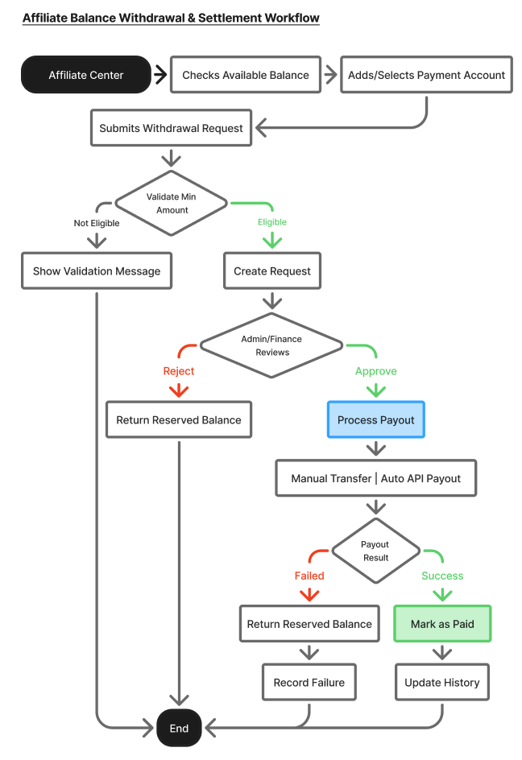

#### 6.1 提现配置

管理员应能够配置：

- 最低提现金额
- 支持的支付方式
- 提现处理方式（人工 / 自动）
- 提现处理规则

#### 6.2 提交提现申请

- 联盟推广用户应能够使用其可提现余额提交提现申请。
- 联盟推广用户应选择已验证的银行账户或钱包账户。
- 系统应校验可提现余额与最低提现要求。
- 提交成功后，申请金额应从可提现余额中预留。
- 联盟推广用户不得对同一金额重复提现。

#### 6.3 提现审批

- 管理员应能够审核提现申请。
- 管理员应能够通过或驳回申请。
- 管理员驳回申请时应提供驳回原因。
- 已通过的申请应进入已配置的结算流程。

#### 6.4 结算处理

系统应支持两种结算方式：

**方案 A：人工结算**

- 管理员通过提现申请。
- 财务 / 管理员人工完成付款转账。
- 管理员登记付款凭证或交易编号。
- 管理员确认付款成功。
- 系统将提现状态更新为“成功”。

**方案 B：自动结算**

- 管理员通过提现申请。
- 系统通过已集成的银行 / 钱包打款服务商发起转账。
- 系统接收交易响应。
- 系统根据打款结果更新提现状态。

#### 6.5 提现状态

| 状态 | 说明 |
|---|---|
| 待审批 | 等待管理员审批 |
| 已通过 | 已通过，等待结算 |
| 处理中 | 已发起付款转账 |
| 成功 | 付款已成功完成 |
| 已驳回 | 提现申请已驳回 |
| 失败 | 付款转账失败 |
| 已取消 | 申请在处理前已取消 |

#### 6.6 提现失败处理

- 失败的提现不得标记为已成功支付。
- 确认付款失败时，系统应将预留金额退回联盟推广用户的可提现余额。
- 系统应记录失败原因与交易凭证。
- 系统在重试失败交易时应防止重复打款。

### 模块 7：提现记录

#### 7.1 联盟推广提现记录

系统应展示：

- 提现申请编号
- 申请日期
- 提现金额
- 支付方式
- 收款账户
- 付款凭证
- 提现状态
- 完成日期

#### 7.2 管理员提现管理

管理员应能够：

- 查看全部提现申请。
- 按联盟推广用户、日期与状态筛选。
- 通过或驳回提现申请。
- 处理人工付款。
- 监控自动付款交易。
- 查看付款失败详情。
- 导出提现记录。

### 模块 8：管理员报表与管理

#### 8.1 联盟推广管理

管理员应能够查看：

- 联盟推广用户总数
- 已激活的联盟推广用户
- 已暂停的联盟推广用户
- 累计推荐账户数
- 累计推荐酒店预订数
- 联盟推广佣金总额

#### 8.2 财务报表

管理员应能够查看：

- 注册奖励总额
- 酒店预订佣金总额
- 待处理佣金
- 联盟推广可提现余额
- 提现总额
- 失败的提现
- 未结清的联盟推广负债

#### 8.3 审计日志

系统应记录重要的联盟推广活动，包括：

- 联盟推广激活与暂停
- 佣金配置变更
- 佣金调整
- 收款账户验证
- 提现审批通过与驳回
- 结算交易

### 模块 9：通用业务规则

- 联盟推广功能应关联至现有的 mTrip 用户账户。
- 联盟推广佣金与注册推荐奖励在按比例计算时，应基于 mTrip 的平台佣金收入计算，而非客户的酒店预订全额。
- 注册推荐奖励与酒店代理预订佣金应分开跟踪，并适用各自独立的资格规则。
- 仅可提现余额可以提现。
- 最低提现金额应由管理员配置。
- 仅已验证的收款账户可接收提现款项。
- 所有佣金与提现交易均应保留可审计的交易记录。
- 已暂停的联盟推广用户不得产生新奖励或提交提现申请。
- 此前已赚取的余额应继续保留记录，并接受管理员审核。
- 所有佣金费率、奖励金额、归因规则与打款设置均应可通过管理后台配置。
- 现有 mTrip 推荐链接机制应在普通用户与已激活的联盟推广用户之间共用。无需单独的联盟推广推荐链接机制。
- 推荐关系归因仅应在新用户注册时发生，账号创建后不得新增、变更或替换。
- 适用的推荐奖励计划应根据被推荐用户成功注册时推荐人的联盟推广状态确定。
- 后续联盟推广状态变更后，原推荐关系归因与已分配的奖励计划应保持不变。
- 联盟推广奖励与佣金费率或固定金额应可通过管理门户按联盟推广类型（代理或商户）配置。
- 与被暂停的联盟推广用户相关的推荐奖励应置为暂挂，经管理员审核后方可变为可用。管理员应能够依据适用的资格规则通过或驳回暂挂的奖励。

**MVP 范围说明**

初始版本应支持现有 mTrip 用户账户、由管理员控制的联盟推广激活、推荐跟踪、注册奖励、酒店预订佣金、联盟推广工作台、收款账户管理、提现申请、人工结算，以及在打款 API 集成可用时的自动结算。
