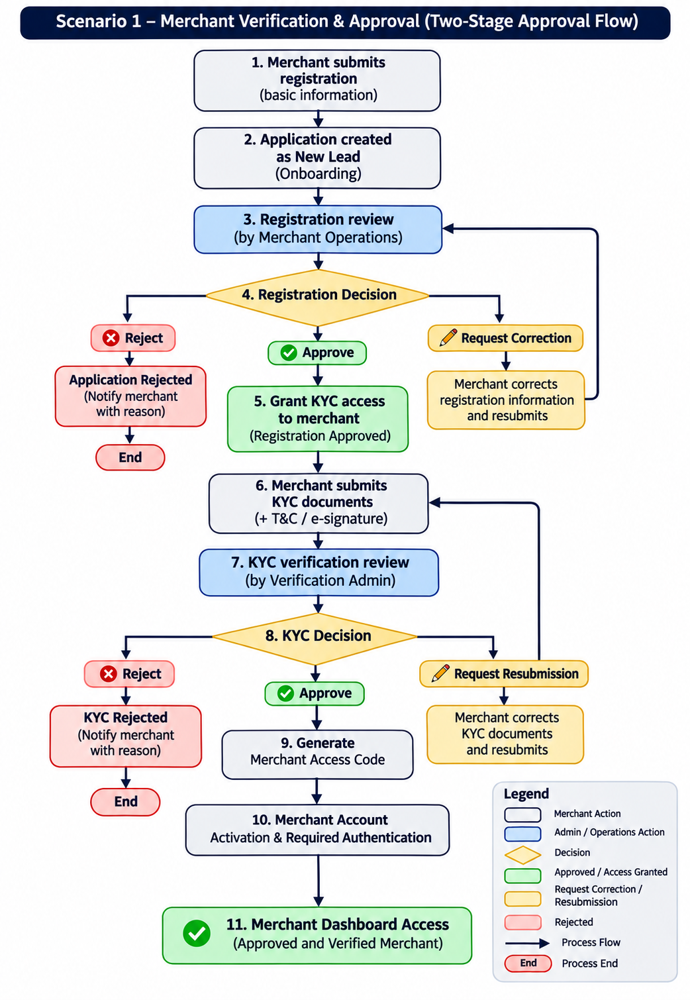

# 场景1-商户认证与审批

> [!info] 原文摘录
> 来源：[[mTrip 超级管理后台知识库/08-原始资料/mTrip_Super_Admin_Portal_PRD_Enterprise_v1.0.20_中文版|mTrip_Super_Admin_Portal_PRD_Enterprise_v1.0.20_中文版]]，第 74–100 行（按导入快照计）。
> 下方保留原文措辞、条目、表格和状态，仅调整图片路径。模块笔记包含其原有验收条款；文末验收汇总另行保留。

<!-- PRD_SOURCE_START:74-100 -->
### 场景 1 – 商户验证与审批

##### 目标

验证商户的基础注册信息；在注册审批通过后，验证其提交的 KYC 文档，并在最终审批与账户激活后授予商户平台访问权限。

**流程**

##### 流程

- 商户提交申请，包含所需的业务信息与联系信息。
- 申请在“入驻”下创建为“新线索”。
- 商户运营审核基础注册信息与业务信息。授权管理员批准注册、要求更正或驳回。仅在注册审批通过后才授予 KYC 访问权限。
- 注册审批通过并授予 KYC 访问权限后，商户提交所需的 KYC 文档、接受条款与条件，并完成电子签名。
- 申请进入“待验证”状态。
- 授权的验证管理员审核所提交的文档。
- 最终 KYC 申请为“已通过”“已驳回”或退回“需重新提交”。KYC 重新提交返回文档验证环节；注册信息更正返回注册审核环节。
- 系统向商户通知验证结果。
- 如需更正或重新提交，商户仅更新所要求的注册信息或 KYC 文档，并重新提交至相应的审核阶段。
- 审批通过后，商户需完成所需的账户访问与安全设置，方可访问商户工作台。

**预期结果**

仅已完成所需账户访问与安全设置、且通过审批与验证的商户，方可访问商户工作台。

<!-- PRD_SOURCE_END -->

---

返回：[[mTrip 超级管理后台知识库/00-知识库首页|00-知识库首页]] · [[mTrip 超级管理后台知识库/09-导入记录/原文章节映射|原文章节映射]] · [[00-mTrip 产品知识库|产品知识库总入口]]

## 关联阅读

- [[mTrip 超级管理后台知识库/03-功能模块/M11-商户认证与审批|M11-商户认证与审批]]
