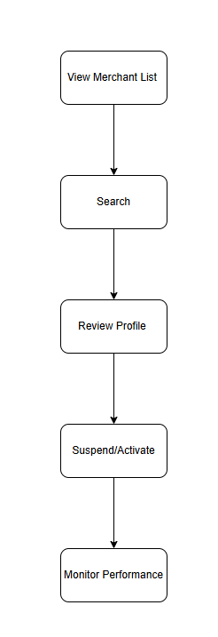

# 场景2-商户运营管理

> [!info] 原文摘录
> 来源：[[mTrip 超级管理后台知识库/08-原始资料/mTrip_Super_Admin_Portal_PRD_Enterprise_v1.0.19_中文版|mTrip_Super_Admin_Portal_PRD_Enterprise_v1.0.19_中文版]]，第 101–122 行（按导入快照计）。
> 下方保留原文措辞、条目、表格和状态，仅调整图片路径。模块笔记包含其原有验收条款；文末验收汇总另行保留。

<!-- PRD_SOURCE_START:101-122 -->
### 场景 2 – 商户运营管理

##### 目标

在入驻之后管理商户账户。

**流程**

##### 工作流程

- 管理员查看商户目录并打开商户资料。
- 管理员查看商户文件、监控商户活动，并审阅任何已记录的违规或警告。
- 管理员暂停该商户、发出警告，或代登录（impersonate）商户账户以调查或解决所报告的问题。
- 管理员还可使用内置通知编辑器向商户发送直接通知（例如关于政策更新或已解决的问题）。
- 所有操作均被记录，以便日后通过商户活动与合规历史进行审查。

**预期结果**

管理员维护商户质量与合规性。

<!-- PRD_SOURCE_END -->

---

返回：[[mTrip 超级管理后台知识库/00-知识库首页|00-知识库首页]] · [[mTrip 超级管理后台知识库/09-导入记录/原文章节映射|原文章节映射]] · [[00-mTrip 产品知识库|产品知识库总入口]]

## 关联阅读

- [[mTrip 超级管理后台知识库/03-功能模块/M12-商户管理|M12-商户管理]]
