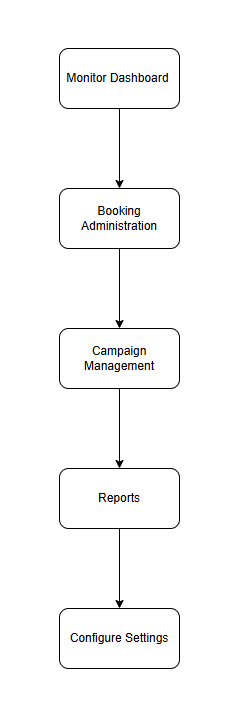

# 场景3-平台管理

> [!info] 原文摘录
> 来源：[[mTrip 超级管理后台知识库/08-原始资料/mTrip_Super_Admin_Portal_PRD_Enterprise_v1.0.19_中文版|mTrip_Super_Admin_Portal_PRD_Enterprise_v1.0.19_中文版]]，第 123–136 行（按导入快照计）。
> 下方保留原文措辞、条目、表格和状态，仅调整图片路径。模块笔记包含其原有验收条款；文末验收汇总另行保留。

<!-- PRD_SOURCE_START:123-136 -->
### 场景 3 – 平台管理

##### 目标

通过集中式管理控制管理与监控平台级运营。

**流程**

**预期结果**

平台运营保持安全、高效管理、可监控与可扩展。

<!-- PRD_SOURCE_END -->

---

返回：[[mTrip 超级管理后台知识库/00-知识库首页|00-知识库首页]] · [[mTrip 超级管理后台知识库/09-导入记录/原文章节映射|原文章节映射]] · [[00-mTrip 产品知识库|产品知识库总入口]]

## 关联阅读

- [[mTrip 超级管理后台知识库/03-功能模块/M18-平台配置与管理|M18-平台配置与管理]]
- [[mTrip 超级管理后台知识库/03-功能模块/M17-报表与分析|M17-报表与分析]]
