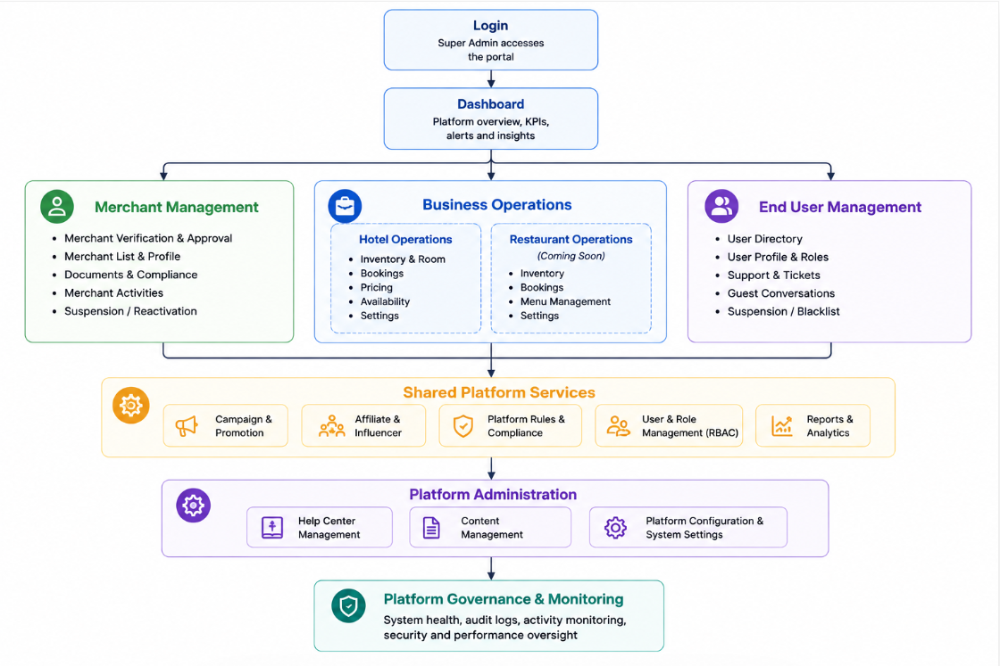

# 场景4-消费者账号支持与高层工作流

> [!info] 原文摘录
> 来源：[[mTrip 超级管理后台知识库/08-原始资料/mTrip_Super_Admin_Portal_PRD_Enterprise_v1.0.19_中文版|mTrip_Super_Admin_Portal_PRD_Enterprise_v1.0.19_中文版]]，第 137–159 行（按导入快照计）。
> 下方保留原文措辞、条目、表格和状态，仅调整图片路径。模块笔记包含其原有验收条款；文末验收汇总另行保留。

<!-- PRD_SOURCE_START:137-159 -->
### 场景 4 – 用户账户支持

##### 目标

使管理员能够管理用户账户、解决支持问题，并在必要时执行平台政策。

##### 工作流程

- 管理员通过用户目录搜索用户，或从已提交的支持工单进入该账户。
- 管理员查看用户的个人资料、预订历史、交易历史、通知历史与账户活动。
- 管理员调查所报告的问题并执行相应操作，例如解决支持工单、批准退款（在授权范围内）、发送通知、暂停账户、延长暂停期限，或因违反平台政策将账户加入黑名单。
- 管理员之后可重新激活已暂停的账户或将用户从黑名单中移除，使账户按平台政策恢复为非活跃或活跃状态。

##### 预期结果

用户问题得到高效解决，同时维护平台安全、防止滥用并确保符合平台政策。

**超级管理员高层级流程**

共享平台服务支持所有业务领域，而平台管理在整个生态中提供集中式配置与治理。

<!-- PRD_SOURCE_END -->

---

返回：[[mTrip 超级管理后台知识库/00-知识库首页|00-知识库首页]] · [[mTrip 超级管理后台知识库/09-导入记录/原文章节映射|原文章节映射]] · [[00-mTrip 产品知识库|产品知识库总入口]]

## 关联阅读

- [[mTrip 超级管理后台知识库/03-功能模块/M20-终端用户管理|M20-终端用户管理]]
- [[mTrip 超级管理后台知识库/07-专题索引/商户端与管理后台关联|商户端与管理后台关联]]
