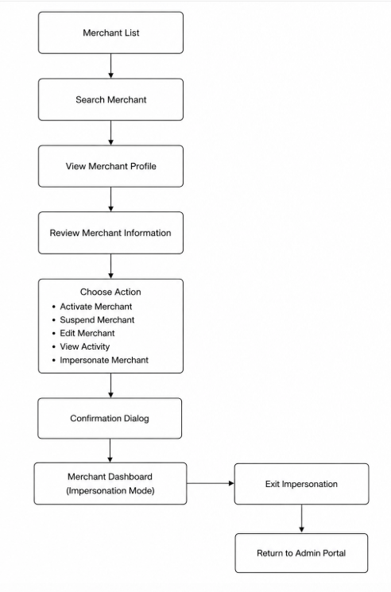

# M12-商户管理

> [!info] 原文摘录
> 来源：[[mTrip 超级管理后台知识库/08-原始资料/mTrip_Super_Admin_Portal_PRD_Enterprise_v1.0.20_中文版|mTrip_Super_Admin_Portal_PRD_Enterprise_v1.0.20_中文版]]，第 294–644 行（按导入快照计）。
> 下方保留原文措辞、条目、表格和状态，仅调整图片路径。模块笔记包含其原有验收条款；文末验收汇总另行保留。

<!-- PRD_SOURCE_START:294-644 -->
### 模块 12：商户管理

##### 目标

使超级管理员能够管理商户审批通过后的完整生命周期。本模块为管理员提供以下能力：监控商户账号、维护商户信息、管理账号状态、支持商户运营、管理市场曝光与排名，以及确保符合平台政策。

##### 说明

商户通过“商户核验与审批”模块成功审批后，即成为 mTrip 平台上的活跃合作伙伴。“商户管理”模块使超级管理员能够在商户整个生命周期内管理商户账号，包括资料管理、账号状态、运营监控、商户文件、安全管理、市场曝光与排名以及商户支持。

##### 核心功能

##### 商户目录

- 查看所有已注册商户。
- 按名称、ID、电话号码、邮箱或商家名称搜索商户。
- 按状态、类别、地区或注册日期筛选商户。
- 对商户记录排序。
- “全部商户”为商户账号目录：无论关联门店/业务实体数量多少，每个已注册商户仅显示一行。
- 将已注册业务实体名称显示为主要的商户名称。各酒店/门店名称显示在“商户详情 > 关联门店/业务实体”中。
- 城市、星级和类别属于各单个门店，应在“关联门店”中显示，不得在“全部商户”中作为单一的商户级数值显示。
- “商户详情”应支持授权管理员查看所有关联门店及其各自的运营状态。

##### 商户资料

- 查看商户资料信息、业务详情、实名认证（KYC）状态、佣金方案、联系方式、银行信息及关联业务实体。

**商务与支付设置（商户级配置）**

- 在“商户管理 → 全部商户 → 商户资料”中展示“商务与支付设置”区域，并提供“编辑配置”操作；账户安全与月度表现仍作为独立的现有区域保留。
- 在商户商务设置摘要中展示佣金方案、佣金比例、交易手续费比例、“到店支付”启用/停用状态、商户未入住（No-Show）费用启用/停用状态，以及商户房费预收比例（0–30%）。
- 获得授权的超级管理员可配置或更新每个商户的佣金方案、商户专属佣金比例（含自定义覆盖值）及交易手续费比例。交易手续费按 mTrip 佣金金额计算，不按客房总价计算。
- 可按商户将“到店支付”配置为启用或停用。仅已启用的商户可向用户提供“到店支付”支付选项；新预订适用预订确认时生效的配置。
- 移除佣金分成控制项。对于已启用“到店支付”的商户，配置商户是否收取未入住（No-Show）费用。仅当启用未入住费用时，商户才可选择最高为适用房价 30% 的房费预收比例。mTrip 佣金不与商户分成。
- 佣金配置应同时支持商户级默认佣金比例，以及在需要时按单个门店设置佣金比例。
- 显式配置的门店佣金比例仅对该门店覆盖商户默认值；未设置覆盖的门店使用商户默认值。应展示适用比例及配置范围。
- 对商户或门店佣金配置的变更应受权限控制、设定生效日期、记录变更原因，并记入配置历史；此前已确认的预订保留其确认时锁定的商务条款。
- 通知对象应同时支持整个商户账户和选定的单个关联门店/业务。发送前应展示目标范围，并保留发送与审计历史。
- 若已启用“到店支付”且商户不收取未入住费用，则仅预收 mTrip 佣金，不预收商户房费。若适用商户未入住费用，则将 mTrip 佣金加上所配置的商户房费比例（最高 30%）作为面向用户的一笔预付定金收取；应保留内部费用构成明细。
- 展示计算预览，包括房价、mTrip 佣金、交易手续费（适用时按佣金计算）、商户未入住预收（房价的 0–30%）、用户预付定金合计以及到店应付余额。严禁以 mTrip 佣金为基数计算商户比例。
- 变更须填写生效日期/时间和原因；保留带版本的值、编辑人及时间戳。已确认的现有预订保留预订确认时锁定的“到店支付”、未入住及预收条款。
- 允许获得授权的用户查看配置历史，并通过基于角色的访问控制（RBAC）防止未授权变更。不得将商户增值税/税费后台默认值作为超级管理员可编辑的控制项对外提供。
- 代登录（impersonate）商户账户，用于问题排查、调查和运营支持。
- 暂停有效的商户账户（阻止新预订；已确认的现有预订不受影响）。
- 向商户发送直接通知，可从消息模板库中选择模板、选择发送渠道（推送、站内信、邮件或短信），并可选关联到某个预订、促销或 App 内页面。

**商户文档管理**

- 查看商户文档。
- 下载已上传的文档。
- 查看文档审核历史。
- 更换已过期的文档。
- 审核佐证材料。

##### 商户状态管理

- 激活商户账户、门店级暂停与商户级升级处理
- 获得授权的超级管理员可暂停或恢复单个门店，而无需暂停其商户账户或其他关联门店。
- 获得授权的超级管理员可整体暂停商户账户，暂停将应用于所有关联门店，无需对每个门店单独执行暂停操作。
- 单个门店存在疑似欺诈或严重违规时，可在门店级标记并升级至商户级调查；仅凭标记不得自动暂停整个商户。
- 对每次门店或商户暂停，应记录范围、原因、责任管理员、生效日期/时间及状态历史。门店级暂停阻止该门店的新预订；商户级暂停阻止所有关联门店的新预订。已确认的现有预订在现有暂停规则下仍不受影响。
- 商户级身份验证与安全控制仍归属于商户账户；门店级运营控制仍归属于各门店。
- 暂停商户账户。
- 恢复已暂停的商户账户。
- 查看商户状态历史。
- 将商户账户加入黑名单。
- 将商户移出黑名单。
- 记录商户暂停原因。
- 配置临时暂停期限。
- 恢复已列入黑名单的商户账户。

**商户账户注销申请审批**

- 审核商户移动端 App 提交的商户账户注销申请。
- 查看注销申请详情，包括商户身份、业务/门店信息、申请日期/时间、提交原因及当前申请状态。
- 注销申请状态显示为“待审批”“已通过”或“已驳回”。
- 仅获得授权的超级管理员可“通过”或“驳回”待处理的商户账户注销申请。
- 通过或驳回注销申请时，须填写管理员原因/备注。
- 若通过，应停用商户访问权限、终止活跃会话、阻止后续商户 App/Web 门户登录，并按已批准的平台数据留存、法律、财务、预订、结算、审计及合规规则处理账户注销。
- 因法律、财务、预订、结算、审计、争议或合规目的必须留存的记录，不得仅因商户账户注销而被删除。
- 若驳回，除已适用其他账户状态限制外，应保持商户账户有效，并将驳回结果通知商户。
- 记录完整的注销申请与决策历史，包括申请人、审批人/审核人、决策、原因/备注及日期/时间。
- 注销申请通过或驳回时，应通过支持的渠道通知商户。

##### 商户活动

- 查看商户近期活动。
- 监控登录历史。
- 监控账户变更。
- 审核商户运营活动。
- 查看审计日志。
- 查看合规历史。
- 查看警告历史。
- 查看暂停历史。
- 查看管理员操作日志。
- 导出活动记录。

##### 餐厅目录——人工核验与数据覆盖

**说明**

餐厅记录可能来源于 Google Places/API，用于发现与展示。由于第三方来源数据可能过时或不准确，当 mTrip 收到可靠的运营反馈，表明餐厅的真实状态或信息与 Google 来源记录不一致时，获得授权的超级管理员应能够对该餐厅进行人工核验。

**核心功能**

- 查看餐厅记录及其来源信息，包括可获取的 Google Place ID、当前 mTrip 核验状态、上架状态及最近一次核验详情。
- 按餐厅名称、城市/位置、核验状态、上架状态及来源搜索和筛选餐厅记录。
- 当运营或管理层等获得授权的内部团队报告问题时，将餐厅标记为需要人工核验。
- 允许获得授权的超级管理员记录人工核验结果：正常营业（Verified Active）、未找到（Not Found）、永久停业（Permanently Closed）、已迁址（Moved）或信息有误（Incorrect Information）。
- 当核验后的真实信息与 Google 来源记录不一致时，允许获得授权的超级管理员更新 mTrip 自有餐厅信息或应用 mTrip 覆盖值。
- 须填写核验原因/备注，并记录核验来源、核验人及核验日期/时间。
- 在可获取时，允许记录佐证材料或内部参考信息。
- 当餐厅被核验为“未找到”或“永久停业”时，允许隐藏/停用该 mTrip 上架记录，而不删除或覆盖原始 Google 来源记录。
- 将原始第三方来源值同 mTrip 自有核验状态与人工覆盖值分开保留，以便追溯。
- 在审计日志中保留完整的核验与人工更新历史。

**业务规则**

- Google/第三方来源数据应始终可识别为来源数据，不得被人工核验操作直接覆盖。
- 人工核验与 mTrip 数据覆盖受权限控制，仅获得授权的超级管理员/运营角色可用。
- 人工核验操作必须包含核验结果与原因/备注。
- 核验状态与上架可见性为两个独立字段；但“核验为未找到”或“永久停业”的结果可按平台配置规则触发 mTrip 上架记录变为“停用/隐藏”。
- 任何 mTrip 自有的人工更正或覆盖都必须记录原值、新值、管理员、原因及日期/时间。
- 若后续来源数据或实地核验确认发生变化，获得授权的管理员可重新核验该餐厅并更新 mTrip 覆盖值/状态，同时保留此前历史。

##### 商城排序

##### 说明

商城排序功能使获得授权的超级管理员能够管理 mTrip 用户端 App 中向用户展示的符合条件的商户业务/门店及目的地的展示优先级。

商城排序包含两个部分：

- 榜单排序——管理单个商户业务/门店上架记录的展示顺序及精选/置顶状态。
- 热门目的地——管理在用户端 App 中向用户优先或重点展示的目的地。

##### 榜单排序

- 按业务类型查看符合条件的业务/门店上架记录。
- 在受支持的业务类型之间切换，如酒店和餐厅。
- 按城市和上架状态筛选上架记录。
- 按业务/门店名称搜索。
- 查看每条上架记录的当前排名。
- 通过拖拽手动调整上架记录顺序。
- 置顶或精选选定的上架记录。
- 确保置顶/精选的上架记录排在常规排名记录之前。
- 查看上架记录详情，包括业务/门店信息、商户信息、上架状态、评分、城市及当前商城排名。
- 查看上架记录关联的商户资料。
- 预览排名后的上架记录在用户端 App 中的展示效果。
- 按适用商城范围（如城市和业务类型）独立展示排名。
- 记录最近一次排名更新及负责该变更的管理员。

##### 热门目的地

- 查看已配置用于商城展示的目的地。
- 搜索和筛选目的地。
- 管理目的地的展示优先级/顺序。
- 配置哪些目的地作为热门目的地展示。
- 按预期展示优先级调整目的地顺序。
- 在目的地配置反映到用户端 App 之前进行预览或核实。

##### 代登录商户

使获得授权的超级管理员能够在无需商户登录凭证的情况下临时访问商户账户，用于问题排查、运营支持和问题调查。

**账户安全、登录方式与双因素认证（2FA）管理**

- 查看商户的登录方式配置及状态，涵盖商户访问码 + Google Authenticator、注册邮箱 + 邮件一次性验证码（OTP）、注册手机号 + 短信一次性验证码（OTP）。
- 展示每种登录方式的“启用”或“停用”状态，并在适用时以掩码形式展示关联标识。
- 按管理员权限为选定商户启用或停用单种邮件或短信登录方式。
- 停用或重新启用商户登录方式前，须经管理员确认并填写原因。
- 当停用某项登录方式时，应立即强制退出该商户的所有活跃会话，并使待处理的二维码登录请求失效。
- 对于手机丢失或疑似欺诈的情形，除停用相关登录方式外，还应撤销受影响的受信任移动设备与生物识别信任。
- 商户目录记录代表已注册的商户账户；关联门店保留各自的城市、类目、星级、运营状态与上架属性。
- 佣金比例可在商户层级配置，也可选择性地在单个门店层级配置；门店层级的覆盖配置优先于商户默认值。
- 暂停单个门店不得改变商户账户或其他门店的状态。商户层级暂停适用于所有关联门店。
- 门店欺诈标记应支持升级至商户层级审核。仅授权管理员可决定暂停整个商户账户。
- 应支持按商户与按门店定向发送通知，并分别记录日志。
- 允许授权超级管理员在不考虑登录方式状态的情况下，强制退出商户的所有活跃会话。
- 查看活跃会话、受信任设备、最后登录方式、最后登录时间、设备信息，以及在可获取时查看 IP 信息。
- 仅在商户的访问问题或安全事件完成复核后，才允许授权管理员重新启用。
- 查看商户访问码状态。
- 查看商户双因素认证（2FA）状态（已启用 / 需重置 / 未绑定）。
- 查看已配置的 2FA 方式（Google Authenticator）。
- 查看 2FA 绑定日期与最后重置日期。
- 授权超级管理员可为单个商户重置 2FA。
- 重置 2FA 会使商户现有的验证器设置失效。
- 2FA 重置后，商户须在下次登录时重新绑定 Google Authenticator。
- 重新绑定时，系统会为该商户生成新的 2FA 设置二维码与手动设置密钥。
- 所有 2FA 重置操作均须记录至审计日志。

##### 业务规则

- 仅授权超级管理员可代登录（impersonate）商户。
- 所有代登录会话均须记录至审计日志。
- 当管理员处于代登录模式时，系统须明确提示。
- 管理员可随时退出代登录。
- 商户密码对管理员始终不可见。
- 代登录期间，敏感安全操作仍受限制。
- 每次代登录会话在授予访问权限前均须填写有效原因。
- 2FA 重置仅对授权超级管理员开放。
- 2FA 重置仅作用于所选商户账户，不得影响其他商户账户。
- 每个商户须拥有独立的 2FA 验证器密钥。
- 超级管理员不得展示或手动提供商户的 2FA 二维码或手动设置密钥。
- 重置 2FA 时，现有验证器密钥失效。
- 商户须在下次登录时完成新的 2FA 绑定。
- 重新绑定期间，系统生成新的二维码与手动设置密钥。
- 所有 2FA 重置操作均须记录审计日志，包括管理员、商户、日期/时间与操作。
- 登录方式启用/停用操作受权限控制，且仅作用于所选商户账户。
- 停用某项登录方式会立即撤销商户的所有活跃会话、使待处理的二维码登录请求失效，并阻止通过该方式的任何新认证。
- 对于手机丢失或疑似欺诈的处置，可包括撤销受影响的受信任移动设备与生物识别信任；商户须完成完整身份认证后方可恢复受信任设备访问。
- 除非单独重置，或商户账户被暂停、列入黑名单，“访问码 + Google Authenticator”方式保持可用。
- 每次登录方式状态变更、强制退出、二维码失效、受信任设备撤销与重新启用，均须在审计日志中记录管理员、商户、操作、原状态、新状态、原因、日期/时间、受影响会话/设备与结果。
- 黑名单商户无法访问商户端 App。
- 每次商户状态变更均须填写管理员备注。
- 商户证件历史须保留以供审计。
- 商户账户删除并非立即执行，须经授权超级管理员明确审批。
- 仅“待审批”的删除申请可被批准或驳回。
- 批准或驳回均须填写管理员原因/意见，并记录至审计日志。
- 批准账户删除申请后，须先撤销商户访问权限与活跃会话，再执行删除流程。
- 账户删除须遵循已获批的数据留存、法律、财务、预订、结算、审计、争议与合规要求；受留存要求约束的记录须在规定的留存期内保持可用。
- 被驳回的删除申请不得删除或停用商户账户，除非该账户被单独暂停、列入黑名单或以其他方式受限。
- 系统须通过支持的各类通知渠道，将删除申请的最终决定告知商户。
- 商城排序在适用的业务类型与商城范围内管理。
- 仅符合资格的上架内容可参与商城排序。
- 在适用排序范围内，置顶/推荐上架内容排在常规排序上架内容之前。
- 调整上架内容顺序会更新其在商城的展示优先级。
- 排序变更不得修改商户的底层业务/门店信息。
- 商城排序仅控制展示优先级，不构成商户审批或实名认证（KYC）。
- 上架状态与商城排序须为相互独立的概念；调整排序不会自动启用或停用上架内容。
- 商城排序变更须记录管理员与最后更新日期/时间。
- 用户端 App 预览仅用于核实商城展示效果，不修改商户上架信息。

##### 平台规则与合规

##### 说明

平台规则与合规功能使超级管理员能够制定、监控并执行平台政策，以确保所有商户符合 mTrip 的运营标准、法律法规与平台质量要求。该模块集中呈现商户违规情况、合规历史、警告记录与处置动作，并保留完整的审计轨迹。

##### 核心功能

- 创建并管理平台运营规则。
- 制定商户合规政策。
- 查看商户违规历史。
- 向商户发出警告通知。
- 因违反政策暂停商户。
- 复核后恢复被暂停的商户。
- 跟踪合规状态。
- 搜索与筛选合规记录。
- 为每次处置动作记录管理员备注。
- 在采取合规处置时通知商户。

##### 业务规则

- 每条违规须归属预定义的违规类目。
- 警告历史不可修改或删除。
- 暂停商户须经管理员确认。
- 每次合规处置均须记录至审计日志。
- 商户将自动收到警告、暂停与恢复的通知。
- 平台规则集中维护，除平台配置例外外，适用于所有商户。
- 黑名单商户无法访问商户端 App。
- 每次商户状态变更均须填写管理员备注。
- 合规记录不可永久删除。
- 商户证件历史须保留以供审计。
- 平台规则在发布后立即生效，除非配置了未来的生效日期。
- 合规处置可能因管理员角色不同而需要不同的审批层级。
- 仅授权超级管理员可代登录（impersonate）商户。
- 所有代登录会话均须记录至审计日志。
- 当管理员处于代登录模式时，系统须明确提示。
- “全部商户”每行显示一个已注册商户账户，并以注册商号作为主商户名称；关联门店可在商户详情中查看。
- 城市、星级与类目在“关联门店”中按门店分别展示，而非作为商户层级的单一值。
- 授权管理员可配置商户默认佣金比例及可选的单个门店覆盖配置，并查看适用范围与审计历史。
- 授权管理员可暂停单个门店而不影响其他门店，或一次操作暂停整个商户及其所有关联门店。
- 授权管理员可标记疑似门店欺诈，升级至商户层级审核，并记录最终决定与历史。
- 通知可定向至商户账户或选定门店，并记录目标范围与发送历史。
- 管理员可随时退出代登录。
- 商户密码对管理员始终不可见。
- 代登录期间，敏感安全操作仍受限制。
- 每次代登录会话在授予访问权限前均须填写有效原因。
- 2FA 重置仅对授权超级管理员开放。
- 2FA 重置仅作用于所选商户账户，不得影响其他商户账户。
- 每个商户须拥有独立的 2FA 验证器密钥。
- 超级管理员不得展示或手动提供商户的 2FA 二维码或手动设置密钥。
- 重置 2FA 时，现有验证器密钥失效。
- 商户须在下次登录时完成新的 2FA 绑定。
- 重新绑定期间，系统生成新的二维码与手动设置密钥。
- 所有 2FA 重置操作均须记录审计日志，包括管理员、商户、日期/时间与操作。

**商户代登录示意图**

##### 验收标准

- 超级管理员可查看、搜索、筛选与排序已注册商户。
- 超级管理员可查看商户资料信息，包括业务详情、认证状态、佣金方案、联系方式、银行信息与关联业务实体。
- 授权超级管理员可查看并编辑商户专属的商务设置（佣金方案/比例、交易手续费、到店支付资格与未入住/预收款控制），并记录生效日期、原因、审计历史，遵循基于角色的访问控制（RBAC）。
- 当到店支付处于停用状态，或商户不收取未入住费用时，商户未入住预收款比例为 0%。对于已启用到店支付且商户收取未入住费用的预订，商户客房费预收款最高可设为客房价格的 30%；mTrip 佣金不参与分成。
- 超级管理员可查看、下载、审核并在适用时替换商户证件。
- 商户证件核验与替换历史须保留以供审计。
- 授权超级管理员可按照允许的账户状态流转，对商户账户执行启用、暂停、恢复启用、列入黑名单与恢复操作。
- 变更商户账户状态时须填写原因或管理员备注。
- 超级管理员可配置临时暂停期限并查看商户状态历史。
- 黑名单商户无法访问商户端 App。
- 超级管理员可查看商户活动、登录历史、账户变更、合规历史、警告历史、暂停历史与管理员操作日志。
- 超级管理员可导出商户活动记录。
- 授权超级管理员可查看商户移动端 App 提交的商户账户删除申请。
- 删除申请详情显示商户、提交原因、申请日期/时间与当前状态。
- 授权超级管理员可批准或驳回“待审批”的删除申请，并须填写原因/意见。
- 审批通过后，在账号删除处理之前，商户访问权限被停用、活跃会话被终止，且后续登录被阻止。
- 系统应保留根据已批准的法律、财务、预订、结算、审计、争议、数据留存或合规要求必须保持可用的记录。
- 驳回后，商户账号按其现有账号状态保持可用，且商户会收到驳回结果。
- 所有删除请求的决策及相关管理员操作均记录在审计历史中，并通过支持的渠道通知商户。
- 超级管理员可通过支持的通知渠道向商户发送通知。
- 获得授权的超级管理员在提供有效理由后可代登录（impersonate）商户账号。
- 系统应明确提示管理员当前处于代登录模式（Impersonation Mode）。
- 超级管理员可随时退出代登录会话。
- 代登录期间不暴露商户凭据，受限的安全操作仍不可用。
- 所有商户代登录会话均记录在审计日志中。
- 获得授权的超级管理员可查看商户的商户访问码状态和双因素认证（2FA）状态。
- 获得授权的超级管理员可为单个商户重置双因素认证（2FA）。
- 重置双因素认证（2FA）后，商户现有的身份验证器设置失效，商户需在下次登录时重新完成 Google Authenticator 绑定。
- 所有双因素认证（2FA）重置操作均记录在审计日志中。
- 超级管理员可查看商户已配置的登录方式及其“已启用”或“已禁用”状态。
- 获得授权的超级管理员可为单个商户启用或禁用邮箱和短信登录方式。
- 禁用商户登录方式需经确认并填写管理员理由。
- 禁用登录方式将强制注销该商户的所有活跃会话，并使该商户待处理的二维码登录请求失效。
- 获得授权的超级管理员可在手机丢失或疑似欺诈的情况下，撤销商户的受信任移动设备和生物识别信任。
- 获得授权的超级管理员可强制注销所有活跃会话，且不改变商户的账号状态。
- 所有登录方式、会话撤销、二维码失效及受信任设备相关操作均可在商户活动/审计历史中查看。
- 超级管理员可按支持的业务类型查看平台展示条目。
- 超级管理员可按城市、展示状态等适用条件搜索和筛选平台展示条目。
- 超级管理员可查看每个符合条件的展示条目的当前平台排名。
- 获得授权的超级管理员可在适用的平台范围内手动调整符合条件的展示条目的顺序。
- 获得授权的超级管理员可将符合条件的展示条目配置为推荐或置顶。
- 在适用范围内，推荐或置顶的展示条目显示在常规排名条目之前。
- 超级管理员可查看展示条目详情及关联的商户信息。
- 超级管理员可在用户端 App 上预览排名展示效果。
- 平台排名变更会记录责任管理员及更新日期/时间。
- 超级管理员可查看、搜索、筛选和管理热门目的地。
- 获得授权的超级管理员可配置并调整热门目的地的顺序。
- 平台排名变更不会修改商户认证状态、展示状态或底层商户业务信息。
- 获得授权的超级管理员可查看和搜索来源于 Google/API 的餐厅记录，以及其 mTrip 认证状态和展示状态。
- 获得授权的超级管理员可将餐厅标记为人工认证并记录认证结果。
- 支持的人工认证结果包括“已认证营业”“未找到”“永久停业”“已搬迁”和“信息有误”。
- 完成餐厅人工认证时必须填写理由/备注。
- 当认证后的餐厅信息与第三方来源不一致时，获得授权的超级管理员可应用 mTrip 自有的更正/覆盖。
- 原始的 Google/第三方来源值单独保留，不被 mTrip 人工更正覆盖。
- 认证结果为“未找到”或“永久停业”的餐厅，可按平台规则从 mTrip 面向用户的展示中隐藏/停用。
- 所有餐厅认证和人工更新操作均在审计历史中记录管理员、结果、理由、适用时的变更前/变更后值以及日期/时间。

<!-- PRD_SOURCE_END -->

---

返回：[[mTrip 超级管理后台知识库/00-知识库首页|00-知识库首页]] · [[mTrip 超级管理后台知识库/09-导入记录/原文章节映射|原文章节映射]] · [[00-mTrip 产品知识库|产品知识库总入口]]

## 关联阅读

- [[mTrip 超级管理后台知识库/04-验收标准/AC12-商户管理|AC12-商户管理]]
- [[mTrip 超级管理后台知识库/07-专题索引/商户入驻、生命周期与账号安全|商户入驻、生命周期与账号安全]]
- [[mTrip 超级管理后台知识库/06-规划与治理/待澄清事项|待澄清事项]]
