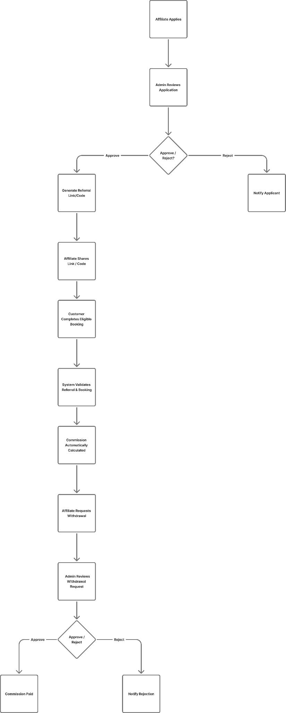

# M15-联盟与达人管理

> [!info] 原文摘录
> 来源：[[mTrip 超级管理后台知识库/08-原始资料/mTrip_Super_Admin_Portal_PRD_Enterprise_v1.0.19_中文版|mTrip_Super_Admin_Portal_PRD_Enterprise_v1.0.19_中文版]]，第 872–995 行（按导入快照计）。
> 下方保留原文措辞、条目、表格和状态，仅调整图片路径。模块笔记包含其原有验收条款；文末验收汇总另行保留。

<!-- PRD_SOURCE_START:872-995 -->
### 模块 15：联盟与达人管理

##### 目标

使超级管理员能够管理平台的联盟推广与达人计划，包括联盟入驻、活动管理、推荐追踪、佣金监控和效果分析。

##### 说明

联盟与达人管理模块使超级管理员能够管理 mTrip 联盟生态，包括联盟入驻、合作伙伴管理、奖励发放、反欺诈、联盟计划配置和联盟码。该模块对平台范围内的联盟运营、佣金与奖励规则、推荐治理以及合作伙伴表现提供集中管控。

联盟与推荐奖励通过奖励钱包以非现金激励形式发放，包括旅行额度、奖励积分、优惠券和代金券。该模块还提供联盟计划设置的集中配置，供推荐活动模块用于定义活动专属的推荐规则与促销活动。

用户对用户（Consumer-to-Consumer）推荐奖励是记录在奖励钱包中的非现金激励（旅行额度、积分、优惠券或代金券）。认证达人的收益以及代理/商户联盟佣金为现金，存放于独立的可提现台账，受释放和打款规则约束。该模块集中配置佣金、推荐奖励、认证、归因和反欺诈控制。

##### 高层级流程

##### 核心功能

##### 联盟申请

- 审核、批准或驳回联盟与达人申请（类型：达人、博主、用户对用户、OTA 合作伙伴、企业）。
- 查看根据可配置的反欺诈检测规则自动计算的风险等级。

##### 合作伙伴目录

- 将合作伙伴类别（用户推荐人、达人、代理或商户）与账户状态、认证状态分开展示。
- 浏览并管理支持的各类型联盟合作伙伴，包括达人、商业联盟和用户推荐。
- 浏览并管理支持的各类型联盟合作伙伴，包括达人、商业联盟和用户推荐。
- 查看合作伙伴资料、发送消息，以及暂停或恢复合作伙伴。

##### 奖励钱包

- 在奖励钱包中仅审核非现金的用户对用户推荐奖励，包括已获得、已兑换、已过期和手动调整的奖励。现金的达人佣金和代理/商户佣金必须在财务管理下的独立台账中管理。
- 仅允许经授权对非现金奖励钱包余额进行手动调整，必须填写原因并留存审计记录；不得将此功能视为现金打款。
- 导出奖励钱包历史记录。

##### 反欺诈

- 审核欺诈队列，包含风险等级、检测原因和调查状态。
- 暂停并锁定欺诈账户（停用推荐链接、冻结待发收益）或恢复该账户；驳回暂停申诉。
- 配置反欺诈检测规则及相应的处置动作（允许、标记或拦截）。

##### 联盟计划配置

- 针对注册成功、首次达标交易、完成符合条件的预订分别配置奖励触发条件。每个触发条件必须有其独立的资格规则和奖励金额。
- 为被推荐用户完成的符合条件的预订配置达人预订佣金。佣金方式、费率或固定金额、持有期和收益上限必须可配置。
- 将用户对用户非现金奖励、达人现金收益和代理/商户现金佣金保持为相互独立的计划。
- 记录每次变更的旧配置值、新配置值、生效日期、操作管理员和原因。
- 按合作伙伴类型配置代理/商户联盟佣金，可采用按比例费率或每笔符合条件的预订固定金额。按比例计算的佣金，以折扣后的净预订金额为基数计算。
- 为代理/商户联盟计划配置每次申请的最低和最高提现金额。限额仅适用于可用的现金联盟佣金余额，不适用于非现金推荐奖励。最高金额必须大于或等于最低金额。
- 配置奖励规则（触发条件：注册/完成支付/完成入住；对象：推荐人/被推荐人/双方；类型：额度/返现/代金券）。
- 配置推荐链接有效期、最低预订金额、每日最大推荐数（欺诈标记的触发条件）以及打款前的奖励持有期。
- 此处配置的推荐设置现作为平台级默认值，各推荐活动（模块 22）可原样采用或覆盖。

##### 联盟码

- 在“联盟码”中展示由酒店现有联盟推荐链接生成的专属二维码。经授权的管理员可查看/下载该二维码；无需单独的二维码管理页面。手动重新生成/停用不在已确认的 MVP 范围内。
- 二维码与推荐链接共享同一联盟身份。一笔预订只能有一个符合条件的推荐来源获得归因，包括同时使用优惠码与二维码/链接的情况。MVP 中酒店二维码的佣金资格仅限首笔符合条件的预订，且须与用户端 App PRD 保持一致。

##### 达人认证与资质审核

- 审核达人申请，包括身份信息、社交媒体主页链接、粉丝信息和佐证材料。
- 批准、驳回达人认证申请或要求补充信息。记录决定、审核人、原因和日期。
- 在合作伙伴目录中展示认证状态。仅认证达人可获得达人专属现金佣金。

**达人等级与业绩表现**

- 配置达人等级以及每个等级所需的交易和推荐业绩要求。
- 配置达人等级的交易/推荐业绩目标和佣金收益上限，包含每笔交易、每周和每月限额。每周/每月打款周期的含义仍待产品确认。
- 展示当前业绩和等级评审资格。等级升级需超级管理员批准，不得自动升级。

##### 达人工作台

- 展示达人资料、认证状态、等级、推荐链接、被推荐用户、注册数、首次交易数和已完成符合条件的预订数。
- 分别展示注册奖励、首次交易奖励和完成预订佣金，并附状态和交易历史。
- 在模块 15 内提供独立的达人工作台，展示达人现金钱包余额、待处理/持有中与可用收益、提现申请、结算状态、资料、认证和业绩。财务管理员在模块 24 下控制提现决定。
- 在“联盟码”下创建和管理与联盟推广绑定的推荐/折扣码，可采用自动生成或经校验的手动录入。
- 在“联盟码”下配置促销类型、住客折扣值（动态值/管理员可配置）、有效期、使用次数限制和适用商户范围。
- 在“联盟码”下复制推荐链接，并暂停或删除优惠码且保留审计历史。

##### 业务规则

- 代理/商户联盟推广仅在被推荐的预订完成后才获得预订佣金。已取消的预订不产生佣金。
- 若代理/商户联盟账户被暂停，其所有未支付的联盟收益将被扣留，直至做出批准释放的决定。
- 达人预订佣金适用于已完成的符合条件的预订。注册奖励和首次交易奖励是独立的可配置事件；就同一笔预订支付多项奖励需有明确的活动规则。
- 推荐来源、推荐人 ID、推荐码和活动必须在注册时记录，并在报告中保持可追溯。
- 完成后退款、佣金计算基数与用户端 PRD 的冲突，以及重复预订的达人归因，仍待产品团队确认。
- 仅经授权的超级管理员可以批准联盟与达人申请。
- 每个获批的联盟推广会被分配唯一的推荐链接或推荐码。
- 代理/商户及符合条件的达人联盟佣金支持按合作伙伴类型/等级由管理员配置比例或固定金额。按比例佣金以扣除所有适用折扣和优惠券后的最终净预订金额为基数（不重复扣减）。固定佣金使用配置的金额；预订完成和持有/释放规则适用。
- 代理/商户联盟佣金提现申请必须达到管理员配置的最低金额，不得超过管理员配置的每次申请最高金额，且不得超过已释放的可用现金联盟佣金余额。拦截无效申请，并向联盟推广展示两项适用限额。待处理、已预留和持有中的资金不可提现。非现金奖励钱包始终不可提现。
- 推荐活动会被记录，用于报告和审计。
- 联盟活动可以分配给选定的联盟推广或达人。
- 所有联盟与达人管理操作均记录在审计日志中。
- 完成预订的佣金/奖励仅在符合条件的预订完成并经过适用持有期后释放。注册奖励和首次达标交易奖励在计划/活动规则明确启用时可单独触发。
- 除非另有配置，每笔成功预订只能产生一次推荐奖励。
- 系统使用配置的反欺诈规则检测重复推荐。
- 可疑推荐行为可被标记为人工审核。
- 用户对用户奖励钱包奖励为非现金旅行额度、积分、优惠券或代金券，不可提现或银行转账。此限制不适用于符合条件的现金达人钱包或代理/商户联盟佣金钱包余额。
- 手动奖励调整需由管理员填写原因，且必须记录在审计日志中。

##### 验收标准

- 超级管理员可以审核达人认证材料，并批准或驳回认证，同时留存审计记录。
- 超级管理员可以配置达人等级、每周/每月目标和收益上限；等级升级需人工批准。
- 授权用户可从门店现有的联盟推广推荐链接中查看并下载门店二维码。
- 达人工作台展示被推荐用户、已完成预订、各奖励类型、收益及提现状态。
- 代理/商户佣金在预订完成前不计入收益，暂停期间的未支付收益将被暂扣。
- 超级管理员可批准或驳回联盟推广申请。
- 超级管理员可管理联盟推广与达人资料。
- 超级管理员可创建并管理联盟推广码。
- 超级管理员可配置联盟推广计划设置。
- 超级管理员可为代理/商户选择按比例或固定金额的联盟推广佣金，并配置适用的比例或固定金额。
- 授权的超级管理员可设置并更新联盟推广计划每次申请的提现最低与最高金额；系统依据这两项限额及可用余额校验申请，向符合条件的联盟推广人员展示适用限额，并记录配置变更的操作人、变更前值、变更后值与时间戳。
- 对于符合条件、预订金额为 100,000 MMK 且折扣为 20,000 MMK 的预订，5% 的联盟推广佣金计算为 5% × 80,000 MMK = 4,000 MMK。
- 系统为已批准的联盟推广人员生成专属推荐链接或推荐码，并跟踪推荐与佣金活动。
- 超级管理员可审核并手动为联盟推广人员的非现金奖励钱包入账。
- 超级管理员可配置佣金、奖励与反作弊规则。
- 未授权用户无法访问联盟推广管理功能。
- 推荐活动会被跟踪并可用于报告。
- 可疑的推荐活动可由管理员审核。

<!-- PRD_SOURCE_END -->

---

返回：[[mTrip 超级管理后台知识库/00-知识库首页|00-知识库首页]] · [[mTrip 超级管理后台知识库/09-导入记录/原文章节映射|原文章节映射]] · [[00-mTrip 产品知识库|产品知识库总入口]]

## 关联阅读

- [[mTrip 超级管理后台知识库/04-验收标准/AC15-联盟与达人管理|AC15-联盟与达人管理]]
- [[mTrip 超级管理后台知识库/07-专题索引/联盟推荐与非现金奖励|联盟推荐与非现金奖励]]
- [[mTrip 超级管理后台知识库/06-规划与治理/待澄清事项|待澄清事项]]

## v1.0.14 阅读提示（整理）

代理/商户现金联盟佣金支持比例或固定金额；比例按折扣净额，现金提现最低金额须配置、展示并在申请时校验。非现金奖励仍不可提现，且该佣金与向商户收取的平台佣金独立。本模块内新增验收未同步到文末 AC15，须结合阅读；详见[[mTrip 超级管理后台知识库/09-导入记录/v1.0.11至v1.0.14差异与跨端影响|版本差异与跨端影响]]。
