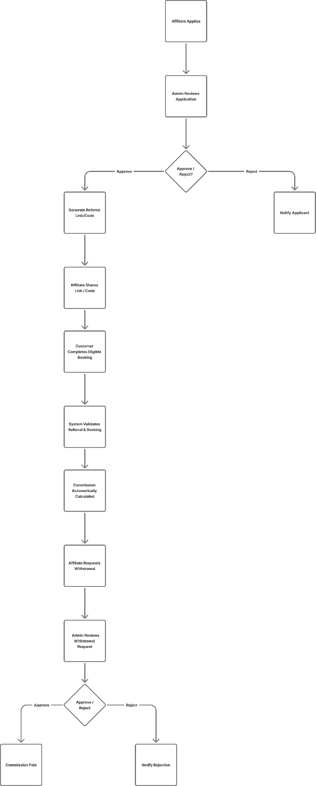

# M15-联盟与达人管理

> [!info] 原文摘录
> 来源：[[mTrip 超级管理后台知识库/08-原始资料/mTrip_Super_Admin_Portal_PRD_Enterprise_v1.0.14_中文版|mTrip_Super_Admin_Portal_PRD_Enterprise_v1.0.14_中文版]]，第 905–1002 行（按导入快照计）。
> 下方保留原文措辞、条目、表格和状态，仅调整图片路径。模块笔记包含其原有验收条款；文末验收汇总另行保留。

<!-- PRD_SOURCE_START:905-1002 -->
### 模块 15：联盟与达人管理

##### 目标

使超级管理员能够管理平台联盟与达人计划，包括联盟入驻、活动管理、推荐跟踪、佣金监控和绩效分析。

##### 描述

联盟与达人管理模块使超级管理员能够管理 mTrip 联盟生态，包括联盟入驻、合作伙伴管理、奖励分发、欺诈防范、联盟计划配置和联盟码。它在联盟运营、佣金与奖励规则、推荐治理以及平台范围内的合作伙伴绩效方面提供集中控制。

联盟与推荐奖励通过奖励钱包以非现金激励形式分发，包括旅行积分、奖励积分、优惠券和代金券。该模块还提供联盟计划设置的集中配置，供推荐活动模块用于定义特定活动的推荐规则和促销活动。

##### 高层工作流

##### 功能需求

##### 联盟申请

•    审核、批准或拒绝联盟与达人申请（类型：达人、博主、用户转用户、OTA 合作伙伴、企业）。

•   查看基于可配置欺诈检测规则自动计算的欺诈风险等级。

##### 合作伙伴名录

•   浏览和管理跨支持合作伙伴类型的联盟合作伙伴，包括达人、商业联盟和用户推荐。

•    查看合作伙伴档案、发送消息，以及停用或恢复合作伙伴。

##### 奖励钱包

•    查看联盟和推荐参与者的非现金奖励活动台账——已赚取、已兑换、已过期或由管理员手动调整的奖励。

•    从联盟的奖励钱包中手动存入或扣除奖励，需提供管理员理由。

•    导出奖励钱包历史。

##### 欺诈防范

•    查看包含风险等级、检测原因和调查状态的欺诈队列。

•    停用并锁定欺诈账户（禁用推荐链接、冻结待结算收益）或恢复该账户；拒绝停用申诉。

•    配置欺诈检测规则及关联的强制措施（允许、标记或阻止）。

##### 联盟计划配置

• 按合作伙伴类型配置代理/商户联盟佣金，可采用按比例费率或按每个符合条件的预订固定金额的方式。对于按比例佣金，按折扣后的净预订金额计算佣金。

• 配置代理/商户联盟计划的最低提现金额。该阈值适用于可用的现金联盟佣金提现，不适用于非现金推荐奖励。

•    配置奖励规则（触发条件：注册 / 完成支付 / 完成入住；目标：推荐人 / 被推荐人 / 双方；类型：积分 / 返现 / 代金券）。

•    配置推荐链接有效期、最低预订金额、每日最多推荐数（欺诈标记触发条件）以及打款前的奖励冻结期。

•    此处配置的推荐设置现作为全平台默认值，各推荐活动（模块 22）可采用或覆盖。

##### 联盟码

•    创建和管理绑定到特定联盟的推荐/折扣码，支持自动生成或经校验的手动输入。

•    配置促销类型、折扣值、有效窗口、使用限制和符合条件的商户范围。

•    复制推荐链接、暂停优惠码或删除优惠码。

##### 业务规则

- 仅授权的超级管理员可以批准联盟与达人申请。
- 每个已批准的联盟都会被分配唯一的推荐链接或推荐码。
- 代理/商户联盟佣金支持由管理员配置的按比例或固定金额方式。按比例佣金按折扣后的净预订金额计算；固定佣金按每个符合条件的预订使用所配置的金额。该联盟佣金与向商户收取的 mTrip 平台佣金相互独立。
- 代理/商户联盟佣金提现申请必须达到或超过管理员基于可用现金联盟佣金余额配置的最低提现金额。低于该阈值的申请不得提交；应向联盟成员显示所配置的最低金额。本规则不允许提现非现金奖励钱包余额、积分、优惠券或代金券。
- 推荐活动被记录以用于报告和审计。
- 联盟活动可分配给选定的联盟或达人。
- 所有联盟与达人管理操作都记录在审计日志中。
- 推荐奖励仅在符合条件的预订完成后授予。
- 每笔成功的预订只能生成一个推荐奖励，除非另有配置。
- 系统使用配置的欺诈防范规则检测重复推荐。
- 可疑的推荐活动可被标记以进行人工审核。
- 联盟与推荐奖励以旅行积分、奖励积分、优惠券或代金券形式发放——不能提现为现金或转账至银行账户。
- 手动奖励调整需要管理员理由，且必须记录在审计日志中。

##### 验收标准

- 超级管理员可以批准或拒绝联盟申请。
- 超级管理员可以管理联盟与达人档案。
- 超级管理员可以创建和管理联盟码。
- 超级管理员可以配置联盟计划设置。
- 超级管理员可为代理/商户选择按比例或固定金额的联盟佣金，并配置适用的比例或固定金额。
- 获授权的超级管理员可设置和更新联盟计划的最低提现金额；系统按所配置的阈值校验申请，并记录配置变更，包括操作人、变更前值、变更后值和时间戳。
- 对于一笔符合条件的预订，预订金额为 100,000 MMK、折扣为 20,000 MMK，5% 的联盟佣金计算为 5% × 80,000 MMK = 4,000 MMK。
- 系统为已批准的联盟生成唯一的推荐链接或推荐码，并跟踪推荐和佣金活动。
- 超级管理员可以审核并手动存入联盟的非现金奖励钱包。
- 超级管理员可以配置佣金、奖励和欺诈规则。
- 未授权用户无法访问联盟管理功能。
- 推荐活动被跟踪记录并可用于报告。
- 可疑的推荐活动可由管理员审核。

<!-- PRD_SOURCE_END -->

---

返回：[[mTrip 超级管理后台知识库/00-知识库首页|00-知识库首页]] · [[mTrip 超级管理后台知识库/09-导入记录/原文章节映射|原文章节映射]] · [[00-mTrip 产品知识库|产品知识库总入口]]

## 关联阅读

- [[mTrip 超级管理后台知识库/04-验收标准/AC15-联盟与达人管理|AC15-联盟与达人管理]]
- [[mTrip 超级管理后台知识库/07-专题索引/联盟推荐与非现金奖励|联盟推荐与非现金奖励]]
- [[mTrip 超级管理后台知识库/06-规划与治理/待澄清事项|待澄清事项]]

## v1.0.14 阅读提示（整理）

代理/商户现金联盟佣金支持比例或固定金额；比例按折扣净额，现金提现最低金额须配置、展示并在申请时校验。非现金奖励仍不可提现，且该佣金与向商户收取的平台佣金独立。本模块内新增验收未同步到文末 AC15，须结合阅读；详见[[mTrip 超级管理后台知识库/09-导入记录/v1.0.11至v1.0.14差异与跨端影响|版本差异与跨端影响]]。
