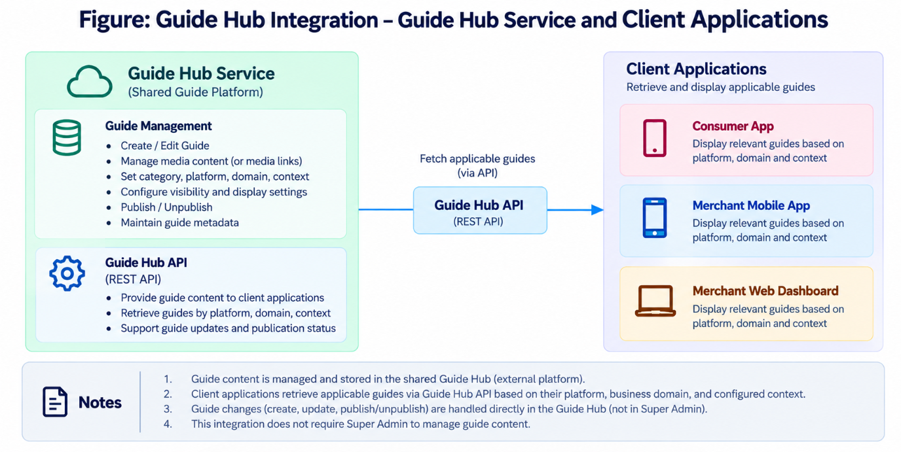

# M21-帮助中心管理

> [!info] 原文摘录
> 来源：[[mTrip 超级管理后台知识库/08-原始资料/mTrip_Super_Admin_Portal_PRD_Enterprise_v1.0.19_中文版|mTrip_Super_Admin_Portal_PRD_Enterprise_v1.0.19_中文版]]，第 1518–1600 行（按导入快照计）。
> 下方保留原文措辞、条目、表格和状态，仅调整图片路径。模块笔记包含其原有验收条款；文末验收汇总另行保留。

<!-- PRD_SOURCE_START:1518-1600 -->
### 模块 21：帮助中心管理

##### 目标

使超级管理员能够维护平台面向公众和合作伙伴的知识库，并监控内容缺口分析。同时使经授权的管理员能够管理和解决商户通过商户端 App 或 Web 门户提交的支持工单。

##### 说明

帮助中心管理模块使超级管理员能够管理平台的知识库、FAQ 内容、分类以及平台级公告。该模块还提供搜索分析与内容洞察，帮助管理员识别知识缺口、改进现有内容，并确保用户能够获取准确且最新的信息。该模块还提供集中的商户支持工单处理能力，包括工单审核、分配、回复、状态与优先级管理、商户沟通以及解决进度跟踪。

##### 核心功能

- 创建、编辑、预览和删除 FAQ 文章（分类、受众、富文本内容、附件或图片、“草稿/已发布/已归档”状态）。
- 创建、编辑、重新排序、切换可见性以及删除 FAQ 分类。
- 创建、编辑和删除平台级公告（受众、优先级、计划开始或结束时间、“草稿/已计划/生效”状态）。
- 查看搜索分析，包括搜索最多的关键词、无结果搜索、浏览量最高的文章以及评分较低的文章，以识别内容改进机会。

##### 商户支持工单管理

- 查看商户通过商户端 App 或 Web 门户提交的支持工单。
- 按工单编号、商户、类别、优先级、状态和日期搜索与筛选工单。
- 查看工单详情，包括商户信息、主题、描述、附件以及会话历史。
- 将工单分配或重新分配给经授权的支持或管理员人员。
- 回复商户支持工单，并在需要时请求补充信息。
- 按支持的生命周期更新工单状态，例如“待处理”“处理中”“等待商户回复”“等待支持回复”“已解决”和“已关闭”。
- 在授权范围内更新工单优先级。
- 在需要进一步操作时允许重新打开已解决的工单。
- 在出现回复、与分配相关的更新或工单状态变更时通知商户。
- 保留工单活动历史和管理操作的审计记录。

**用户指南 / Guide Hub 访问（外部管理）**

- 用户指南内容将直接在集中的 Guide Hub 中创建、配置、发布和维护。超级管理员后台不提供指南管理、发布、定向、排序或指南内容管理功能。
- 以下 Guide Hub 访问信息在本 PRD 中提供给运营和技术团队。技术团队可使用同一环境和 API 文档进行集成测试与验证。

| 项目 | 详情 |
|---|---|
| Guide Hub 网址 | https://guide-hub-production-m6ybjs.laravel.cloud |
| 登录邮箱 | mtrip@guidehub.com |
| 密码 | mTrip@2026! |
| API 文档 | https://guide-hub-production-m6ybjs.laravel.cloud/docs/api#/ |
| 用户指南 | https://guide-hub-production-m6ybjs.laravel.cloud/admin/user-guide |
| 开发者指南 | https://guide-hub-production-m6ybjs.laravel.cloud/admin/integration-guide |

##### 业务规则

- 文章在缺少标题或内容时无法保存。
- 公告在缺少标题、开始日期和结束日期时无法保存。
- 已发布的 FAQ 文章和公告将立即对其目标受众可见，除非配置了计划发布时间。
- 商户通过商户端 App 或 Web 门户提交的支持工单应与超级管理员帮助中心与支持管理模块同步。
- 工单的访问、分配、重新分配、优先级变更、回复、重新打开、解决和关闭应依据 RBAC 进行权限控制。
- 支持的工单状态应包括“待处理”“处理中”“等待商户回复”“等待支持回复”“已解决”和“已关闭”。
- 标记为“已解决”的工单在需要进一步操作或商户跟进时可重新打开。
- 工单回复、状态变更、优先级变更、分配及其他管理操作应记录在工单活动历史和审计日志中。
- 当支持回复或相关工单状态更新需要商户关注时，应通知商户。
- 指南内容管理不在超级管理员后台的范围内，应直接在集中式的 Guide Hub 中执行。
- 指南的定向投放、场景化展示位置、展示顺序、发布状态及其他指南配置，应根据 Guide Hub 系统提供的能力在该系统中维护。
- 受支持的 mTrip 客户端应用应通过 Guide Hub 集成/API 获取适用的已发布指南内容。

图：Guide Hub 集成 —— Guide Hub 服务与客户端应用

**验收标准**

- 超级管理员可创建、编辑、发布和删除常见问题（FAQ）文章。
- 超级管理员可管理常见问题分类及其可见性。
- 超级管理员可创建并安排平台级公告。
- 超级管理员可查看搜索分析，并针对已识别的内容缺口采取行动。
- 超级管理员可查看商户通过商户端 App 或 Web 门户提交的支持工单。
- 授权管理员可按工单编号、商户、分类、优先级、状态和日期搜索与筛选商户支持工单。
- 授权管理员可查看工单详情，包括商户信息、主题、描述、附件和会话历史。
- 授权管理员可将工单指派或重新指派给支持/管理员坐席。
- 授权管理员可回复商户工单，并在需要时索取补充信息。
- 授权管理员可更新工单优先级，并推动工单沿受支持的工单状态生命周期流转。
- 授权管理员可根据权限和工单状态解决、关闭和重新打开工单。
- 对适用的支持回复和工单状态更新，系统应向商户侧触发通知。
- 工单活动历史和相关的管理操作应予保留，以便审计和追溯。
- 超级管理员后台不提供指南管理或指南发布/配置控制功能；经授权的运营用户在 Guide Hub 中直接管理指南内容。
- 本 PRD 中提供 Guide Hub 的访问信息和技术文档参考，供运营与技术团队使用。
- 技术团队可使用所提供的 Guide Hub 环境和 API/开发者文档来测试和验证客户端集成。
- 受支持的客户端应用应通过约定的集成/API 从 Guide Hub 获取适用的指南内容。

<!-- PRD_SOURCE_END -->

---

返回：[[mTrip 超级管理后台知识库/00-知识库首页|00-知识库首页]] · [[mTrip 超级管理后台知识库/09-导入记录/原文章节映射|原文章节映射]] · [[00-mTrip 产品知识库|产品知识库总入口]]

## 关联阅读

- [[mTrip 超级管理后台知识库/04-验收标准/AC21-帮助中心管理|AC21-帮助中心管理]]
- [[mTrip 超级管理后台知识库/07-专题索引/用户支持、权限与审计|用户支持、权限与审计]]
- [[mTrip 超级管理后台知识库/06-规划与治理/待澄清事项|待澄清事项]]
