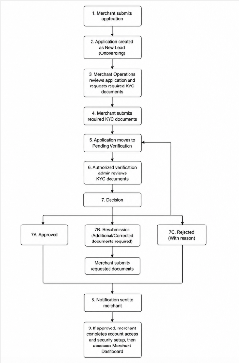
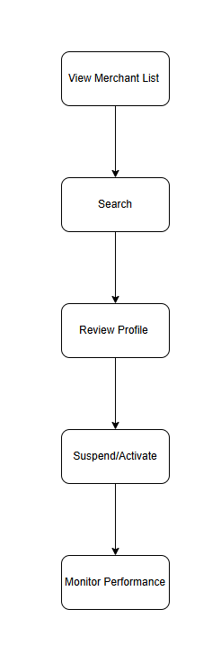
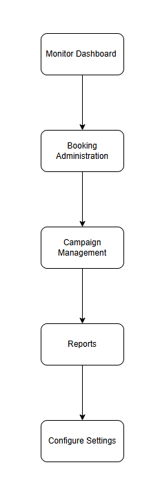
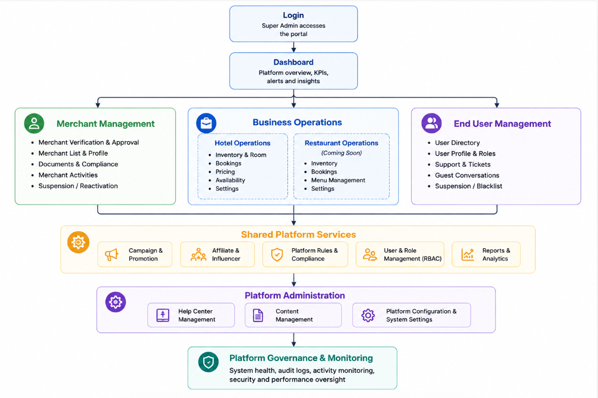
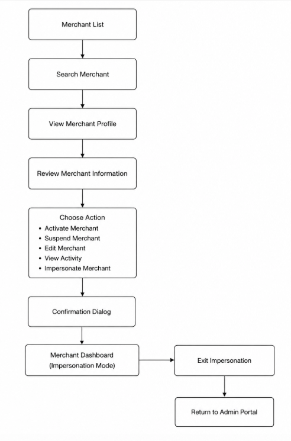
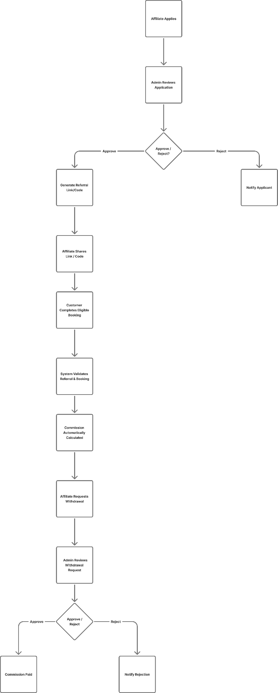
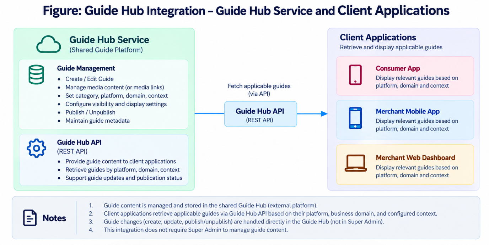

# 术语与图示索引

> [!note] 整理索引
> 本页是阅读导航与整理说明，不新增需求或实现结论。正式业务依据请使用原文链接；原文分歧见[[mTrip 超级管理后台知识库/06-规划与治理/待澄清事项|待澄清事项]]。

## 术语导航

以下释义为阅读辅助，业务规则以对应原文为准。

| 术语 | 阅读辅助说明 | 原文入口 |
| --- | --- | --- |
| KYC | 商户企业与身份核验 | [[mTrip 超级管理后台知识库/03-功能模块/M11-商户认证与审批\|M11-商户认证与审批]] |
| OTP / 2FA | 一次性验证码 / 双因素认证 | [[mTrip 超级管理后台知识库/03-功能模块/M11-商户认证与审批\|M11-商户认证与审批]] |
| RBAC / MFA | 基于角色的访问控制 / 多因素认证 | [[mTrip 超级管理后台知识库/03-功能模块/M16-用户与角色管理\|M16-用户与角色管理]] |
| GBV | 总预订额 | [[mTrip 超级管理后台知识库/03-功能模块/M24-财务管理\|M24-财务管理]] |
| MMK | 原文货币钱包记账单位 | [[mTrip 超级管理后台知识库/03-功能模块/M25-钱包管理\|M25-钱包管理]] |
| PMS / Channel Manager | 物业管理系统 / 渠道管理系统 | [[mTrip 超级管理后台知识库/03-功能模块/M18-平台配置与管理\|M18-平台配置与管理]] |
| LBS | 基于位置的服务 | [[mTrip 超级管理后台知识库/03-功能模块/M18-平台配置与管理\|M18-平台配置与管理]] |
| CTR / ROI | 点击率 / 投资回报率 | [[mTrip 超级管理后台知识库/03-功能模块/M14-活动与促销管理\|M14-活动与促销管理]] |

## 原始图示

7 张图均逐字节复制，图注沿用或概括原文上下文，图片内容未经修改。

### 图 01 · 商户认证与审批工作流

来源：[[mTrip 超级管理后台知识库/02-业务流程/场景1-商户认证与审批|场景1-商户认证与审批]]，原文第 118 行。

### 图 02 · 商户运营管理工作流

来源：[[mTrip 超级管理后台知识库/02-业务流程/场景2-商户运营管理|场景2-商户运营管理]]，原文第 145 行。

### 图 03 · 平台管理工作流

来源：[[mTrip 超级管理后台知识库/02-业务流程/场景3-平台管理|场景3-平台管理]]，原文第 171 行。

### 图 04 · 超级管理后台高层工作流

来源：[[mTrip 超级管理后台知识库/02-业务流程/场景4-终端用户账户支持与高层工作流|场景4-终端用户账户支持与高层工作流]]，原文第 196 行。

### 图 05 · 商户模拟登录示意图

来源：[[mTrip 超级管理后台知识库/03-功能模块/M12-商户管理|M12-商户管理]]，原文第 617 行。

### 图 06 · 联盟与达人高层工作流

来源：[[mTrip 超级管理后台知识库/03-功能模块/M15-联盟与达人管理|M15-联盟与达人管理]]，原文第 919 行。

### 图 07 · 指南中心服务与客户端应用集成

来源：[[mTrip 超级管理后台知识库/03-功能模块/M21-帮助中心管理|M21-帮助中心管理]]，原文第 1551 行。

---

返回：[[mTrip 超级管理后台知识库/00-知识库首页|00-知识库首页]] · [[00-mTrip 产品知识库|产品知识库总入口]]
