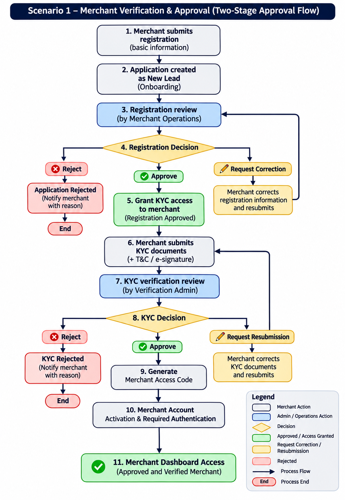
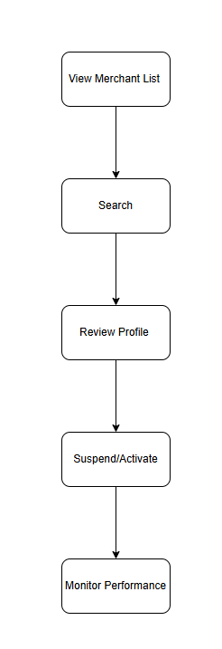
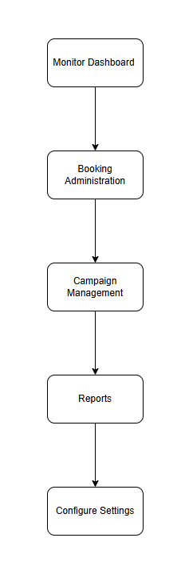
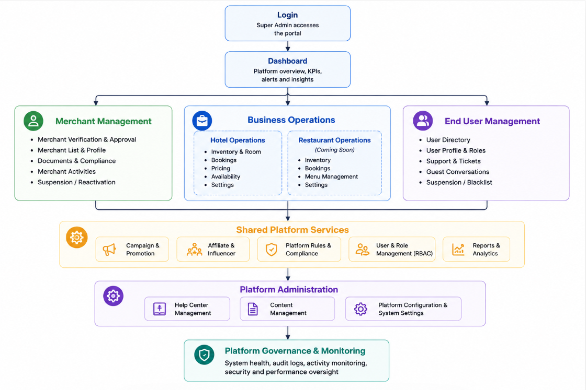
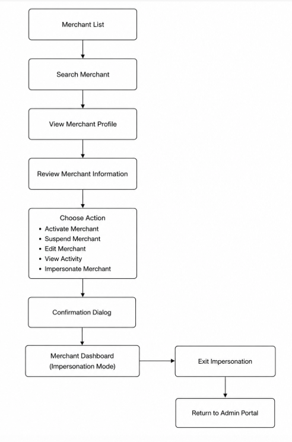
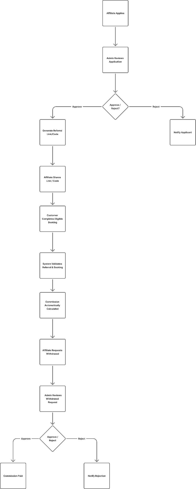
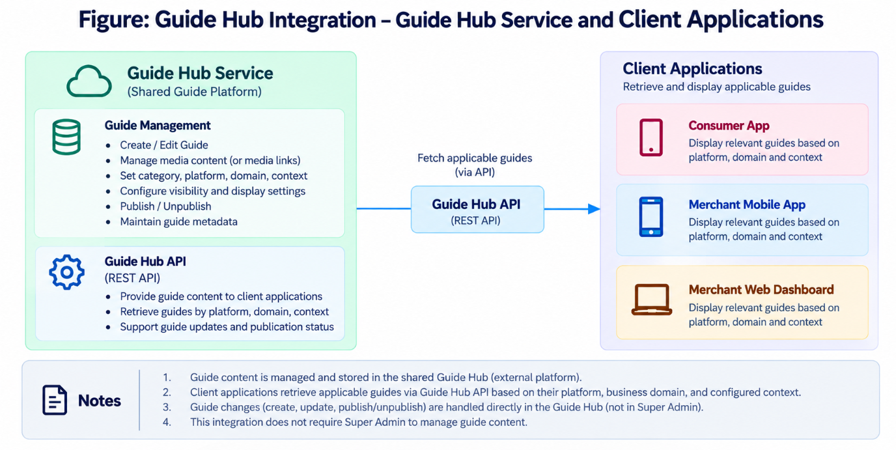

# mTrip 产品需求文档（PRD）

## 超级管理员 - v1.0.20

作者：Ms. May Shoon Lett Zaw

团队：产品团队

| 产品经理 | Mr. Aung Khant Kyaw |
|---|---|
| 工程负责人/团队负责人 | Mr. Li Sir |
| 设计师 | Mr. Chit Ko Ko |
| 审批人/签核 |  |

PM 冲刺规划：mTrip 冲刺计划

PRD 状态：

### 目录

（原文此处为 Word 自动生成的目录域，docx 中未保存目录条目，故此处仅有标题。）

### 概述

mTrip 超级管理员后台是负责治理 mTrip 生态的集中式管理平台。平台管理员可通过该后台验证商户、管理商户账户、监管预订运营、配置活动、管理联盟与达人推广计划、管理用户与角色、监控报告与分析，并维护全局平台设置。该后台是连接商户端 App 与用户端 App 的运营控制中心，确保跨多个业务域的平台治理、安全、运营效率与可扩展的业务增长。

超级管理员后台采用模块化、可扩展的架构设计。酒店商户运营是初始的业务域重点，同时平台通过共享平台能力与业务专属运营模块，可承载餐厅、航空公司、租车、景点及未来其他旅行相关服务等更多业务域。

平台按业务专属运营模块（如商户管理、业务运营、终端用户管理）与共享平台服务（如活动管理、联盟管理、报告与分析、平台配置）进行组织。该模块化架构使平台能够在多个业务域间扩展，同时保持一致治理与运营效率。

### 问题

随着商户数量与用户预订量持续增长，人工管理效率低下且难以扩展。平台管理员需要一个集中式系统，以标准化商户验证、运营监控、预订管理、活动管理、用户管理、报告与系统配置。若无专门的管理后台，运营效率、数据一致性与平台治理将受到显著影响。随着平台扩展以支持多个业务域，集中式管理对于维持一致的治理、运营可见性与平台可扩展性愈发关键。

### 目标

- 提供集中式管理平台，支撑平台运营。
- 通过标准化的验证流程提升商户入驻效率。
- 通过基于角色的访问控制（RBAC）实现安全的平台治理。
- 通过工作台与报告提升运营可见性。
- 构建可扩展的平台，支持未来商户类别。
- 在后端与 API 集成开始前，端到端验证完整的超级管理员信息架构与交互设计。

### 约束条件

#### 约束 1：Phase 1 MVP 范围

超级管理员后台将作为 Phase 1 MVP 的一部分开发，初始业务域重点为酒店商户运营。

本 PRD 中定义的超级管理员后台需求，代表为支撑 mTrip 运营而实施的平台管理能力，包括商户验证与管理、预订管理、活动与促销管理、联盟与达人管理、终端用户管理、用户与角色管理、财务管理、报告与分析、平台配置，以及本文档中定义的其他管理功能。

平台通过共享平台服务与集中式管理能力，设计为支持多个业务域。

酒店将是 Phase 1 支持的初始商户域。其他业务域可复用相同的共享平台能力，同时引入各自域特定的运营需求。

#### 约束 2：跨平台依赖

超级管理员后台依赖与商户端 App、用户端 App、认证服务、通知服务以及未来的支付与结算服务的无缝集成。通过管理后台所做的变更必须在所有已连接的平台间同步，以确保数据一致性与运营准确性。

#### 约束 3：安全、合规与访问控制

超级管理员后台管理敏感业务数据与平台级配置。所有管理功能均应遵循基于角色的访问控制（RBAC）、审计日志与安全策略，以防止未授权访问、确保可追责性并保护平台完整性。对模块、功能与管理操作的访问应根据所分配的用户角色与权限进行控制。系统还应维护关键管理活动的审计日志，以支持监控、可追溯性、合规与安全调查。

#### 核心用户画像

| 用户画像 | 说明 |
|---|---|
| 核心用户画像 – 超级管理员 | 超级管理员是 mTrip 平台的主要负责人，拥有全部管理功能的完整访问权限。该角色负责商户验证与审批、商户管理、平台规则与合规、业务运营、活动与促销管理、联盟与达人管理、终端用户管理、报告与分析、帮助中心与内容管理，以及平台配置。超级管理员可创建内部管理员账户，并通过基于角色的访问控制（RBAC）分配权限。 |

#### 用户旅程与平台流程

超级管理员后台管理平台的完整运营生命周期，从商户验证开始，贯穿商户管理、预订管理、活动运营、报告与系统配置。

### 场景 1 – 商户验证与审批

##### 目标

验证商户的基础注册信息；在注册审批通过后，验证其提交的 KYC 文档，并在最终审批与账户激活后授予商户平台访问权限。

**流程**

##### 流程

- 商户提交申请，包含所需的业务信息与联系信息。
- 申请在“入驻”下创建为“新线索”。
- 商户运营审核基础注册信息与业务信息。授权管理员批准注册、要求更正或驳回。仅在注册审批通过后才授予 KYC 访问权限。
- 注册审批通过并授予 KYC 访问权限后，商户提交所需的 KYC 文档、接受条款与条件，并完成电子签名。
- 申请进入“待验证”状态。
- 授权的验证管理员审核所提交的文档。
- 最终 KYC 申请为“已通过”“已驳回”或退回“需重新提交”。KYC 重新提交返回文档验证环节；注册信息更正返回注册审核环节。
- 系统向商户通知验证结果。
- 如需更正或重新提交，商户仅更新所要求的注册信息或 KYC 文档，并重新提交至相应的审核阶段。
- 审批通过后，商户需完成所需的账户访问与安全设置，方可访问商户工作台。

**预期结果**

仅已完成所需账户访问与安全设置、且通过审批与验证的商户，方可访问商户工作台。

### 场景 2 – 商户运营管理

##### 目标

在入驻完成后管理商户账户。

**流程**

##### 流程

- 管理员查看商户目录并打开商户档案。
- 管理员查看商户文档、监控商户活动，并查看记录在案的违规或警告。
- 管理员可暂停商户、发出警告，或代登录商户账户以调查或解决所报告的问题。
- 管理员还可使用内置通知编辑器向商户发送直接通知（例如关于政策更新或已解决的问题）。
- 所有操作均被记录，以便后续通过“商户活动”与“合规历史”查看。

**预期结果**

管理员维护商户质量与合规性。

### 场景 3 – 平台管理

##### 目标

通过集中式管理控制管理与监控平台级运营。

**流程**

**预期结果**

平台运营保持安全、高效管理、可监控且可扩展。

### 场景 4 – 用户账户支持

##### 目标

使管理员能够管理客户账户、解决支持问题，并在必要时执行平台政策。

##### 流程

- 管理员通过“终端用户目录”搜索客户，或从提交的支持工单进入该账户。
- 管理员查看客户的个人资料、预订历史、交易历史、通知历史与账户活动。
- 管理员调查所报告的问题并执行相应操作，例如解决支持工单、批准退款（在授权范围内）、发送通知、暂停账户、延长暂停期，或因违反政策将账户加入黑名单。
- 管理员后续可重新激活已暂停的账户或将用户从黑名单中移除，按平台政策将账户恢复为未激活或激活状态。

##### 预期结果

客户问题得到高效解决，同时维护平台安全、防止滥用并确保符合平台政策。

**超级管理员高阶流程**

共享平台服务支撑所有业务域，而平台管理则在生态范围内提供集中式配置与治理。

### 模块 11：商户验证与审批

##### 目标

使超级管理员与授权运营用户能够在授予 mTrip 商户平台访问权限之前，管理商户入驻、KYC 验证、重新提交、审批与驳回。

##### 说明

商户验证与审批分为五个申请队列：入驻、待验证、重新提交、已通过、已驳回。

入驻阶段管理正式 KYC 验证前的新注册商户。商户运营可联系商户、审核公司与注册业务信息，并执行运营评估。授权管理员必须批准基础注册后，方可授予 KYC 访问权限。审批通过后，运营可分配 KYC 要求并协助提交。

入驻推进流程为：

新线索 → 已联系 → 注册审核中 → 注册已通过 → 已授予 KYC 访问权限 → KYC 进行中商户可在同一公司/集团下注册一个或多个业务。公司级信息仅维护一次，而每个注册业务各自维护其业务信息，包括业务类型、联系方式、城市及适用的 KYC 要求。

商户仅在获得基础注册审批通过后，方可访问并提交 KYC 文档。申请随后进入“待验证”，由授权管理员审核 KYC 文档并作出最终验证决定。初始注册/KYC 更正不属于审批后的门店资料更新请求。

验证期间，管理员可批准或驳回单份文档。根据审核结果，申请可为“已通过”“已驳回”，或退回商户“需重新提交”。重新提交的文档在作出最终决定前将再次审核。

所有重要的入驻与验证活动均记录在申请时间线中。

最终审批通过后，系统生成唯一的六位商户访问码。酒店访问码使用 HXXXXX，租车访问码使用 CXXXXX。该访问码通过所选通知渠道（邮件、短信和/或站内通知）发送，并始终作为一种可用的认证方式保留。回访商户也可改用注册邮箱配合邮件一次性验证码（OTP），或注册手机号配合短信一次性验证码（OTP）。若选择其他已批准的登录方式，则无需使用商户访问码。

##### 核心功能

- 查看按“入驻”“待验证”“重新提交”“已通过”“已驳回”分组的商户申请，并显示汇总数量。
- 使用支持的筛选条件搜索与筛选商户申请。
- 查看公司级信息以及该商户下注册的所有业务。
- 查看每个注册业务的业务类型、城市、联系方式与 KYC 状态。
- 将商户申请分配给商户运营。
- 跟踪入驻阶段：新线索、已联系、注册审核中、注册已通过、已授予 KYC 访问权限、KYC 进行中。
- 在入驻过程中记录并更新商户的运营评估。
- 根据所选业务与业务类型选择并分配 KYC 验证要求。
- 支持在发送实名认证（KYC）请求前，预览并管理适用的 KYC 要求。
- 仅在授权管理员审批通过基础注册后，方可发送 KYC 权限开通/请求。
- 支持商户运营团队在需要时协助商户提交 KYC 资料。
- 当商户运营团队决定不再推进该商户时，支持在入驻过程中驳回/关闭线索。
- 授权管理员可在开通 KYC 权限前审批通过基础注册、填写原因要求更正，或驳回注册。
- 记录授权内部用户可见的内部备注。
- 查看每个商户申请的完整活动时间线。
- 在“待核验”中审核已提交的 KYC 文件。
- 查看单份已提交文件。
- 审批通过或驳回单份 KYC 文件。
- 在允许作出最终核验决定前，跟踪已审核文件的数量。
- 当已提交文件需要更正或替换时，发起重新提交请求。
- 向商户提供要求重新提交的原因/备注。
- 跟踪重新提交进度，并识别哪些文件已重新提交。
- 结合此前的核验结果审核新重新提交的文件。
- 核验完成后，审批通过或驳回商户申请。
- 以只读方式查看“已通过”申请、已通过文件、核验历史及商户访问信息（如适用）。
- 查看“已驳回”申请、受影响文件、驳回原因/备注及核验历史。
- 所有商户申请队列均支持分页。
- 商户审批通过后生成唯一的六位商户访问码，酒店商户使用 HXXXXX 格式，租车商户使用 CXXXXX 格式。
- 根据用户权限查看、复制、重新发送和重新生成商户访问码。
- 通过支持的渠道发送商户访问码：邮件、短信和 App 内通知。
- 支持通过已批准的登录方式完成首次账号激活和完整身份验证；当选择“商户访问码 + Google Authenticator”时，须先绑定 Google Authenticator，方可访问商户工作台。

##### 业务规则

- 商户申请须先进入“入驻”队列，之后才能进入正式的 KYC 核验。
- 有效的入驻跟踪阶段包括“新线索”“已联系”“注册审核中”“注册已通过”“KYC 权限已开通”和“KYC 进行中”。注册审批通过是开通 KYC 权限的前置必要条件。
- 在执行入驻运营操作前，必须先分配商户运营团队。
- 一个商户可在同一公司/集团下注册一个或多个业务实体。
- 公司级信息适用于该商户/公司，而业务专属信息和 KYC 要求按每个已注册业务实体分别维护。
- 每个已注册业务实体可具有不同的业务类型、联系人、手机号、邮箱、城市和 KYC 要求集合。
- KYC 要求须根据所选业务及适用的核验模板确定。
- 商户运营团队可协助商户提交 KYC 资料，但除非通过基于角色的访问控制（RBAC）单独授权，否则不得审批通过或驳回 KYC 文件。
- 若不应推进至 KYC 核验，商户运营团队可在入驻过程中驳回/关闭线索。相关操作及原因须记录在活动历史中。
- 基础注册审批与 KYC 最终审批是两个独立的决定。注册被驳回后不能进入 KYC；要求更正的申请则退回注册审核。
- 仅基础注册已审批通过的商户可获得 KYC 权限并提交 KYC 文件。必填 KYC 文件和电子签名提交后，申请即转入“待核验”。
- 必须先完成单份文件审核，才能完成最终核验决定。
- 仅授权的核验角色可执行文件级核验操作。
- 可识别的文件状态包括“待处理”“已通过”和“已驳回”。
- “请求重新提交”须指明受影响的文件，并包含面向商户的原因/备注。
- 重新提交申请将保留在“重新提交”队列中，直至所需更正文件提交并审核完成。
- 此前已通过的文件无需重新提交，除非另有明确要求。
- 仅当所有必填 KYC 要求均已成功核验时，申请方可审批通过。
- “最终审批通过商户”“驳回申请”和“请求重新提交”操作均受权限控制。
- 已驳回申请须保留驳回原因、受影响文件、审核人、日期及核验历史。
- 已通过申请及其核验记录须保留，以供审计和复核。
- 已通过申请不得直接退回“待核验”，除非发起新的重新核验流程。审批通过后的门店/资料更新请求不得作为商户初始“待核验”的一部分进行审核。
- 所有入驻阶段变更、分配、KYC 请求、文件审核、重新提交请求、审批通过和驳回均须记录在活动/审计历史中。
- 商户访问码仅在商户最终审批通过后生成。
- 每个商户访问码在全平台范围内须唯一。
- 商户访问码须恰好包含六位大写字母和数字，且须唯一，输入时不区分大小写。
- 首字符标识商户类型：酒店为 H（HXXXXX），租车为 C（CXXXXX）。其余五位可包含 A-Z 和 0-9。
- 商户访问码本身不授予访问权限；每种登录方式均须完成其指定的第二因素或一次性验证码（OTP）校验。
- 商户访问码的生成、重新生成和重新发送操作均受权限控制，且须记录在审计日志中。
- 重新生成商户访问码将使原访问码失效。
- “商户访问码 + Google Authenticator”仍为可用登录方式。当商户选择邮箱 OTP 或短信 OTP 登录时，商户访问码为可选项。
- 首次账号激活时，商户须使用已批准的登录方式及其所需的 OTP 完成一次成功的完整身份验证。仅当商户选择“商户访问码 + Google Authenticator”时，才须绑定 Google Authenticator。
- 仅在成功完成双因素认证（2FA）绑定和身份验证后，方可访问商户工作台。

##### 验收标准

- 超级管理员可查看“入驻”“待核验”“重新提交”“已通过”和“已驳回”队列中的申请。
- 授权用户可搜索和筛选商户申请。
- 超级管理员可查看公司级信息及该商户下注册的所有业务实体。
- 每个已注册业务实体显示其适用的业务类型、城市、业务专属信息和 KYC 状态。
- 一个商户可在同一公司/集团下拥有多个已注册业务实体。
- 超级管理员可为入驻申请分配商户运营团队。
- 商户运营团队可跟踪“新线索”“已联系”“注册审核中”“注册已通过”“KYC 权限已开通”和“KYC 进行中”；开通 KYC 权限须有授权管理员作出的注册审批通过决定。
- 商户运营团队可记录运营评估，并为业务实体选择适用的 KYC 要求。
- KYC 要求可根据业务类型而有所不同。
- 仅在基础注册经授权管理员审批通过后，商户运营团队方可发送 KYC 权限开通/请求。
- 商户运营团队可协助商户提交 KYC 资料，但除非单独授权，否则不具备文件审批通过/驳回权限。
- 商户运营团队可在入驻过程中驳回/关闭线索，并记录原因。
- 授权管理员可记录注册审批通过、更正请求和驳回，包括决定历史；在注册审批通过前，KYC 权限处于锁定状态。
- 仅注册已审批通过的商户提交的 KYC 申请会显示在“待核验”中。初始 KYC 审核不得显示审批通过后的门店资料更新请求。
- 授权管理员可查看、审批通过或驳回单份已提交文件。
- 系统跟踪最终核验前的文件审核进度。
- 授权管理员可填写原因/备注发起重新提交请求。
- 商户可提交更正/替换后的文件。
- 重新提交的申请显示在“重新提交”队列中，并展示重新提交进度。
- 授权管理员可审核重新提交的文件并作出后续核验决定。
- 授权管理员可审批通过或驳回最终的商户申请。
- 已通过申请显示已通过文件和完整的核验历史。
- 已驳回申请显示受影响文件、驳回信息和完整的核验历史。
- 每个申请均可查看完整的入驻与核验活动时间线。
- 所有重要核验操作均予以记录，以供审计。
- 商户审批通过后生成唯一的六位商户访问码。酒店代码使用 HXXXXX，租车代码使用 CXXXXX。
- 商户访问码在商户审批通过后生成。
- 授权管理员可根据权限查看、复制、重新发送或重新生成商户访问码。
- 商户访问码的发送支持邮件、短信和 App 内通知。
- 审批通过后，商户可使用商户访问码开始身份验证。
- 首次账号激活时，商户须使用已批准的登录方式及其所需的 OTP 完成一次成功的完整身份验证。仅当商户选择“商户访问码 + Google Authenticator”时，才须绑定 Google Authenticator。
- 仅在账号成功激活并使用所选已批准的登录方式完成完整身份验证后，方可访问商户工作台。
- 超级管理员可查看商户已配置的登录方式及其“已启用”或“已停用”状态。
- 授权超级管理员可针对单个商户启用或停用邮箱和短信登录方式，并记录原因。
- 停用某登录方式将强制退出所有选定的活跃商户会话，并使待处理的扫码登录请求失效。
- 授权超级管理员可针对手机丢失或疑似欺诈情形，撤销受信任移动设备和生物识别访问权限。
- 超级管理员可查看登录历史、活跃会话、受信任设备和安全操作审计记录。

### 模块 12：商户管理

##### 目标

使超级管理员能够管理商户审批通过后的完整生命周期。本模块为管理员提供以下能力：监控商户账号、维护商户信息、管理账号状态、支持商户运营、管理市场曝光与排名，以及确保符合平台政策。

##### 说明

商户通过“商户核验与审批”模块成功审批后，即成为 mTrip 平台上的活跃合作伙伴。“商户管理”模块使超级管理员能够在商户整个生命周期内管理商户账号，包括资料管理、账号状态、运营监控、商户文件、安全管理、市场曝光与排名以及商户支持。

##### 核心功能

##### 商户目录

- 查看所有已注册商户。
- 按名称、ID、电话号码、邮箱或商家名称搜索商户。
- 按状态、类别、地区或注册日期筛选商户。
- 对商户记录排序。
- “全部商户”为商户账号目录：无论关联门店/业务实体数量多少，每个已注册商户仅显示一行。
- 将已注册业务实体名称显示为主要的商户名称。各酒店/门店名称显示在“商户详情 > 关联门店/业务实体”中。
- 城市、星级和类别属于各单个门店，应在“关联门店”中显示，不得在“全部商户”中作为单一的商户级数值显示。
- “商户详情”应支持授权管理员查看所有关联门店及其各自的运营状态。

##### 商户资料

- 查看商户资料信息、业务详情、实名认证（KYC）状态、佣金方案、联系方式、银行信息及关联业务实体。

**商务与支付设置（商户级配置）**

- 在“商户管理 → 全部商户 → 商户资料”中展示“商务与支付设置”区域，并提供“编辑配置”操作；账户安全与月度表现仍作为独立的现有区域保留。
- 在商户商务设置摘要中展示佣金方案、佣金比例、交易手续费比例、“到店支付”启用/停用状态、商户未入住（No-Show）费用启用/停用状态，以及商户房费预收比例（0–30%）。
- 获得授权的超级管理员可配置或更新每个商户的佣金方案、商户专属佣金比例（含自定义覆盖值）及交易手续费比例。交易手续费按 mTrip 佣金金额计算，不按客房总价计算。
- 可按商户将“到店支付”配置为启用或停用。仅已启用的商户可向用户提供“到店支付”支付选项；新预订适用预订确认时生效的配置。
- 移除佣金分成控制项。对于已启用“到店支付”的商户，配置商户是否收取未入住（No-Show）费用。仅当启用未入住费用时，商户才可选择最高为适用房价 30% 的房费预收比例。mTrip 佣金不与商户分成。
- 佣金配置应同时支持商户级默认佣金比例，以及在需要时按单个门店设置佣金比例。
- 显式配置的门店佣金比例仅对该门店覆盖商户默认值；未设置覆盖的门店使用商户默认值。应展示适用比例及配置范围。
- 对商户或门店佣金配置的变更应受权限控制、设定生效日期、记录变更原因，并记入配置历史；此前已确认的预订保留其确认时锁定的商务条款。
- 通知对象应同时支持整个商户账户和选定的单个关联门店/业务。发送前应展示目标范围，并保留发送与审计历史。
- 若已启用“到店支付”且商户不收取未入住费用，则仅预收 mTrip 佣金，不预收商户房费。若适用商户未入住费用，则将 mTrip 佣金加上所配置的商户房费比例（最高 30%）作为面向用户的一笔预付定金收取；应保留内部费用构成明细。
- 展示计算预览，包括房价、mTrip 佣金、交易手续费（适用时按佣金计算）、商户未入住预收（房价的 0–30%）、用户预付定金合计以及到店应付余额。严禁以 mTrip 佣金为基数计算商户比例。
- 变更须填写生效日期/时间和原因；保留带版本的值、编辑人及时间戳。已确认的现有预订保留预订确认时锁定的“到店支付”、未入住及预收条款。
- 允许获得授权的用户查看配置历史，并通过基于角色的访问控制（RBAC）防止未授权变更。不得将商户增值税/税费后台默认值作为超级管理员可编辑的控制项对外提供。
- 代登录（impersonate）商户账户，用于问题排查、调查和运营支持。
- 暂停有效的商户账户（阻止新预订；已确认的现有预订不受影响）。
- 向商户发送直接通知，可从消息模板库中选择模板、选择发送渠道（推送、站内信、邮件或短信），并可选关联到某个预订、促销或 App 内页面。

**商户文档管理**

- 查看商户文档。
- 下载已上传的文档。
- 查看文档审核历史。
- 更换已过期的文档。
- 审核佐证材料。

##### 商户状态管理

- 激活商户账户、门店级暂停与商户级升级处理
- 获得授权的超级管理员可暂停或恢复单个门店，而无需暂停其商户账户或其他关联门店。
- 获得授权的超级管理员可整体暂停商户账户，暂停将应用于所有关联门店，无需对每个门店单独执行暂停操作。
- 单个门店存在疑似欺诈或严重违规时，可在门店级标记并升级至商户级调查；仅凭标记不得自动暂停整个商户。
- 对每次门店或商户暂停，应记录范围、原因、责任管理员、生效日期/时间及状态历史。门店级暂停阻止该门店的新预订；商户级暂停阻止所有关联门店的新预订。已确认的现有预订在现有暂停规则下仍不受影响。
- 商户级身份验证与安全控制仍归属于商户账户；门店级运营控制仍归属于各门店。
- 暂停商户账户。
- 恢复已暂停的商户账户。
- 查看商户状态历史。
- 将商户账户加入黑名单。
- 将商户移出黑名单。
- 记录商户暂停原因。
- 配置临时暂停期限。
- 恢复已列入黑名单的商户账户。

**商户账户注销申请审批**

- 审核商户移动端 App 提交的商户账户注销申请。
- 查看注销申请详情，包括商户身份、业务/门店信息、申请日期/时间、提交原因及当前申请状态。
- 注销申请状态显示为“待审批”“已通过”或“已驳回”。
- 仅获得授权的超级管理员可“通过”或“驳回”待处理的商户账户注销申请。
- 通过或驳回注销申请时，须填写管理员原因/备注。
- 若通过，应停用商户访问权限、终止活跃会话、阻止后续商户 App/Web 门户登录，并按已批准的平台数据留存、法律、财务、预订、结算、审计及合规规则处理账户注销。
- 因法律、财务、预订、结算、审计、争议或合规目的必须留存的记录，不得仅因商户账户注销而被删除。
- 若驳回，除已适用其他账户状态限制外，应保持商户账户有效，并将驳回结果通知商户。
- 记录完整的注销申请与决策历史，包括申请人、审批人/审核人、决策、原因/备注及日期/时间。
- 注销申请通过或驳回时，应通过支持的渠道通知商户。

##### 商户活动

- 查看商户近期活动。
- 监控登录历史。
- 监控账户变更。
- 审核商户运营活动。
- 查看审计日志。
- 查看合规历史。
- 查看警告历史。
- 查看暂停历史。
- 查看管理员操作日志。
- 导出活动记录。

##### 餐厅目录——人工核验与数据覆盖

**说明**

餐厅记录可能来源于 Google Places/API，用于发现与展示。由于第三方来源数据可能过时或不准确，当 mTrip 收到可靠的运营反馈，表明餐厅的真实状态或信息与 Google 来源记录不一致时，获得授权的超级管理员应能够对该餐厅进行人工核验。

**核心功能**

- 查看餐厅记录及其来源信息，包括可获取的 Google Place ID、当前 mTrip 核验状态、上架状态及最近一次核验详情。
- 按餐厅名称、城市/位置、核验状态、上架状态及来源搜索和筛选餐厅记录。
- 当运营或管理层等获得授权的内部团队报告问题时，将餐厅标记为需要人工核验。
- 允许获得授权的超级管理员记录人工核验结果：正常营业（Verified Active）、未找到（Not Found）、永久停业（Permanently Closed）、已迁址（Moved）或信息有误（Incorrect Information）。
- 当核验后的真实信息与 Google 来源记录不一致时，允许获得授权的超级管理员更新 mTrip 自有餐厅信息或应用 mTrip 覆盖值。
- 须填写核验原因/备注，并记录核验来源、核验人及核验日期/时间。
- 在可获取时，允许记录佐证材料或内部参考信息。
- 当餐厅被核验为“未找到”或“永久停业”时，允许隐藏/停用该 mTrip 上架记录，而不删除或覆盖原始 Google 来源记录。
- 将原始第三方来源值同 mTrip 自有核验状态与人工覆盖值分开保留，以便追溯。
- 在审计日志中保留完整的核验与人工更新历史。

**业务规则**

- Google/第三方来源数据应始终可识别为来源数据，不得被人工核验操作直接覆盖。
- 人工核验与 mTrip 数据覆盖受权限控制，仅获得授权的超级管理员/运营角色可用。
- 人工核验操作必须包含核验结果与原因/备注。
- 核验状态与上架可见性为两个独立字段；但“核验为未找到”或“永久停业”的结果可按平台配置规则触发 mTrip 上架记录变为“停用/隐藏”。
- 任何 mTrip 自有的人工更正或覆盖都必须记录原值、新值、管理员、原因及日期/时间。
- 若后续来源数据或实地核验确认发生变化，获得授权的管理员可重新核验该餐厅并更新 mTrip 覆盖值/状态，同时保留此前历史。

##### 商城排序

##### 说明

商城排序功能使获得授权的超级管理员能够管理 mTrip 用户端 App 中向用户展示的符合条件的商户业务/门店及目的地的展示优先级。

商城排序包含两个部分：

- 榜单排序——管理单个商户业务/门店上架记录的展示顺序及精选/置顶状态。
- 热门目的地——管理在用户端 App 中向用户优先或重点展示的目的地。

##### 榜单排序

- 按业务类型查看符合条件的业务/门店上架记录。
- 在受支持的业务类型之间切换，如酒店和餐厅。
- 按城市和上架状态筛选上架记录。
- 按业务/门店名称搜索。
- 查看每条上架记录的当前排名。
- 通过拖拽手动调整上架记录顺序。
- 置顶或精选选定的上架记录。
- 确保置顶/精选的上架记录排在常规排名记录之前。
- 查看上架记录详情，包括业务/门店信息、商户信息、上架状态、评分、城市及当前商城排名。
- 查看上架记录关联的商户资料。
- 预览排名后的上架记录在用户端 App 中的展示效果。
- 按适用商城范围（如城市和业务类型）独立展示排名。
- 记录最近一次排名更新及负责该变更的管理员。

##### 热门目的地

- 查看已配置用于商城展示的目的地。
- 搜索和筛选目的地。
- 管理目的地的展示优先级/顺序。
- 配置哪些目的地作为热门目的地展示。
- 按预期展示优先级调整目的地顺序。
- 在目的地配置反映到用户端 App 之前进行预览或核实。

##### 代登录商户

使获得授权的超级管理员能够在无需商户登录凭证的情况下临时访问商户账户，用于问题排查、运营支持和问题调查。

**账户安全、登录方式与双因素认证（2FA）管理**

- 查看商户的登录方式配置及状态，涵盖商户访问码 + Google Authenticator、注册邮箱 + 邮件一次性验证码（OTP）、注册手机号 + 短信一次性验证码（OTP）。
- 展示每种登录方式的“启用”或“停用”状态，并在适用时以掩码形式展示关联标识。
- 按管理员权限为选定商户启用或停用单种邮件或短信登录方式。
- 停用或重新启用商户登录方式前，须经管理员确认并填写原因。
- 当停用某项登录方式时，应立即强制退出该商户的所有活跃会话，并使待处理的二维码登录请求失效。
- 对于手机丢失或疑似欺诈的情形，除停用相关登录方式外，还应撤销受影响的受信任移动设备与生物识别信任。
- 商户目录记录代表已注册的商户账户；关联门店保留各自的城市、类目、星级、运营状态与上架属性。
- 佣金比例可在商户层级配置，也可选择性地在单个门店层级配置；门店层级的覆盖配置优先于商户默认值。
- 暂停单个门店不得改变商户账户或其他门店的状态。商户层级暂停适用于所有关联门店。
- 门店欺诈标记应支持升级至商户层级审核。仅授权管理员可决定暂停整个商户账户。
- 应支持按商户与按门店定向发送通知，并分别记录日志。
- 允许授权超级管理员在不考虑登录方式状态的情况下，强制退出商户的所有活跃会话。
- 查看活跃会话、受信任设备、最后登录方式、最后登录时间、设备信息，以及在可获取时查看 IP 信息。
- 仅在商户的访问问题或安全事件完成复核后，才允许授权管理员重新启用。
- 查看商户访问码状态。
- 查看商户双因素认证（2FA）状态（已启用 / 需重置 / 未绑定）。
- 查看已配置的 2FA 方式（Google Authenticator）。
- 查看 2FA 绑定日期与最后重置日期。
- 授权超级管理员可为单个商户重置 2FA。
- 重置 2FA 会使商户现有的验证器设置失效。
- 2FA 重置后，商户须在下次登录时重新绑定 Google Authenticator。
- 重新绑定时，系统会为该商户生成新的 2FA 设置二维码与手动设置密钥。
- 所有 2FA 重置操作均须记录至审计日志。

##### 业务规则

- 仅授权超级管理员可代登录（impersonate）商户。
- 所有代登录会话均须记录至审计日志。
- 当管理员处于代登录模式时，系统须明确提示。
- 管理员可随时退出代登录。
- 商户密码对管理员始终不可见。
- 代登录期间，敏感安全操作仍受限制。
- 每次代登录会话在授予访问权限前均须填写有效原因。
- 2FA 重置仅对授权超级管理员开放。
- 2FA 重置仅作用于所选商户账户，不得影响其他商户账户。
- 每个商户须拥有独立的 2FA 验证器密钥。
- 超级管理员不得展示或手动提供商户的 2FA 二维码或手动设置密钥。
- 重置 2FA 时，现有验证器密钥失效。
- 商户须在下次登录时完成新的 2FA 绑定。
- 重新绑定期间，系统生成新的二维码与手动设置密钥。
- 所有 2FA 重置操作均须记录审计日志，包括管理员、商户、日期/时间与操作。
- 登录方式启用/停用操作受权限控制，且仅作用于所选商户账户。
- 停用某项登录方式会立即撤销商户的所有活跃会话、使待处理的二维码登录请求失效，并阻止通过该方式的任何新认证。
- 对于手机丢失或疑似欺诈的处置，可包括撤销受影响的受信任移动设备与生物识别信任；商户须完成完整身份认证后方可恢复受信任设备访问。
- 除非单独重置，或商户账户被暂停、列入黑名单，“访问码 + Google Authenticator”方式保持可用。
- 每次登录方式状态变更、强制退出、二维码失效、受信任设备撤销与重新启用，均须在审计日志中记录管理员、商户、操作、原状态、新状态、原因、日期/时间、受影响会话/设备与结果。
- 黑名单商户无法访问商户端 App。
- 每次商户状态变更均须填写管理员备注。
- 商户证件历史须保留以供审计。
- 商户账户删除并非立即执行，须经授权超级管理员明确审批。
- 仅“待审批”的删除申请可被批准或驳回。
- 批准或驳回均须填写管理员原因/意见，并记录至审计日志。
- 批准账户删除申请后，须先撤销商户访问权限与活跃会话，再执行删除流程。
- 账户删除须遵循已获批的数据留存、法律、财务、预订、结算、审计、争议与合规要求；受留存要求约束的记录须在规定的留存期内保持可用。
- 被驳回的删除申请不得删除或停用商户账户，除非该账户被单独暂停、列入黑名单或以其他方式受限。
- 系统须通过支持的各类通知渠道，将删除申请的最终决定告知商户。
- 商城排序在适用的业务类型与商城范围内管理。
- 仅符合资格的上架内容可参与商城排序。
- 在适用排序范围内，置顶/推荐上架内容排在常规排序上架内容之前。
- 调整上架内容顺序会更新其在商城的展示优先级。
- 排序变更不得修改商户的底层业务/门店信息。
- 商城排序仅控制展示优先级，不构成商户审批或实名认证（KYC）。
- 上架状态与商城排序须为相互独立的概念；调整排序不会自动启用或停用上架内容。
- 商城排序变更须记录管理员与最后更新日期/时间。
- 用户端 App 预览仅用于核实商城展示效果，不修改商户上架信息。

##### 平台规则与合规

##### 说明

平台规则与合规功能使超级管理员能够制定、监控并执行平台政策，以确保所有商户符合 mTrip 的运营标准、法律法规与平台质量要求。该模块集中呈现商户违规情况、合规历史、警告记录与处置动作，并保留完整的审计轨迹。

##### 核心功能

- 创建并管理平台运营规则。
- 制定商户合规政策。
- 查看商户违规历史。
- 向商户发出警告通知。
- 因违反政策暂停商户。
- 复核后恢复被暂停的商户。
- 跟踪合规状态。
- 搜索与筛选合规记录。
- 为每次处置动作记录管理员备注。
- 在采取合规处置时通知商户。

##### 业务规则

- 每条违规须归属预定义的违规类目。
- 警告历史不可修改或删除。
- 暂停商户须经管理员确认。
- 每次合规处置均须记录至审计日志。
- 商户将自动收到警告、暂停与恢复的通知。
- 平台规则集中维护，除平台配置例外外，适用于所有商户。
- 黑名单商户无法访问商户端 App。
- 每次商户状态变更均须填写管理员备注。
- 合规记录不可永久删除。
- 商户证件历史须保留以供审计。
- 平台规则在发布后立即生效，除非配置了未来的生效日期。
- 合规处置可能因管理员角色不同而需要不同的审批层级。
- 仅授权超级管理员可代登录（impersonate）商户。
- 所有代登录会话均须记录至审计日志。
- 当管理员处于代登录模式时，系统须明确提示。
- “全部商户”每行显示一个已注册商户账户，并以注册商号作为主商户名称；关联门店可在商户详情中查看。
- 城市、星级与类目在“关联门店”中按门店分别展示，而非作为商户层级的单一值。
- 授权管理员可配置商户默认佣金比例及可选的单个门店覆盖配置，并查看适用范围与审计历史。
- 授权管理员可暂停单个门店而不影响其他门店，或一次操作暂停整个商户及其所有关联门店。
- 授权管理员可标记疑似门店欺诈，升级至商户层级审核，并记录最终决定与历史。
- 通知可定向至商户账户或选定门店，并记录目标范围与发送历史。
- 管理员可随时退出代登录。
- 商户密码对管理员始终不可见。
- 代登录期间，敏感安全操作仍受限制。
- 每次代登录会话在授予访问权限前均须填写有效原因。
- 2FA 重置仅对授权超级管理员开放。
- 2FA 重置仅作用于所选商户账户，不得影响其他商户账户。
- 每个商户须拥有独立的 2FA 验证器密钥。
- 超级管理员不得展示或手动提供商户的 2FA 二维码或手动设置密钥。
- 重置 2FA 时，现有验证器密钥失效。
- 商户须在下次登录时完成新的 2FA 绑定。
- 重新绑定期间，系统生成新的二维码与手动设置密钥。
- 所有 2FA 重置操作均须记录审计日志，包括管理员、商户、日期/时间与操作。

**商户代登录示意图**

##### 验收标准

- 超级管理员可查看、搜索、筛选与排序已注册商户。
- 超级管理员可查看商户资料信息，包括业务详情、认证状态、佣金方案、联系方式、银行信息与关联业务实体。
- 授权超级管理员可查看并编辑商户专属的商务设置（佣金方案/比例、交易手续费、到店支付资格与未入住/预收款控制），并记录生效日期、原因、审计历史，遵循基于角色的访问控制（RBAC）。
- 当到店支付处于停用状态，或商户不收取未入住费用时，商户未入住预收款比例为 0%。对于已启用到店支付且商户收取未入住费用的预订，商户客房费预收款最高可设为客房价格的 30%；mTrip 佣金不参与分成。
- 超级管理员可查看、下载、审核并在适用时替换商户证件。
- 商户证件核验与替换历史须保留以供审计。
- 授权超级管理员可按照允许的账户状态流转，对商户账户执行启用、暂停、恢复启用、列入黑名单与恢复操作。
- 变更商户账户状态时须填写原因或管理员备注。
- 超级管理员可配置临时暂停期限并查看商户状态历史。
- 黑名单商户无法访问商户端 App。
- 超级管理员可查看商户活动、登录历史、账户变更、合规历史、警告历史、暂停历史与管理员操作日志。
- 超级管理员可导出商户活动记录。
- 授权超级管理员可查看商户移动端 App 提交的商户账户删除申请。
- 删除申请详情显示商户、提交原因、申请日期/时间与当前状态。
- 授权超级管理员可批准或驳回“待审批”的删除申请，并须填写原因/意见。
- 审批通过后，在账号删除处理之前，商户访问权限被停用、活跃会话被终止，且后续登录被阻止。
- 系统应保留根据已批准的法律、财务、预订、结算、审计、争议、数据留存或合规要求必须保持可用的记录。
- 驳回后，商户账号按其现有账号状态保持可用，且商户会收到驳回结果。
- 所有删除请求的决策及相关管理员操作均记录在审计历史中，并通过支持的渠道通知商户。
- 超级管理员可通过支持的通知渠道向商户发送通知。
- 获得授权的超级管理员在提供有效理由后可代登录（impersonate）商户账号。
- 系统应明确提示管理员当前处于代登录模式（Impersonation Mode）。
- 超级管理员可随时退出代登录会话。
- 代登录期间不暴露商户凭据，受限的安全操作仍不可用。
- 所有商户代登录会话均记录在审计日志中。
- 获得授权的超级管理员可查看商户的商户访问码状态和双因素认证（2FA）状态。
- 获得授权的超级管理员可为单个商户重置双因素认证（2FA）。
- 重置双因素认证（2FA）后，商户现有的身份验证器设置失效，商户需在下次登录时重新完成 Google Authenticator 绑定。
- 所有双因素认证（2FA）重置操作均记录在审计日志中。
- 超级管理员可查看商户已配置的登录方式及其“已启用”或“已禁用”状态。
- 获得授权的超级管理员可为单个商户启用或禁用邮箱和短信登录方式。
- 禁用商户登录方式需经确认并填写管理员理由。
- 禁用登录方式将强制注销该商户的所有活跃会话，并使该商户待处理的二维码登录请求失效。
- 获得授权的超级管理员可在手机丢失或疑似欺诈的情况下，撤销商户的受信任移动设备和生物识别信任。
- 获得授权的超级管理员可强制注销所有活跃会话，且不改变商户的账号状态。
- 所有登录方式、会话撤销、二维码失效及受信任设备相关操作均可在商户活动/审计历史中查看。
- 超级管理员可按支持的业务类型查看平台展示条目。
- 超级管理员可按城市、展示状态等适用条件搜索和筛选平台展示条目。
- 超级管理员可查看每个符合条件的展示条目的当前平台排名。
- 获得授权的超级管理员可在适用的平台范围内手动调整符合条件的展示条目的顺序。
- 获得授权的超级管理员可将符合条件的展示条目配置为推荐或置顶。
- 在适用范围内，推荐或置顶的展示条目显示在常规排名条目之前。
- 超级管理员可查看展示条目详情及关联的商户信息。
- 超级管理员可在用户端 App 上预览排名展示效果。
- 平台排名变更会记录责任管理员及更新日期/时间。
- 超级管理员可查看、搜索、筛选和管理热门目的地。
- 获得授权的超级管理员可配置并调整热门目的地的顺序。
- 平台排名变更不会修改商户认证状态、展示状态或底层商户业务信息。
- 获得授权的超级管理员可查看和搜索来源于 Google/API 的餐厅记录，以及其 mTrip 认证状态和展示状态。
- 获得授权的超级管理员可将餐厅标记为人工认证并记录认证结果。
- 支持的人工认证结果包括“已认证营业”“未找到”“永久停业”“已搬迁”和“信息有误”。
- 完成餐厅人工认证时必须填写理由/备注。
- 当认证后的餐厅信息与第三方来源不一致时，获得授权的超级管理员可应用 mTrip 自有的更正/覆盖。
- 原始的 Google/第三方来源值单独保留，不被 mTrip 人工更正覆盖。
- 认证结果为“未找到”或“永久停业”的餐厅，可按平台规则从 mTrip 面向用户的展示中隐藏/停用。
- 所有餐厅认证和人工更新操作均在审计历史中记录管理员、结果、理由、适用时的变更前/变更后值以及日期/时间。

### 模块 13：预订管理

##### 目标

使超级管理员能够监控、管理并监督 mTrip 平台上的所有预订活动，确保预订准确性、运营效率、问题及时解决和财务对账。

##### 说明

预订管理模块使超级管理员能够在预订全生命周期内监控和管理 mTrip 平台上的预订。该模块提供对预订详情、用户与商户信息、退款申请、结算记录和运营活动的集中可见性，以支持问题调查、财务对账和平台运营。

##### 核心功能

##### 预订管理

- 查看所有预订
- 查看预订详情
- 搜索和筛选预订
- 调查预订问题
- 执行获授权的手动预订操作。
- 查看预订历史
- 监控预订状态
- 查看与预订相关的用户和商户信息

##### 退款管理

- 查看退款申请
- 审核退款理由
- 批准或驳回退款申请
- 记录管理员备注
- 查看退款历史

##### 结算与对账

- 查看商户结算信息
- 查看预订佣金明细
- 审核商户打款计算。
- 查看结算历史
- 到店支付 – 预订管理：展示商户是否选择开通、适用的未入住费用政策、商户预收比例、mTrip 佣金、预付定金及该预订的剩余酒店余额。
- 对于到店支付，佣金按享受适用的连住优惠和优惠券后的最终房费计算。交易手续费仅按佣金计算。未入住预收款在未启用时为零；启用时按所设比例计算，最高不超过 30%。未入住预收款究竟以折后房费还是原始房费为基数，需由产品与财务确认。
- 记录预订专属的取消/未入住政策、适用截止时间、财务构成及退款/保留结果。商户预收款与 mTrip 佣金必须在账目中保持可单独识别。
- 到店支付的取消和未入住结果必须遵循预订确认时记录的政策；仅当商户已启用未入住费用时，才适用商户预收款金额。
- 对于用户延迟取消和已确认的未入住，不予退款。mTrip 保留佣金和交易手续费，商户获得未入住预收款。未支付的酒店余额不再收取。折扣补贴处理待产品与财务确认。
- 不含折扣的简单示例：房费 100,000 MMK；佣金 5% = 5,000；交易手续费为佣金的 2% = 100。未启用未入住费用时，线上支付 = 5,100，到店支付 = 95,000。按 10% 启用未入住费用时，线上支付 = 15,100，到店支付 = 85,000。两种情况下，完成入住的支付总额均为 100,100 MMK。
- 应用预订确认时记录的商户佣金、到店支付设置、未入住政策和房费预收比例；后续变更不得追溯影响已确认的预订。

##### 到店支付 – 支付计算、结算与退款规则

##### 1. 佣金与收款

- mTrip 佣金由商户承担，不向用户额外收取。
- 对于到店支付预订，mTrip 通过线上支付收取佣金、适用的交易手续费和未入住预收款（如已启用）。
- 佣金和未入住预收款从到店应付房费中扣除。
- 交易手续费单独收取，且仅按佣金金额计算。
- 已通过线上收取的佣金不得在商户结算时重复收取。

##### 2. 折扣与支付计算

当连住优惠和优惠券同时适用时，必须先应用连住优惠，再应用适用的优惠券。

各项折扣均须保留其预订时的出资类型（商户出资、平台出资或共担）及出资比例。

**计算规则**

| 项目 | 计算方式 |
|---|---|
| 最终房费 | 原始房费 − 连住优惠 − 优惠券抵扣 |
| 佣金 | 最终房费 × 佣金比例 |
| 交易手续费 | 佣金 × 交易手续费比例 |
| 线上支付金额（Pay Now） | 佣金 + 交易手续费 + 未入住预收款 |
| 到店支付金额（Pay at Hotel） | 最终房费 − 佣金 − 未入住预收款 |
| 客户支付总额 | 最终房费 + 交易手续费 |

##### 3. 未入住（No-Show）政策

- 若未启用未入住政策，则不预先收取任何未入住金额。
- 若已启用，所配置的未入住比例必须在 1% 至 30% 之间。
- 若用户入住，预收金额将抵扣房费并与商户结算。
- 若用户未入住，未入住金额不予退款，并作为保留预订的补偿与商户结算。
- 对于已确认未入住的预订，不得收取剩余的未付酒店余额。
- 对于用户在允许取消期限内取消的情况，退还佣金及任何未入住预收款。交易手续费不予退还。无需向商户支付未入住款项。

系统必须保留预订时适用的未入住政策和比例。

##### 4. 支付计算示例

**示例：含连住优惠和优惠券的预订**

所有金额均以 MMK 计。

| 说明 | 金额 |
|---|---|
| 原始房费 | 100,000 |
| 连住优惠（10%，商户出资） | (10,000) |
| 连住优惠后房费 | 90,000 |
| 固定金额优惠券（平台出资） | (10,000) |
| 最终房费 | 80,000 |
| 佣金（5%） | 4,000 |
| 交易手续费（佣金的 2%） | 80 |
| 未入住预收款（10%） | 8,000 |

**支付明细**

| 说明 | 启用未入住 | 未启用未入住 |
|---|---|---|
| 佣金 | 4,000 | 4,000 |
| 交易手续费 | 80 | 80 |
| 未入住预收款 | 8,000 | 0 |
| 线上支付金额 | 12,080 | 4,080 |
| 到店支付金额 | 68,000 | 76,000 |
| 客户支付总额 | 80,080 | 80,080 |

注：上述比例为示例。本示例以折后最终房费作为未入住计算基数，具体以产品与财务确认为准。

##### 5. 商户结算

平台出资的折扣必须通过结算返还给商户。对于共担折扣，返还须按预订时记录的出资比例执行。

**场景 A：用户成功入住**

基于启用未入住政策的上述示例：

| 说明 | 金额（MMK） |
|---|---|
| 最终房费 | 80,000 |
| 减：佣金 | (4,000) |
| 加：平台出资优惠券返还 | 10,000 |
| 商户应得总额 | 86,000 |
| 酒店直接收取的金额 | 68,000 |
| mTrip 应付商户金额 | 18,000 |

mTrip 应付金额由 8,000 MMK 的未入住预收款和 10,000 MMK 的平台出资优惠券返还构成。

**平台财务明细**

| 说明 | 金额（MMK） |
|---|---|
| 已赚取佣金 | 4,000 |
| 已收取交易手续费 | 80 |
| 平台出资优惠券支出 | (10,000) |
| 其他成本前的净财务结果 | (5,920) |

**场景 B：用户未入住**

| 说明 | 金额（MMK） |
|---|---|
| 原始线上支付金额 | 12,080 |
| 不可退还未入住金额（商户）；佣金 4,000 和交易手续费 80 由 mTrip 保留；退款总额 0 | 8,000 |
| 原始未付酒店余额 | 68,000 |
| 应收取的酒店余额 | 0 |
| 应付商户的未入住补偿 | 8,000 |

未入住金额不得退还给用户。

对于已确认的未入住，mTrip 保留佣金和交易手续费。平台出资和共担折扣的处理仍待产品与财务确认。

##### 6. 取消与退款规则

取消资格遵循预订时记录的政策（用户端 PRD 模块 8 第 8.9.1 节）。对于符合条件的用户取消，退还除交易手续费外的所有线上支付款项。对于延迟取消和未入住，不予退款；mTrip 保留佣金和交易手续费，商户获得未入住预收款。若商户或 mTrip 在入住前取消已确认的预订，则退还全部线上支付款项（含交易手续费），不受取消截止时间限制。此情况下无需向商户支付未入住款项。

部分取消与部分退款不在 MVP 范围内。每次取消均针对一个完整预订编号，包括多酒店行程中的预订。对于到店支付，无论原支付如何拆分，用户选择 mTrip 钱包或外部银行/电子钱包接收全部符合条件的退款。示例：在线支付 30,200 MMK（佣金 10,000；交易手续费 200；未入住预收 20,000），符合条件的情况下用户取消退还 30,000 MMK，商户或 mTrip 取消退还 30,200 MMK，延迟取消或未入住退还 0 MMK。未支付的酒店余额不予收取。退款处理与审计要求参见模块 24。

##### 7. 超级管理员财务记录

超级管理员后台必须为支付、退款与结算对账维护以下信息：

- 原始房费金额与最终折后房费金额。
- 已应用的折扣、出资类型与出资比例。
- 佣金与交易手续费。
- 未入住政策、费率与已收取金额。
- 在线支付与酒店支付的拆分。
- 退款金额、状态与交易流水号。
- 商户应得金额与结算金额。
- 取消或退款前后的原始财务记录与修订后财务记录。

商户银行转账必须由财务人工处理。已完成的转账、交易流水号与结算状态必须记录在超级管理员后台。

##### 8. 待业务确认事项

以下事项需产品与财务在发布前确认：

| 事项 | 需确认内容 |
|---|---|
| 未入住计算 | 以原始房费金额还是最终折后房费金额作为计算基数。 |
| 未入住结算 | 已确认：佣金与交易手续费由 mTrip 留存；已配置的未入住预收款项结算给商户。 |
| 折扣出资 | 已确认未入住预订的平台出资与共担折扣如何处理。 |
| 退款执行（Q3） | 待产品与财务确认：上线时支持的自动退款方式、支付渠道失败核验、重试规则与人工退款接管。 |
| 入住后退款 | 酒店已直接收取款项的退款与结算处理。 |

##### 验收标准

- 仅已开通的商户可提供到店支付；预订需展示预付费用、酒店余额、费用拆分、支付确认、取消/未入住结果与完整审计历史。

##### 预订记录

- 查看预订核验历史
- 查看预订修改历史
- 查看取消历史
- 查看与预订相关的审计日志。

##### 业务规则

- 超级管理员可查看平台内所有预订。
- 预订信息在商户端 App 与用户端 App 之间同步。
- 人工预订操作仅限具备相应角色与权限的授权管理员执行。
- 所有预订修改必须记录在审计日志中。
- 已取消或已完成的预订不可修改，业务规则允许的情况除外。
- 退款申请仅可针对符合平台退款政策的预订状态进行处理。
- 退款申请必须关联有效预订。
- 驳回退款申请时必须填写管理员备注。
- 商户结算仅在预订成功完成后生成。
- 平台佣金在计算商户打款金额前扣除。
- 预订历史、核验记录与审计日志不可修改或删除。
- 退款决策处理完成后，商户与用户将收到通知。
- 到店支付、商户未入住费用与预收款处理必须遵循商户开通设置与具体预订条款；对存在争议的款项分配标记并提交财务复核。
- 到店支付：入住结算规则：对于已确认的到店支付预订，一旦系统中记录用户的实际入住，系统应自动将到店支付结算标记为“已完成”。仅计划入住日期到达不得触发完成。正常入住结算无需单独的商户付款确认、超级管理员核验或财务审批。入住事件、时间戳与结算状态流转应保留在审计历史中。按本规则标记为“已完成”的结算表示运营层面的结算完成，并不单独核验酒店收取余额的到账情况。
- 开发/后端配置说明（无超级管理员界面）：商户特定的 VAT 与税费默认值/税率应由开发团队依据已批准的商户配置，在应用后端/代码中配置与维护。系统必须在预订费用/税费计算中使用适用的商户默认值，并将所应用的值持久化到预订财务拆分中。这些默认值不可通过超级管理员后台编辑。开发团队必须在实施前与财务确认税费适用性、计税基数与舍入规则。

##### 验收标准

- 超级管理员可查看所有预订。
- 超级管理员可搜索与筛选预订。
- 超级管理员可调查与预订相关的问题。
- 授权管理员可执行人工预订操作。
- 超级管理员可审核退款申请。
- 超级管理员可通过或驳回退款申请。
- 超级管理员可查看商户结算信息。
- 超级管理员可查看预订历史与审计记录。
- 所有预订修改均记录在审计日志中。
- 预订信息在商户端 App 与用户端 App 之间保持同步。
- 记录到实际入住事件后，到店支付结算自动标记为“已完成”，而不仅仅在计划入住日期到达时标记；状态流转与时间戳可审计，正常入住无需单独的付款核验。
- 系统将已采集的佣金、交易手续费与到店支付设置应用于已确认预订，并将商户未入住预收款与 mTrip 佣金分开记录，以便审计与对账。
- 验证第 6 节中的五种到店支付结果，包括退款金额、交易手续费处理、商户结算与退款去向。确认部分取消与部分退款操作不可用。

### 模块 14：活动与促销管理

##### 目标

使超级管理员能够创建与管理平台活动及超级管理员创建的促销，同时对商户在商户端 App 中独立管理的、商户自出资创建的促销提供只读监控。此免审批/只读规则适用于普通的非长住商户促销；长住遵循专门的审批流程。

##### 说明

本模块支持平台活动、超级管理员创建的促销、代金券、优惠码、活动出资与分析。商户自出资创建的促销在商户工作台中独立创建与管理，无需超级管理员审批。超级管理员对商户创建的促销具有独立的只读监督权限，对超级管理员创建的促销与平台活动具有管理权限。此免审批/只读规则适用于普通的非长住商户促销；长住遵循专门的审批流程。

##### 核心功能

##### 平台活动

- 创建与管理平台活动，包含适用的活动类型、奖励类型、参与资格、排期与参与商户。商户自出资促销不通过此流程创建或审批。此免审批/只读规则适用于普通的非长住商户促销；长住遵循专门的审批流程。
- 设置活动目标、排期（开始/结束日期与时间）、分配预算与参与商户（平台活动默认为全部商户，商户自有活动为单一商户）。
- 配置并监控平台活动资金，包括已批准预算总额、已分配预算、预留金额、已使用金额与可用余额。超级管理员可准备或申请活动/共担预算分配，但使用 mTrip 平台资金须经授权预算审批人（按 RBAC 为财务/运营）批准。
- 暂停、恢复或结束活动；查看其关联的代金券与优惠码。

使用以下仅管理员可用的配置与审批流程创建长住活动。每个门店同一时间只能有一个生效的长住配置。

##### 长住 — 配置与门店级冲突预防

- 仅授权超级管理员用户可配置长住参与资格、参与酒店门店、最短/最长预订时长、阶梯最短/最长间夜数、折扣比例、适用房型、有效期日期/时间、出资类型（商户/平台/共担）与共担比例。商户可提交建议的促销详情，但不可配置或激活长住规则。
- 支持单一配置内的多个不重叠阶梯；校验间夜数为正、最小值 ≤ 最大值、折扣上限与出资拆分。使用基于门槛的阶梯时，适用符合条件的最高阶梯；不得叠加多个长住折扣。仅当门店配置与整段住宿的可用房量允许时，才允许超过 30 个间夜的预订。60 间夜阶梯仅为示例，并非全局上限。
- 按酒店门店（而非按法人商户账户）强制每个门店仅一个生效的长住配置。在提交、审批、排期、激活与编辑时校验平台来源与商户来源活动的冲突，包括未来有效期重叠与并发请求。对存在冲突的门店阻止激活/审批并标识现有活动；不得静默替换。多门店活动必须排除冲突或在激活前解决冲突。
- 在长住折扣之后应用符合条件的优惠券，并受优惠券资格约束。独立配置优惠券出资。现有原型优惠券选项“仅限长住”/“最优生效”不得覆盖已商定的符合条件叠加规则；发布前需与用户端模块 2 对齐。保留已确认预订与已领取权益的条款；编辑仅向后生效。

**长住 — 商户促销审批申请**

- 活动与促销 → 活动 → 活动审批申请：为商户提交的长住促销提供队列，与普通自出资促销及预算审批区分。展示申请编号、商户/门店、建议折扣、房型、最短间夜数、排期、提交日期、冲突结果与状态。
- 流程：已提交/待审批 → 审核中 → 已通过或已驳回（驳回须填写原因）；允许退回修改并重新提交。在管理员规则、冲突校验、所需出资审批与生效条件均满足前，审批不会激活活动。由授权管理员配置最终规则并发布/排期已批准的促销。将决策与最终条款通知商户；维护版本化的审计历史。
- 质量校验（QA）——无论来源如何，同一门店的重叠生效/已排期长住规则应被驳回；允许同一商户下不同门店；验证审批权限、阶梯校验、超过 30 间夜的资格、优惠券计算与向后变更。普通非长住自出资促销仍免审批。
- 超级管理员创建的促销可由授权管理员为选定的符合条件商户配置与管理。商户自出资创建的百分比、固定金额与优惠码促销仅用于监控可见，无需超级管理员审批。此免审批/只读规则适用于普通的非长住商户促销；长住遵循专门的审批流程。
- 超级管理员创建的活动或促销使用 mTrip 共担时，授权管理员配置建议的平台出资并提交单独的平台资金使用申请；仅有促销管理权限并不授权使用资金。
- 超级管理员创建的活动或促销需要 mTrip 出资时，在授权预算审批人（按 RBAC 为财务/运营）批准出资申请前，平台出资的权益不得生效。
- 出资获批后，已批准的 mTrip 出资金额从相应的平台活动资金中预留。系统更新促销与出资状态，记录审批人与决策，并发送相应通知。若出资被驳回，则不预留或使用任何平台预算。

##### 代金券管理

- 创建与管理平台代金券。
- 配置代金券资格规则。
- 配置代金券有效期。
- 将代金券分配给符合条件的商户或用户分群。

##### 优惠码管理

- 创建与管理优惠码。
- 配置兑换规则。
- 监控优惠码使用情况。
- 激活或停用优惠码。

##### 活动排期与自动化

- 设定活动的开始与结束日期。
- 配置活动优先级。
- 根据排期自动启用或停用活动。

##### 活动分析

- 查看活动效果指标，包括曝光量、点击率（CTR）、转化率、归因收入与投资回报率（ROI）。
- 查看转化漏斗：曝光 → 点击 → 领取 → 预订 → 完成预订 → 收入。
- 支持并排比较两个活动或两个时间段；导出比较结果与活动效果报告。
- 按活动来源（平台本身、特定商户，或特定促销、代金券、优惠码或奖励类型）以及商户参与情况拆解活动效果。

**商户自费促销（只读监控）与欢迎奖励**

- 将商户创建的自费促销与超级管理员创建的促销分开查看。支持按商户/门店、促销类型、有效期日期/时间、启用状态与生命周期状态搜索和筛选；查看折扣、领取情况与审计历史。超级管理员仅有监控权限，不能对这些促销执行审批、驳回、编辑、启用或结束操作。该免审批/只读规则适用于普通非长住商户促销；长住遵循专门的审批流程。
- 商户可通过商户工作台创建、编辑、启用、停用、结束和删除自己的自费折扣比例（Percentage）、固定金额（Fixed Amount）与优惠码（Promo Code）促销，无需申请超级管理员审批。商户无法使用出资类型（Funding Type）与共担（Co-Fund）配置。该免审批/只读规则适用于普通非长住商户促销；长住遵循专门的审批流程。
- 超级管理员创建的促销与平台/共担活动由获得授权的超级管理员用户单独管理。任何由 mTrip 出资的投入均需遵循既有的独立“平台资金使用”审批、预留与使用管控。
- 获得授权的预算审批人（依据 RBAC 由财务/运营担任）审批或驳回超级管理员管理/共担活动的平台资金申请；该审批不适用于商户创建的自费促销。
- 符合条件的超级管理员管理活动在资金审批通过后，预留并跟踪已批准的 mTrip 出资，记录实际使用情况，并按既有财务规则释放未使用资金。
- 对于商户创建的自费促销，在商户保存时强制执行平台规定的商户出资折扣上限与受保护最低应付金额。例如，官方房价为 100,000 MMK、受保护最低应付金额为 20,000 MMK 时，商户出资折扣上限为 80,000 MMK；未经授权的 100% 免费促销将被拦截。
- 商户自费促销不存在“待审批”“已通过”“已驳回”“暂停”或“向超级管理员申请”流程。已启用的促销按有效期依次进入“已排期 → 进行中 → 已过期”状态；停用或结束会立即阻止新的领取。该免审批/只读规则适用于普通非长住商户促销；长住遵循专门的审批流程。
- 商户对自费促销的编辑直接生效且仅面向未来，无需审批。保留此前已领取的客户权益的原始条款、折扣、兑换次数限制与有效期。该免审批/只读规则适用于普通非长住商户促销；长住遵循专门的审批流程。
- 停用、结束或删除商户自费促销会立即停止新的客户领取，但不影响已存在的有效领取。删除为软删除/归档；保留记录用于客户兑换、报表与审计。该免审批/只读规则适用于普通非长住商户促销；长住遵循专门的审批流程。
- 此前已领取的促销仍对客户可见，并可按其领取时的原始条款与有效期兑换，包括在商户编辑、停用、结束或删除该促销之后。
- 超级管理员可监控促销生命周期、启用状态、商户/门店、领取数量、时间戳与原始促销版本，但不能更改商户自费促销状态或客户权益。该免审批/只读规则适用于普通非长住商户促销；长住遵循专门的审批流程。
- 商户参与超级管理员创建的平台活动受单独的活动规则约束。商户可参与符合条件的活动，但不能配置平台共担比例。
- 商户退出 mTrip 创建或共担的活动需经超级管理员审批。商户退出申请在获得授权的超级管理员批准或驳回前保持“待审批”状态。待审批期间，现有活动参与状态与符合条件的新客户领取继续有效。审批通过后，自审批生效时间戳起，该商户活动参与下的新领取停止，而此前已领取的客户权益与已确认预订仍按原条款有效。如被驳回，活动参与状态维持不变。记录申请、决定、审批人、时间戳、原因与审计历史，并将结果通知商户。
- 记录商户促销的创建、编辑、启用/停用、结束/删除操作，以及操作人、时间戳、版本与关联的客户领取，用于超级管理员的只读监督与可追溯。
- 超级管理员创建的促销与平台/共担活动保留其适用的 RBAC、资金治理、排期、报表与审计管控。
- 欢迎奖励仍按其现有的超级管理员配置、资格、发放、兑换与审计要求进行管理。

**验收标准**

- 超级管理员可批准或驳回商户活动退出；待审批/已驳回的申请不改变参与状态；已批准的退出仅阻止新的领取，并保留既有客户领取。
- 将活动退出决定、原参与条款、领取版本、批准/驳回结果与生效时间戳保留在审计轨迹中。共担预算审批仍为独立的财务/运营授权流程。
- 如审批通过，自审批生效时间戳起，该商户参与终止，不再接受新的客户领取。已领取符合条件活动权益的客户仍有权按原领取条款兑换；不得取消或删除与领取关联的记录。通知商户。
- 退出申请待审批期间，商户继续按现有活动设置执行。如被驳回，活动参与与促销资格按此前已批准的条款保持不变；通知商户。
- 超级管理员应展示待处理的商户活动退出申请，包含商户、活动、参与条款、申请时间与原因；获得授权的审批人可执行“批准”或“驳回”，并记录审批人、时间戳与可选的审批意见。
- 商户共担/mTrip 活动退出——超级管理员审核：商户可加入符合条件的 mTrip 创建活动，但不能自行退出。退出申请须提交超级管理员批准或驳回。

**多业务服务活动**

- 按支持的业务服务（酒店、餐厅、机票、玩乐、交通、水疗）配置活动资格。
- 选择客户在单次预订中跨多个服务类型组合优惠的方式——所有服务合计一次、每个服务各一次，或任意一次。

##### 业务规则

- 超级管理员可创建面向全部或指定商户的平台级活动。
- 商户通过商户工作台独立创建和管理自费促销；超级管理员仅具有只读监控权限。该免审批/只读规则适用于普通非长住商户促销；长住遵循专门的审批流程。
- 商户创建的促销必须遵守平台政策。
- 商户创建的自费促销不提供出资类型或共担选项，超级管理员也不对其进行分类或审批。共担仅通过单独治理的超级管理员管理平台活动适用。该免审批/只读规则适用于普通非长住商户促销；长住遵循专门的审批流程。
- 商户创建的自费促销在创建、编辑、启用、停用、结束或删除时均无需超级管理员审批。这些促销不适用“向超级管理员申请”“待审批”“已驳回”或“暂停”状态。该免审批/只读规则适用于普通非长住商户促销；长住遵循专门的审批流程。
- 平台资金使用申请与独立的授权预算审批人决定适用于需要 mTrip 出资的超级管理员管理平台/共担活动，不适用于商户自费促销。
- 系统不得仅凭超级管理员的促销审批就预留、扣减或使用平台活动资金预算。平台资金使用需单独的出资审批决定，且批准金额不得超过平台活动资金可用余额。
- 资金审批通过后，系统应针对适用的平台活动资金预留已批准的 mTrip 出资金额，并维护已批准预算总额、已预留、已使用、已释放与可用余额。被驳回的资金申请不得影响资金余额。
- 商户自费促销的编辑直接对未来领取生效；不适用超级管理员重新审批或编辑申请“暂停”状态。已领取的权益保留其原始条款。该免审批/只读规则适用于普通非长住商户促销；长住遵循专门的审批流程。
- 商户停用、结束或软删除促销会立即停止新的领取，同时按原始条款与有效期保留此前已领取的客户权益。
- 商户促销的编辑、停用、结束与删除不得使既有客户领取失效；权益仍关联至原始领取版本。
- 对商户创建的自费促销与超级管理员创建的促销及平台活动分别维护记录与只读可见性，并受 RBAC 与审计日志约束。该免审批/只读规则适用于普通非长住商户促销；长住遵循专门的审批流程。
- 在商户保存时校验商户自费折扣上限与受保护最低应付金额。平台出资活动仍受其自身的审批与资金管控约束。该免审批/只读规则适用于普通非长住商户促销；长住遵循专门的审批流程。
- 促销的取消、暂停与修订不得使既有客户领取失效；客户权益必须可追溯至其最初领取的版本。
- 促销审核状态与编辑申请审核状态应分开存储与展示，所有决定均受 RBAC 与审计日志约束。
- 启用前，系统必须依据商户出资折扣上限与受保护最低应付金额校验商户出资折扣。超出商户上限、导致未经授权的 100% 免费预订，或将应付金额降至受保护最低值以下的促销不得启用。共担促销在启用/对客户可见前需同时获得促销审批与资金审批。
- 所有活动变更均记录在审计日志中。
- 代金券兑换必须遵循活动资格规则。
- 优惠码在全平台必须唯一。
- 已过期的代金券与优惠码不可兑换。
- 当多个活动同时符合条件时，由活动优先级决定应用哪个促销。
- 超级管理员可查看商户自费促销的生效起止时间戳（Valid From/To）与生命周期状态，无需审批或驳回商户促销提交。该免审批/只读规则适用于普通非长住商户促销；长住遵循专门的审批流程。
- 超级管理员可以只读方式查看商户促销变更历史，以及与领取关联的原始版本。
- 商户促销变更仅面向未来生效，无需审批挂起；此前已领取的客户权益仍可按原始条款兑换。
- 已启用的商户促销按有效期进入“已排期”“进行中”“已过期”状态；停用或结束会立即停止新的领取。
- 商户的编辑、停用、结束与软删除不会移除或修改此前已领取的权益。
- 超级管理员可单独监控商户自费促销的状态、启用状态、有效期、领取与活动历史，且不执行审批操作。该免审批/只读规则适用于普通非长住商户促销；长住遵循专门的审批流程。
- 领取保护适用于商户自费促销以及符合条件的平台/共担活动参与；平台出资活动的资金审批仍单独进行。
- 自动排期的活动必须按配置的日期与时间启用和停用。
- 长住优惠（Long Stay Deal）至少需要一个折扣阶梯；若仅适用于指定酒店，则必须至少选择一家酒店。
- 活动在启用前须至少包含一个符合条件的服务类型或参与商户。
- 多个活动冲突时，仅应用优先级最高的一个活动，除非叠加规则明确允许多个促销同时生效。

##### 验收标准

- 超级管理员可创建并管理平台级活动。
- 超级管理员可创建并管理平台代金券。
- 超级管理员可生成并管理优惠码。
- 超级管理员可将活动分配给符合条件的商户。
- 活动排期自动生效。
- 超级管理员可查看活动效果报表与分析。
- 代金券核销与优惠码使用情况可跟踪。
- 所有活动操作均记录于审计日志。
- 超级管理员可创建并管理活动，审核商户创建且未由商户选择出资类型的促销请求。超级管理员可通过/驳回促销，并在提议共担（Co-Fund）时配置拟定的 mTrip 出资额并提交平台资金使用申请。与超级管理员促销审批权限分离的授权预算审批人（按 RBAC 为财务/运营）可批准或驳回平台活动资金的使用。系统应防止在资金审批通过前预留/使用平台资金，防止已审批资金超出可用预算，预留已批准的 mTrip 出资，跟踪已预留/已使用/已释放/可用余额，强制执行受保护的最低应付金额与商户出资折扣上限，阻止未经授权的 100% 免费/超限促销，将两项审批决定记录于审计日志，更新状态，并按需通知商户。

### 模块 15：联盟与达人管理

##### 目标

支持超级管理员管理平台的联盟推广与达人计划，包括联盟推广入驻、活动管理、推荐跟踪、佣金监控与业绩分析。

##### 说明

联盟与达人管理模块支持超级管理员管理 mTrip 联盟生态，包括联盟推广入驻、合作伙伴管理、奖励发放、反欺诈、联盟计划配置与联盟码。该模块对平台范围内的联盟推广运营、佣金与奖励规则、推荐治理及合作伙伴业绩提供集中管控。

联盟推广与推荐奖励通过奖励钱包以非现金激励形式发放，包括旅行抵扣金、奖励积分、优惠券与代金券。该模块还集中配置联盟计划设置，供推荐活动模块用于定义各活动的推荐规则与推广活动。普通用户推荐预订抵扣金记录在同一个 mTrip 钱包（模块 25）中，而非独立的可消费奖励余额；联盟推广的现金打款仍单独处理。

用户对用户（Consumer-to-Consumer）推荐奖励为记录在奖励钱包中的非现金激励（旅行抵扣金、积分、优惠券或代金券）。已认证达人的收益与代理/商户联盟佣金为现金，存放于独立的可提现台账，受解冻与打款规则约束。该模块集中配置佣金、推荐奖励、认证、归因与反欺诈控制。普通用户推荐预订抵扣金记录在同一个 mTrip 钱包（模块 25）中，而非独立的可消费奖励余额；联盟推广的现金打款仍单独处理。

##### 高层流程

##### 核心功能

##### 联盟申请

- 审核、通过或驳回联盟推广与达人申请（类型：达人、博主、用户对用户、OTA 合作伙伴、企业）。
- 查看系统基于可配置的欺诈检测规则自动计算的风险等级。

##### 合作伙伴目录

- 将合作伙伴类别（用户推荐人、达人、代理或商户）与账户状态、认证状态分开显示。
- 浏览并管理各支持的合作伙伴类型下的联盟推广伙伴，包括达人、商业联盟推广伙伴与用户推荐。
- 浏览并管理各支持的合作伙伴类型下的联盟推广伙伴，包括达人、商业联盟推广伙伴与用户推荐。
- 查看合作伙伴资料、发送消息，以及暂停或恢复合作伙伴。

##### 奖励钱包

- 仅审核奖励钱包中的非现金用户对用户推荐奖励，包括已获得、已核销、已过期与人工调整记录。达人及代理/商户的现金佣金须在财务管理下的独立台账中管理。普通用户推荐预订抵扣金记录在同一个 mTrip 钱包（模块 25）中，而非独立的可消费奖励余额；联盟推广的现金打款仍单独处理。
- 仅允许授权人员对非现金奖励钱包余额进行人工调整，须填写原因并留存审计记录；不得将该功能视为现金打款。普通用户推荐预订抵扣金记录在同一个 mTrip 钱包（模块 25）中，而非独立的可消费奖励余额；联盟推广的现金打款仍单独处理。
- 导出奖励钱包历史记录。

##### 反欺诈

- 审核欺诈队列，包含风险等级、检测原因与调查状态。
- 暂停并锁定欺诈账户（停用推荐链接、冻结待结算收益）或恢复该账户；驳回暂停申诉。
- 配置欺诈检测规则及对应的处置动作（允许、标记或拦截）。

##### 联盟计划配置

- 分别针对注册成功、首笔符合条件的交易与完成符合条件的预订配置奖励触发条件。每个触发条件须有独立的资格规则与奖励金额。
- 为被推荐用户完成的符合条件的预订配置达人预订佣金。佣金方式、比例或固定金额、冻结期与收益上限须可配置。
- 将用户对用户非现金奖励、达人现金收益与代理/商户现金佣金作为独立计划分别管理。
- 记录每次变更的原配置值与新配置值、生效日期、操作管理员及原因
- 按合作伙伴类型为代理/商户联盟推广佣金配置按比例费率或每笔符合条件的预订固定金额。按比例计算的佣金以折扣后的预订净额为基数。
- 为代理/商户联盟推广计划配置单次提现的最低与最高金额。限额仅适用于可用的现金联盟佣金余额，不适用于非现金推荐奖励。最高金额须大于或等于最低金额。
- 配置奖励规则（触发条件：注册 / 完成支付 / 完成入住；对象：推荐人 / 被推荐人 / 两者；类型：抵扣金 / 返现 / 代金券）。
- 配置推荐链接有效期、最低预订金额、每日推荐上限（触发欺诈标记的条件）以及奖励发放前的冻结期。
- 此处配置的推荐设置作为平台级默认值，各推荐活动（模块 22）可直接采用或自行覆盖。

##### 联盟码

- 在联盟码中显示由酒店门店现有联盟推荐链接生成的门店唯一二维码。授权管理员可查看/下载二维码；无需独立的二维码管理页面。手动重新生成/停用不在已确认的 MVP 范围内。
- 二维码与推荐链接共用同一联盟身份。每笔预订仅可有一个符合条件的推荐来源获得归因，包括同时使用优惠码与二维码/链接的情形。酒店门店二维码的佣金资格在 MVP 中仅限首笔符合条件的预订，并须与用户端 App PRD 对齐。

##### 达人核验与认证

- 审核达人申请，包括身份信息、社交媒体主页链接、粉丝信息与证明材料。
- 对达人认证予以通过、驳回或要求补充材料。记录决定、审核人、原因与日期。
- 在合作伙伴目录中显示认证状态。仅已认证达人可获得达人专属现金佣金。

**达人等级与业绩**

- 配置达人等级及各等级所需的交易与推荐业绩要求。
- 配置达人等级的交易/推荐业绩目标与佣金收益上限，包括单笔交易、周度与月度限额。周度/月度打款周期的含义仍待产品确认。
- 显示当前业绩与等级评审资格。等级升级须经超级管理员审批，不得自动升级。

##### 达人工作台

- 显示达人资料、认证状态、等级、推荐链接、被推荐用户、注册数、首笔交易与已完成符合条件的预订。
- 分别显示注册奖励、首笔交易奖励与完成预订佣金，并附状态与交易历史。
- 在模块 15 内提供独立的达人工作台，显示达人钱包的现金余额、待处理/冻结与可用收益、提现申请、结算状态、资料、认证与业绩。财务管理员在模块 24 下控制提现决策。
- 在联盟码下创建并管理与联盟推广伙伴绑定的推荐码/折扣码，支持自动生成或经校验的手工录入。
- 在联盟码下配置促销类型、住客折扣值（可动态/由管理员配置）、有效期、使用次数限制与适用商户范围。
- 在联盟码下复制推荐链接，并可暂停或删除优惠码，保留审计历史。

##### 业务规则

- 代理/商户联盟推广伙伴仅在被推荐的预订完成后才获得预订佣金。已取消的预订不产生佣金。
- 若代理/商户联盟推广账户被暂停，所有未支付的联盟推广收益将被扣留，直至作出批准解冻的决定。
- 达人预订佣金适用于已完成且符合条件的预订。注册奖励与首笔交易奖励为独立可配置的事件；同一笔预订发放多项奖励须有明确的活动规则。
- 推荐来源、推荐人 ID、推荐码与活动须在注册时记录，并保持可追溯以供报表使用。
- 完成后退款、与用户端 PRD 冲突的佣金计算基数，以及复购预订的达人归因，仍待产品团队确认。
- 仅授权超级管理员可审批联盟推广与达人申请。
- 每个获批的联盟推广伙伴均分配唯一推荐链接或推荐码。
- 代理/商户及符合条件的达人联盟佣金支持按合作伙伴类型/等级由管理员配置比例或固定金额。按比例计算的佣金以扣除所有适用折扣与优惠券后的最终预订净额为基数（不重复扣减）。固定佣金按配置金额计算；适用预订完成与冻结/解冻规则。
- 代理/商户联盟佣金提现申请须满足管理员配置的最低金额，不得超过管理员配置的单次最高金额，且不得超过已解冻的可用现金联盟佣金余额。拦截无效申请，并向联盟推广伙伴显示两项适用限额。待处理、已预留与冻结中的资金不可提现。非现金奖励钱包仍不可提现。
- 推荐活动须记录，用于报表与审计。
- 联盟推广活动可分配给选定的联盟推广伙伴或达人。
- 所有联盟推广与达人管理活动均记录于审计日志。
- 完成预订佣金/奖励仅在符合条件的预订完成且经过适用冻结期后解冻。注册奖励与首笔符合条件的交易奖励在计划/活动规则明确启用时可单独触发。
- 每笔成功预订仅可产生一项推荐奖励，除非另有配置。
- 系统使用配置的反欺诈规则检测重复推荐。
- 可疑推荐活动可被标记以供人工审核。
- 用户对用户奖励钱包奖励为旅行抵扣金、积分、优惠券或代金券等非现金形式，不可提现或转账至银行账户。该限制不适用于符合条件的达人钱包或代理/商户联盟佣金钱包的现金余额。普通用户推荐预订抵扣金记录在同一个 mTrip 钱包（模块 25）中，而非独立的可消费奖励余额；联盟推广的现金打款仍单独处理。
- 人工奖励调整须由管理员填写原因，并须记录于审计日志。

##### 验收标准

- 超级管理员可审核达人核验材料，并通过或驳回认证，留存审计记录。
- 超级管理员可配置达人等级、周度/月度目标与收益上限；等级升级须人工审批。
- 授权用户可从酒店门店现有联盟推荐链接查看并下载二维码。
- 达人工作台显示被推荐用户、已完成预订、分类奖励类型、收益与提现状态。
- 代理/商户佣金在预订完成前不产生，暂停期间未支付收益将被扣留。
- 超级管理员可批准或驳回联盟推广申请。
- 超级管理员可管理联盟推广与达人资料。
- 超级管理员可创建并管理联盟推广码。
- 超级管理员可配置联盟推广计划设置。
- 超级管理员可为代理商/商户选择按比例或固定金额的联盟推广佣金，并配置适用的费率或固定金额。
- 获授权的超级管理员可设置和更新联盟推广计划单次申请的最低与最高提现金额；系统应依据上述两项限额及可用余额校验提现申请，向符合条件的联盟推广人员展示适用限额，并记录配置变更的操作人、变更前值、变更后值及时间戳。
- 对于符合条件的预订，若预订金额为 100,000 MMK、折扣为 20,000 MMK，则 5% 的联盟推广佣金计算为 5% × 80,000 MMK = 4,000 MMK。
- 系统应为已批准的联盟推广人员生成专属推荐链接或推荐码，并跟踪推荐与佣金活动。
- 超级管理员可审核并手动为联盟推广人员的非现金奖励钱包入账。普通用户推荐预订产生的入账记录在同一 mTrip 钱包（模块 25）中，而非独立的可消费奖励余额；联盟推广的现金打款仍单独处理。
- 超级管理员可配置佣金、奖励与反欺诈规则。
- 未授权用户无法访问联盟推广管理功能。
- 推荐活动应被跟踪并可供报表使用。
- 管理员可审核可疑的推荐活动。

### 模块 16：用户与角色管理

##### 目标

使超级管理员能够通过基于角色的访问控制（RBAC）在超级管理员后台内安全管理用户账户、子账户、角色与权限。

##### 说明

用户与角色管理模块使超级管理员能够创建并管理内部用户账户、分配角色与权限，并控制对各系统模块的访问。虽然仅有一名主超级管理员，但其可为内部团队成员创建子账户，并根据职责分配相应权限。

本模块通过审计日志确保访问管理的安全性并保持责任可追溯。

##### 核心功能

- 创建子账户
- 管理用户账户
- 启用或停用用户账户
- 分配角色
- 配置权限
- 管理基于角色的访问控制（RBAC）策略。
- 重置管理员密码（若支持密码认证）。
- 查看用户活动日志
- 查看登录历史
- 权限矩阵管理
- 查看权限矩阵。
- 配置模块级权限。
- 配置功能级权限。
- 克隆现有角色。
- 比较角色权限。
- 会话管理
- 查看活跃的管理员会话。
- 强制注销活跃会话。
- 查看会话历史。
- 查看会话设备与 IP 信息。
- 安全管理
- 配置密码策略（若支持密码认证）。
- 配置多因素认证（MFA）策略。
- 出于安全目的锁定或解锁管理员账户。

##### 业务规则

- 仅超级管理员可创建子账户。
- 每个子账户必须至少分配一个角色。
- 访问权限由所分配的角色决定。
- 用户仅可访问其分配角色所允许的模块与功能。
- 已停用的账户无法访问系统。
- 所有用户账户、角色与权限变更必须记录在审计日志中。
- 角色权限变更在保存后立即生效。
- 每个管理员账户必须至少分配一个角色。
- 强制注销会立即终止活跃会话。
- 安全策略变更适用于所有新建的管理员账户。

##### 验收标准

- 超级管理员可创建新的子账户。
- 超级管理员可编辑或停用子账户。
- 超级管理员可为用户分配一个或多个角色。
- 系统依据所分配权限限制访问。
- 用户活动与登录历史可供审核。
- 未授权用户无法修改角色或权限。
- 所有用户账户与权限变更均记录在审计日志中。
- 超级管理员可配置模块级权限。
- 超级管理员可克隆现有角色。
- 超级管理员可终止活跃会话。
- 超级管理员可配置安全策略。
- 角色与权限变更在保存后立即生效。

##### 提现审批权限

仅财务管理员（或指定的财务超级管理员）可批准、驳回并记录达人及代理商/商户现金提现申请的转账。超级管理员对提现记录仅有只读访问权限；认证与等级升级仍仅限于获授权的超级管理员角色。

财务管理员可审核、批准、驳回并处理联盟推广与达人的现金提现。超级管理员仅可查看提现记录。上述权限应通过 RBAC 实施，并记录所有决策。

### 模块 17：报表与分析

##### 目标

使超级管理员能够通过全面的报表、工作台与分析监控平台表现，以支持运营监控与业务决策。

##### 说明

报表与分析模块为超级管理员提供对 mTrip 平台运营与业务洞察的集中访问。其使管理员能够监控商户表现、预订活动、收入趋势、活动效果、联盟推广表现及关键指标（KPI）。报表可筛选并导出，以支持数据驱动的决策。

##### 核心功能

- 查看商户报表
- 查看预订报表
- 查看收入报表
- 查看活动分析
- 查看联盟推广与达人表现报表
- 在可衡量的情况下包含二维码扫描、注册、首次交易、首次符合条件的酒店预订、完成转化、奖励入账、现金佣金、冻结、提现与打款；按合作方类型、达人等级、联盟推广码、活动及日期筛选。将非现金合计与现金合计分开。
- 监控工作台 KPI
- 筛选报表
- 导出报表
- 财务分析
- 查看结算报表。
- 查看退款报表。
- 查看佣金报表。
- 监控商户打款汇总。
- 运营分析
- 监控商户审批趋势。
- 查看预订取消趋势。
- 监控平台增长指标。
- 查看商户活动趋势。
- 工作台自定义
- 配置工作台组件。
- 保存报表筛选偏好。
- 定时生成报表。

##### 高管工作台

- 查看收入趋势、预订趋势、预订渠道表现及表现最佳的商户。
- 按日期范围筛选；导出为 PDF、Excel 或 CSV。

##### 交易报表

- 按类型（预订支付、退款、商户结算、联盟推广佣金、活动预算、代金券核销、优惠券折扣、促销折扣、提现）、支付方式、状态、商户及日期范围，搜索并筛选完整交易流水。
- 按总额、佣金、净额或日期/时间排序；查看每笔交易的总额至净额明细。

##### 业务报表

- 生成 6 份预定义报表（商户、预订、收入、活动、联盟推广、房量库存），每份均可按日期范围、商户、状态及导出格式配置。

##### 自定义报表

- 跨 7 种报表类型构建临时报表，每种类型均可配置报表字段。
- 选择日期范围。
- 选择导出格式并生成报表。

##### 工作台 KPI

工作台提供平台运营与业务表现的高层概览。

示例 KPI 包括：

##### 商户概览

- 商户总数
- 活跃商户数
- 已暂停商户数
- 待审批商户数
- 新注册商户数
- 待验证商户数

##### 预订概览

- 预订总数
- 已确认预订数
- 已完成预订数
- 已取消预订数
- 待退款数
- 退款完成率

##### 收入概览

- 总收入
- 佣金收入
- 月度收入趋势
- 商户打款
- 待结算

##### 活动表现

- 活跃活动数
- 活动转化率
- 优惠券使用量

##### 联盟推广表现

- 联盟推广人员总数
- 推荐总数
- 已赚取佣金
- 表现最佳的联盟推广人员
- 待结算佣金
- 已完成佣金打款

##### 新增 KPI 部分

- 平台运营
- 商户审批时长
- 平均预订处理时长
- 退款处理时长
- 系统可用性

**推荐与佣金报表**

提供推荐来源、可衡量的二维码扫描、注册、首次交易、完成预订、奖励金额、佣金、提现及转化率相关报表。允许获授权用户筛选并导出结果。

##### 业务规则

- 报表使用最新的平台数据生成。
- 报表访问通过基于角色的访问控制（RBAC）控制。
- 管理员可使用支持的筛选条件（如日期范围、商户、活动或预订状态）筛选报表。
- 导出的报表必须反映导出时刻所选的筛选条件。
- 报表导出会记录在审计日志中。
- 定时报表必须使用最新的平台数据。
- 工作台组件可根据管理员权限进行配置。
- 财务报表仅获授权角色可访问。
- 定时报表按配置的计划生成。
- 生成自定义报表需要报表类型及至少一个已选报表字段。
- 负数财务交易（如退款与提现）应在交易报表中明确标识。

##### 验收标准

- 超级管理员可查看商户、预订、收入、活动及联盟推广报表。
- 工作台 KPI 显示当前平台表现。
- 管理员可使用支持的筛选条件筛选报表，并以支持的格式导出。
- 超级管理员可使用支持的报表字段与筛选条件构建并生成自定义报表。
- 超级管理员可查看财务报表。
- 超级管理员可定时生成报表。
- 工作台组件可配置。
- 财务报表依据所分配的用户权限进行限制。
- 报表导出记录在审计日志中。
- 定时报表成功生成。
- 未授权用户无法访问受限报表。

## 用户钱包余额作废报表

- 提供“报告与分析 → 财务报告 → 用户钱包余额作废报表”。获授权的财务与超级管理员角色可查看并导出 CSV/XLSX；实施 RBAC 并记录导出操作。
- 按日期范围、用户 ID、删除请求 ID、状态及审批人筛选。显示作废金额、币种、审批原因、申请/审批/最终确认时间戳、超级管理员审批人、财务制单/复核人、账本参考号及最终状态。
- 仅已完成的作废计入作废余额合计；待处理、已驳回及已过期的审批应可另行报表以供审计。纳入所有已最终确认的作废记录，无论原钱包金额或阈值豁免情况。
- 验收标准——导出的行与筛选条件及源账本一致；合计与账本对账一致；仅授权用户可导出；已删除的用户仍通过保留的审计标识体现。

### 模块 18：平台配置与管理

##### 目标

使超级管理员能够配置和维护平台级设置、业务规则、集成与主数据，以确保 mTrip 生态内平台运营、安全与可扩展性的一致性。

##### 说明

平台配置与管理设置模块使超级管理员能够管理影响整个 mTrip 平台的全局配置，包括通知模板、平台设置、主数据、集成与平台服务、本地化设置及维护配置。这些设置确保商户端 App、用户端 App 与超级管理员后台的行为一致。

##### 核心功能

##### 平台设置

- 配置平台设置。
- 配置本地化设置，包括支持的语言、货币与时区。
- 管理维护模式与系统可用性。
- 管理平台公告。

##### 通知管理

- 管理通知模板。
- 配置电子邮件、短信、推送通知与站内通知模板。

##### 商户配置

- 配置商户入驻要求。
- 管理必需的商户文件模板。
- 创建、编辑、启用与停用支持的商户类别。
- 配置平台业务规则。
- 启用或停用平台功能。

##### 业务配置

- 配置佣金设置。
- 配置取消政策模板。
- 配置退款政策模板。
- 配置结算参数。

##### 酒店预订配置

- 配置多酒店预订的最大多段住宿数量。该值定义客户在单次多酒店预订中最多可添加的独立酒店住宿段数。

示例：若最大多段住宿数量配置为 3，则客户在单次支付结算中最多可添加 3 段住宿。达到配置上限后，用户端 App 应隐藏或禁用“添加更多住宿”操作。

- 若客户移除一段或多段已添加的住宿，且总数低于配置上限，“添加更多住宿”操作应重新可用。
- 配置的上限应由后端强制执行，并在用户端 App 中一致体现。
- 多酒店结算支付倒计时：用户打开多酒店支付页面时，用户端 App 应启动 10 分钟实时支付倒计时。若倒计时结束前未支付成功，应将用户重定向至价格确认页重新确认当前价格。倒计时不得保持静止。

##### 集成配置

- 配置 PMS 集成设置。
- 配置渠道管理器集成设置。
- 管理第三方 API 连接。
- 配置 API 凭证与连接状态。

##### 基于位置的服务（LBS）

- 配置地图服务提供商。
- 配置默认搜索半径与距离计算。
- 管理地理围栏与服务覆盖区域。
- 配置位置权限与附近搜索的平台行为。
- 监控位置服务状态与 API 连通性。

##### 业务规则

- 仅授权管理员可根据其被分配的角色与权限修改平台配置设置。
- 配置变更按平台业务规则生效。
- 所有配置变更必须记录在审计日志中。
- 维护模式仅可由授权用户启用或停用。
- 本地化设置在受支持的平台上一致应用。
- 通知模板的变更仅影响后续通知，不修改已发送的通知。
- 集成设置仅可由授权管理员修改。
- 配置变更不得影响已完成的交易。
- 功能配置变更按配置的生效规则生效。
- 除非另有说明，商户入驻要求的变更仅适用于新申请。
- 除非另有说明，位置配置变更仅适用于未来的基于位置的服务。
- 配置变更在应用到平台前必须经过校验。
- 最大多段住宿数量必须为正整数，并应按当前生效的平台配置适用于新建及进行中的多酒店预订。
- 即使绕过用户端 App 的控件，当预订已达到配置的最大多段住宿数量时，后端应拒绝任何添加住宿的请求。
- 对于多酒店结算，支付倒计时自进入支付页面开始，10 分钟后到期（支付成功除外）。到期后用户返回价格确认页；用户端 App 与后端必须应用相同的到期规则。

##### 验收标准

- 超级管理员可创建、编辑与管理通知模板。
- 超级管理员可配置平台设置。
- 超级管理员可创建、编辑、启用与停用类别。
- 超级管理员可配置支持的语言、货币与时区。
- 超级管理员可启用或停用维护模式。
- 未授权用户不能修改平台配置或系统设置。
- 所有配置变更均记录在审计日志中。
- 超级管理员可配置 PMS 集成设置。
- 超级管理员可配置渠道管理器集成设置。
- 超级管理员可管理商户入驻要求。
- 超级管理员可配置业务规则参数。
- 超级管理员可启用或停用平台功能。
- 超级管理员可配置基于位置的服务（LBS）设置。
- 超级管理员可配置并更新多酒店预订的最大多段住宿数量。
- 达到配置的最大多段住宿数量时，用户端 App 禁用或隐藏“添加更多住宿”操作，并阻止再添加一段住宿。
- 移除一段住宿后，若住宿总数低于配置上限，“添加更多住宿”操作重新可用。
- 后端校验防止多酒店预订超过配置的最大多段住宿数量。
- 多酒店结算自进入支付页面起显示 10 分钟实时倒计时；未在到期前支付成功则将用户重定向至价格确认页，且前端与后端的到期处理保持一致。

### 模块 19：房量库存与可用房量管理（仅监控）

##### 目标

使超级管理员能够实时监控平台内商户的客房库存与可用房量，而不直接修改商户自有库存。

##### 说明

房量库存与可用房量管理模块为超级管理员提供对 mTrip 平台内商户库存与可用房量的只读、平台级可见性。库存信息从商户端 App、用户预订活动以及 PMS、渠道管理器等受支持的集成同步。该模块使管理员能够监控库存水平、可用房量、同步状态、入住率趋势与库存预警，而不直接修改商户自有库存。

##### 核心功能

- 查看平台库存关键指标（KPI）、入住率指标与库存预警。
- 搜索、筛选（按商户、城市、状态）并按房型查看详细可用房量，包括同步状态与来源（商户门户、PMS、渠道管理器）。
- 查看按时间顺序排列的库存时间线，涵盖库存增加、减少、预订、退房、同步事件、房量关闭与维护占用。
- 查看可用房量日历，展示每日、每房型的状态。
- 按优先级查看、确认并处理库存预警（售罄、库存不足、同步失败、维护、已恢复）；确认或处理每条预警。
- 生成库存报告：入住率、客房使用率、商户库存、库存变动与每日可用房量。

##### 业务规则

- 超级管理员后台对库存明确仅为监控用途：超级管理员不能直接修改商户客房库存。
- 库存预警阈值（如售罄与库存不足）可根据平台业务规则配置。
- 库存更新仅来源于商户门户、用户预订/退房或 PMS/渠道管理器集成。

##### 验收标准

- 超级管理员可查看所有商户与房型的库存。
- 超级管理员可按商户、城市与状态搜索和筛选可用房量。
- 超级管理员可查看任一房型的库存时间线与同步状态。
- 超级管理员可查看、确认并处理库存预警。
- 系统不提供任何可直接编辑商户自有库存的控件。已驳回与待审批的房型保持未发布状态。每次重新提交均回到“待审批”，需要新的审核决定，且不得创建重复的房型记录。

### 模块 20：用户管理

**术语与原型实现说明**

在用户管理中，所有可见的客户账户 UI 标签应使用“Consumer”，而非“User”或“End User”。这包括导航、面包屑、页面标题、按钮（例如 Add Consumer）、关键指标（KPI）卡片（例如 Total Consumers）、搜索框、表头、筛选器、对话框及相关标签。

Figma 原型目前仅更新了侧边栏名称，受 Figma 配额限制，内部页面可能仍保留旧术语。开发与测试应以本 PRD 为准确定最终显示的标签；无需仅为该措辞变更而额外重新设计原型。

本次仅为术语更新，不涉及功能、流程、权限、数据结构或业务规则的变更。“User”仍适用于内部管理员账户及模块 16：用户与角色管理；现有技术标识符无需重命名。

##### 目标

使超级管理员能够管理并监控用户账户的完整生命周期，包括客户资料、预订、活动、交易、奖励、支持交互、会话与账户状态。

##### 说明

用户管理模块为超级管理员提供对 mTrip 平台内用户的集中可见性与管理控制。

该模块使管理员能够管理客户账户、查看客户活动与交易历史、管理忠诚度奖励、处理客户问题、监控住客与商户之间的会话，并采取适当的账户操作，如暂停或加入黑名单。

该模块专门适用于用户，与商户管理及内部用户与角色管理相互独立。

##### 核心功能

##### 用户目录与资料

- 使用可用的客户信息与账户属性搜索和筛选终端用户。
- 创建并管理用户账户。
- 查看客户资料与联系信息。
- 查看客户账户状态与忠诚度等级。
- 查看已注册设备与登录历史。
- 强制账户或单个设备退出登录。
- 在适用情况下重置客户账户凭证。

##### 预订历史与活动

- 查看客户预订历史。
- 查看预订详情与预订状态。
- 查看与预订相关的客户退款申请。
- 查看客户在受支持的平台活动中的活动历史，包括认证、浏览、预订、支付、奖励、促销、评价、支持活动与账户变更。
- 搜索和筛选客户活动。

##### 交易与支付

- 查看客户交易历史。
- 在适用情况下查看与预订、支付、退款、奖励、优惠券、代金券与钱包活动相关的交易。
- 查看交易状态及相关交易详情。
- 搜索和筛选客户交易。
- 查看相关预订或交易信息。
- 导出客户交易历史。

##### 用户账户删除审批与钱包余额作废

入口：“用户管理 → 用户目录 → 用户档案 → 批准注销”（现有开发实现）。显示请求 ID、用户状态、最新钱包余额、阈值、符合条件的预订、退款状态及审批历史。

预订阻断项：待支付；已确认且计划退房日期尚未过去；已入住；退款中（无论预订状态如何）。计划退房日期之后的“已确认”预订，不因商户未更新“已退房/未入住（No-Show）”而单独构成阻断。不得为支持注销而自动完成预订。保留历史预订记录。

钱包阈值：超级管理员应通过受控设置配置以 MMK 计的最低余额阈值，并具备变更历史、生效日期及权限控制。提交时检查当前钱包余额，并在最终执行前再次检查。余额高于阈值时阻断自助注销，并引导用户联系客户支持。

审批：经授权的超级管理员可批准/驳回客户支持升级的注销申请；审批原因必填，证明材料可选。审批有效期默认为 7 天，超级管理员可针对后续审批配置；变更须记录日志。审批过期需重新审核。

财务控制：超级管理员批准后，须由相互独立的财务经办人与财务复核人在账户注销完成前审核该不可逆的余额作废。不得由单人完成最终处理。注销完成后，终止活跃会话并保留所需的财务、预订及审计记录。

##### 业务规则

钱包余额等于或低于阈值时，允许自助注销，无需支持/财务审批，但须满足预订阻断条件且用户明确确认余额作废。仅在注销成功后作废剩余余额，并计入内部账本；不进行现金退款。高于阈值时，保留支持升级、超级管理员审批及财务经办-复核流程；仅在审批通过后开放用户自助注销。Mario 的最新澄清优先于“用户模块 19”中冲突的表述；发布前需经产品/财务签核。

完成所需审批后，为该特定用户开放注销并通知其本人；用户须在配置的审批有效期内于 App 内完成注销。重新检查阻断项与余额；余额发生重大变化需重新审核。阈值示例 5,000 MMK：0–5,000 MMK 可直接注销；5,001 MMK 需经支持及审批。

**验收标准**

未授权用户无法审批；缺少原因将阻断审批；证明材料可选；过期审批无法完成最终处理；退款中阻断注销；仅“已确认且已过退房日期”的预订不构成阻断；每笔已完成的余额作废均计入账本并可审计。

##### 奖励与优惠券

- 查看用户忠诚度等级及奖励积分余额。
- 查看奖励获取与兑换历史。
- 查看用户优惠券与代金券及其当前状态。
- 用户钱包结算：将实际的 MMK 预订抵扣金钱包与忠诚度奖励积分、优惠券及代金券分开展示。积分增加/积分扣减操作不得改变 MMK 钱包余额。
- 提供受权限控制的用户钱包账本链接及手动钱包结算操作，包含原因、关联预订/退款、金额、审批状态与交易历史。
- 查看用户会员与忠诚度信息。
- 在授权范围内增加或扣减忠诚度积分。
- 在授权范围内向用户发放优惠券或代金券。
- 撤销符合条件的未使用优惠券或代金券。

##### 用户支持

- 查看用户支持历史及支持工单。
- 搜索并筛选支持工单。
- 代用户创建支持工单。
- 查看并更新支持工单状态。
- 在适用情况下将支持案例关联至相关预订、交易或奖励。
- 添加内部管理备注。
- 在支持活动需要时向用户发送通知。

##### 通知历史

- 查看已向用户发送的通知。
- 查看通知的发送渠道及送达状态。
- 在支持的情况下查看通知已读状态。
- 搜索并筛选用户通知历史。

##### 住客会话

- 监控受支持业务域内用户与商户之间的会话。
- 使用相关用户、商户、预订、业务域及会话信息搜索并筛选会话。
- 查看会话历史。
- 审核被举报或升级的会话。
- 在需要时将会话升级以进一步审核。
- 创建与会话相关的支持案例。
- 在授权范围内访问相关用户、商户、预订及业务信息。
- 在需要时发送相关用户通知。

##### 暂停与黑名单

- 暂停用户账户。
- 重新激活已暂停的用户账户。
- 延长现有暂停期限。
- 查看暂停原因及历史。
- 将符合条件的用户账户加入黑名单。
- 查看黑名单原因及佐证材料。
- 在授权范围内将用户账户移出黑名单。
- 保留账户处置历史以供管理审核。

##### 用户档案中的推荐信息

在每个用户档案中，分别展示账户类型与注册来源。展示推荐人 ID、推荐码或链接、活动、注册日期、首笔有效交易、已完成预订及相关奖励历史。

##### 业务规则

- 用户信息仅可由经授权且具备相应角色与权限的管理员访问。
- 创建或更新用户账户时，须校验必填的用户信息。
- 用户账户操作不得修改历史预订、交易、奖励或支持记录。
- 退款操作须遵循适用的预订、取消及退款政策。
- 忠诚度积分与会员等级须遵循平台配置的忠诚度规则。
- 手动调整忠诚度积分须由经授权的管理员执行，并填写调整原因。
- 优惠券与代金券仅可依据其适用状态及平台规则撤销。
- 用户交易须保留历史记录，以供审计与对账。
- 住客会话仅可由经授权的管理员访问。
- 对住客会话执行的管理操作须可追溯。
- 暂停与黑名单操作须填写管理原因。
- 被列入黑名单的用户依据平台规则无法访问受限平台服务。
- 将用户移出黑名单不会自动重新激活其账户，除非适用的账户状态规则另有配置。
- 敏感管理操作须遵循基于角色的访问控制（RBAC）。
- 相关用户账户操作及管理变更须记录至审计日志。
- 除非适用的数据保留与隐私要求允许，不得通过超级管理员后台永久删除用户记录及相关历史信息。

##### 验收标准

- 超级管理员可搜索、筛选、查看、创建及管理用户账户。
- 超级管理员可查看用户档案、账户状态、已注册设备及登录历史。
- 超级管理员可查看用户预订历史及相关预订信息。
- 超级管理员可查看用户在受支持平台功能中的活动。
- 超级管理员可查看、搜索并筛选用户交易历史。
- 超级管理员可查看用户忠诚度积分、会员信息、优惠券、代金券及奖励历史。
- 经授权的超级管理员可增加或扣减忠诚度积分。
- 经授权的超级管理员可发放或撤销符合条件的优惠券与代金券。
- 超级管理员可查看并管理用户支持工单。
- 超级管理员可查看用户通知历史。
- 超级管理员可监控住客与商户之间的会话，并执行允许的管理操作。
- 经授权的超级管理员可暂停、重新激活、延长暂停、加入黑名单，以及将用户移出黑名单。
- 未授权的管理员无法访问受限的用户信息或执行管理操作。
- 相关管理操作记录至审计日志。

### 模块 21：帮助中心管理

##### 目标

使超级管理员能够维护平台面向公众及合作伙伴的知识库，并监控内容缺口分析。同时使经授权的管理员能够管理与解决商户通过商户端 App 或 Web 门户提交的支持工单。

##### 说明

帮助中心管理模块使超级管理员能够管理平台的知识库、FAQ 内容、分类及平台级公告。该模块还提供搜索分析与内容洞察，帮助管理员识别知识缺口、改进现有内容，并确保用户可获取准确、最新的信息。该模块还提供集中的商户支持工单处理能力，包括工单审核、分配、回复、状态与优先级管理、商户沟通及解决进度跟踪。

##### 核心功能

- 创建、编辑、预览及删除 FAQ 文章（分类、受众、富文本内容、附件/图片、草稿/已发布/已归档状态）。
- 创建、编辑、调整顺序、切换可见性及删除 FAQ 分类。
- 创建、编辑及删除平台级公告（受众、优先级、计划开始/结束时间、草稿/已排期/生效中状态）。
- 查看搜索分析，包括搜索量最高的关键词、无结果搜索、浏览量最高的文章及低评分文章，以识别内容改进机会。

##### 商户支持工单管理

- 查看商户通过商户端 App 或 Web 门户提交的支持工单。
- 按工单 ID、商户、分类、优先级、状态及日期搜索并筛选工单。查看工单详情，包括商户信息、主题、描述、附件及会话历史。
- 将工单分配或重新分配给经授权的支持/管理员人员。
- 回复商户支持工单，并在需要时请求补充信息。
- 使用支持的生命周期更新工单状态，例如“待处理”“处理中”“等待 – 商户回复”“等待 – 支持回复”“已解决”“已关闭”。
- 在授权范围内更新工单优先级。
- 当需要进一步处理时，允许重新打开已解决的工单。
- 在发生回复、与分配相关的更新或工单状态变更时通知商户。
- 保留工单活动历史及管理操作的审计记录。

**用户指南 / Guide Hub 访问（外部管理）**

- 用户指南内容将直接在集中式 Guide Hub 中创建、配置、发布与维护。超级管理员后台不提供指南管理、发布、定向、排序或指南内容管理功能。
- 本 PRD 提供以下 Guide Hub 访问信息，供运营与技术团队使用。技术团队可使用同一环境及 API 文档进行集成测试与验证。

| 项目 | 详情 |
|---|---|
| Guide Hub URL | https://guide-hub-production-m6ybjs.laravel.cloud |
| 登录邮箱 | mtrip@guidehub.com |
| 密码 | mTrip@2026! |
| API 文档 | https://guide-hub-production-m6ybjs.laravel.cloud/docs/api#/ |
| 用户指南 | https://guide-hub-production-m6ybjs.laravel.cloud/admin/user-guide |
| 开发者指南 | https://guide-hub-production-m6ybjs.laravel.cloud/admin/integration-guide |

##### 业务规则

- 文章缺少标题或内容时无法保存。
- 公告缺少标题、开始日期或结束日期时无法保存。
- 已发布的 FAQ 文章与公告立即对其目标受众可用，除非配置了计划发布时间。
- 商户通过商户端 App 或 Web 门户提交的支持工单，应与超级管理员帮助中心与支持管理模块同步。
- 工单的访问、分配、重新分配、优先级变更、回复、重新打开、解决及关闭，须依据 RBAC 进行权限控制。
- 支持的工单状态应包括“待处理”“处理中”“等待 – 商户回复”“等待 – 支持回复”“已解决”“已关闭”。
- 标记为“已解决”的工单，在需要进一步处理或商户跟进时可重新打开。
- 工单回复、状态变更、优先级变更、指派及其他管理操作应记录在工单活动历史和审计日志中。
- 当支持回复或相关工单状态更新需要商户关注时，系统应通知商户。
- 指南内容管理不在超级管理员后台范围内，应直接在集中式 Guide Hub 中执行。
- 指南定向、场景化展示位置、展示顺序、发布状态及其他指南配置，应根据 Guide Hub 系统所提供的能力在该系统中维护。
- 受支持的 mTrip 客户端应用应通过 Guide Hub 集成/API 获取适用的已发布指南内容。

图：Guide Hub 集成——Guide Hub 服务与客户端应用

**验收标准**

- 超级管理员可创建、编辑、发布和删除 FAQ 文章。
- 超级管理员可管理 FAQ 分类及其可见性。
- 超级管理员可创建平台级公告并设置定时发布。
- 超级管理员可查看搜索分析，并就发现的内容缺口采取措施。
- 超级管理员可查看商户通过商户端 App 或 Web 门户提交的支持工单。
- 授权管理员可按工单编号、商户、分类、优先级、状态和日期搜索并筛选商户支持工单。
- 授权管理员可查看工单详情，包括商户信息、主题、描述、附件和会话历史。
- 授权管理员可将工单指派或重新指派给支持人员或管理员。
- 授权管理员可回复商户工单，并在需要时请求补充信息。
- 授权管理员可更新工单优先级，并推动工单按支持的状态生命周期流转。
- 授权管理员可根据权限和工单状态解决、关闭和重新打开工单。
- 对适用的支持回复和工单状态更新，系统会触发面向商户的通知。
- 工单活动历史及相关管理操作应予保留，以供审计和追溯。
- 超级管理员后台不提供指南管理或指南发布/配置控制；经授权的运营用户直接在 Guide Hub 中管理指南内容。
- 本 PRD 中提供 Guide Hub 访问信息和技术文档参考，供运营团队和技术团队使用。
- 技术团队可使用提供的 Guide Hub 环境和 API/开发者文档来测试和验证客户端集成。
- 受支持的客户端应用通过约定的集成/API 从 Guide Hub 获取适用的指南内容。

### 模块 22：推荐活动

##### 目标

支持超级管理员设计、上线并管理基于推荐的用户拉新活动，对邀请新用户加入平台的用户给予奖励。

##### 说明

推荐活动模块支持超级管理员设计、管理和监控基于推荐的营销活动，鼓励现有用户邀请新客户加入平台。每个活动均可继承联盟与达人推广计划（模块 15）中配置的平台级推荐设置，或以活动专属规则进行覆盖。通过推荐活动发放的奖励由联盟与达人推广计划的奖励钱包管理，确保奖励追踪与治理集中化。常规用户推荐预订抵扣额度记录在同一个 mTrip 钱包（模块 25）中，而非单独的可消费奖励余额；联盟推广的现金打款仍保持独立。

推荐归因：仅支持符合条件的新注册，校验推荐码并确保每个账号仅适用一次。用户端模块 14 负责已安装 App 的深度链接、应用商店重定向、延迟推荐码恢复和手动输入兜底；超级管理员后台保留活动归因和审计记录。深度链接无需新增管理端界面。

##### 核心功能

- 查看和管理推荐活动，包括活动状态、参与情况和奖励发放指标。
- 创建并配置推荐活动，包括活动信息、奖励配置、推荐条件、预算分配、防欺诈规则和发布设置。
- 选择奖励规则类型（邀请人数、成功注册、首次预订、完成入住或预订金额）和奖励类型（旅行抵扣、奖励积分、代金券或优惠券）。
- 按活动覆盖任意平台级推荐默认值（链接有效期、最低预订金额、每用户最大邀请数或奖励数等），或保留继承平台级设置。
- 按活动配置防欺诈保障措施（设备复用检测、自我推荐拦截、虚假预订检测、单设备/IP 最大注册数），除显式覆盖外继承平台级默认值。
- 将活动保存为草稿、预览、设置定时发布或发布；复制现有活动；激活、暂停或结束进行中的活动。

##### 推荐奖励规则

活动配置必须区分非现金的用户到用户奖励与现金的达人/合作伙伴佣金。支持可配置的注册与首次交易触发条件、活动专属住客折扣与预算规则，以及平台默认值的继承/覆盖。防止同一符合条件的触发事件产生重复奖励/归因。

支持超级管理员按计划为注册、首次达标交易和符合条件的已完成预订配置推荐奖励。记录资格条件、奖励金额、生效日期和变更历史。防止同一奖励事件重复发放。

##### 业务规则

- 推荐活动必须包含活动名称、活动类型和有效的活动周期，方可保存或发布。
- 当活动奖励规则的预估成本超出其分配的奖励预算时，系统应发出警告。
- 活动的防欺诈设置继承平台级默认值，除非管理员显式覆盖。
- “激活”“暂停”和“结束”操作仅对处于相应状态的活动可用。

##### 验收标准

- 超级管理员可查看、搜索和筛选推荐活动。
- 超级管理员可创建并配置推荐活动。
- 超级管理员可为单个活动覆盖平台级推荐默认值。
- 超级管理员可将活动保存为草稿、设置定时发布或发布。
- 超级管理员可激活、暂停、复制或结束活动。

### 模块 23：内容管理

##### 目标

支持超级管理员管理在商户端 App 和用户端 App 中展示的营销横幅和视觉品牌主题。

##### 说明

内容管理模块支持超级管理员管理 mTrip 平台上的视觉营销内容和品牌资产。该模块包括横幅管理，用于管理在用户旅程各环节展示的促销内容；以及主题管理，用于维护平台在受支持应用中的视觉识别、品牌资产和应用主题。

##### 核心功能

##### 横幅管理

- 创建、编辑、复制、激活/停用和删除促销横幅，每个横幅均包含桌面端图片、移动端图片和缩略图。
- 配置横幅在受支持的应用页面和用户旅程中的投放位置。
- 将横幅定向至特定受众（全部用户、新用户、回访用户、会员等级、国家或语言），并设置其开始和结束的日期与时间。
- 设置横幅的展示优先级，并在发布前将其保存为草稿。

##### 主题管理

- 创建、预览、复制、激活/停用和删除视觉主题，区分内置主题和自定义主题（默认、节日、促销、周年、目的地、合作、自定义）。
- 在受支持的界面区域配置应用品牌，包括品牌标识、启动屏、导航、预订、搜索和视觉样式。
- 上传主题所需的全部品牌资产（标识、图标、启动图、横幅、导航图标、代金券图形），并跟踪主题上线前仍缺失的必需资产。
- 以手机端效果预览主题，依次切换启动屏、登录、首页、搜索、预订和代金券页面。

##### 业务规则

- 横幅或主题未填写名称时不可保存。
- 平台默认内置主题的名称、类型和优先级不可更改。
- 在提供全部必需品牌资产之前，主题不可发布。

##### 验收标准

- 超级管理员可创建、定时和管理促销横幅。
- 超级管理员可创建和管理视觉品牌主题，包括全部必需资产。
- 超级管理员可在发布前预览主题。
- 平台默认内置主题受到保护，不可重命名或调整优先级。

### 模块 24：财务管理

##### 目标

支持超级管理员监控和管理平台市场的财务活动，包括用户支付、平台佣金、商户结算、退款、调整和财务报告。

##### 说明

财务管理模块为超级管理员提供 mTrip 平台各项财务活动的集中可视性。

该模块支持管理员监控平台市场财务表现、查看用户和商户交易、跟踪平台收入和佣金、管理商户结算、查看退款和调整，并生成财务报告。

财务信息可跨受支持的业务域和商户查看，以支持运营监控、对账和财务报告。

##### 核心功能

##### 财务概览

- 查看总预订金额（GBV）。
- 查看平台收入和佣金。
- 查看商户应付总额。
- 查看待结算金额。
- 查看已结算金额。
- 查看退款总额。
- 查看收入汇总，包括总预订收入、平台佣金、已发放退款和净收入。
- 按业务域查看收入分布。
- 查看商户结算汇总，包括应付、已结算、待结算和失败/暂缓金额。
- 查看用户支付汇总，包括支付总额、成功支付、待支付、失败支付和已退款金额。
- 查看近期财务交易。

##### 交易

- 查看涉及用户、商户和 mTrip 平台的全部财务交易。
- 查看交易详情，包括交易编号、预订编号、交易类型、用户、商户、业务域、总金额、佣金、净金额和交易状态。
- 按交易编号、预订编号、用户或商户搜索交易。
- 按日期范围、交易类型、状态、业务域和商户筛选交易。
- 查看受支持的交易类型，包括预订支付、退款、拒付和调整。
- 查看交易状态：已完成、待处理、失败和已退款。已退款指全部符合条件的退款均已完成，即使保留了不可退的交易手续费。
- 导出交易记录。

##### 商户结算

- 查看商户应付和结算信息。
- 按预订查看到店支付商户的未入住预收款项，包括策略的启用/停用状态、配置比例（房价的 0–30%）、商户分成部分、单独记录的 mTrip 佣金和交易手续费。
- 独立于 mTrip 佣金跟踪商户预收应付款项及其对账状态，不涉及佣金分摊，也不重复计算。
- 支持查看每个预订所使用的商户商务配置版本及生效日期，以及管理员变更历史。
- 查看结算详情，包括结算编号、结算周期、总预订金额、佣金、退款/调整、净结算金额、到期日和结算状态。
- 跟踪待结算项目。
- 跟踪正在处理中的结算。
- 查看已完成/已付款的结算。
- 查看失败或暂缓的结算。
- 按商户或结算编号搜索结算。
- 按日期范围、状态、业务域和商户筛选结算。
- 导出结算记录。

##### 退款与调整

- 查看用户退款和经授权的财务调整。
- 用户钱包手动结算（新增）：经授权的财务/运营人员可向用户钱包发起例外的手动退款入账结算（币种 MMK），区别于忠诚度奖励积分调整。需记录用户、符合条件的预订/交易、获批退款金额、结算原因、证据/凭证及申请人身份。
- 采用经办-复核（maker-checker）审批（或书面等效的职责分离机制）；入账前应校验资格、原始支付、退款政策及历史退款。通过幂等交易引用防止重复入账；禁止钱包余额为负，禁止未经授权的现金充值。
- 仅在审批通过后才记入不可变更的钱包退款/人工调整账本分录；展示待审批、已通过、已驳回、已入账和失败状态；提供通知、在获授权时通过冲正分录进行冲正，以及完整的
- 审批通过的符合条件的 MMK 结算仅更新客户钱包一次；被驳回/失败的请求不改变余额；忠诚度积分保持不变；钱包余额有效期与使用限制遵循模块 25。
- 查看退款详情，包括退款编号（Refund ID）、预订编号、客户、商户、业务域、退款/调整类型、原始金额、退款金额、商户影响及状态。
- 查看符合条件的取消退款、拒付（chargeback）及获授权的人工调整。MVP 不支持部分取消和部分退款操作。
- 跟踪待处理、处理中、已完成、失败和已驳回的退款或调整。
- 按退款编号、预订编号、客户或商户搜索退款与调整。
- 按日期范围、类型、状态、业务域和商户筛选记录。
- 导出退款与调整记录。

##### 到店支付 – 退款执行与结算打款

- 普通预订：仅将全部符合条件的退款存入 mTrip 钱包。到店支付：允许客户选择 mTrip 钱包（24 小时内）或外部银行/电子钱包（约 30 天），包括商户或 mTrip 发起的取消。无论原始支付如何拆分，均将全部符合条件的退款发送至所选去向。例如，以钱包/KBZ 混合支付产生的 30,000 MMK 符合条件的退款，全额发送至所选去向。适用模块 13 第 6 节的交易手续费规则。
- 钱包退款在内部入账一次。外部退款必须遵循客户选择的去向。上线时哪些支付方式支持自动退款、哪些需要财务人工打款，仍待产品与财务确认（Q3）。
- 退款生命周期：待审批（如需）→ 已通过/待处理 → 处理中 → 已退款。仅在确认全部符合条件的退款已完成后方可将预订标记为已退款。成功的退款交易记录为已完成，失败或已驳回的退款保留原因与历史记录。拟定的 Q3 防护措施（待产品与财务审批）：在重试或发起人工打款前，核对处于待处理、超时或结果未知的支付渠道返回结果。继续操作前应确认原始尝试未向客户付款，以防重复退款。
- 财务人工退款：记录收款方/支付方式、审批金额、打款流水号、凭证、实际处理日期、操作人及审批/审计历史；仅在打款确认后标记为已完成。防止 API、人工和钱包渠道之间出现重复退款；将累计退款与可退金额进行核对。按适用情况将状态同步至预订管理与用户端/商户端视图。
- 商户结算银行转账：现阶段 MMQR 提供支付/退款 API，但不提供转账 API（开发方确认）。系统自动计算应付金额与对账，财务在系统外执行银行转账，并记录已完成的打款流水号、金额、日期、凭证和状态。实际打款状态应与记录入住时置为“已完成”的运营结算状态保持分离。
- QA 检查点 – 验证五种取消结果、两种预订类型的退款去向、混合支付路由、交易手续费处理、钱包入账及商户结算。自动退款失败、重试、人工打款核验及防重复测试，均以 Q3 最终决策为准。

##### 财务报表

- 生成收入与佣金报表。
- 生成商户结算报表。
- 生成退款与调整报表。
- 生成交易报表。
- 按支持的日期范围、业务域及适用商户筛选报表。
- 查看此前生成的财务报表。
- 查看报表生成状态。
- 下载已生成的报表。
- 以 Excel、CSV 或 PDF 格式导出报表。

##### 业务规则

- 财务数据仅限获授权的管理员根据其被分配的角色和权限访问。
- 平台佣金必须按适用的佣金配置计算。
- 净交易金额必须体现交易总额扣除适用的平台佣金和财务调整后的金额。
- 商户结算金额必须体现适用的佣金、退款和调整。
- 退款和调整必须按适用情况关联至相关财务交易或预订。
- 财务交易记录必须保留其交易历史，以供审计和对账。
- 结算状态必须反映当前结算处理状态。
- 失败或暂挂的结算必须保持可见，以便运营跟进。
- 退款和调整记录必须保留其处理状态和财务影响。
- 不得通过超级管理员后台永久删除财务记录。
- 财务导出和生成的报表必须体现管理员所选的筛选条件和报告期间。
- 对敏感财务信息的访问和财务操作必须遵循基于角色的权限。
- 相关财务操作和管理变更必须记录在审计日志中。

##### 验收标准

- 超级管理员可查看财务概览工作台。
- 超级管理员可查看预订总额（Gross Booking Value）、平台佣金、商户应付、待结算、已结算金额和退款金额。
- 超级管理员可按业务域查看收入汇总。
- 超级管理员可查看客户支付和商户结算汇总。
- 超级管理员可查看和搜索财务交易。
- 超级管理员可按日期范围、类型、状态、业务域和商户筛选交易。
- 超级管理员可查看某笔交易的总额、佣金和净额。
- 结算控制：将预付佣金视为已从客房金额中收取，不得在商户结算中再次扣除或收取。单独记录交易手续费，并将商户未入住预收及适用的平台承担补贴与商户应付金额进行核对。
- 到店支付 – 财务结算与对账：记录预收的 mTrip 佣金及适用的交易手续费（按佣金计算），以及仅在启用商户未入住费用时的商户房费预收（最高为房价的 30%）。在账本、退款和结算中分别体现各组成部分。
- 到店支付 – 入住触发：对于已确认的到店支付预订，记录的实际客户入住应自动将运营结算状态置为“已完成”。系统不得仅依赖计划入住日期，并应保留入住事件、时间戳和结算状态历史以供对账。该状态不构成酒店直接收取金额的独立确认。取消、未入住及入住前退款/调整处理仍按现有政策执行。
- 到店支付配置按商户设置；商户未选择开通的，平台不得展示该选项。商户开通/关闭及生效日期必须与商户工作台和用户端结账同步。
- 使用预订时记录的政策、截止时间和时区评估取消资格。适用模块 13 和模块 24 中的退款与结算规则。
- 管理员可对到店支付的组合定金进行对账，并区分 mTrip 佣金与商户未入住预收。不发生重复收取；退款/未入住事件应一致地更新账本。
- 对于已记录实际入住的到店支付预订，正常流程下结算状态自动变为“已完成”，无需单独的商户付款确认或超级管理员/财务核验；入住及状态变更均记录以供审计。
- 超级管理员可搜索和筛选商户结算。
- 超级管理员可查看预订总额、佣金、退款/调整及净结算金额。
- 超级管理员可查看退款、拒付及获授权的调整。
- 超级管理员可搜索和筛选退款与调整记录。
- 超级管理员可查看退款或调整的财务影响。
- 超级管理员可生成收入与佣金、商户结算、退款与调整以及交易报表。
- 超级管理员可导出支持的财务记录和报表。
- 已生成的报表可按支持的文件格式下载。实际银行打款仍按上述规定人工执行。
- 适用模块 13 第 6 节的取消与退款规则，以及模块 24 的退款去向规则。对符合条件的客户取消保留交易手续费；商户或 mTrip 取消已确认预订时退还该费用。
- 相关财务操作记录在审计日志中。

##### 用户钱包余额作废控制

财务经办-复核：在获授权的超级管理员批准钱包余额作废删除请求后，财务经办应准备/核验作废交易，并由另一名获授权的财务复核人审批，之后方可执行最终作废与删除。同一用户不得同时担任经办和复核。

内部“已作废 mTrip 钱包余额”账本应作为已完成的用户账户删除作废的唯一数据来源，与普通钱包余额过期区分。记录用户 ID（Consumer ID）、删除请求 ID、余额快照、最终金额、币种、时间戳、原因、超级管理员审批人、财务经办/复核人、审批状态、账本引用及审计历史。

作废仅在最终余额复核及适用审批（超过阈值的情形需财务复核）通过且删除成功后完成。已驳回、已过期或失败的请求不得记为已完成的作废。保留财务/审计记录。

##### 业务规则

- 根据用户端 PRD 的最新澄清，若剩余钱包余额等于或低于配置阈值，无需财务人工审批。
- 仅在用户确认删除账户且删除成功完成后，剩余钱包余额方可自动作废。
- 系统必须在账户删除前校验最终钱包余额，并保留作废的审计记录。
- 若钱包余额超过配置阈值，必须适用现有的财务经办-复核审批流程。
- 阈值以内余额的财务审批豁免，须在发布前经产品与财务确认。
- 用户端 PRD 模块 19 必须与确认后的业务规则对齐，以确保两个平台保持一致。

**验收标准**

财务经办与复核人分离；最终账本不可变更/可审计；已驳回和待处理的案例不计入已完成的作废；报表与最终账本分录核对一致。

### 模块 25：钱包管理

##### 目标

使获得授权的超级管理员能够配置、监控和治理用户 mTrip 钱包，并与用户端 App 模块 18 保持一致，包括退款入账有效期、适用的钱包最高限额、钱包使用行为、退款分配、余额可见性及钱包交易监控。

##### 说明

mTrip 钱包是一种临时预订金钱包，用于符合条件的退款和常规用户推荐奖励。它不是普通电子钱包：用户不能进行现金存入、现金取出、充值、转账或提现。1 单位钱包余额等于 1 MMK，钱包余额仅可用于符合条件的 mTrip 交易，如酒店预订、用车预订及其他支持的 mTrip 服务。

超级管理员后台提供用户端 App 钱包流程所需的配置与运营监控。管理员可控制钱包余额有效期及适用于各支持交易类型的钱包最高金额，并可监控退款、消费和过期钱包交易。

##### 核心功能

- 人工钱包结算控制：分别展示人工结算请求和钱包退款账本记录，包含客户、关联预订、MMK 或其他金额、原因、审批人、时间戳、有效期和对账引用。人工钱包结算仅为经审批的退款入账，不是通用钱包充值。
- 业务规则 / 验收标准：执行基于角色的访问控制（RBAC）、审批、退款资格、防重复、交易审计、正确可用余额、有效期和钱包交易可见性。忠诚度积分调整绝不得记录为货币性钱包结算。

##### 钱包配置

- 配置用于新发放退款入账额度的钱包额度过期周期（例如 6 个月或 1 年）。
- 为每种受支持的交易类型或服务（如酒店预订、用车预订）配置钱包最高可用金额/上限。
- 将钱包使用配置为结账时自动应用，用户可在支付前开启/关闭钱包使用。
- 常规的用户间推荐预订奖励入账至同一 mTrip 钱包，标记为推荐奖励，并注明来源活动、金额、有效期和审计参考。联盟推广/达人推广的金额台账单独维护；未经批准的规则，积分/优惠券/代金券不得转换为现金或钱包额度。
- 按服务配置每笔预订的最高可用钱包金额，并配置单笔入账的有效期。用户端 PRD 以 6 个月和 100,000 MMK 为例；上线默认值、退回额度有效期和推荐额度有效期需待确认。不支持充值；用户端界面使用“查看详情”。
- QA 检查点——钱包/KBZPay 混合支付的标准退款将符合条件的总金额一次性入账至钱包；每笔退款入账均有各自配置的有效期。验证限额执行、推荐奖励入账，以及不可提现/充值。

维护以下规则：钱包额度仅可用于符合条件的 mTrip 交易，不得用于现金充值、现金取出、充值、转账或提现。

##### 钱包账户与余额监控

- 使用受支持的客户标识搜索并查看用户钱包。
- 查看用户当前可用的钱包余额（MMK）。
- 查看各笔退款入账金额及其指定有效期。
- 将已过期的钱包金额与可用钱包余额分开查看。

##### 钱包交易监控

- 查看符合条件的退款入账至用户钱包时生成的钱包退款交易。
- 查看钱包额度用于符合条件的 mTrip 交易时生成的钱包消费交易。
- 查看钱包退款入账达到有效期并作废时生成的过期交易。
- 查看交易详情，包括日期/时间、钱包交易类型、金额、相关预订编号、mTrip 钱包交易编号，以及适用的交易状态/详情。
- 支持按退款、消费、过期三类交易类别监控/筛选钱包交易。
- 钱包交易记录应支持追溯至相关预订，并维护唯一的 mTrip 钱包交易编号。
- 退款、消费、过期钱包交易的历史记录应保留，用于运营调查和审计。

##### 退款钱包分配与过期控制

普通预订的合资格退款入账至 mTrip 钱包。对于到店支付，仅当客户选择时才入账至钱包；否则按模块 24 在外部处理退款。

- 每笔退款入账应根据超级管理员后台配置的钱包有效期获得各自的过期日期。
- 达到过期日期时，过期额度应作废、从可用钱包余额中移除，并记录为过期钱包交易。
- 超级管理员应根据适用的 mTrip 交易/退款流程控制退款钱包分配。

##### 结账使用控制

- 结账时，系统应检查可用钱包余额以及超级管理员为所选交易类型配置的最高可用上限。
- 当钱包使用为开启状态时，应自动应用合规钱包金额，最高至配置上限。
- 用户可在支付前关闭钱包使用；关闭后，该笔交易不应应用钱包额度。
- 若预订金额超过可用钱包金额，剩余金额应使用其他受支持的支付方式支付。

##### 联盟与达人推广结算

- 为达人钱包和代理商/商户联盟佣金钱包维护独立的金额台账，包含待结算/冻结、可用、预留、已支付和已冲正余额及关联交易。将非现金的用户间奖励钱包与金额打款分开。常规用户推荐预订额度记录在同一 mTrip 钱包（模块 25）中，而非单独的可消费奖励余额；金额类联盟打款仍单独处理。
- 按符合条件的合作方类型/等级，配置每次申请的最低和最高金额提现金额、适用的收益冻结期和资格条件。最高值必须大于或等于最低值。提现申请必须同时满足两项配置限额，并处于已释放的可用余额范围内；应预留申请资金以防重复提现，并在驳回或打款失败时将资金退回可用余额。
- 当代理商/商户或达人账户被暂停时，应扣留未支付的金额收益，并阻止新的提现处理，直至授权释放。退款冲正/追回规则待确认。
- 验收标准：达人与代理商/商户的金额台账与非现金奖励钱包相互独立；已释放余额及适用的每次申请最低/最高提现限额得到执行；仅财务人员拥有审批/转账权限；被驳回/失败的打款恢复预留资金；已暂停账户不可提现；所有决策和支付事件均可审计。常规用户推荐预订额度记录在同一 mTrip 钱包（模块 25）中，而非单独的可消费奖励余额；金额类联盟打款仍单独处理。

##### 业务规则

- mTrip 钱包是用于退款和常规推荐奖励的预订额度，并非普通电子钱包。
- 1 钱包额度 = 1 MMK。
- 用户不得对钱包余额进行现金充值、现金取出、充值、转账或提现。
- 普通预订的合资格退款入账至 mTrip 钱包。对于到店支付，仅当客户选择时才入账至钱包；否则按模块 24 在外部处理退款。
- 每笔退款入账均有单独的过期日期，有效期由超级管理员后台控制。
- 过期钱包额度作废且不可使用。
- 超级管理员控制每种受支持交易类型的最高可用钱包金额。
- 适用时，钱包金额在结账时自动应用，用户可覆盖为关闭使用。默认行为为开启。
- 钱包仅可用于符合条件的 mTrip 交易。
- 钱包交易监控应区分退款、消费和过期交易，并保留相关预订/交易参考。

**验收标准**

- 经授权的超级管理员可配置钱包额度过期周期。
- 经授权的超级管理员可为每种受支持交易类型配置钱包最高可用金额/上限。
- 超级管理员可查看用户钱包余额及各笔退款入账的有效期信息。
- 超级管理员可查看钱包退款、消费和过期交易，并附带相关预订和钱包交易参考。
- 普通预订的合资格退款入账至 mTrip 钱包。对于到店支付，仅当客户选择时才入账至钱包；否则按模块 24 在外部处理退款。钱包额度按配置的管理规则过期。
- 过期钱包额度作废、不计入可用余额，并记录为过期交易。
- 结账时，钱包使用遵循配置的最高可用上限和自动应用行为。
- 用户可在支付前关闭钱包使用。
- 钱包额度不可现金充值、现金取出、充值、转账或提现。

### 验收标准汇总

##### 模块 11：商户验证与审批

- 超级管理员可查看入驻、待验证、重新提交、已通过和已驳回队列中的申请。
- 授权用户可搜索和筛选商户申请。
- 超级管理员可查看公司层级信息以及商户下注册的所有经营主体。
- 每个已注册经营主体显示其适用的业务类型、城市、业务专属信息和实名认证（KYC）状态。
- 一个商户可在同一公司/集团下拥有多个已注册经营主体。
- 超级管理员可为入驻申请指派商户运营。
- 商户运营可将申请推进至新线索、已联系、已授予实名认证访问权限和实名认证进行中。
- 商户运营可记录运营评估，并为经营主体选择适当的实名认证要求。
- 实名认证要求可因业务类型而异。
- 商户运营可向商户发送实名认证访问权限/请求。
- 商户运营可协助商户提交实名认证材料，但除非单独授权，不拥有文件审批/驳回权限。
- 商户运营可在入驻过程中驳回/关闭线索，并记录原因。
- 已提交的实名认证申请显示在待验证队列中。
- 授权管理员可查看、审批或驳回单份已提交文件。
- 系统在最终验证前跟踪文件审核进度。
- 授权管理员可附原因/备注要求重新提交。
- 商户可提交更正/替换文件。
- 重新提交的申请显示在重新提交队列中，并展示重新提交进度。
- 授权管理员可审核重新提交的文件并作出后续验证决定。
- 授权管理员可审批或驳回商户申请的最终结果。
- 已通过的申请显示已通过的文件和完整验证历史。
- 已驳回的申请显示受影响文件、驳回信息和完整验证历史。
- 每个申请的完整入驻与验证活动时间线均可查看。
- 所有重要验证操作均记录用于审计。
- 商户审批通过后生成唯一的六位商户访问码。酒店访问码使用 HXXXXX，租车访问码使用 CXXXXX。
- 授权管理员可根据权限查看、复制、重新发送或重新生成商户访问码。
- 商户访问码支持通过邮件、短信和应用内通知发送。
- 审批通过后，商户可使用商户访问码开始认证。
- 首次账户激活时，商户必须使用已批准的登录方式及其所需的一次性验证码（OTP）完成一次完整的成功认证。仅当商户选择“商户访问码 + Google Authenticator”时，才需要注册 Google Authenticator。
- 仅在账户激活成功并使用所选已批准登录方式完成完整认证后，才授予商户工作台访问权限。

##### 模块 12：商户管理

- 超级管理员可按受支持的业务类型查看平台上架条目。
- 超级管理员可按城市和状态筛选平台上架条目。
- 超级管理员可搜索经营主体/门店上架条目。
- 超级管理员可查看各上架条目当前在平台上的排名。
- 经授权的超级管理员可手动调整符合条件上架条目的排序。
- 更新后的排序顺序在适用的业务类型和平台范围内生效。
- 经授权的超级管理员可将上架条目配置为推荐/置顶。
- 推荐/置顶上架条目在适用范围内显示在普通排序条目之前。
- 超级管理员可打开上架详情，查看关联商户、经营主体/门店信息、上架状态、评分、城市和平台信息。
- 超级管理员可从上架详情跳转至关联的商户档案。
- 超级管理员可在用户端 App 预览上架条目的排序展示效果。
- 平台上架排序变更记录操作管理员和更新时间。
- 超级管理员可查看和管理热门目的地。
- 经授权的超级管理员可调整热门目的地排序。
- 平台排序变更不修改商户验证状态或商户业务信息。

##### 模块 13：预订管理

- 超级管理员可查看生效开始/结束时间戳，并查看系统标记的无效促销日期时间范围。
- 领取保护同样适用于商户参与平台/共担促销活动；单独的出资审批仍须执行。
- 超级管理员可查看所有预订。
- 超级管理员可搜索和筛选预订。
- 超级管理员可调查与预订相关的问题。
- 授权管理员可执行人工预订操作。
- 超级管理员可审核退款申请。
- 超级管理员可审批或驳回退款申请。
- 超级管理员可查看商户结算信息。
- 超级管理员可查看预订历史与审计记录。
- 所有预订修改均记录在审计日志中。
- 预订信息在商户端 App 与用户端 App 之间保持同步。

##### 模块 14：活动与促销管理

- 超级管理员可创建并管理平台级活动。
- 超级管理员可创建并管理平台代金券。
- 超级管理员可生成并管理优惠码。
- 超级管理员可将活动分配给符合条件的商户。
- 活动排期自动生效。
- 超级管理员可查看活动效果报告与分析。
- 系统跟踪代金券核销与优惠码使用情况。
- 所有活动操作均记录在审计日志中。
- 超级管理员可创建“长住优惠（Long Stay Deal）”活动，并将任意优惠限制为特定服务类型。
- 超级管理员可以只读方式搜索、筛选并查看所有商户自建的自费促销及其领取与活动历史，并与超级管理员创建的促销分开管理。
- 商户自费促销的创建、编辑、启用、停用、结束或删除无需超级管理员审批；不适用审批申请或编辑“暂缓（On Hold）”流程。
- 超级管理员可单独创建并管理超级管理员创建的促销与平台活动，平台共担（Co-Fund）的使用须经独立的资金审批；此前已领取的商户促销权益仍按原领取时的条款受到保护。
- 超级管理员可监控商户创建的促销，但不得修改其配置，也不得使此前已领取的用户权益失效。

##### 模块 15：联盟与达人管理

- 超级管理员可批准或驳回联盟推广申请。
- 超级管理员可管理联盟推广与达人资料。
- 超级管理员可创建并管理联盟推广码。
- 超级管理员可配置联盟推广计划设置。
- 系统为已批准的联盟推广生成专属推荐链接或推荐码，并跟踪推荐与佣金活动。
- 超级管理员可审核联盟推广人员的非现金奖励钱包并手动入账。普通用户推荐预订的入账记录在同一个 mTrip 钱包（模块 25）中，而非单独的可消费奖励余额；联盟推广的现金打款仍单独处理。
- 超级管理员可配置佣金、奖励与反欺诈规则。
- 未授权用户无法访问联盟推广管理功能。
- 系统跟踪推荐活动并支持生成报告。
- 管理员可审查可疑的推荐活动。

##### 模块 16：用户与角色管理

- 超级管理员可创建新的子账号。
- 超级管理员可编辑或停用子账号。
- 超级管理员可为用户分配一个或多个角色。
- 系统根据所分配的权限限制访问。
- 用户操作与登录历史可供查看。
- 未授权用户无法修改角色或权限。
- 对用户账号与权限的所有变更均记录在审计日志中。
- 超级管理员可配置模块级权限。
- 超级管理员可克隆现有角色。
- 超级管理员可终止活跃会话。
- 超级管理员可配置安全策略。
- 角色与权限变更保存后立即生效。

##### 模块 17：报告与分析

- 超级管理员可查看商户、预订、收入、活动与联盟推广报告。
- 工作台关键指标（KPI）展示当前平台表现。
- 管理员可使用支持的筛选条件筛选报告，并以支持的格式导出。
- 超级管理员可使用支持的报表字段与筛选条件构建并生成自定义报告。
- 超级管理员可查看财务报告。
- 超级管理员可安排报告生成计划。
- 工作台组件可配置。
- 财务报告根据所分配的用户权限加以限制。
- 报告导出记录在审计日志中。
- 计划报告可成功生成。
- 未授权用户无法访问受限报告。

##### 模块 18：平台配置与系统设置

- 超级管理员可创建、编辑并管理通知模板。
- 超级管理员可配置平台设置。
- 超级管理员可创建、编辑、启用并停用分类。
- 超级管理员可配置支持的语言、币种与时区。
- 超级管理员可启用或停用维护模式。
- 未授权用户无法修改平台配置或系统设置。
- 所有配置变更均记录在审计日志中。
- 超级管理员可配置 PMS 集成设置。
- 超级管理员可配置渠道管理器集成设置。
- 超级管理员可管理商户入驻要求。
- 超级管理员可配置业务规则参数。
- 超级管理员可启用或停用平台功能。
- 超级管理员可配置基于位置的服务（LBS）设置。

##### 模块 19：库存与可用房量管理

- 超级管理员可查看所有商户与房型的库存。
- 超级管理员可按商户、城市与状态搜索并筛选可用房量。
- 超级管理员可查看任一房型的库存时间线与同步状态。
- 超级管理员可查看、确认并处理库存告警。
- 系统不提供任何直接修改商户所属房量库存数的控件。

##### 模块 20：用户管理

- 超级管理员可搜索、筛选、查看、创建并管理终端用户账号。
- 超级管理员可查看客户资料、账号状态、已注册设备与登录历史。
- 超级管理员可查看客户预订历史及相关预订信息。
- 超级管理员可查看客户在平台各项支持功能中的活动。
- 超级管理员可查看、搜索并筛选客户交易历史。
- 超级管理员可查看客户积分、会员信息、优惠券、代金券与奖励历史。
- 经授权的超级管理员可为积分加分或扣分。
- 经授权的超级管理员可发放或撤销符合条件的优惠券与代金券。
- 超级管理员可查看并管理客户支持工单。
- 超级管理员可查看客户通知历史。
- 超级管理员可监控住客与商户之间的会话，并执行允许的管理操作。
- 经授权的超级管理员可暂停、恢复、延长暂停、加入黑名单以及将客户移出黑名单。
- 未授权管理员无法访问受限的客户信息或管理操作。
- 相关管理操作记录在审计日志中。

##### 模块 21：帮助中心管理

- 超级管理员可创建、编辑、发布并删除 FAQ 文章与分类。
- 超级管理员可创建并排期平台级公告。
- 超级管理员可查看搜索分析以弥补内容缺口。
- 超级管理员可查看、搜索、筛选并管理通过商户端 App 或 Web 门户提交的商户支持工单。
- 经授权的管理员可分配/重新分配工单、回复商户、更新优先级与状态，以及解决、关闭或重新打开工单。
- 商户支持工单的回复及相应状态更新会触发商户通知，工单操作保留在活动/审计历史中。
- 用户指南内容直接在集中式 Guide Hub 中管理；超级管理员后台无需提供指南管理能力。
- Guide Hub 的访问方式与 API/开发者文档在 PRD 中引用，供运营与技术团队使用。
- 支持的 mTrip 客户端应用通过约定的集成/API 使用 Guide Hub 中适用的指南内容。

##### 模块 22：推荐活动

- 超级管理员可查看、搜索并筛选推荐活动。
- 超级管理员可创建并配置推荐活动。
- 超级管理员可针对单个活动覆盖平台级推荐默认设置。
- 超级管理员可将活动保存为草稿、安排排期或发布。
- 超级管理员可启用、暂停、复制或结束活动。

##### 模块 23：内容管理

- 超级管理员可创建、排期并管理推广横幅。
- 超级管理员可创建并管理视觉品牌主题，包括所有所需素材。
- 超级管理员可在发布主题前预览。
- 平台默认内置主题受保护，不可被重命名或调整优先级。

##### 模块 24：财务管理

- 超级管理员可查看财务概览工作台。
- 超级管理员可查看预订总额、平台佣金、商户应结款、待结算金额、已结算金额与退款金额。
- 超级管理员可按业务领域查看收入汇总。
- 超级管理员可查看客户支付与商户结算汇总。
- 超级管理员可查看并搜索财务交易。
- 超级管理员可按日期范围、类型、状态、业务领域与商户筛选交易。
- 超级管理员可查看单笔交易的总额、佣金与净额。
- 超级管理员可查看商户结算及其当前状态。
- 超级管理员可搜索并筛选商户结算。
- 超级管理员可查看预订总额、佣金、退款/调整与净结算金额。
- 超级管理员可查看退款、拒付与授权调整。
- 超级管理员可搜索并筛选退款与调整记录。
- 超级管理员可查看退款或调整的财务影响。
- 超级管理员可生成“收入与佣金”“商户结算”“退款与调整”和交易报告。
- 超级管理员可导出支持的财务记录与报告。
- 生成的报告可按支持的文件格式下载。
- 未授权管理员无法访问受限的财务信息或操作。
- 相关财务管理员操作记录在审计日志中。

##### 模块 25：钱包管理

- 经授权的超级管理员可配置钱包入账有效期。
- 经授权的超级管理员可为每种支持的交易类型配置钱包最高可用金额上限。
- 超级管理员可查看用户钱包余额与退款入账到期日。
- 超级管理员可查看退款、消费与已过期钱包交易，以及相关预订与钱包交易编号。
- 普通预订的符合条件的退款入账至 mTrip 钱包。对于到店支付，仅在客户选择时才入账钱包；否则按模块 24 在外部处理退款。
- 已过期的钱包入账作废，不计入可用余额，并记录为“已过期”交易。
- 结账时的钱包使用遵循管理员配置的可用上限与“自动应用”行为，同时用户可将钱包使用关闭。
- 钱包入账仅作为预订/退款抵扣额度，不可兑现、提现、充值、转让或提取。

### 设计

| UX/UI 团队 Figma 设计稿链接 | https://pixel-igloo-58570745.figma.site/ |
|---|---|
| 设计团队手绘稿 Figma 链接 | https://www.figma.com/design/ToBbeDlxTGYrtdLxI0yZ7o/Super_Admin_Dashboard?node-id=13-2&p=f&t=mnQBq4tFRb0Fqz0G-0 |

##### 技术考量

- 认证服务
- 在超级管理员后台与商户端 App 认证服务之间同步各商户的登录方式状态。
- 支持由授权管理员发起的立即撤销会话、使待处理的扫码登录失效，以及撤销受信任设备/生物识别信任。
- 返回通用认证错误，并在管理视图中对已关联的邮箱地址与手机号码保持掩码显示，除非经许可的支持流程需要更多明细。
- 商户端 App 集成
- 用户端 App 集成
- 通知服务
- 分析服务
- 未来支付服务
- 审计日志
- 物业管理系统（PMS）集成服务
- 渠道管理器集成服务
- API 网关
- 配置管理服务
- 文件存储服务（商户文档）
- 监控与告警
- 集成日志
- 数据备份与恢复

将受支持的 mTrip 客户端应用与集中式 Guide Hub 服务/API 集成，以实现导览内容分发。超级管理员不属于 Guide Hub 内容管理工作流的一部分。

导览创建、元数据/配置、定向、排序、发布与维护由获得授权的运营用户在 Guide Hub 中直接处理。

技术团队可使用模块 21 下列出的 Guide Hub 环境、API 文档、用户指南与开发者指南进行集成测试与验证。

客户端集成应遵循 Guide Hub API 支持且经工程团队确认的认证/授权、检索、错误处理、重试、监控及其他技术要求。

**餐厅数据核验与覆盖**

在第三方餐厅源数据（例如 Google Place ID/来源属性）与 mTrip 自有的核验状态、人工更正及列表可见性覆盖之间保持清晰分离。

面向用户的餐厅检索应应用生效的 mTrip 列表状态/覆盖，而不修改原始第三方源记录。

所有人工核验与覆盖操作均须受权限控制，并记录审计日志，包含变更前/后值、原因、管理员及时间戳。

##### 成功指标

- 商户审批周转时间
- 已核验商户增长
- 预订问题解决时间
- 活动效果
- 平台正常运行时间
- 管理员工作效率
- 商户审批 SLA 达成率
- 退款处理周转时间
- 结算处理准确率
- 活动参与率
- 联盟转化率
- 系统集成成功率

### 变更记录

| 版本 | 日期 | 变更内容 |
|---|---|---|
| 1.0.1 | 2026 年 9 月 14 日 | 与最新版商户端 App PRD 对齐商户认证。新增六位、按商户类型区分的访问码（HXXXXX/CXXXXX）、Google/邮箱/短信 OTP 登录方式、按商户启用/禁用登录方式的控制、强制登出、扫码登录失效、受信任设备/生物识别撤销及审计要求。 |
| 1.0.2 | 2026 年 9 月 16 日 | mTrip_Restaurant _Super_Admin_Portal_PRD_v1.0.2 另新增模块 18 > 业务配置下的平台级多段住宿预订配置，包括最大多段住宿次数、用户端 App“添加更多住宿”行为、后端强制执行、业务规则与验收标准。 |
| 1.0.3 | 2026 年 9 月 18 日 | 根据运营决策修订 Guide Hub 范围。移除超级管理员的导览管理、发布、定向、排序及导览内容管理职责。导览内容现仅在集中式 Guide Hub 中管理。新增 Guide Hub 环境/登录参考、API 文档、用户指南与开发者指南，供运营使用及技术团队集成测试/验证。相应更新模块 21、验收标准、验收标准摘要及技术考量。 |
| 1.0.4 | 2026 年 9 月 21 日 | 在模块 12 下新增餐厅名录人工核验与 mTrip 数据覆盖要求。获授权的超级管理员用户可核验来自 Google/API 的餐厅记录、记录核验结果、应用 mTrip 自有的更正/可见性覆盖、保留原始源数据，并维护完整审计历史。 |
| 1.0.5 | 2026 年 9 月 23 日 | 将模块 21 扩展为帮助中心与支持管理。新增商户支持工单管理，用于处理通过商户端 App/Web 门户提交的工单，包括搜索/筛选、工单详情、分配/重新分配、客服回复、优先级与状态生命周期管理、“重新打开/解决/关闭”操作、商户通知、活动历史、基于角色的访问控制（RBAC）及审计要求。相应更新模块 21 目标、说明、业务规则、验收标准及验收标准摘要。 |
| 1.0.6 | 2026 年 9 月 28 日 | 在模块 12：商户管理下新增商户账号注销申请审批。超级管理员可审核商户移动端 App 的注销申请，批准或驳回并须填写原因，批准后撤销商户访问权限与会话，保留必要的法律/财务/预订/结算/审计/合规记录，将决定通知商户，并维护完整审计历史。为与用户端 App 模块 18：mTrip 钱包对齐，扩展模块 25：钱包管理。新增管理后台详细要求，涵盖可配置的钱包额度有效期、各受支持交易类型的钱包最高可用金额/限额、带用户开/关覆盖的自动应用钱包、用户钱包余额与退款额度有效期可见性、退款/消费/过期交易监控、退款钱包分配控制、单笔额度有效期与作废处理、结账限额行为、详细业务规则、验收标准及验收标准摘要更新。 |
| 1.0.7 | 2026 年 9 月 29+30 日 | 更正模块 14：活动与促销管理，以反映最终确定的促销出资流程。移除由商户选择出资类型/共担的逻辑。超级管理员现控制商户出资与共担处理、mTrip 出资/费用分摊、平台活动资金使用、受保护的最低应付金额、商户出资折扣上限、防止商户出资的 100% 免费/超限促销、批准/驳回、状态更新、通知及相关业务规则与验收标准。 |
| 1.0.8 | 2026 年 10 月 12 日 | 与商户端 App PRD v1.0.8 对齐商户认证。从模块 11 与 12 的商户 Web 工作台及移动端 App 认证选项中移除 Google 社交登录，并移除超级管理员的商户登录方式控制。保留邮箱 OTP、短信 OTP、商户访问码 + Google Authenticator（2FA）及现有扫码/生物识别安全控制。 |
| 1.0.9 | 2026 年 10 月 15 日 | 新增人工钱包退款额度结算及其与忠诚度积分的分离；到店支付商户选择加入、预付费用处理、取消/未入住（No-Show）政策及财务对账。澄清：商户增值税/税费默认值由后端/代码配置（不在超级管理员界面）；交易手续费按佣金金额计算，而非按预订总额。新增到店支付在实际记录客户入住后自动完成运营结算；正常入住无需单独核验，保留时间戳/审计历史及现有例外政策。 |
| 1.0.10 | 2026 年 10 月 20 日 | 更新模块 14 – 活动与促销管理，使商户创建的自付费促销规则与修订后的免审批工作流对齐。移除针对商户自付费促销的超级管理员审批、编辑后重新审批、“待审批”“已驳回”及“暂停”要求。确认商户可直接控制创建、编辑、启用、禁用、结束与删除；生效开始/结束日期与时间；已排期、进行中与已过期生命周期状态；变更的后续适用；保护此前已领取的客户权益；以及超级管理员只读监控与审计历史。平台创建与共担活动仍适用单独的审批与出资治理。 |
| 1.0.11 | 2026 年 10 月 23 日 | 更新模块 12 – 商户管理，新增商户专属商务与支付设置，包括可配置的佣金与交易手续费率、到店支付资格、未入住（No-Show）费用设置及商户房费预收上限 30%。更新模块 13 – 预订管理，新增到店支付付款明细、取消/未入住（No-Show）处理、预订级配置快照及结算规则。更新模块 24 – 财务管理，新增商户预收、佣金核算、退款及财务对账。更新模块 14 – 活动与促销管理，新增超级管理员对商户从 mTrip 创建及共担活动提出的提现申请的批准/驳回，保留此前已领取的客户权益与已确认预订。同步更新相关业务规则与验收标准。 |
| 1.0.12 | 2026 年 11 月 6 日 | 模块 20 由终端用户管理更名为用户管理；用户账号界面术语统一；澄清原型局限与开发指引。无功能变更。 |
| 1.0.13 | 2026 年 11 月 9 日 | 模块 15 – 联盟与达人管理：确认管理员可为代理/商户配置按百分比或固定金额的联盟推广佣金。按百分比佣金以折扣后的净预订金额计算。更新核心功能、业务规则、验收标准及相关待定问题。 |
| 1.0.14 | 2026 年 11 月 10 日 | 模块 15 – 联盟与达人管理：新增管理员可配置的代理/商户货币联盟推广佣金提现最低金额、可用余额校验、面向联盟方的阈值可见性及配置变更审计历史。非现金奖励钱包提现限制保持不变。 |
| 1.0.15 | 2026 年 11 月 11 日 | 整合现有联盟与达人要求，去除重复章节。澄清非现金用户奖励钱包与货币化的达人钱包及代理/商户钱包的区别；独立达人工作台；合作伙伴级按最终净预订金额的百分比/固定佣金；认证、等级、上限与奖励触发条件；首次预订酒店扫码归因；仅财务可审批提现、冻结/阈值控制、暂停及报表。更新模块 15、16、17、22 与 24。标记未解决的退款/追回、打款周期及用户端 App 对齐决策。 |
| 1.0.16 | 2026 年 11 月 16 日 | 将提现配置扩展至在代理/商户联盟推广佣金提现（模块 15）及符合条件的货币化联盟与达人结算（模块 24）现有最低金额之外，新增管理员可配置的单次申请最高金额。新增最高金额 ≥ 最低金额校验、可用余额检查、面向联盟方的限额可见性、验收标准及审计历史。非现金奖励钱包仍不可提现。 |
| 1.0.17 | 2026 年 11 月 18 日 | 澄清模块 12 商户级名录与注册企业名称；关联门店属性；商户/门店佣金配置；门店独立暂停与商户整体暂停；欺诈标记升级；通知定向；业务规则与验收标准。 |
| 1.0.18 | 2026 年 11 月 19 日 | 使模块 11 与场景 1 的入驻要求与已批准的商户 PRD 对齐：在获得实名认证（KYC）访问权限前先进行基础注册审批；单独的实名认证（KYC）最终审批、更正/重新提交及审批后门店更新工作流。 |
| 1.0.19 | 2026 年 11 月 19 日 | 更新用户账号注销要求，包括预订资格校验、可配置的最低钱包余额阈值、超级管理员审批工作流、必填审批原因、可配置的审批有效期、财务经办-复核授权、钱包作废台账及财务报表/导出。使账号注销要求与用户端 App PRD 模块 19 对齐。更新多酒店结账支付规则，以反映已确认方案：自支付页面打开起开始 10 分钟倒计时，超时后跳转至价格复核。 |
| 1.0.20 | 2026 年 11 月 24 日 | 更新模块 12–15、20、22、24 与 25，以与用户 PRD 澄清内容对齐。细化长住促销、到店支付计算与结算、取消与退款规则、人工转账、钱包与推荐额度及账号注销阈值。从 MVP 中移除部分取消与部分退款。澄清退款去向及交易手续费例外情形。新增计算示例，并记录未决的产品与财务决策，包括 Q3。 |

##### 待定问题

- 商户暂停政策
- 审批工作流
- 定时报表导出
- 活动定向规则
- 联盟佣金规则
- 未来支付管理
- 最终确定支持的物业管理系统（PMS）提供商。
- 最终确定支持的渠道管理器提供商。
- 确认结算流程与打款周期。
- 定义佣金计算规则。
- 定义推荐欺诈检测策略。
- 确定商户创建促销的审批工作流。

##### 问答

| 提出方 | 问题 | 回答 |
|---|---|---|
| 产品团队 | 由谁审批商户？ | 获授权的管理员。 |
| 产品团队 | 被驳回的商户能否重新申请？ | 可以，更新所需信息后即可重新申请。 |
| 工程团队 | 权限如何管理？ | 使用基于角色的访问控制（RBAC）。 |
| 业务团队 | 活动能否定向特定商户？ | 可以。 |
| 产品团队 | 管理员能否暂停商户？ | 可以，依据平台政策执行。 |

##### 功能时间线与分期

| 功能 | 状态 |
|---|---|
| 模块 11：商户核验与审批 | 待办 |
| 模块 12：商户管理 | 待办 |
| 模块 13：预订管理 | 待办 |
| 模块 14：活动与促销管理 | 待办 |
| 模块 15：联盟与达人管理 | 待办 |
| 模块 16：用户与角色管理 | 待办 |
| 模块 17：报告与分析 | 待办 |
| 模块 18：平台配置与系统设置 | 待办 |
| 模块 19：房量库存与可用房量管理 | 待办 |
| 模块 20：终端用户管理 | 待办 |
| 模块 21：帮助中心管理 | 待办 |
| 模块 22：推荐活动 | 待办 |
| 模块 23：内容管理 | 待办 |

##### PRD 检查清单

| 主题 | 状态 |
|---|---|
| 概述 | 已完成 |
| 问题 | 已完成 |
| 目标 | 已完成 |
| 约束条件 | 已完成 |
| 用户画像 | 已完成 |
| 用户旅程 | 已完成 |
| 功能需求 | 已完成 |
| 验收标准 | 已完成 |
| 设计 | 已完成 |
| 技术考量 | 已完成 |
| 成功指标 | 已完成 |
| 待定问题 | 已完成 |
| 问答 | 已完成 |
| 时间线 | 已完成 |
